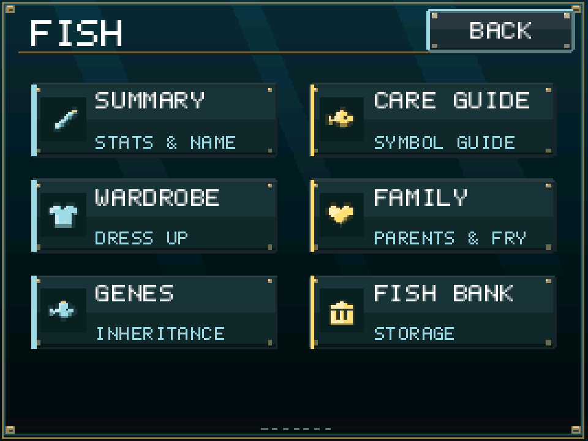
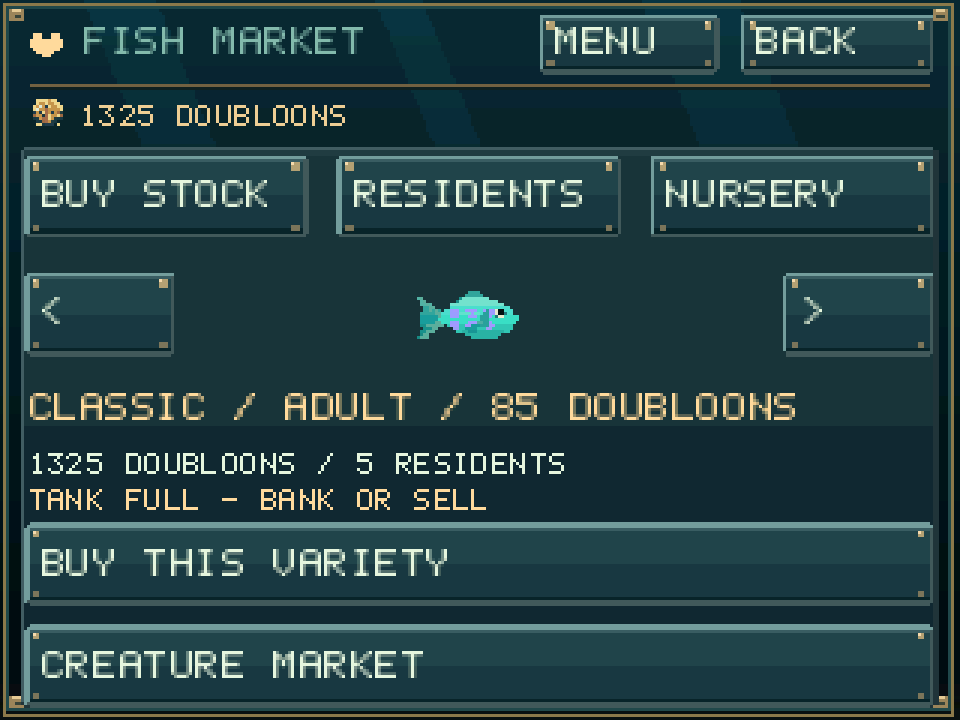
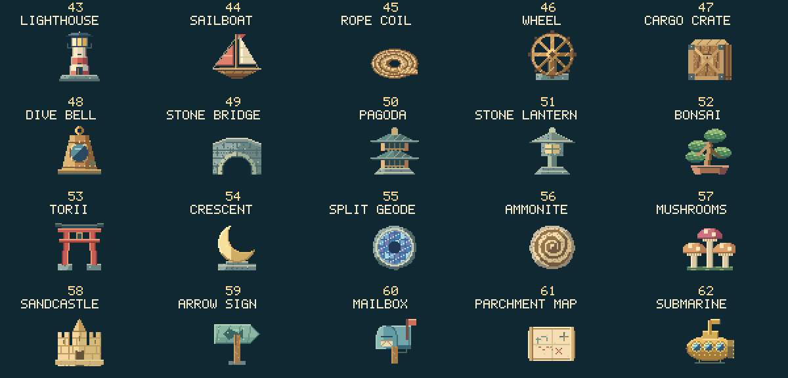
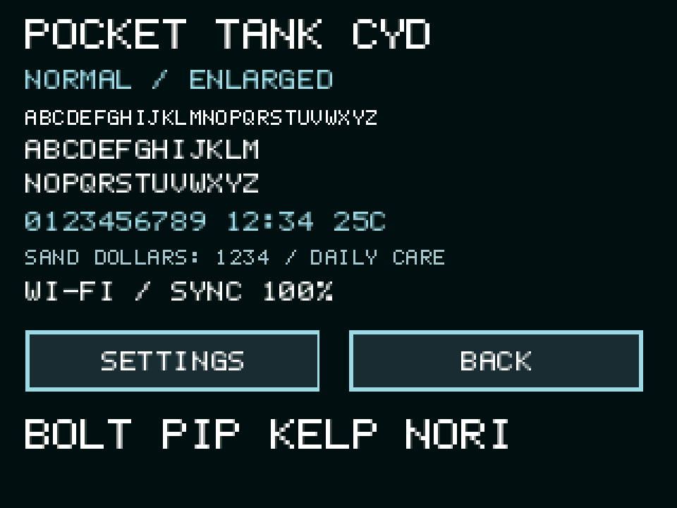
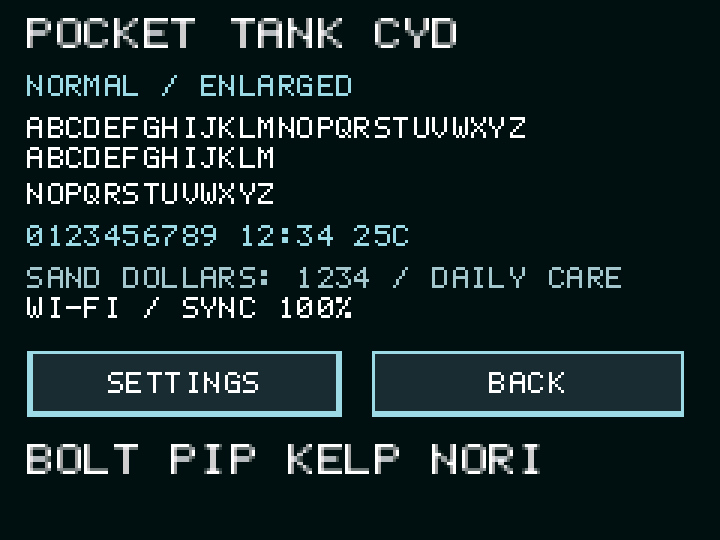
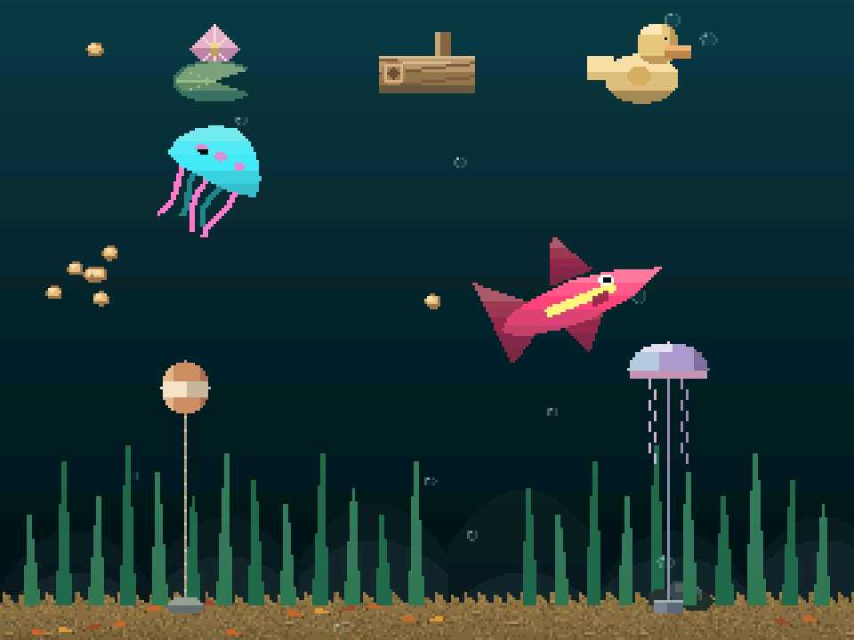
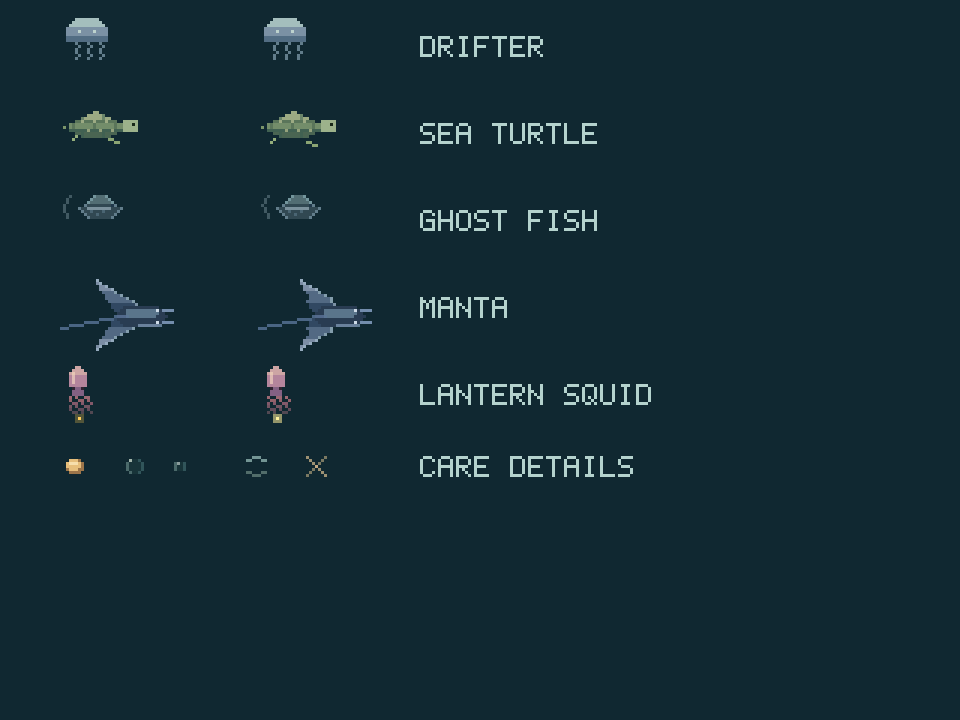

# Pocket Tank CYD 2.4.0

<p align="center"><a href="https://jeromedontdev.github.io/pocket-tank-cyd/"></a></p>

A CYD-only fork of [mediacutlet/pocket-tank](https://github.com/mediacutlet/pocket-tank),
now versioned independently. This source targets **2.4.0**. Stable firmware,
update packages and the browser installer are published through GitHub Releases;
check the latest release and the website's displayed version before installing.
Originally based on upstream v0.3.8.
What began as a hardware port has become **a distinct aquarium game**:
permanent game modes, shared multi-aquarium progression, a global Fish Bank,
inherited genetics, illustrated adventures, a story RPG and eighteen games.
It retains the original aquarium simulation and credits its origins, but is no
longer just upstream Pocket Tank running on another display. Older release
downloads and tags remain unchanged.
Targets the **ESP32-2432S028 Cheap Yellow Display** and
**ELEGOO ESP32-32E 2.8-inch ILI9341V**, with a development shared-image build:
4 MB flash, no PSRAM, 320x240 SPI LCD and XPT2046 resistive touch.
Other boards, model inference/training, audio, battery/PMIC and IMU drivers
are not included. See [LICENSE](LICENSE) for the original project license.

**Take the illustrated tour:** [CYD features and screenshots](docs/CYD-FEATURES.md)
covers named tanks, the bank, inherited creatures, mini-games,
decorations, fish-care upgrades, desk-companion progression, optional weather,
themed clocks, Wi-Fi setup, releases and SD workflows with captures from the
actual desktop renderer.

## New in 2.4.0: a breeding-and-trading aquarium

The aquarium is moving from cleaning chores and freely selected fish looks
toward buying breeding stock, raising inherited varieties and selling healthy
offspring. Separate tanks let you maintain different breeding lines. Names and
optional wearables remain personal touches; existing residents are preserved.
The single active currency is **doubloons**. XP/levels, firsts, trophies,
discoveries, frames and object-story rewards no longer drive progression.
Historical save records remain readable, but are not another currency or
another set of duties.

Achievement retirement also removes the old first-meal/hold/feeding/night
popups and growth-stage announcements, their runtime detectors, and one-time
growth/trust bonus payouts. Actual growth, birth income and trading remain;
historical badge records and earned wallets are preserved in saves.

**Cultivated calm, fresh names and statement pieces:** fish are no longer born
or bought fully calm. Calm settles only as far as trust allows (a newcomer about
6 of 10), so patient holds and feeding raise it; a fish's favorite piece closes
another quarter of the gap. Naming keyboards have a **SUGGEST** key that draws
from 130 names, skipping names already in the tank. Every movable piece,
including the fixed sea-glass, brain-coral, tiki, bottle, anemone and teapot
scenery, now has **REMOVE** on the movement screen; it goes to storage and
**PLACE** in Decor & Storage brings it back free. The **Lighthouse, Stone Bridge,
Pagoda and Torii Gate** are now large pieces on the castle's scale. Seahorses
read grips from each piece's own art, so every standing decoration offers perches
(the large ones several, mirrored or not). **Current Runner** is now a tap-to-rise
dive through rock gaps rather than a lane game like Fish Slalom, and **Reef
Architect** is a real logic puzzle: plant six corals that match every row and
column clue without touching.

**No environmental chores:** seagrass, algae, sponge, scissors, Reef Rhythm
and the bubbler are retired. Swipes no longer activate currents or current bonuses.
Buy **Anubias Carpet (60), Moss Cushions (85), Pearlweed (110) or
Kelp (95 doubloons)** in **Decor & Storage**. Each is a plant set for that
aquarium. Mix the first three across six low patches with sandy gaps.
Kelp adds two taller stands, about half the sword plant's height, with
subtle twice-per-second sway and real seahorse perches. Simple detail keeps
kelp still. The sword plant has broader folded, veined emerald/teal leaves
and an updated shop illustration.
Kelp Forest's background leaves now grow from each stalk's tapered tip
without abrupt horizontal cuts through the top leaves.
The same shop row lets you **Store** or **Plant** it again at no further cost.
The low plants use the static backdrop; kelp animates separately without
rebuilding it. There is no growth, trimming, feeding
penalty or shelter bonus. Existing saves keep their Anubias cover for free;
new aquariums start with bare sand. There is no separate Foliage menu.
Purchased sword plants and sufficiently wide floor decorations
provide shelter, including placed extra copies. The forced starter stone arch
is gone; a bare tank can still breed over open sand.
Snail and urchin are ornamental wanderers; shrimp still eat fallen pellets,
without algae-based refusal. There is no environmental neglect penalty or
offline upkeep debt. Without planted kelp, a sword plant or a suitable decoration post, a
seahorse cruises upright through open water instead of sitting on the floor.

Tap a fish to open its summary directly, with its needs and breeding information
inside the Fish menu rather than a stats/tool overlay covering the tank.
One **Back** returns directly to the aquarium; **Menu** goes straight to the
main menu from any fish submenu. **Help** (main menu) replaces the Fish-menu
Care Guide: fourteen illustrated topics from Getting Started to Market Prices.
Shared crafted glass, brass fittings and framed controls also cover submenus,
setup, weather and network/update pages.
The main menu groups **Fish**, **Tank**, **Market**, **Games**, **Help** and
**Settings**. Main > Fish opens the current fish's Summary, whose six actions
(Rename, Family, Genes, Life, Wardrobe, Fish Bank) replace the old duplicate
Fish menu; Fish Bank and Rename return to that Summary. Rename is a full-page
QWERTY screen. **Games** is one paged list: arcade games, Stories and The Lost
Current sit side by side, with no Arcade/Stories/RPG submenus. Tank identity
and rename belong to Tank Summary > Name & Identity, now with thirteen
subtitles and twelve emblems so eight aquariums can all differ.
Buying, residents/sales and the fish pair/nursery have separate market pages.
There is no sponge/scissors padlock, and Decor no longer offers fish fry.
Active original upstream artwork has been replaced with
new detailed fish, helpers, scenery and icon illustrations, following this
fork's material/shading direction.

The first market tier is now the simple **Tetra**; **Harborfin** (the original
starter's frozen variety ID) is a mid-tier fish. Existing residents keep their
names, colors, genes and breeding compatibility. Market stock is listed in tier
order, and each tier adds 20% to a fish's base worth.

**Genetics and vigor:** sale value = stage worth x market tier x care condition
(60–100%) x genes. The gene factor starts at x1.00 and adds 4% per point of
**vigor**, 15% per shown recessive trait, 25% per mutation and 10% for a rare
marking (COMMON / FINE / RARE / PRIZED). Vigor (0–10) is hybrid vigor:
heterozygous hidden markings, colors and carried traits raise it, while
line-breeding converges toward low-vigor offspring. Vigor also adds up to 10%
growth. Bought stock always costs more than its immediate resale.

**Favorite decor:** every fish loves one decoration (shown on its Summary as
LOVES ...: PLACED or MISSING). With it placed, calm recovers 30% faster and
growth is +10%; without it, calm drifts down to 7.5 at most and growth is -10%.
Mini-game rounds pay up to 12 doubloons, five rounds per game per day.

Clock styles have redesigned glass frames (digital, neon, compact, flip,
binary) and the weather card uses matching glass with an illustrated condition
badge. Jellyfish trail tapered, curling tentacles rather than streamers, and
large shrimp schools again draw half of their members to preserve FPS.
Fish summaries use illustrated, individually colored ten-segment need gauges;
Fullness and Calm both increase toward healthier states.
Tank menus pack the remaining actions without a blank tile, and decorative
footer dots no longer masquerade as page indicators.
**Tank Summary > Name & Identity** groups tank rename, subtitle and illustrated
reef/shell/pearl/star badges. Both tank and fish names use a shared QWERTY
keyboard, including first-run and newborn naming.
Seasonal accents derive their hemisphere from the saved **weather city**,
even when live forecasts are off. Without a city, no season is guessed.
Accents can still be switched off, but there is no separate location selector.
Quieter, lower-contrast theme scenery and sparser glowing specks leave the
residents and purchased decorations as the foreground, without moving or
removing anything you own. For a restrained layout, choose one tall focal
piece, a low plant set and a wide sandy swimming lane; store other pieces
in Decor & Storage without selling them.

**Pellets / Flakes / Bloodworms** are permanent diets with distinct live food
art and shop samples: rounded brown pellets, irregular rainbow-colored flakes
and curled red bloodworms. Flake colors stay attached to their individual food
particles while falling. Their growth multipliers remain **1x / 1.25x / 1.5x**;
Flakes cost **250 doubloons**, Bloodworms **750 more**. The gold doubloon
icon accompanies wallets rather than leaving the currency text-only.
There is no bubbler placement, bubble-column destination or greeting/bond
reward. Natural ambient and courtship bubbles remain purely visual.

This source overhaul is not a claim that 2.4.0 is already published.





**Creature Market** (Market hub, or the link on Fish Market) trades every
creature in one place: the shrimp school, snail, urchin, seahorse and pearl
mussel. Creatures do not breed; each aquarium keeps one of each (shrimp as one
school). Colors roll at purchase: NATURAL 45%, TINTED 30% (x1.4 resale),
TWO-TONE 20% (x2) or PRIZED 5% (x3.5), so rare colors are worth reselling and
rerolling is a gamble that loses on average. Roles: shrimp forage fallen food,
snails keep the glass clear (calm +10%), urchins graze at night (rest +20%),
seahorses perch on kelp, sword grass and the tops of decor (trust from holds doubles) and the pearl mussel pays
doubloons while your fish stay fed. Legacy creature pairs and nursery stock
were retired once with a refund. The Decor shop now sells only decorations and
ground cover.

**Breeding contracts:** every three days one of six harbor clients orders a
variety with a requirement (fine or rare grade, or any mutation, bred adult)
and pays quote x1.6 + 50 doubloons for a fitting fish before the deadline.
**Auction day:** on Saturdays one prized bred fish can go under the hammer;
five rival bids land between 95% and 165% of its quote, and the result page
shows every bid. Both use the same confirmed, transactional sale as the market.

The main menu is **Fish, Tank, Market, Games, Casino, Help**, with Settings on
the cog in the bottom-right corner. **Main > Fish** is the Fish hub (Summary,
Rename, Family, Genes, Life, Wardrobe, plus `<`/`>` fish selection and Fish
Bank); the Fish Summary itself shows only Trust, Energy, Fullness, Calm and
**Vigor** bars with value, favorite-decor, pedigree and demand lines.
**Casino** has six games: Fish Races (pick one of four lanes, fixed x2-x6
odds, ~90% return), Reef Reels (three reels, ~94% return), Pearl Hi-Lo, the
Shell Game, Treasure Dive and the Tide Wheel; bets are 5-50 doubloons,
settled once and saved, and are disabled in Creative. One fish variety is in
**demand** each day: bred (generation 1+) fish of it sell for +25%. Sale pages
show a **pedigree certificate**; bloodlines add 2% per generation (6% for
RARE+ genes, up to five generations). Decor shop rows mark items your fish love
with a heart. **Market > Collection** tracks the marking, trait and color
mutations bred per variety; completing a row unlocks a variety statue to show
in the tank. Snails clean the glass (calm +10%) and urchins graze at night
(rest +20%).

Buy fish in **Main Menu > Market**. Raise a healthy pair of
the same variety to adult/elder, keep room in the tank, and establish feeding
before breeding. Offspring inherit their parents' looks and genes. Sale
quotes reward variety, life stage, trust, energy, fullness and calm. Bought
stock always costs more than its best immediate same-stage resale value.
Sales require confirmation and save successfully before paying out; names,
family records and Bank references stay consistent. Fish varieties can breed
only with the same variety, including direct spawning and forced/debug paths.
Base fish and creature colors are acquired through bought stock, inheritance
or genetic mutation, not free palette editors, including in Creative.
Hard mode still has its existing online starvation risk; removing environmental
chores does not remove feeding or Hard-mode consequences.

Permanent **Pellets / Flakes / Bloodworms** diets use the same doubloons and
apply across your aquariums. Their food particles look different, and growth is
multiplied by **1x / 1.25x / 1.5x**; better food does not remove hunger or
turn into an ongoing subscription. Flakes cost **250**, then Bloodworms cost
**750 more**; Pellets remain free.
The original theme remains free; the other seven themes cost **120–360**
doubloons (tap once to see the price, again to buy). Old earned unlocks migrate
without a second payout or an XP gate.

**Back up before updating.** New binary saves are **6476 bytes**, with
schema-23 JSON exports. The frozen 6472-byte layout is followed by four
aquarium-local foliage bytes; exports add `foliage` beside `progression`.
Existing saves migrate; older firmware
cannot read newly saved data. Partitions and touch calibration are unchanged.

The versioned sections below are historical development notes. Where old
screens, currencies, unlock rules or menus differ, the current 2.4.0 rules
above take precedence.

## Retained from 2.3.20: quieter presentation

The earlier Names & Looks and tool controls are superseded by the 2.4.0
navigation above. Symbol Guide explains actual fish needs, personality and bond.
Fish Summary labels needs and personality traits.
All seven clock faces gain restrained framing and clearer detail without
animated glow, new buffers or changes to saved clock preferences.

The seasonal pumpkin is retired, including its flicker, night illumination
and full-screen redraw requirement. It is no longer sold, placed or drawn.
Old saves still load: item ID 8 and its binary fields remain reserved, and
paid pumpkins receive their usual 20-percent sell-back value once when their
aquarium is loaded. Stored copies are retired too; free/Creative copies earn
no refund. This changes neither save size nor partitions.

## Retained from 2.3.19: smoother fish, illustrated menus and movable scenery

Fish swim more fluidly. The tail beat advances continuously instead of jumping
when speed changes, turns ease in and out, and pace follows a damped spring.
Fish no longer seesaw nose-up/nose-down along the surface, sides or sand.
These motion fields are runtime only; they add no save data or render cost.

The eighteen mini-games and their menu thumbnails now share an illustrated
art kit: water gradients, light shafts, kelp, sand, bevelled blocks and
game-specific props, with HUD text on dark plates. Every menu page shares the
same backdrop, bevelled buttons and full-colour shop previews. Hit boxes are
unchanged, and games still run at 27-30 FPS on the CYD.

**Every decoration can be moved**, including the fourteen original and added
sand pieces and the surface floats. Buying a piece opens its placement page
right away; the shop's MOVE button reopens it. The placement page offers
MIRROR to flip a piece, and BEHIND / IN FRONT choices consider only nearby
pieces. Floats (lily pads, log and duck) can sit behind the fish or in front
of them. DONE saves; the separate CANCEL button is gone.

Still menu pages are no longer redrawn every frame, so touch is sampled two to four times as often in the shop and Milestones. Routine saves are coalesced to at
least two minutes apart and are faster (about 120-250 ms each); purchases,
renames, rewards, sleep and updates still save at once. Internal RAM was
trimmed so purchases and HTTPS weather keep enough working memory.

The flash now runs at **80 MHz** (DIO), the ESP32's standard rate, instead of
ESP-IDF's conservative 40 MHz default. On the CYD the controlled fixtures went
from 17.4/16.7/13.9/14.9 to **21.9/21.2/17.3/18.7 FPS**, beating the earlier
2.3.18-era build, with no memory cost. This was measured on the
ESP32-2432S028; the ELEGOO board uses the same module class and image but was
not separately benchmarked.

**Saves are now schema 20 / 6424 bytes** (an 88-byte movable-scenery tail
after the unchanged 6336-byte prefix). Older saves and schema 1-19 backups
load unchanged. Firmware older than 2.3.19 cannot read the new save or
schema-20 exports: back up before updating and do not downgrade afterwards.
Partitions, calibration, hardware profiles and companion version 7 are unchanged.
See [hardware measurements](firmware/CYD.md#fluid-fish-motion-and-save-pacing-after-2318).

## Retained from 2.3.18: everyday aquarium polish

This follow-up prioritizes the aquarium itself: existing fish movement,
individual reactions and understandable care feedback, not more mini-games,
currencies or chores. Detailed artwork, fish update frequency, save schema 19 /
6336 bytes, companion version 7, hardware profiles and partitions are preserved.

Fish ease into a personality-scaled hover as they arrive at rest spots.
Lazy fish pursue food more leisurely; close approaches steer more directly
down to pellets. Bold fish are less startled by taps, including repeated taps.
These are small changes to existing traits and steering, not new personality
stats, extra animations or persistent state.

Fish Interaction shows the next 10/25/50-bond trick milestone and the number
of +5 greetings needed, with the existing 30-second greeting cooldown visible.
Creative correctly shows its unlocked tricks; Follow still needs a tankmate.
A Fish's Life explains the next stage in rounded-up growth-hours and that sleep
grows fish more slowly. Existing rest/interest spots are explained without
adding another care checklist.

Rendering shares clock metadata across each immutable frame, uses exact paired
RGB565 writes, and carries fractional light-scene deadlines without catch-up
frames. Opaque final spans apply their identical lighting/dimming once per span;
crown colors are prepared once per fan. Normal-scale LCD expansion reuses
identical already-converted rows within the current DMA stripe rather than
re-reading and byte-swapping the same source column. No faster SPI, new
framebuffer or reduced detail is involved. Optional caches yield RAM to HTTPS.

The preceding controlled COM4 clock/decor test improved **13.88 to 15.43 FPS**,
with p95 **84 to 76 ms**; other scenes gained only 1-2%. These are scene-specific
measurements, not a 30-FPS promise. Daily backup capture still takes about
105 ms and can hitch, but normally happens only once per UTC day when enabled.
It is not the focus of everyday animation work.
See [hardware measurements and limitations](firmware/CYD.md#com4-beforeafter-measurements).

## Retained from 2.3.17: bounded rendering caches and background SD backups

The 2.3.15 and 2.3.16 publication attempts stopped at test-harness gates, before
publishing firmware: a strict-C POSIX declaration and lazy website-image
decoding. This release corrects both and includes the complete follow-up below.

Weather checks at boot and once per hour, including failed attempts, rather
than every fifteen minutes. Offline connection attempts are bounded; optional
artwork caches yield RAM to verified HTTPS and warm again after the radio stops.

Clock replay indexes commands by tile band. Static decoration palettes, helper
poses and compressed backdrop rows avoid repeated work without changing a pixel.
Simulation reuses exact calculations without lowering fish update frequency.
No faster SPI, new framebuffer, reduced detail or save-format change is required.

Daily SD backups capture and validate an immutable snapshot on the tank task;
a lower-priority CPU1 worker writes and verifies it while rendering continues.
COM4 testing reduced the observed tank-task backup service from **718 to 109 ms**,
with storage/readback completing in **442 ms** in the worker. Snapshot validation
still causes a brief hitch; this is not completely hitch-free.

Controlled five-fish fixtures measured **19.51 / 18.75 / 14.00 / 16.72 FPS**
versus **19.40 / 18.75 / 13.80 / 16.79** immediately before this follow-up.
The clock-heavy case's clock work fell from 8.24 to 7.88 ms, but p95 frame
times stayed unchanged. Gains are small and scene-dependent, not a universal
speedup. See [hardware measurements and limitations](firmware/CYD.md#com4-verification-of-the-four-part-follow-up).
Schema 19 / 6336-byte saves and companion version 7 are unchanged from 2.3.14;
back up first and do not downgrade to older save formats.

## Retained from 2.3.14: fish-first rendering and harbor/garden artwork

Twenty detailed static decorations join the shop, with six new wearables:
Sailor Cap, Pirate Hat, Beret, Sun Hat, Viking Helm and Scarf. Accessories use
species-specific fitting through every life stage. Jellyfish support all but
the wraparound scarf; ties, bowties and bandanas remain available.

Item management uses **BUY**, **PLACE** and **SELL STORED**. Hold a decoration
in the aquarium to move it; confirm **REMOVE** to return it to shared storage
without a refund. Removed NEXT/MOVE COPY/STORE COPY controls no longer clutter
the shop.

The renderer overlaps 40-row tile drawing with LCD transfer using the existing
framebuffer allocation. Cost-based partial damage replaces the fixed 40% rule;
scenery updates at an independent slower cadence while fish retain full-rate
movement. Frame-pacing diagnostics report percentiles and stalls. These are
rendering changes, not a promise of universal FPS gains.



**Back up before updating.** New saves use schema 19 / 6336 bytes and companion
version 7. Earlier saves migrate; older firmware cannot read newly saved data.
Partitions, hardware profiles and touch calibration are unchanged.

### Roomier aquarium fish scale

Fish in the aquarium draw at 67% of their previous width and height (33%
smaller), consistently from fry through elder. Bodies, fins, patterns and
wearables scale together; the selection ring follows the smaller fish.
Decorations and helpers are unchanged. Saved sizes, growth and meal bonuses,
swimming/care behavior and generous tap targets remain unchanged. Rendering-only
culling and repaint bounds follow the smaller artwork, retaining padding for
turns and wearables. Menu portraits retain their readable preview sizes.
Dense scenes can still require full-frame repainting; this is not a guaranteed
overall FPS increase.
This visual-only change needs no save migration and does not compound on reload.

## New in 2.3.11: exact-color artwork and selective LCD updates

Menu artwork now uses palette-indexed RGB565 where it is smaller, without
quantizing colors. Together with the existing alpha compression, this reduces
the unified application to **1,728,176 bytes**, leaving **237,904 bytes** per OTA
slot. Seven low-color icons now pack four 4-bit indices per word; the other
indexed artwork keeps 8-bit indices. This saves another **2,704 app bytes**
over the 1,730,880-byte first indexed-art build, or 22,640 bytes versus the
1,750,816-byte prior pass. No artwork,
features, saves or partitions are removed. The raw SD/browser icon bank is
unchanged.

Partial LCD writes now invalidate only overlapping canonical fingerprints,
preserving unaffected stripes even across full-frame/partial transitions.
In the physical-display harness, returning to canonical drawing after a
one-pixel partial update sends **1 stripe instead of 40-43** at both scales and
orientations. This is a controlled transfer-count result, not a live FPS claim.
Invalidation now jumps directly to the affected stripe range instead of scanning
every stripe in the intersecting canonical band.
All 48 sampled scene hashes and compressed/raw artwork comparisons match.
The optimization preview was backed up, app-only flashed and fully read back on
**COM4 only**. Release 2.3.11 includes all the following optimization stages.
One paired hardware run measured 14.12/13.59 FPS in the two lighter scenes,
11.73 FPS in frozen decor/clock v1 and 11.62 FPS with maximum extra ornaments.
Differences from the preceding build were only about 0-1.2%; these diagnostic
results do not establish a sustained live-gameplay gain.

## Included in 2.3.11: rendering traffic and artwork headroom

The next optimization pass caches one palette-indexed sprite and silhouette for
the most-repeated static extra ornament, prepares fish yaw/palette calculations
between tiles, and skips unchanged partial LCD stripes using bounded,
overlap-invalidated fingerprints. Adjacent matching damage rows merge up to
80 pixels high. Animated ornaments, colors, drawing detail and SPI speed remain
unchanged. The decorated/clock diagnostic now uses a seeded, fixed-time scene
instead of copying a changing aquarium.

Lossless embedded alpha compression, shared creature-card frames and additional
menu-only size optimization reduce the local unified app to **1,750,816 bytes**,
leaving **215,264 bytes** in either existing OTA slot. This saves another
**22,704 bytes** versus the first-stage build last flashed to COM4. The raw
icon bank remains byte-identical; saves and partitions do not change.

Three alternating desktop reference/current pairs showed **5.7-11.3% less
render time** in decorated/clock scenes, **0.9-3.6% less** in lighter scenes,
and **10.8-14.7% less** isolated fish-drawing time. All 48 sampled frame hashes
match. These are desktop CPU measurements, not device FPS or LCD timings.
This second-stage build was backed up, flashed and read back on **COM4 only**;
its appearance was confirmed. The hardware
FPS measurements below still belong to the first stage, not this build.

## Included in 2.3.11: creature targeting and helper rendering

Overlapping helpers now select the closest creature within its tap area, rather
than whichever type happens to be checked first. Fish retain their existing tap
priority. Shrimp targeting and the card's shown count follow the actual scene
detail; hidden shrimp and the diagnostic-hidden seahorse no longer catch taps.
The snail card describes grazing, seeking algae, exploring sand or returning
to it. Pressing COLORS does not drag, feed or hitch a creature behind the card;
sliding off the button cancels opening the editor.

The first-stage unified application was **1,773,520 bytes**, leaving **192,560 bytes**
in either existing OTA slot. That is 15,856 bytes smaller than the recorded
local pre-change preview. Modal menu code and mini-games use size optimization;
aquarium simulation, live rendering, the clock and LCD transfers retain their
speed-oriented settings. No games, art, certificates or save fields are removed.

Snail foot ridges and fixed seahorse body/fin geometry are calculated once,
and urchin rows only prepare colors they actually use. These exact caches cost
about 1.9 KiB of static RAM, not another framebuffer. Controlled renderer tests
include floor/glass snails, resting/swimming seahorses, chewing/resting urchins,
custom colors, both resolutions and all detail levels. Their 48 sampled frame
hashes match the unchanged renderer. Desktop whole-frame timings remain mixed.
On COM4, the fixed benchmark scenes improved from 13.90/13.46 to 14.53/14.03 FPS;
the maximum-ornament scene improved from 9.35 to 9.62 FPS. These are controlled
diagnostic scenes, not a guarantee of the same gain in a live aquarium.

## New in 2.3.10: mussel creature cards and colors

Tap the resident mussel to inspect its automatic-income progress, shared daily
allowance and any care/save pause. Creature cards show a visible next arrow when
another owned helper is available; cycling is informational and never collects
income. Fish cards also use a high-contrast graphical next arrow.

The mussel's COLORS button opens the same free PRIMARY/DETAIL editor as other
creatures, also available through NEXT TYPE in Creature Colors. PRIMARY tints
the shell and DETAIL the inner mantle; the pearl and payout sparkle retain
their meaning. SAVE COLORS commits the draft; NATURAL is a preview until saved.
Colors persist in binary/JSON saves using a reserved byte, without moving save
fields. The companion record is version 6; do not downgrade a profile after
saving with 2.3.10, because older firmware cannot read that record.
Back up before updating; app-only updates preserve hardware profiles, calibration
and existing aquariums.

## Retained from 2.3.9: aquarium performance and interaction polish

The grass layout leaves a sandy center opening about 12% of the
screen width (roughly three blade columns). Outer grass beds retain their
side-glass coverage; the movable sword plant is unchanged. This removes grass
work rather than hiding rendered blades, so shelter and trimming use the same
clearing. Existing saved blade heights are retained.

Aquarium rendering also reuses exact fish-motion and jellyfish-strand
calculations between render tiles, and skips LCD checksums for partial damage
regions where checksum reuse is deliberately disabled. It does not lower SPI
speed, animation rate, polygon detail or color depth. Renderer stress tests
support repeatable `--baseline` / `--out` measurements; desktop timings are not
a guarantee of device FPS.

Calm fish occasionally inspect the resident mussel instead of their usual
favorite decoration, and resting fish can settle beside a familiar resting
companion. Hunger, distress and feeding priorities remain unchanged. A successful
mussel payout gives a brief, local gold glint; failed payouts, Creative mode and
loading a save do not announce income. There is no persistent icon or popup.

The placement preview outlines the selected copy and marks its
starting position. Tap overlapping placed decorations to cycle between them,
including different types; drag horizontally to move the selected piece.
The placement label identifies the selected piece. **REMOVE** (confirmed by a
second tap) returns it to storage without selling or refunding it. Hold a
decoration in the tank to open this screen, including extra copies.
Switching selection discards unconfirmed
preview edits; CANCEL restores the original layout.

## Retained from 2.3.8: one shop and a passive-income creature

Decoration storage is part of each item's shop entry, not a separate inventory
screen. Buy the first item normally; its entry then manages stored/placed copies,
additional purchases and confirmed sales using **BUY**, **PLACE** and
**SELL STORED**. Move or remove decorations directly from the tank; there is
no copy-cycling or move/store control in the item panel.

**Pearl Mussel** is a normal shop creature costing **120 sand dollars** per
aquarium (free in Creative). It appears on the sand like the other residents.
Every ten healthy running minutes automatically credits one sand dollar, with
a shared 15/day allowance and no XP or offline income. There is no collection
screen or daily-task unlock. Previously earned mussels and banked income migrate.
After buying a mussel in 2.3.8, do not downgrade that profile to older firmware:
the per-aquarium resident mask requires the new reader.

## 2.3.7: quieter defaults and ELEGOO touch correction

New aquariums start with trophy decorations hidden, including Creative mode.
Enable them in **Life > Rewards > Trophies**; existing saved choices are preserved.
ELEGOO's fresh touch default now reverses X and preserves Y, matching the
previously working calibration. App-only updates keep saved calibration intact.
Brightness investigation found maximum backlight already applied with dimming
off; this release does not claim an increase in ELEGOO backlight brightness.

## Unified CYD and ELEGOO display support

Runtime hardware profiles now let the same
`unified` application image run on both tested boards. A saved profile selects
LCD initialization, orientation, touch defaults and peripheral capabilities.
Physical tests traced the white/striped display to failed-SD
cleanup disturbing LCD DMA; retaining the SD bus restores visible output.
The ELEGOO UI is upright at normal speed. Its default touch transform is
corrected without invalidating existing calibration; the user confirmed their
calibrated touch works. Fresh uncalibrated touch still needs physical testing.
The installer uses one app for both boards and provisions the explicitly
selected hardware profile. There is no preselected installer profile: new
installations must choose CYD or ELEGOO CYD explicitly. The board remembers
that profile across reboots and updates; reliable first-boot autodetection is
not available on the tested displays. Existing tanks migrate by save-preserving USB;
on later web-updater visits, select the matching board to verify its saved
profile, not to reset it.
Legacy board-specific SD/Wi-Fi packages remain available.

Choose your exact board in the [website installer](https://jeromedontdev.github.io/pocket-tank-cyd/flash.html).
The ELEGOO uses the same LCD/touch SPI pins but an **ILI9341V**, not the original
supported CYD revision's custom initialization. Its red LED is GPIO22; GPIO4
is held high to disable the audio amplifier. GPIO34 is battery sensing, **not
a room-light sensor**: automatic room dimming/night detection is unavailable.
No audio or battery/charging application is added.

The shared app is `pocket-tank-unified-app.bin`, with `unified-update.ptu`
and `unified-ota.json` for subsequent SD/Wi-Fi updates. Board-specific legacy
packages retain their original names. The unified family marker,
`cydesp32profiles`, does not disable old board-marker checks: the USB updater
permits only the selected hardware's legacy identity or a matching saved
unified profile. New-board factory images contain the same app with different
blank NVS profiles; never use them to migrate existing aquariums.
The unconfigured factory image waits for explicit USB serial selection before
initializing board-dependent hardware. The original CYD retains its existing
display initialization.
If an ELEGOO was already flashed with the original CYD image and shows white,
the save-preserving web updater will intentionally refuse that identity
mismatch. A backed-up, explicit **app-only board conversion** is needed;
do not use factory installation to preserve an existing aquarium.
See [hardware and recovery instructions](firmware/CYD.md#supported-board-variants).

## Previously in 2.3.5: consistent menus and clearer updates

The source now calls **Settings > Device > Firmware Updates** what it is:
one page with separate **Check SD Card** and **Check GitHub via Wi-Fi** actions.
Versions 2.3.4 and older label that entry **SD Updates**.

**Screenshot to SD** lives only under **Device**, not twice in Device and SD
Backups. Weather text sizing lives only under **Clock/Weather > Weather**.
Device actions use aligned full-width rows; screenshot success/failure is
visible on that page. Enlarged-scale clipping, locked-trick labels, journal
line spacing, inventory details and update-footer collisions are corrected.
The renderer tests measure text and button bounds and text collisions at both
240x180 and 320x240: 434 menu-state renders, including long status strings,
full Bank pages, Creative/Hard controls and maximum game records.

## New in 2.3.4: SD-optional aquarium storage

The current source stores all eight aquarium slots internally. Buying and
switching tanks no longer requires SD. On first boot, leave the original card
inserted so existing inactive tanks can be imported automatically; originals
are retained, but are not kept in sync after import. Missing imports report
an error and can be retried by reinserting the card and restarting.

SD remains for backups, screenshots and offline updates. The active profile
retains two verified generations; inactive archives write/readback a replacement
before retiring their previous generation to fit the existing 128 KiB partition.
No partitions or save schema change. Use 2.3.4 or newer for this storage behavior.

## New in 2.3.3: clearer screenshots and more update memory

**Settings > Device > Screenshot to SD** exposes the aquarium screenshot
feature without opening backups. Versions 2.3.3 and 2.3.4 also offered a
**Photo to SD** duplicate in SD Backups; 2.3.5 keeps only the Device control.
Screenshots save BMP images in `pocket-tank/photos/`.

Dedicated Wi-Fi update mode no longer reserves fish/decor rendering scratch,
and manifest reception memory is allocated only after the HTTPS handshake.
This leaves more ESP32 RAM for GitHub release-asset certificate validation,
without disabling certificate, board, version, size or SHA-256 checks.

## New in 2.3.2: on-device GitHub updates

**Settings > Device > Firmware Updates > Check GitHub via Wi-Fi** checks this fork's
latest stable GitHub release and offers newer firmware for explicit approval.
The existing SD installer remains available on the same page. Install 2.3.2
once over USB or SD to enable the default channel. Aquarium saving must succeed
before entering update mode.

Downloads use certificate-verified HTTPS and a tag-pinned app URL. The board
checks exact size, board marker, embedded version and SHA-256 before selecting
the inactive boot slot. It never downloads a factory-reset image. Standard
releases are trusted downloads, not digitally signed firmware; see the
[Wi-Fi update flow and trust model](docs/OTA.md#github-wi-fi-updates-232-and-newer).

## New in 2.3.1: smaller firmware and clearer inventory

Version 2.3.1 adds an explicit **BACK** inside the inventory item panel;
it returns to the list and cancels sale confirmation without selling or
moving anything. The panel hides the list footer to avoid duplicate Back
buttons. In 2.3.8, copy controls live in the item's normal shop entry and
mussel income is automatic, without a separate panel.

A measured CYD build uses size optimization for setup, update UI, companion
menus, snapshot I/O, device-management and weather code while keeping simulation,
rendering, games and per-frame progression speed-optimized. TLS is configured
for the outbound HTTPS client role only; certificate verification stays enabled.
The app is **19,312 bytes smaller** than published 2.3.0, leaving **188,240 bytes**
(about 184 KiB) in each OTA slot.
No features, certificate checks, artwork or safe-update slots were removed.
These are build-size results, not a new hardware FPS claim. See the
[firmware-space audit](firmware/CYD.md#firmware-space-audit-after-230).
Client-only TLS was tested on the actual CYD: weather and GitHub Pages
HTTPS certificate validation passed, followed by a safe return to the aquarium.
The intentionally unconfigured legacy Wi-Fi OTA channel remains unchanged;
this is not a claim of an end-to-end Wi-Fi firmware installation.

## New in 2.3.0: shared decoration inventory and care-first income

The source provides shared storage within each physical decoration's shop entry. Buy additional
copies into shared storage with **BUY**, or **PLACE** an owned copy without
paying again. Hold a decoration in the tank to move it; **REMOVE** on the
movement screen stores the selected piece without selling it. To transfer a piece, store
it, switch aquariums with **TANKS**, then place it from the same shared storage.
Selling a stored copy is a separate, two-tap action; free/Creative copies
do not generate resale money.

Storage holds up to 64 pieces. A tank retains its existing primary placements
and can display up to eight additional basic ornaments, each with its own
position and front/back depth. Plants, castles, living coral and reef clusters
can have multiple owned copies in storage or different tanks,
but only one of each is placed per tank: their vegetation, lighting, growth
and helper-anchor systems remain single-instance. Helpers, permanent upgrades,
themes and fixed background scenery are not inventory objects.

Existing purchases and layouts remain in place. Storage is profile-wide,
extra placements are local to their aquarium, and saves migrate through an
append-only inventory tail. These features require 2.3.0 or newer.

Daily care offers **125 sand dollars** (30 + 30 + 65), with the same
**50 XP**. The **pearl mussel** is purchased from the shop, independently
for each aquarium. While all resident fish are fed and calm, it automatically
credits one coin per ten minutes of live simulation, up to 15 per profile/day.
Legacy banked coins settle automatically and failed saves retain them for retry.
There is no offline accumulation or extra XP,
and extra aquariums do not multiply the allowance. The mussel normally rests,
then makes a gentle 16-second crawl along the sand about once every six minutes.
Games now offer **up to five dollars per game per day**: one dollar per
qualifying saved round, up to 90 across all 18 games. Challenge and Relaxed
share each game's allowance, and switching tanks does not reset it. Games
still give no XP; daily care remains the larger, much quicker source.

The update also retires obsolete “new fry” welcome flags when the referenced
fish has already grown past fry. Genuine unfinished fry welcomes still resume,
and completing a welcome only dismisses it after a successful save.

## New in 2.2.6: cleaner navigation and leaner five-fish rendering

- Wardrobe Colors has one shared header **BACK**, returning to Wardrobe.
  The fish's name replaces the repeated subheading; the removed button's old
  touch target is inactive. Leaving without **SAVE COLORS** discards the draft.
  Creature Colors keeps its **NEXT TYPE** control.
- The existing 12 KB backdrop cache reuses identical neighboring rows.
  Simple renders contiguous uncached rows together instead of repeating
  scenery/vegetation setup for every scanline. No extra cache RAM or visual
  detail is traded for speed.
- Controlled native five-fish tests measured about **33-37% lower render time
  in Simple** and **15-22% lower in heavier themed scenes** versus 2.2.5.
  These are desktop renderer measurements, **not CYD FPS guarantees**.
  Both scales and all three details retain identical reference images.
- Fixed perched-seahorse contact shadows disappearing at tile boundaries.
  Stress tests compare full, tiled and retained-region output, check rendering
  does not mutate the synthetic aquarium, and never use the real save.
- Fish limits, care/progression, artwork, saved preferences and save format
  are unchanged. See [performance methodology](firmware/CYD.md#five-fish-renderer-validation-226)
  for reproducible commands and measurement limits.

## New in 2.2.7: measured CYD performance improvements

The CYD build uses the full capacity of its existing LCD DMA halves,
skips off-tile polygon palettes, reuses identical fish-pitch queries,
clips/replays translucent clock runs as spans and avoids unnecessary helper
shading/distance work without reducing detail.
On the connected CYD, a RAM-only five-fish copy of the saved decorated tank
with its clock enabled measured **10.79 FPS** over 1,200 frames; the slowest
120-frame window was **10.22 FPS**, including a 5 ms/frame service reserve.
This is not a guaranteed minimum for gameplay, network activity or every layout,
and ordinary four-fish monitoring still included sub-10 FPS windows.
The changes apply across both display scales, all three scene details and all
gameplay modes; the quoted measurement is specifically Normal/Balanced.
See [hardware test scope and commands](firmware/CYD.md#five-fish-hardware-follow-up-227).

## Previously in 2.2.5: consistent typography in both display scales

- Normal no longer thickens arbitrary font strokes by repeating rows and
  columns. Fractional sizes use exact pixel coverage; native 5x7 and integer
  sizes remain sharp. Enlarged keeps its crisp small text.
- Menus, fish/helper cards, setup, games, story pages, notifications, weather
  and clock captions share the corrected renderer. Jumbo text/Flip digits
  use it too; segmented, analog and binary clock designs remain distinct.
- Case-sensitive Wi-Fi names/passwords use the same sizing and rasterization,
  including the smallest text size. Common UI punctuation now includes
  parentheses, brackets, equals, ampersand, hash, dollar, at, underscore,
  quotation marks and asterisk instead of leaving blank cells.
- Existing text sizes, spacing, wrapping, panel bounds, touch targets, colors,
  save format and gameplay stay intact. No font downloads or new buffers.

| Normal typography | Enlarged typography |
|---|---|
|  |  |

## Previously in 2.2.4: quieter scenery and little aquarium details

- Sand has restrained grain, sparse two-tone pebbles and depth shading.
  Low distant ridges and layered kelp, coral, ruins and ice silhouettes keep
  the scenery behind the residents instead of competing with them.
- Lily pad, duck, floating log, tethered buoy and jelly lantern gain softer
  material faces, leaf veins, wood rings and quieter highlights.
- All five rare visitors gain clearer forms: scuted turtle shell, folded
  manta wings, glassy ghost-fish edges and softly shaded jelly/squid bodies.
- Food pellets have a readable lit face; bubbles have fine translucent rims.
  A small mint wipe arc or warm trim glint follows a successful active tool
  stroke, then clears on release. No extra particles or timers.
- Shared tank/preview art stays within existing bounds. Simple retains its
  quiet water and hidden ambient bubbles/helpers, but receives the same sand,
  food and tool feedback. Saves, ownership, visits, care and progression stay
  unchanged. Helpers, castle, living coral and reef cluster are not reworked.

| Floating material details | Rare visitors and care details |
|---|---|
|  |  |

## Previously in 2.2.3: dimensional fish and accessories

- All ten fish varieties now have restrained back highlights, body midtones
  and underside shading. Fins, tails, ray wings and jellyfish bells share the
  same gentle material lighting; head-on turns keep rounded volume.
- All six wearable accessories have lit faces and shaded folds inside their
  existing outlines. Both chosen accessory colors and Natural are retained.
- Tank fish, wardrobe, setup and portraits share the actual renderer.
  Species silhouettes, swimming, inherited markings, shimmer/pale-belly traits,
  growth, sleep cues and wearable attachment are unchanged.
- Shading selects from five pre-tinted colors during the existing polygon
  scanline pass: no new textures, framebuffer, per-pixel lighting or assets.
  Saves, prices and daily progression remain unchanged.

| Ten fish varieties | Six wearable accessories |
|---|---|
|  |  |

## Previously in 2.2.2: more crafted aquarium decorations

- Twenty in-tank ornaments and fixed scenery pieces now have material-specific
  shading: wood grain and brass chest fittings, faceted crystals, beveled
  masonry, rounded pebbles, pearl sheen, sponge pores and barrel hoop rivets.
- Sea glass, brain coral, tiki, bottle, anemone and teapot gain softer forms,
  readable recesses and quieter highlights. The sea fan connects to its base.
- Seagrass has a deeper jade palette; broad sword leaves have a lit face and
  shaded fold without changing their growth, size, sway or trimming behavior.
- The actual tank and shop previews share the same artwork, at both sizes and
  all three scene details, including night lighting and cached/tiled drawing.
- Ownership, positions, touch targets, prices, daily care and schema-17 saves
  are unchanged. No new graphics buffers, asset downloads or animations.


## Previously in 2.2.1: a more consistent pixel-art interface

- Fifteen shared menu/goal icons redrawn with distinct silhouettes, outlines,
  shaded bodies, upper-left highlights and restrained warm details.
- All eighteen game thumbnails share a quieter aqua/gold/rose palette, framed
  underwater backplates and shaded cards, tiles and treasure chests.
- Bronze, silver and gold medals have faceted faces and two-tone ribbons;
  unearned medals remain clearly hollow.
- Art keeps its existing bounds and touch targets at Normal and Enlarged size.
  No new artwork buffers, PSRAM, downloads or per-frame aquarium effects.
- This first art pass covers interface illustrations, not a replacement of
  swimming fish, tank scenery, story scenes or the existing PNG icon pack.
  Gameplay, daily rewards, saves and progression are unchanged.


## Previously in 2.2.0: care-first daily progression

- **Collections > Goals > TODAY:** three flexible care activities, up to
  **100 sand dollars and 50 XP per day**. MILESTONES keeps the original goals.
- Games remain unlimited, but share only **5 bonus dollars/day and no XP**.
  Challenge records and medals continue after the allowance runs out.
- Budgeted for short daily visits over weeks, not repetitive feeding or game
  grinding. No streak penalties or missed-day debt.
- Existing XP, wallet, fish and unlocks are preserved. Append-only
  **6032-byte saves / schema 17** import older saves; back up before upgrading.
  See [the daily care rules and pacing assumptions](#aquarium-journal).

## Previously in 2.1.3: cleaner settings and readable weather

- One **Clock/Weather** hub: **Clock Face**, **Colors**, **Text / Effects**,
  **Time / Zone**, **Weather**, and one **Show Clock** action. BACK always
  returns one level; no nested Style/Text tabs or repeated preview buttons.
- **Weather > Text: Small/Medium/Large** resizes the weather reading and clock
  weather/event captions. The same saved control is **Weather Size** under
  **Text / Effects**. Clock text adapts to avoid overlap.
- Simple sun, partly cloudy, cloud, fog, rain, snow and thunderstorm icons
  accompany cached conditions in Weather and the clock. Unknown readings have
  no invented icon; stale/offline labels remain.
- One Auto Feed toggle, full-width SD actions, simpler city search, and a
  confirmation before forgetting a city. No save-format changes.
- Browser feeding is just **Place food > tap a column**; the extra
  Left/Middle/Right buttons have been removed.
- This version's browser, installer and documentation consistently identify it
  as **Pocket Tank CYD**; original upstream attribution is retained.

## Previously in 2.1.2: working browser fish-card tools

The fish-card padlock, sponge, scissors and DONE controls now work in the
browser. The lock prevents bare-hand cleaning/trimming; selected tools still
work. Lock changes are saved, and the card stays open when toggling it.
Hardware touchscreen behavior and the save format are unchanged.

## Previously in 2.1.1: fullscreen browser play and food placement

- Fullscreen/Exit fullscreen enlarges the game while keeping its controls.
- **Place food** lets you tap a column anywhere in the tank. Pellets still enter at the water surface.
  Plain surface taps also feed; the tank's existing pellet limit still applies.
- Optional **Touch hints** show where taps/drags land. Letterbox margins do
  not activate the tank.
- The public game and updater are built from the latest stable **release tag**,
  not unreleased main. The home/flasher HTML and board display names can receive
  copy-only updates from main without changing released game/update logic or
  internal hardware identities. Its displayed tag/source commit and installer version are
  checked together before deployment. It compiles shared C code to WebAssembly,
  not the ESP32 binary.

## Previously in 2.1.0: scene detail, readable clocks and quieter low-light output

- **[Play in your browser](https://jeromedontdev.github.io/pocket-tank-cyd/play.html)**:
  the actual game simulation, mouse/touch controls and a separate local browser
  save. No CYD, account or upload required. Browser storage is not a backup:
  clearing site data, private browsing or eviction can remove progress.
- **Tiny** joins Large, Medium, Small and Jumbo. Under **Clock/Weather > Text / Effects**,
  choose Small/Medium/Large separately for date/AM-PM/seconds and for
  weather/activity. Text wraps and fits down only when needed; all seven
  themes, five positions and both resolutions are covered by overlap tests.
- Independent **Normal/Enlarged** size and **Balanced/Simple/Enhanced** scene
  detail. Normal + Balanced are the defaults; existing saved choices remain.
- Simple retains real stationary seagrass and placed decorations while hiding
  helpers, bubbles and ambient effects. Their simulation and benefits continue.
  Balanced reduces secondary animation; Enhanced retains smooth effects.
- Measured on a populated CYD: approximately **20 FPS Simple**, **10 FPS Balanced**
  and **8-9 FPS Enhanced** at either size. These are observations, not guarantees.
- **Jumbo** enlarges the selected clock theme instead of replacing it: Minimal
  text, Digital segments, Analog hands, Neon glow, Flip tiles, Binary dots and
  Orbit rings remain distinct. Colors, date/seconds and weather/activity still work.
- Room-light dimming now drives both screen and automatic back LED with a
  stronger low-light curve; pagination buttons use arrows without page labels.
- Existing saves, fish, wallet, progression and mode choices are preserved.

## Previously in 2.0.0: a distinct game, illustrated throughout

The interface now shares compact pixel-art icons, chapter scenery, and real
fish portraits instead of relying on text alone:

- Six illustrated Lost Current landmarks, visible fish guides, approach icons,
  chapter-journal thumbnails, and saved-result illustrations.
- Destination cards for all three adventures, with the chosen route and the
  real fish or saved traveler portrait; illustrated keepsakes and discovery hints.
- Portrait-led Fish Life, Family and Genes pages, milestone badges, and
  illustrated discovery/reward and bond/trick controls.
- Recognizable game-menu/help artwork and visual Home/Journal navigation.
- Flatter menus: separate Goals and Album, Themes under Tank, Tank Identity
  under Aquariums, a two-entry Adventures hub, and a second Fish menu page.
- Six more games on page three (18 total): Lighthouse, Shell Slide,
  Sonar Sweep, Tide 2048, Harbor Stack, and Echo Reef, integrated with saved
  records, medals, and balanced rewards in Normal/Hard.
- First-run **Normal / Creative / Hard** game modes. The choice applies to all
  aquariums and is fixed until a confirmed **full wipe**; Settings only shows
  the current mode. Existing saves migrate to Normal without a reset.
- Money, XP, goals, discoveries, unlocks, campaign progress and game records
  follow every aquarium. Residents and layouts stay local; the global 20-slot
  Fish Bank moves fish between tanks with their families, genes and bonds.
- Creative makes fish, looks, themes, wearables, frames and shop choices free.
  Add fish up to five active including travelers; confirmed removal keeps two
  residents. Creative cannot grant spendable progression rewards.
- Hard disables Comfort Assist and starts Auto Feed off. Six hours at severe
  hunger while running can kill fish, with a warning an hour before danger.
  No offline or old-age deaths; extinction offers a free rescue pair without
  losing progression. Normal and Creative never kill fish.

The artwork is static and reuses existing renderers plus small shared sprites:
no PSRAM, new framebuffer, SD artwork requirement, save-layout change, or
background aquarium animation. Text labels and existing touch navigation remain.


### Maintenance and compatibility

Named companion pages and shared Home initialization keep navigation readable
and consistent between simulator and hardware. Games have a separate module;
the aquarium renderer retains its bounded caches and tiled framebuffer.
Obsolete upstream files and rejected prototype keyboards are removed. Save
layouts/migrations remain frozen and regression-tested. Refactoring is not a
claim of higher FPS; this board still has no PSRAM and limited OTA headroom.

## Previously in 1.4.0

This release adds:

- **The Lost Current**, an optional six-chapter, 18-encounter story RPG tied to
  real fish, bonds, genetics, family legacies, visitors, decorations, and earlier
  adventures. No fish harm, forced quests, care-stat changes, or background AI.
- **Twelve games across two pages**, including Reef Defender, Current Runner,
  Pearl Breaker, Tide Tactics, Reef Architect, and Deep Expedition. Help, pause,
  saved records, medals, and transactional rewards are included.
- Consistent **BACK** navigation; separate Fish Life, Family, Genes, Visitor Log,
  tank recaps, and display rewards; clearer care and bond explanations.
- Visible clock sparkles under **Clock/Weather > Text / Effects**, useful wrapped
  event captions, steady Frame-selector typography, and a redesigned manta.
- Working CYD room-light/LED touch controls, steadier ambient-light filtering,
  and a non-flashing Wi-Fi flow that returns to Settings.
- **Schema 14 backups**, retaining imports from schemas 1–13 and existing binary
  saves. Back up before upgrading; do not downgrade an upgraded save.


### Recent releases

- [2.1.0](https://github.com/jeromedontdev/pocket-tank-cyd/releases/tag/v2.1.0):
  independent scene details, themed Jumbo clocks, stronger linked screen/LED
  room-light dimming and arrow-only pagination.
- [2.0.0](https://github.com/jeromedontdev/pocket-tank-cyd/releases/tag/v2.0.0):
  illustrated interface, eighteen games, permanent Normal/Creative/Hard modes,
  shared progression/global Bank, safer expanded storage and focused code cleanup.
- [1.4.0](https://github.com/jeromedontdev/pocket-tank-cyd/releases/tag/v1.4.0):
  optional fish-story RPG, six more games, consistent menus, clock effects,
  CYD control fixes, and the feature-focused website with a separate USB flasher.
- [1.3.0](https://github.com/jeromedontdev/pocket-tank-cyd/releases/tag/v1.3.0):
  inherited genetics/markings, family trees, five visitors, seasons, rear RGB LED,
  room-light sensor, SD photos/daily backups, and browser save viewer.
- [1.2.0](https://github.com/jeromedontdev/pocket-tank-cyd/releases/tag/v1.2.0):
  persistent fish biographies/buddies, tank identity and recaps, rare sightings,
  and six fixed sand decorations.
- [1.1.0](https://github.com/jeromedontdev/pocket-tank-cyd/releases/tag/v1.1.0):
  calm friendships, creature shortcuts, reversible decoration placement,
  aquarium summaries, scenic effects, and save-preserving browser USB updates.

## What remains

- **Genetics and family trees:** fish carry hidden markings, colors and four
  recessive traits (Shimmer, Painted Fins, Pale Belly, Gold Eye) that bred fry
  inherit, with rare mutations. **Home > Fish > Family** shows generations,
  parents, grandparents and children; **Fish page 2 > Genes** shows inheritance; see the
  [family guide](docs/CYD-FEATURES.md#family-genes-and-visitors-new-in-13).
- Five rare harmless visitors with a **Visitor Log**, and seasonal sand scenery
  that follows the clock (north, south or off).
- The CYD's **room-light sensor** can dim the backlight in a dark room, and the
  **back RGB LED** glows with the water color or signals hunger and visitors.
- Daily automatic SD backups (newest seven kept), **Device > Screenshot to SD**
  and a browser [save viewer](https://jeromedontdev.github.io/pocket-tank-cyd/viewer.html).
- Fish biographies, remembered swim buddies, life firsts and adventure keepsakes.
- Quiet bounded recaps, helper reports, tank subtitles/emblems and discovery hints.
- Rare harmless unknown visitors, plus six cached fixed sand decorations.
- Verified-backup status and a source-name/version preview before restoring.
- Calm fish form swim buddies and follow in short, spaced pairs.
  Stable favorite decorations guide resting and exploration; see **Home > Fish > Fish Life**.
- Tap shrimp, snail, urchin or seahorse for diet, activity and progress.
  The shrimp card distinguishes actual population from drawn representatives;
  **COLORS** opens that creature's free color editor.
- Decoration placement is a live **PREVIEW**: **DONE** commits, **CANCEL**
  restores position, depth, stacking and color. Autosaves retain the committed layout.
- Aquarium summaries show residents, Bank, traveler, upgrades, theme and last visit.
- Sparse Deep Glow silhouettes, Moonlit shooting stars and treasure/crystal glints
  use small, infrequent dirty regions rather than animated whole-screen backdrops.

- Personality-aware **rules-based** fish goals, reflexes, feeding, growth,
  trust, milestones, breeding, tank maintenance and the shop.
- Touch-only navigation, persistent five-point touch calibration, fixed
  display orientation, brightness and gameplay settings.
- Flash-resident icon art and versioned SD JSON tank backups with safety snapshots
  before restores.
- Offline SD firmware packages through **Settings > Device > Firmware Updates**, with
  checksum/board validation, explicit confirmation and a pre-update tank backup.
- Treasure chest: 120 sand dollars, placement/layering, move/sell and persistence.
- Scallop shell (60), starfish ornament (60), sunken anchor (80), and a
  bobbing, bottom-tethered buoy (80). All support placement, depth and selling.
- One-time sand palette (300) and mood lights (300) upgrades. Tap **SAND** or
  **WATER** in **Home > Tank > Sand & Water** to cycle colors for free, including the original look.
  Mood Lights includes Rainbow, Hot Pink and Neon Lime alongside the classic
  blue, teal, violet and amber gradients; no flashing or strobing.
  Sand Palette also includes Rainbow, Hot Pink, Electric Cyan and Neon Lime.
- Shipwreck (200), treasure urn (60), crystals (100), sea fan (80),
  sunken ruins (160), and a bobbing tethered jelly lantern (120).
- Ten creature looks: Classic, Angel, Guppy, Tetra, Puffer, Shark, Jellyfish,
  Stingray, Clownfish and Betta; nine marking
  patterns: Stripes, Spots, Band, Plain, Saddle, Tiger, Speckle, Fade and Mask. Open **Keeper > fish portrait >
  CUSTOMIZE** to change an existing fish's unlocked variety, pattern, body and marking
  colors for free. Varieties unlock through [Keeper levels](#fish-variety-unlocks);
  existing owned/seen looks stay available. DONE saves; CANCEL discards the preview. Fry offers show
  their variety, and bred fry inherit their parents' appearance traits.
  Sharks have a pointed snout, dorsal fin and gills; jellyfish pulse and wave
  their tentacles; rays flap their wings; bettas have flowing fins. These are
  peaceful visual varieties using the existing fish care system, not predators
  or separate species simulations. Jellyfish appearances occupy a normal fish
  slot and are separate from the decorative Jelly Lantern shop item.
- Fish customization offers 24 body colors and 24 marking colors, including
  hot pink, vivid red/orange/yellow, neon lime/green, cyan, electric blue,
  purple, magenta, pastels, white and dark slate.
- **Settings > Device > WIPE ALL PROGRESS** opens a separate confirmation.
  Confirming resets the entire collection, money, records and progression,
  then opens the first-run mode choice. CANCEL or waiting 20 seconds keeps
  everything. Explicit SD backups and touch calibration are preserved.
- Optional **Minimal, Digital, Analog, Neon, Flip, Binary and Orbit idle clocks**
  over the aquarium.
  Open **Settings > CLOCK/WEATHER** for large/medium/small/jumbo/tiny sizes, center or four-corner
  placement, 12/24-hour time, a DST toggle and UTC offsets in selectable
  1-hour, 30-minute or 15-minute steps. The default
  layout is large and centered. Clocks are **OFF by default** and saved per tank.
  **Jumbo** enlarges the selected theme for distance reading, keeping its
  design and colors with weather/activity beneath it. Other sizes are unchanged.
  Choose **15 sec, 30 sec, 1, 2, 5 or 10 min** of inactivity, or **Manual Only**;
  **SHOW CLOCK** opens it immediately. The first touch only dismisses the clock.
  **Colors** offers primary and secondary colors: theme defaults or
  white, amber, mint, cyan, rose, lavender and red, plus the background toggle.
  **Text / Effects** holds seconds/date visibility and supporting text sizes.
  Visible panels are opaque. Normal skips hidden aquarium drawing and reduces
  ambient bubbles, grass sway updates and visible shrimp representatives
  (10 real shrimp display as 5); population and care/progression rules stay intact.
- A selected fish's card has a **>** button just outside its top-right edge
  to cycle through fish, wrapping to the first. Tapping the card still opens Keeper.
- **Settings > WI-FI / SYNC** scans 2.4 GHz networks and
  provides a full single-page QWERTY password keyboard with separate
  numbers/symbols, connection errors, change-network and confirmed
  forget options. The tank is saved before a brief restart into setup; Wi-Fi
  credentials are device-wide and never included in aquarium backups.
  NTP sets the time when returning to the tank and on subsequent boots.
  After a failed sync, the overlay says **SYNC NEEDED**, not an invented time.
  No battery-backed RTC is fitted: Wi-Fi is needed again after power loss.
  A synchronized clock keeps running offline while powered or in deep sleep.
  Set your standard-time UTC offset and enable **DST: +1 HOUR** during daylight
  saving. DST is manual, not an automatic regional schedule.
- Legacy Wi-Fi firmware downloads are
  **disabled by default** until a CYD fork update channel is configured.
- A desktop preview of the actual CYD gameplay/renderer and native regressions.

The original learned advisor selected goals and urgency from fish state;
this fork instead uses explicit personality-aware rules. There is no LLM,
generated conversation or learned-confidence hesitation. This is the same
advisor the CYD port already used before the cleanup. SD storage does not
replace the working RAM needed by the original model.

## Build and upgrade

### For AI coding assistants

[AGENTS.md](AGENTS.md) is the repository's AI-maintenance entry point: architecture,
save/memory constraints, safe hardware workflows, test commands, and the complete
documentation/release checklist. Keep it current when those contracts change.
It is project guidance, not a private file or part of the firmware.

### Install from your browser

**[Explore the website](https://jeromedontdev.github.io/pocket-tank-cyd/)**
for a feature overview and screenshots, or
**[open the USB web installer](https://jeromedontdev.github.io/pocket-tank-cyd/flash.html)**
in desktop Chrome or Edge. Connect an ESP32-2432S028 CYD with a USB data cable;
no ESP-IDF installation is needed.

Choose **save-preserving USB update** for an existing CYD tank. It validates
the running firmware, board identity, partition layout and active slot before
writing only the application. Back up first and keep USB power connected.
The separate **factory installer overwrites saved tanks, Wi-Fi, calibration
and collection identity** and is only for new boards or deliberate resets.
Both flows require an explicit acknowledgment; refusal never falls back to
factory flashing. All artwork is embedded; no SD icons are needed.

The site uses pinned ESP Web Tools/esptool-js and the latest stable release's
application/factory images, checked against published SHA-256 checksums and board
markers before deployment. The factory flow checks only the chip family:
users must confirm the correct CYD display model.

Prebuilt CYD firmware, SD update packages, matching artwork and installation
instructions are available under
[Latest built release](https://github.com/jeromedontdev/pocket-tank-cyd/releases/latest).

| Download | Use |
|---|---|
| [SD update: update.ptu](https://github.com/jeromedontdev/pocket-tank-cyd/releases/latest/download/update.ptu) | Existing CYD installations; place at `pocket-tank/update.ptu` on SD |
| [Initial-flash binary](https://github.com/jeromedontdev/pocket-tank-cyd/releases/latest/download/pocket-tank-cyd-factory.bin) | New boards only; flash at `0x0` |
| [Install instructions](https://github.com/jeromedontdev/pocket-tank-cyd/releases/latest/download/INSTALL.txt) | SD placement, USB flashing and warnings |
| [Checksums](https://github.com/jeromedontdev/pocket-tank-cyd/releases/latest/download/SHA256SUMS.txt) | Verify downloaded files |

**All artwork is embedded in the firmware. No icons need to be copied to SD.**
No source build is needed for these downloads. From 2.3.4, SD is optional for
all eight aquariums and remains useful for backups, screenshots and offline
updates. Older multi-tank installs need the original card once for import.
Use the SD update for an existing installation. **Factory images overwrite
saved tanks and settings** and are only for new boards or deliberate resets.
See [release instructions](firmware/CYD.md#downloadable-releases).

Install ESP-IDF (verified with v6.1), then open its PowerShell terminal:

```powershell
.\tools\build_cyd.ps1
.\tools\build_cyd.ps1 -Flash -Port COM4
```

The helper builds in `firmware\build_cyd` and upgrades **only the active app**,
detected through the USB console (`ota_0` at `0x20000`, `ota_1` at `0x200000`).
For deliberate recovery without a working console, specify `-AppSlot ota_0`
or `-AppSlot ota_1`; this does not change the boot slot.
It assumes this fork's CYD partition table is already installed;
it does not erase NVS, flash a partition table or format SD.
For an unflashed board, from `firmware`:

```powershell
idf.py -B build_cyd -D SDKCONFIG=build_cyd\sdkconfig -D SDKCONFIG_DEFAULTS=sdkconfig.defaults build
idf.py -B build_cyd -p COM4 flash
```

The only supported target is ESP32/CYD. `sdkconfig.defaults` is the canonical
configuration; `sdkconfig.cyd` is retained as an identical compatibility alias
for existing build directories. The app partition layout and NVS save offsets
are unchanged. Never erase NVS to perform a normal upgrade.

See [firmware/CYD.md](firmware/CYD.md) for SD setup, calibration, console
commands, JSON backup/restore and hardware limitations.

## Playable website

[Play Pocket Tank CYD in your browser](https://jeromedontdev.github.io/pocket-tank-cyd/play.html).
It runs the shared C simulation and renderer as WebAssembly, with mouse/touch
input and Normal, Creative or Hard first-run profiles. Local browser storage
keeps a complete archive of profiles, Bank, aquariums and preferences across
reloads and browser restarts. Autosaves run every five seconds, after actions,
when hidden and on exit; failures remain visible with retry/export controls.
Only one tab can write the save at a time. Fullscreen keeps shortcuts visible;
Place food offers tap-to-place feeding. Touch hints show
tap/drag positions. A plain tank tap feeds only near the surface; food falls
from the surface at the selected horizontal position, not at the tapped depth.

Use **Export browser save** for a backup and **Import browser save** to restore
that archive. Import validates the native save before replacing your current
data; reset requires confirmation. Browser archives are not CYD JSON backups.
HTTPS/localhost, JavaScript, WebAssembly, Web Locks and writable local storage
are required. Hardware, Wi-Fi credentials, live weather, SD photos/calibration
and firmware updates are intentionally unavailable.

For a local build, activate **Emscripten 4.0.18**, restore **cJSON 1.7.19**
(the firmware's managed component or `.browser-tools/cJSON`), then run:

```powershell
python tools\build_browser.py --out _site
npm install --prefix .browser-tools --no-save playwright@1.56.1
npx --prefix .browser-tools playwright install chromium
node tools\test_browser.cjs
```

The test runner serves the staged game on an ephemeral localhost port and
closes it afterward. It checks actual gameplay/input, all first-run modes,
reload/pagehide/browser-restart persistence, exclusive tabs, save failures,
export/import/reset and corrupt-save preservation. Pages builds and tests the
same playable assets before deployment; JS/CSS/WASM use content-hashed paths.
Public deployments check out the latest stable release tag and require the
browser build and USB installer to match that tag/version/commit. The game
shows its release tag and source commit; local builds are labeled Development.
Run `tools/prepare_web_installer.py` before the browser build when staging a
combined site with published USB firmware.

## Desktop preview and tests

Configure/build the firmware first to provide its managed cJSON dependency.
With Python 3.9+ and a GCC/Clang-compatible C compiler:

```powershell
python sim\run.py --cc clang
python sim\run.py --cc clang --smoke
python tools\test_tank_backup.py --cc clang
python -m unittest discover -s tools -p "test_*.py"
```

`--cc` also accepts the path to Zig (the runner adds `cc`). The preview uses
Python's Tk window, so SDL/LVGL are no longer required. Mouse gestures act as
touches; toolbar buttons open Keeper, Settings and Shop. It has its own
`sim\tank.sav`; it never touches the physical device. Wi-Fi is simulated,
not hardware-emulated. Export/restore buttons use the same CYD JSON schema.

The native suite checks all shop items, fish styles/patterns, customization
save/cancel/failure and breeding, frozen legacy saves, JSON
round-trip/rejection/write failures, decoration rendering with scratch guards,
Settings confirmation/timeout/fixed orientation, Wi-Fi flow, the unconfigured
update-channel message and rejection of upstream update manifests.

## Shop expansion

**Home > Tank > Shop & Decor** lists unlocks from cheapest to most expensive, with
stable ordering for equal prices. The nursery's FRY row, when available, stays
separate at the top. Existing item IDs, prices, placements and ownership are
unchanged.

Eight scenic unlocks retain the existing save ownership IDs:

| Unlock | Sand dollars | Effect |
|---|---:|---|
| Zen Pebbles | 40 | Fixed stone stack on the sand |
| Duck Float | 60 | A yellow duck bobbing at the surface |
| Pearl Clam | 70 | Fixed open clam and pearl |
| Lily Pads | 80 | Floating pads with a pink water lily |
| Floating Log | 90 | A gently bobbing surface log |
| Tube Sponges | 100 | Fixed gold sponge garden |
| Lost Barrel | 110 | Fixed oak barrel |
| Dive Helmet | 140 | Fixed brass diving helmet |

The three surface ornaments can be displayed together. These eight scenic
unlocks support moving and layering. A paid copy refunds 20 percent once
(tap SELL twice). The permanent
unlock follows all tanks; free replacement copies show REMOVE and refund zero.
The shop descriptions identify their positions.
Slow Garden and Bio Filter are retired with the old upkeep mechanics.
Their IDs remain reserved; eligible paid copies receive ordinary sell-back
value once when migrated. Other care, fish aging and coral growth remain
unchanged. Inactive tanks still pause.


## Fish-care upgrades

Every shop item uses a muted gray icon until purchased and its full-color icon
afterward, in both the shop list and item details. This indicates ownership,
not affordability.

Four permanent fish-care purchases join the price-sorted shop:

| Upgrade | Sand dollars | Effect |
|---|---:|---|
| Calm Current | 160 | 25% faster energy recovery while resting or asleep |
| Cozy Shelter | 180 | 25% faster natural stress decay, including sleep |
| Play Kit | 200 | 25% faster curiosity gain from exploring |
| Training Ring | 240 | Adds 25% of the normal hold-to-trust rate |

Bonuses do not stack with duplicate purchases. Training Ring adds to, rather
than multiplies, the seahorse's bonus (225% total while hitched). These do not
change food rewards, energy drain, curiosity spending, maximum stats, size,
aging, hunger or breeding requirements. Sleeping tanks in the SD collection
stay paused. Purchases travel with their own tank, survive reboot and JSON
backups, and clear when that tank is wiped. Older backups start without them.
The binary save's 4000-byte prefix is unchanged; a formerly reserved byte holds the flags.

The fork also includes upstream's daytime breather fix: exhausted fish duck
into nearby authored shelter (or their resting corner) to recover without changing
their advisor goal. Calm Current also boosts this resting recovery. The CYD
fork retains its separate update channel and existing release-number format.

## Display readability

CYD menu text is pixel-aligned in both Enlarged and Normal modes, with a minimum
5x7 glyph (including subtext), brighter secondary labels, and wrapped status
messages. Journal cards, the collection album, fry offers, Settings and SD
Updates use full-size captions rather than downscaled microtext. Detailed
build information is on Updates; Settings > Device keeps a readable version footer.

## Aquarium Journal

Open **Home > Collections > Goals** or **Album**, or **Home > Tank > Themes**.
**Goals opens TODAY**, a care-first checklist. Tap **MILESTONES** for the
original 15 one-time objectives; **TODAY** returns to daily care.

| Daily activity | Sand dollars | XP |
|---|---:|---:|
| One player feeding actually eaten | 30 | 12 |
| Say Hello, or hold calmly near a fish for 60 seconds | 30 | 13 |
| Create a current that a fish responds to, or watch a settled tank for five minutes | 65 | 25 |

Tap each ready **CLAIM** to save it, once per profile per day: **125 dollars
and 50 XP** in total. Watching requires an uncovered, lit aquarium with at
least one fed, non-distressed fish; menus and mini-games do not count.
The alternatives need no purchased helpers, forced fish sales or excessive feeding.
Repeat feeding, currents and holds do not farm XP or additional care money;
growth, births and full-trust milestones still pay their one-time dollars.
Games give no XP and only a small shared daily coin bonus.

The checklist refreshes on a new **UTC day**, not your clock display's timezone.
Without a usable clock it refreshes after 24 hours of running care time;
restarting does not reset the allowance. Clock synchronization adopts the
existing allowance, and moving the clock backward does not renew it.
Missed days give no back-pay, streak loss or debt. Saved rewards never expire;
unclaimed daily checklist progress refreshes with the day.

Spending never lowers your Keeper level. The 15 levels still top out at
**4,200 XP**; existing XP, levels and unlocks are preserved. Newly claimed
milestone XP is half its old value (1,410 XP across all 15); already paid
rewards are not removed. The three postcard adventures still add 180 XP total.

**Pacing budget, not a promise of individual playtime:** completing daily care
needs around 5-10 minutes including navigation. With milestone rewards, the
6,770-dollar shop takes at most 55 fully completed daily check-ins at the new
125-dollar allowance before any milestone, adventure or mussel income.
Seven 500-dollar aquarium expansions add another 28 such check-ins; duplicate
decorations are optional extra spending, not part of that single-copy budget.
XP pacing is unchanged: daily care alone reaches level 15 in 84 visits; milestones and
adventures shorten that. Wearables cost another 535 dollars per fully equipped
fish and new fry cost 200 each, so optional collection spending extends the
budget. Games are not required for these targets. No currency or existing
progress was reset for this rebalance.

Three of the 15 objectives are active at once. Tap a ready objective to
claim its one-time XP and sand-dollar reward; the next objective replaces it.
Existing care totals qualify, but old care does not grant bulk retroactive
XP. The album permanently records seen and adult appearances, including
customized looks, even after selling a fish; it is not an acquisition-only
species checklist. Backdrops unlock at levels 3 (Kelp Forest), 6 (Coral Reef)
and 10 (Deep Glow). Original remains available, and themes do not replace
your purchased water/sand palettes or lock existing customization.
Kelp Forest now has a rich green water tint, leafy stalks and light shafts;
Coral Reef adds blue water and large pink/peach branching coral; Deep Glow
has midnight-purple water, luminous jellyfish and bioluminescent specks.
Original is unchanged.
Four more backdrops are available on the Themes page's second screen:

| Backdrop | Keeper level | Look |
|---|---|---|
| Sunken Ruins | 5 | Weathered stone columns and broken arches in teal water |
| Sunset Lagoon | 8 | Peach/purple water, a golden sun and reflections |
| Ice Cavern | 12 | Blue water, hanging ice and faceted crystals |
| Moonlit Reef | 15 | Midnight-blue water, crescent moon and silver reflections |

Use the `<` / `>` buttons above the theme rows to browse both pages.
The existing theme IDs and unlock levels are unchanged. New IDs 4..7 fit the
existing save byte; there is no save-size increase. Older firmware will not
recognize the new backdrops, so avoid downgrading.

### Fish-variety unlocks

New aquariums start with **Classic** fish only. Keeper XP from daily care,
milestones and one-time adventures gradually unlocks more appearances for **CUSTOMIZE** and
future shop fry offers:

| Keeper level | Variety |
|---|---|
| 1 | Classic |
| 2 | Guppy |
| 3 | Tetra |
| 4 | Clownfish |
| 6 | Angel |
| 8 | Betta |
| 10 | Puffer |
| 12 | Shark |
| 14 | Stingray |
| 15 | Jellyfish |

The Journal's Album shows required levels for locked varieties. Customization
cycles only available varieties; all patterns and colors remain available.
Unlocks and Journal XP **follow all aquariums**. Existing active/banked fish
and appearances already recorded in the Album are grandfathered in: they
remain usable even below their new level requirement. Seen varieties stay
available after fish are sold, stored or customized. Breeding still inherits
existing parents' looks; it cannot randomly bypass variety unlocks.
These are visual appearances, not different fish-care rules or predator behavior.

XP, claims, album records and the selected theme survive saves and SD
backup/restore. Wipe clears them along with the tank. Claims and theme
changes report save failures instead of applying unsaved rewards.

## Mini-games

Open **Home > Games**. Tap **PLAY AS** to cycle through your active fish;
Slalom uses that fish's real appearance, Feed Frenzy visits the tank's fish,
and Treasure Cast shows existing fish among the hazards. These are portraits,
not fish transfers: games cannot injure, feed, train or change the actual fish.

| Game | How to play | Qualifies for its daily bonus |
|---|---|---|
| Bubble Pop | Pop rising bubbles for 30 seconds; gold bubbles score 3. | Score 3+ |
| Pearl Match | Reveal cards and remember six pearl pairs; untimed. | Solve all pairs |
| Fish Slalom | Use LEFT/RIGHT to pass 12 open gates and collect their snacks. | Score 2+ |
| Treasure Cast | Time five casts over the chest, avoiding fish/debris. | One accurate cast |
| Feed Frenzy | Choose each visiting fish's requested snack for 30 seconds. Correct +2; wrong -1, never below zero. | Score 2+ |
| Reef Puzzle | Rotate pipe tiles to connect the left inlet to the right outlet; untimed, always solvable. | Solve the pipes |
| Reef Defender | Aim taps at incoming hazards; defend the reef across five increasingly busy waves. | Score 4+ |
| Current Runner | Tap to rise and let the sub sink through 18 rock gaps; each gap scores 1, a pearl inside it 2, and leftover hull 2 each. | Score 4+ |
| Pearl Breaker | Move the paddle to keep the pearl bouncing and clear the reef blocks. | Score 4+ |
| Tide Tactics | Move/attack orthogonally, guard to heal, and capture three flags within 22 turns; enemies respond after each move. | Score 4+ |
| Reef Architect | Logic grid: plant 6 corals so every row and column matches its edge number, no two corals touch (even diagonally) and rocks stay bare. Solved scores 24-40 (fewer taps is better); giving up scores one per clue met. | Score 4+ |
| Deep Expedition | Choose branching routes, manage oxygen and inventory, and return with your loot. | Score 4+ |

Use the page arrows to browse three pages. Page three adds **Lighthouse**
(cross-toggle logic), **Shell Slide** (sliding puzzle), **Sonar Sweep**
(row/column clue hunt), **Tide 2048** (tile merging), **Harbor Stack**
(timed stacking), and **Echo Reef** (sequence memory). These six are
integrated with persistent records, medals, and a per-game daily coin allowance, just like the
original twelve. Extended save storage avoids growing the crowded NVS blob.

| Page-three game | Qualifies for daily bonus | Bronze / Silver / Gold |
|---|---|---|
| Lighthouse | Solved | ≤24 / ≤16 / ≤8 moves |
| Shell Slide | Solved | ≤80 / ≤40 / ≤24 moves |
| Sonar Sweep | At least 10 points | 10 / 20 / 25 points |
| Tide 2048 | At least 128 points | 128 / 512 / 2048 points |
| Harbor Stack | At least 30 points | 30 / 80 / 120 points |
| Echo Reef | At least 3 rounds | 3 / 7 / 12 rounds |

Unsolved/zero-progress finishes pay nothing. Relaxed uses the same allowance
without records/medals. Games never grant XP.

Each new game opens with its own rules. **PAUSE** freezes a round; **HELP**
reopens its instructions. Strategy and placement games are turn-based, not
reaction tests. The records screen has matching pages, with saved best scores,
round counts, and medals for all eighteen games. Original six-game records remain
intact when upgrading.
Relaxed Defender, Runner, and Breaker run at 65% speed; the three turn-based
games keep their normal rules. All six offer the same capped rewards in either
mode, but only challenge play records personal bests and medals.

| New-game medals | Bronze | Silver | Gold |
|---|---:|---:|---:|
| Reef Defender | 8 | 20 | 36 |
| Current Runner | 12 | 28 | 44 |
| Pearl Breaker | 6 | 14 | 24 |
| Tide Tactics | 8 | 18 | 30 |
| Reef Architect | 8 | 24 | 36 |
| Deep Expedition | 10 | 24 | 40 |

Each qualifying round offers **1 sand dollar**, up to **5 dollars per game per UTC day**
and **90 across all eighteen games**. Challenge and Relaxed share each game's
allowance across every aquarium in the profile. Games give **no
Journal XP**. Further play remains unlimited; Challenge still saves records
and medals even when the coin allowance is exhausted.
**SAVE RESULT** saves the actual bonus, daily allowance and game records together; a failed save changes none and
leaves the claim available to retry. A round can only be claimed once.
BACK or PLAY AGAIN requires a second tap before discarding an unclaimed reward.
On upgrading from the old shared allowance, dollars already earned that day
conservatively reduce each game's remaining allowance until the next daily
reset. No existing earnings are removed.

Aquarium care, growth and care progression pause throughout the games menu,
round and results. Leaving resumes normal care; manually sleeping/rebooting
still uses the normal offline-care rules. Games, in-progress scores and
unclaimed rewards are temporary. Claimed challenge-mode personal bests, round
counts and bronze/silver/gold medals are permanent and follow all aquariums.
There are no entry fees, wagers or penalties to your actual aquarium.

Use **CHALLENGE / RELAXED** on the games menu to switch modes. Relaxed Bubble
Pop and Feed Frenzy have no countdown: tap **FINISH** whenever you like.
Relaxed Slalom and Treasure Cast move at half speed; Match and Reef remain
untimed. Relaxed play shares each game's five-dollar daily allowance, gives no XP and does not
set records or medals. **RECORDS** shows personal bests and permanent gold
challenge targets: 24 Bubble points, Match in 16 moves, 24 Slalom points,
10 Cast points, 40 Frenzy points, and Reef in 18 moves. Meeting a move target
means that many moves or fewer. The suggested game advances after you claim
its challenge-mode reward; it has no calendar deadline or streak.

## The Lost Current: an optional fish-story RPG

Open **Home > Adventures > The Lost Current** for a saved, turn-based story.
It is an addition to the aquarium, not a replacement for care or the existing
timed expeditions. There are no compulsory quests, deadlines, fees, or
missed-visit penalties. Close it at any time and return to the aquarium.

Choose an actual fish as the story's guide. Across six chapters, explore a
forgotten current, solve encounters through courage, curiosity, or kindness,
and leave a shared legacy for the aquarium. Choices save immediately;
chapter rewards are saved in the same transaction and cannot be claimed twice.
Failed saves leave both progress and rewards unchanged, with an explicit retry.
There are 18 encounters. Each choice develops one shared adventure skill;
an approach can succeed directly or find a safe alternate way forward. Chapter
resolutions and the finale branch with your decisions. The three endings favor
journeys, wonders, or welcome. Story rewards are memories, skills, and an
optional map keepsake on the trophy shelf, not coins or care-stat advantages.

The story recognizes fish bonds and learned tricks, inherited traits and
family connections, decorations and aquarium appearance, visitor sightings,
and earlier expedition discoveries. These offer alternative approaches and
context, never a requirement to buy an object, breed a particular fish, or
change a device setting. Descendants can continue their family's journey.
The campaign journal remembers chapter contributors even when a fish leaves
the active tank.

Adventure skills belong to the shared story, separate from care statistics.
Story choices do not feed, train, age, injure, transfer, or change a real fish.
Nothing runs in the aquarium simulation on behalf of the RPG: no new swimming
AI, background encounters, enemies, or continuous effects. Normal aquarium
gameplay remains available whether you start, finish, or ignore the story.

## Desk companion, discoveries and safe adventures

The navigation, greetings, bonds and collection descriptions in this older
section are historical. The current breeding/trading menus at the top of
this document supersede them; Say Hello and its trick screen are not playable.

Tap a fish and its **MENU** button for **Home**: **Fish**, **Tank**,
**Adventures**, **Collections**, **Games**, and **Settings**.
Fish holds interactions, Bank, wardrobe,
names/looks, life and family/genes; Tank holds the shop, aquariums, palettes,
creature colors, identity and tank journal.
Collections holds separate Goals and Album pages, discovery hints, display rewards,
visitor log and object stories. Themes are under Tank, and Tank Identity is
under Aquariums. Fish Life, Family, Genes, Firsts and Keepsakes are independent
Fish menu entries rather than cross-linked tabs. Adventures
is its own destination, not a container for unrelated features. Back returns
to the category you used. All return buttons are labeled **BACK**; action buttons
such as Save, Cancel, and Done retain their action labels.
There are no daily streaks or missed-visit penalties.

**Settings** is grouped into **Display**, **Clock/Weather**, **Wi-Fi/Sync**,
**SD Backups**, **Aquarium Care**, and **Device** (updates/calibration/wipe).
Pagination buttons use arrows only; their touch areas and wrap behavior are unchanged.
With **Display > ROOM LIGHT: DIM** or **DIM+NIGHT**, the screen and automatic
back LED share an aggressive low-light curve: about 27% output at 50% room
light, 8% at 25%, and 2% in darkness. Screen output is relative to your selected
brightness, with a 1% floor before night dimming. ROOM LIGHT OFF disables
sensor dimming for both outputs.
Wi-Fi/Sync restarts into its low-memory setup mode with the backlight dark until
the first complete frame, then returns to Settings after clock synchronization.
**Display > SCALE** toggles **Normal 320x240** (formerly Compact, now the default
for fresh installations, resets and new aquariums) / **Enlarged 240x180**.
Existing saves retain their selected scale. Normal renders
the full tank natively, making scene objects and clock graphics about 25%
smaller in each dimension, with no crop or inset. Page controls remain
readable. The setting and remapped positions persist per aquarium; failed
saves roll back. Both sizes reuse tiled framebuffer storage to preserve
weather's RAM budget.

**Display > SCENE: BALANCED / SIMPLE / ENHANCED** is independent of scale.
**Normal size + Balanced detail are the defaults.** Balanced keeps the complete
scene with reduced secondary animation, aiming for about 10 FPS. Simple aims
for about 20 FPS: the static sword plant, starter reef and all placed decorations remain,
but decorative animation, helpers, bubbles, the trophy shelf and ambient
sparkles are hidden.
Fish, dropped food and current responses remain active. Enhanced
keeps full secondary animation; about 5 FPS is acceptable.
These are performance goals, not frame caps or guarantees for every aquarium.
Helpers still work normally; nothing is sold, removed or reset. Placement
editors show the complete scene regardless of detail.
This device-wide preference persists on the CYD outside aquarium/JSON saves.
The simulator previews it for the current session. It is not a game mode,
care assist. Existing saved size/detail choices are respected.

- **Settings > Aquarium Care > Comfort Assist** (the saved Cozy Care option)
  keeps unattended care comfortable without pretending you fed,
  cleaned or trained your fish. Classic keeps the original care behaviour.
  New aquariums start Cozy; existing aquariums stay Classic until you change
  the option. Bonds never decay in either mode.
- **SAY HELLO** adds 5 bond, up to 100, once per 30 powered-on seconds.
  It doesn't manufacture trust, feeding counters or Journal care milestones.
  DART unlocks at bond 10, BUBBLES at 25, FOLLOW at 50. Tap an unlocked trick
  to request a playful dart, a visit to the bubble column, or following a
  tankmate; close the menu to watch. **Fish > Say Hello > HOW BONDS WORK** explains
  this alongside **trust**, the separate 0–10 confidence built through food
  and calm care. Bond is permanent friendship, not another trust multiplier
  or a source of care XP. Bonds/tricks travel with banked and adventuring fish.
- **Settings > Clock/Weather > Text / Effects > Event Captions** shows useful adventures, ready postcards,
  visitors, hunger or stress beside the idle clock. Routine exploration is silent.
  Weather and events wrap to fit; even Enlarged mode with a long city name is bounded.
  **Settings > Clock/Weather > Text / Effects > Sparkles** controls eight bright cyan/gold
  drifting stars beside the clock, not fish mood. They remain visible without
  captions and never cover the clock face or its weather panel.
- **Collections > Discoveries** automatically records bubble watching, exploration, sheltered rest,
  swimming together, playful darts, reef visits, greetings, learned tricks,
  growing up and adventure postcards. Behaviour discoveries require at least
  two seconds of the activity with the aquarium visible; you don't have to
  tap the event while it happens.
- Complete **Nature** (six activity discoveries), **Friendship** (hello and a
  trick), or **Story** (all three postcards) and claim its permanent cosmetic
  reward in **Collections > Display Rewards**.
  Frames colour the companion page and add small clock-corner ornaments;
  **FRAME >** cycles only unlocked frames and displays the selected name;
  the page explains which sets still need discoveries or a claim. ORIGINAL removes
  the ornament without changing your clock colours.
  **TROPHIES** shows/hides earned shells and gold game-challenge markers in
  the aquarium. Collection claims are one-time, not a repeatable currency source.

### Story quests

Choose a fish, destination and postcard route, then tap **SEND FISH** and
**CONFIRM SEND**. ARCH/BUBBLES choose the postcard's scenery, not different
risks, durations or rewards.

| Destination | Time away | Reward | Postcard find |
|---|---|---|---|
| Lantern Lagoon | 2 hours | 10 sand dollars + 30 Journal XP | Lantern shell |
| Pearl Library | 6 hours | 20 sand dollars + 60 Journal XP | Pearl bookmark |
| Starlight Cove | 12 hours | 30 sand dollars + 90 Journal XP | Star stone |

The selected fish **actually leaves the aquarium** and cannot be fed, sold
or banked while away. Its care, age, appearance, trust and bond are preserved
in the save. Its tank slot is reserved so it **automatically returns** when
the timer finishes, without waiting for you to claim rewards. At least one
fish stays home. One adventure runs at a time.
Each destination can be completed and claimed once; postcards and
route choices remain in the Album. There are no entry fees, failures,
deadlines or expiring rewards.

Progress is saved and resumes after restart. With a synced clock, elapsed time
includes power-off/sleep; without valid time, powered-on seconds advance it.
No time is guessed while the clock is unknown. Completed rewards wait for you.
CLAIM saves coins, XP and claim state together, with rollback/retry if saving
fails. Schema 9 includes the safely stored traveler, per-fish wardrobe/colors
and creature colors;
schema 6/7 companion saves
still import, including already-running short portrait stories. Schemas 1–5
still import with Classic settings and empty companion progress.
Do not downgrade after using the new progression.

### Optional weather with the clock

Open **Settings > CLOCK/WEATHER > WEATHER**, search for a city, select the correct
result, choose F/C and enable weather. No location is inferred automatically.
Weather is off by default and needs a saved Wi-Fi connection; city search and
selected coordinates are sent to [Open-Meteo](https://open-meteo.com/) over
HTTPS. Location and units are device-wide settings, separate from aquarium
backups.

The clock displays current temperature/conditions, or an explicit
unavailable/offline/stale status. Weather occupies a bordered, larger-text area
attached to the clock, with the city on its own wrapped lines. Useful event captions
share the reserved clock area without covering its face. Conditions refresh
about every **15 minutes**; readings **30 minutes** old are marked stale.
Disabled weather makes no requests.
Weather data: Open-Meteo; city search: GeoNames via Open-Meteo.

## Fish bank

Open **Home > Fish > Fish Bank** to keep up to **20 fish** outside the five-fish
active tank limit. **In Tank > STORE** deposits a fish; **Stored > CHOOSE**
shows a banked fish's age, trust and appearance. Use **RETURN** if there is
room, or **SWAP** to choose the active fish that trades places with it.
The **20 slots are global**, shared by every aquarium: store a fish in one
tank, switch aquariums, then return or swap it into the other tank.
Every move asks for confirmation and saves immediately; a failed save
leaves both fish where they were. Storage and swaps are free.

Keep at least two fish active. Swaps work even at this minimum and when the
tank or bank is full. Finish naming a new fry before moving fish. Stored
fish do not age, grow, eat, earn care rewards or require attention. Names,
looks, stage, age, traits, trust, bonds, family and milestone reward ledgers
travel with each fish. Positions and current swimming goals restart on
return. Slot-based parent links to a fish leaving the active tank are
cleared rather than reassigned to its replacement.

The bank is included in autosaves and SD backups. Restoring a snapshot
restores both the tank and bank; restoring an older pre-bank snapshot
starts with an empty bank. **Wipe clears the bank too**, but not SD files.

## Additional aquariums

Open **Home > Tank > Aquariums**. The original tank is free; each additional
tank costs **500 sand dollars**, paid from your shared wallet (free in Creative).
There are **eight tanks total**. Buying enters a new aquarium with two fry
and first-time setup; it does not copy your fish. Both purchases and free
switches require confirmation.

**Sand dollars are global:** earning or spending in any tank changes the same
balance, and switching never restores an old wallet. XP, goals, discoveries,
unlocks, campaign progress and all eighteen game records also follow every
aquarium, together with the **global 20-slot Fish Bank**. Each aquarium keeps
its **own residents, decoration placements, layout and palette selection**.
Fish identities, family links, genes and bonds travel through the Bank with
the fish; extra tanks are decorative/resident expansions of the same profile,
not separate progression saves. Finish naming a fry before leaving.
Use **NAME TANK** to name the active aquarium (up to 15 characters). Select
a character, use `<` / `>` to change it, then SAVE; BACK discards edits. Names remain
with their slots across switches, restarts and individual JSON restores.
Wipe removes the entire collection.
Inactive tanks are fully paused: no aging, hunger, growth, rewards or offline
simulation while another tank is active. The active tank retains the existing
power-off/sleep behavior.

From 2.3.4, an SD card is not required to buy or switch. Sleeping
aquariums are checksummed internal archives. A replacement is written and read
back before its previous archive generation is retired; the active profile
still retains two generations. The outgoing tank must save before switching;
the final active-save commit selects the new aquarium and records the purchase.
Failures do not charge you or replace the live aquarium.

For an existing multi-tank installation, boot once with its original SD inserted.
Missing internal slots are imported from `pocket-tank/tanks`; source files are
not deleted or updated. A corrupt existing internal archive fails explicitly,
never falling back to stale SD data. An incomplete import does not stop the active
tank; reinsert the original card and restart to retry missing slots.

Older per-aquarium Banks merge into the global Bank the first time you visit
each old tank. If the combined contents exceed 20 fish, the switch asks you
to make room first; no fish are discarded. Fish identities and their family
references are migrated together to prevent collisions between old tanks.

**JSON replaces the active aquarium, global Bank and shared progression**, preserving the
current purchased-slot identity; it is not a whole-collection backup.
Restored fish receive safe profile-wide identities in multi-tank collections,
with their family and buddy links remapped together, so an older or portable
snapshot cannot alias a different tank's residents.
**Wipe resets the entire profile**, including every tank slot, money, records,
progression and the first-run mode choice. Old inactive snapshots cannot
reappear in the new collection; explicit SD backups remain untouched.
To archive tank contents, export each aquarium and also copy the
card's `pocket-tank/tanks` directory. There is no one-click whole-collection
restore: copying SD files alone cannot recreate ownership after erasing NVS.
Do not downgrade firmware
after buying aquariums: older builds do not preserve collection metadata.

## Harbor and garden additions

The normal price-sorted shop now includes **20 additional static, movable
decorations**: Lighthouse, Sailboat, Rope Coil, Ships Wheel, Port Crate, Dive
Bell, Stone Bridge, Pagoda, Stone Lantern, Bonsai, Torii Gate, Moon Stone,
Geode, Fossil, Mushrooms, Sandcastle, Seaside Sign, Message Chest, Treasure
Map and Submarine. These are models/ornaments, not new creatures: no growth,
bobbing, flashing, motors or ambient animation. Move them, choose front/back
depth, reorder, sell, or use the existing shared storage and extra-copy controls.
Their detailed static artwork includes tapered lighthouse masonry and lantern
railings, stitched sails and rigging, braided rope, iron-bound crates, riveted
bronze and reflected portholes. Garden pieces have carved arch stones, layered
pagoda eaves, lattice lanterns, twisted bonsai branches and glazed planters.
Bevelled moon metal, geode facets, fossil chambers, spotted mushroom caps,
castle battlements, a carved sign, an envelope panel and a compass-marked map
give the smaller objects individual details.

Four of them are large pieces on the castle's scale: the Lighthouse (56 by 132),
Stone Bridge (136 by 72, open to swim under), Pagoda (88 by 118) and Torii Gate
(112 by 96). The other sixteen retain their existing 40-by-40 artwork bounds and use the same
procedural RGB565 rendering and bounded static caches as the other ornaments.
There are no new bitmap banks, animation frames, allocations or save fields.

**Life > Wardrobe** also offers six new proportional accessories: Sailor Cap,
Pirate Hat, Beret, Sun Hat, Viking Helm and Scarf. All twelve accessories use
the fish's pose and scale, including fry; their two colors use Wardrobe Colors.
Normal/Hard purchases retain their listed level/coin requirements; Creative
uses the same designs free. Ownership and colors follow each fish through
Bank swaps and adventures.

New exports use **schema 21** (schema 20 plus Reef Rhythm and creature stock);
older schemas 1–20 and binary saves remain
importable. The offline viewer displays the new placed/stored decorations and
per-fish wardrobe. Older firmware cannot read schema-21 exports or the expanded
binary save; retain an older matching backup before deliberate downgrades.

## Fork maintenance

This is intentionally no longer a multi-board tree. Upstream gameplay changes
can still be ported manually, but merges and release compatibility are not
automatic. Preserve existing binary offsets and append new fields; the save
is now 6464 bytes (5848 through 1.3, 40 bytes of game records, 24 bytes of RPG
progress, an 8-byte compatibility Creative marker, 40 more game-record bytes
and 48 bytes of mode/starvation/unlock/refund state, plus 24 bytes of shared daily care,
100 bytes of inventory, eight bytes of mussel state, 24 bytes of per-game income
and four alignment bytes, then a 168-byte static-decoration tail, an 88-byte
movable-scenery tail and 40 bytes of Reef Rhythm/creature stock), with the
previous 6424-byte prefix, 6336-byte prefix, 6168-byte prefix, 4520-byte layout and the
original 1920-byte chest, 1952-byte palette, 2000-byte customization and
2040-byte Journal and 3968-byte Fish Bank layouts intact. The new 32-byte
aquarium metadata identifies the purchased collection, active slot, its name and
four care-upgrade flags in a formerly reserved byte. The 42-item shop uses
the original full 32-bit ownership field plus those four flags and a separate
six-bit fixed-scenery mask in the new polish tail.

The first CYD cleanup pass removes the upstream filming-only prototype name
keyboards and the bodies of permanently disabled hardware staging commands.
Fish naming still uses the letter wheel; Wi-Fi keeps its separate QWERTY
keyboard. Old staging commands explicitly refuse instead of modifying saves.
Save migrations, frozen fields, simulator fixtures, attribution and required
SD/network/update dependencies are retained. This pass reduces the measured
app image from **1,769,664 to 1,766,384 bytes** (3,280 bytes saved), leaving
**199,696 bytes (10.16%)** in each OTA slot; static DRAM drops by 9 bytes.
These are local build measurements, not a published release or an FPS claim.

The final 2.0.0 refactor build measures **1,760,944 app bytes**, leaving
**205,136 bytes (10.43%)** per OTA slot. Static DRAM is **71,331 bytes**.
The separate games module, named companion pages and common Home initialization
preserve the existing save format and framebuffer/cache budgets.

Physical COM4 testing covered legacy-save migration with all four residents
and the wallet intact, both display scales, all eighteen game entry screens,
SD backup/readback/restore validation, Bank JSON validation and reboot persistence.
It also found an older **empty 64 KiB SPIFFS template** inside the storage
partition. The formatting guard now recognizes that exact metadata-only image;
any payload, damage or unknown nonblank content still blocks formatting.
Blocked loads show an explicit storage error and do not acknowledge a pending
OTA image as valid. Native tests pin both accepted and rejected cases.

Obsolete upstream board photos, simulator screenshots, battery/touch logs,
LLM-era design/benchmark notes and the unused duplicate partition table have
also been removed. The active partition table is `firmware/partitions.cyd.csv`.
Keep `assets/icons` as the artwork source, `docs/media/cyd-features` as the
current gallery and `sim/testdata/saves` as migration regression fixtures.
Build outputs, dependency downloads and caches are not part of this pruning.

The appended companion section holds bonds, discoveries, quests, wearables and game records.
Wardrobe/color data uses reserved relationship/portrait bytes; four per-creature color
pairs append eight bytes (including reserved alignment bytes).
The append-only polish tail adds stable fish identities, remembered buddies,
biographies, eight recent observations, tank subtitles/emblems, rare-visitor
sightings and backup status. See the [quiet-depth guide](docs/CYD-FEATURES.md#quiet-depth-new-in-12)
for menu paths, visitor timing and migration limits. The NVS partition is
unchanged; its practical 5920-byte ceiling still applies. Expanded active saves
instead use the existing 128 KiB SPIFFS partition, with alternating CRC-checked,
readback-verified copies and a durable wipe marker. Legacy NVS is migration
input only; corrupt storage never silently falls back to stale NVS or formats
nonblank data. No partition-table change or SD card is needed for the active save.
The current binary save is 6,464 bytes: the previous 6,424-byte prefix
is unchanged, with independent 20-byte Reef Rhythm and 20-byte creature-stock tails.
JSON exports use schema 21 for an individual aquarium, including shared inventory,
pearl-mussel income, daily care, its fixed mode, individual game-income allowances,
Lost Current progress and eighteen-game records,
the polish and story tails and saved Enlarged/Normal scale; schema
1 through 20 backups remain importable when valid for the selected mode.
Cross-mode restores cannot bypass a
chosen game mode: changing modes requires a confirmed full wipe.
Older firmware cannot restore newer-schema backups; keep a matching
pre-upgrade backup before downgrading. Obsolete upstream design proposals have
been removed; this README and the CYD guide describe the current game and its
authoritative build/hardware contracts.

Do not use upstream installers or release binaries on this fork. See
[docs/OTA.md](docs/OTA.md) for offline SD packages, the opt-in fork channel
and signing limitations.
