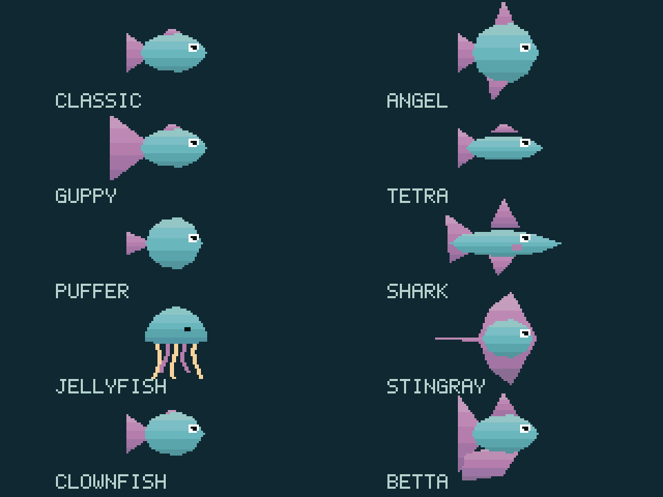
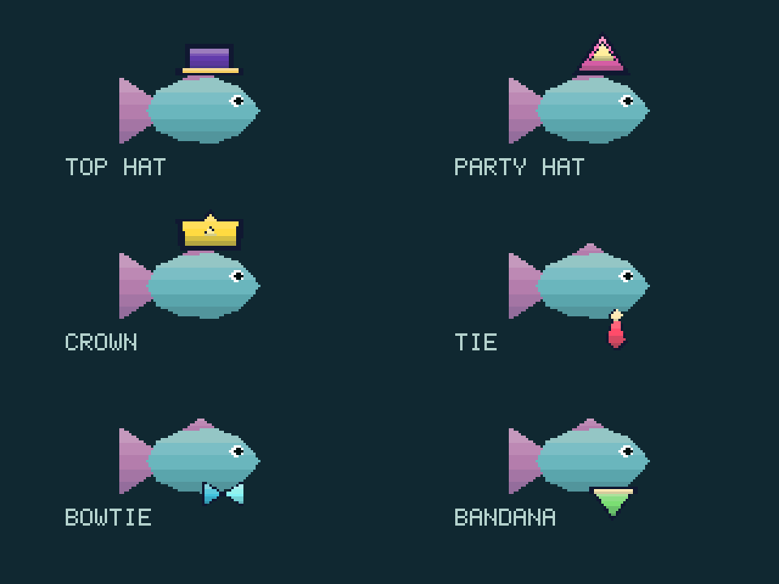
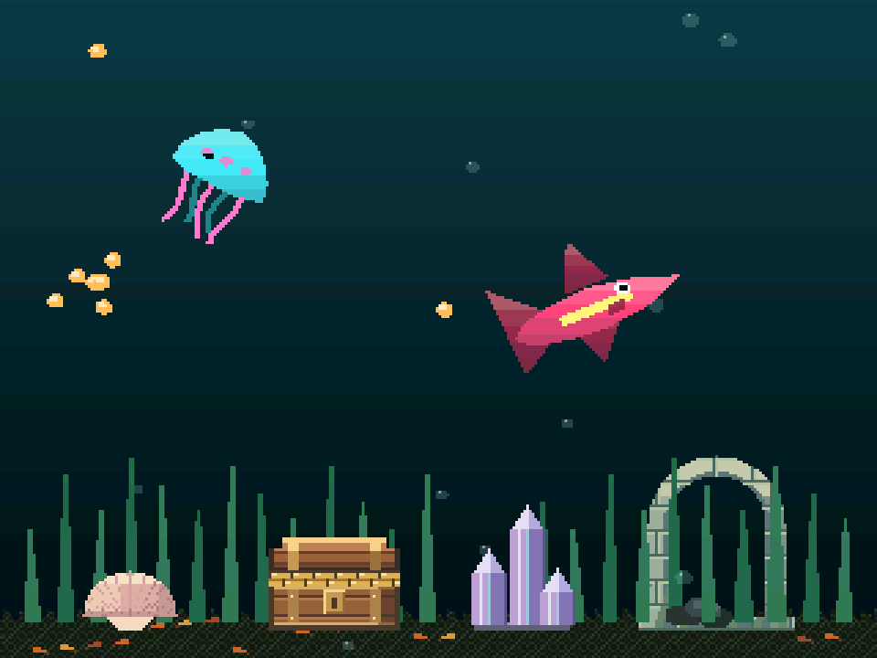
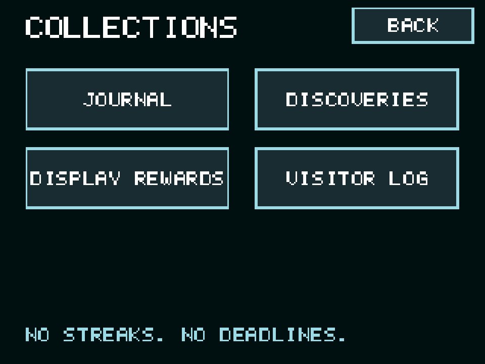
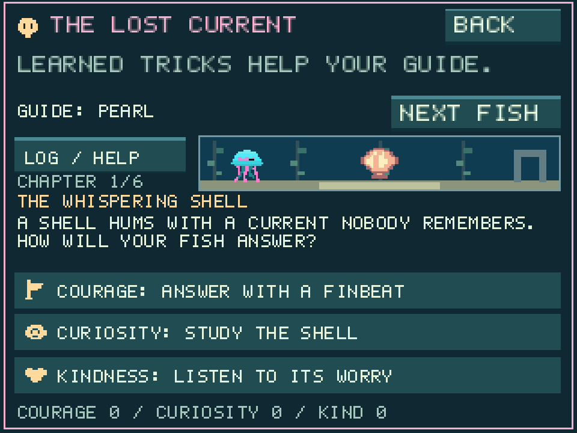
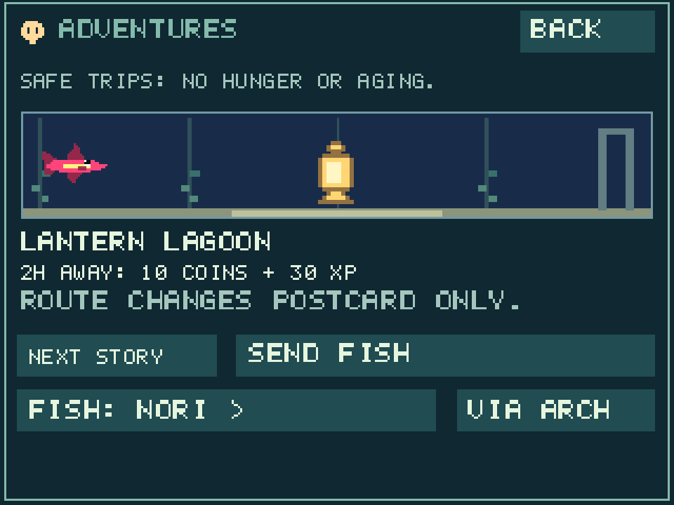

# Pocket Tank CYD 2.2.3

<p align="center"><a href="https://jeromedontdev.github.io/pocket-tank-cyd/"></a></p>

A CYD-only fork of [mediacutlet/pocket-tank](https://github.com/mediacutlet/pocket-tank),
now versioned independently. This is **release 2.2.3**; firmware, update
packages and the browser installer are published through GitHub Releases.
Originally based on upstream v0.3.8.
What began as a hardware port has become **a distinct aquarium game**:
permanent game modes, shared multi-aquarium progression, a global Fish Bank,
inherited genetics, illustrated adventures, a story RPG and eighteen games.
It retains the original aquarium simulation and credits its origins, but is no
longer just upstream Pocket Tank running on another display. Older release
downloads and tags remain unchanged.
Targets the **ESP32-2432S028 Cheap Yellow Display**:
4 MB flash, no PSRAM, 320x240 SPI LCD and XPT2046 resistive touch.
Other boards, model inference/training, audio, battery/PMIC and IMU drivers
are not included. See [LICENSE](LICENSE) for the original project license.

**Take the illustrated tour:** [CYD features and screenshots](docs/CYD-FEATURES.md)
covers named tanks, the bank, creature customization, Journal, mini-games,
decorations, fish-care upgrades, desk-companion progression, optional weather,
themed clocks, Wi-Fi setup, releases and SD workflows with captures from the
actual desktop renderer.

## New in 2.2.3: dimensional fish and accessories

- All ten fish varieties now have restrained back highlights, body midtones
  and underside shading. Fins, tails, ray wings and jellyfish bells share the
  same gentle material lighting; head-on turns keep rounded volume.
- All six wearable accessories have lit faces and shaded folds inside their
  existing outlines. Both chosen accessory colors and Natural are retained.
- Tank fish, wardrobe, setup and portraits share the actual renderer.
  Species silhouettes, swimming, inherited markings, shimmer/pale-belly traits,
  growth, sleep cues and wearable attachment are unchanged.
- Shading selects from five pre-tinted colors during the existing polygon
  scanline pass: no new textures, framebuffer, per-pixel lighting or assets.
  Saves, prices and daily progression remain unchanged.

| Ten fish varieties | Six wearable accessories |
|---|---|
|  |  |

## Previously in 2.2.2: more crafted aquarium decorations

- Twenty in-tank ornaments and fixed scenery pieces now have material-specific
  shading: wood grain and brass chest fittings, faceted crystals, beveled
  masonry, rounded pebbles, pearl sheen, sponge pores and barrel hoop rivets.
- Sea glass, brain coral, tiki, bottle, anemone and teapot gain softer forms,
  readable recesses and quieter highlights. The sea fan connects to its base.
- Seagrass has a deeper jade palette; broad sword leaves have a lit face and
  shaded fold without changing their growth, size, sway or trimming behavior.
- The actual tank and shop previews share the same artwork, at both sizes and
  all three scene details, including night lighting and cached/tiled drawing.
- Ownership, positions, touch targets, prices, daily care and schema-17 saves
  are unchanged. No new graphics buffers, asset downloads or animations.



## Previously in 2.2.1: a more consistent pixel-art interface

- Fifteen shared menu/goal icons redrawn with distinct silhouettes, outlines,
  shaded bodies, upper-left highlights and restrained warm details.
- All eighteen game thumbnails share a quieter aqua/gold/rose palette, framed
  underwater backplates and shaded cards, tiles and treasure chests.
- Bronze, silver and gold medals have faceted faces and two-tone ribbons;
  unearned medals remain clearly hollow.
- Art keeps its existing bounds and touch targets at Normal and Enlarged size.
  No new artwork buffers, PSRAM, downloads or per-frame aquarium effects.
- This first art pass covers interface illustrations, not a replacement of
  swimming fish, tank scenery, story scenes or the existing PNG icon pack.
  Gameplay, daily rewards, saves and progression are unchanged.



## Previously in 2.2.0: care-first daily progression

- **Collections > Goals > TODAY:** three flexible care activities, up to
  **100 sand dollars and 50 XP per day**. MILESTONES keeps the original goals.
- Games remain unlimited, but share only **5 bonus dollars/day and no XP**.
  Challenge records and medals continue after the allowance runs out.
- Budgeted for short daily visits over weeks, not repetitive feeding or game
  grinding. No streak penalties or missed-day debt.
- Existing XP, wallet, fish and unlocks are preserved. Append-only
  **6032-byte saves / schema 17** import older saves; back up before upgrading.
  See [the daily care rules and pacing assumptions](#aquarium-journal).

## Previously in 2.1.3: cleaner settings and readable weather

- One **Clock/Weather** hub: **Clock Face**, **Colors**, **Text / Effects**,
  **Time / Zone**, **Weather**, and one **Show Clock** action. BACK always
  returns one level; no nested Style/Text tabs or repeated preview buttons.
- **Weather > Text: Small/Medium/Large** resizes the weather reading and clock
  weather/event captions. The same saved control is **Weather Size** under
  **Text / Effects**. Clock text adapts to avoid overlap.
- Simple sun, partly cloudy, cloud, fog, rain, snow and thunderstorm icons
  accompany cached conditions in Weather and the clock. Unknown readings have
  no invented icon; stale/offline labels remain.
- One Auto Feed toggle, full-width SD actions, simpler city search, and a
  confirmation before forgetting a city. No save-format changes.
- Browser feeding is just **Place food > tap a column**; the extra
  Left/Middle/Right buttons have been removed.
- This version's browser, installer and documentation consistently identify it
  as **Pocket Tank CYD**; original upstream attribution is retained.

## Previously in 2.1.2: working browser fish-card tools

The fish-card padlock, sponge, scissors and DONE controls now work in the
browser. The lock prevents bare-hand cleaning/trimming; selected tools still
work. Lock changes are saved, and the card stays open when toggling it.
Hardware touchscreen behavior and the save format are unchanged.

## Previously in 2.1.1: fullscreen browser play and food placement

- Fullscreen/Exit fullscreen enlarges the game while keeping its controls.
- **Place food** lets you tap a column anywhere in the tank. Pellets still enter at the water surface.
  Plain surface taps also feed; the tank's existing pellet limit still applies.
- Optional **Touch hints** show where taps/drags land. Letterbox margins do
  not activate the tank.
- The public website/game is built from the latest stable **release tag**, not
  unreleased main. Its displayed tag/source commit and installer version are
  checked together before deployment. It compiles shared C code to WebAssembly,
  not the ESP32 binary.

## Previously in 2.1.0: scene detail, readable clocks and quieter low-light output

- **[Play in your browser](https://jeromedontdev.github.io/pocket-tank-cyd/play.html)**:
  the actual game simulation, mouse/touch controls and a separate local browser
  save. No CYD, account or upload required. Browser storage is not a backup:
  clearing site data, private browsing or eviction can remove progress.
- **Tiny** joins Large, Medium, Small and Jumbo. Under **Clock/Weather > Text / Effects**,
  choose Small/Medium/Large separately for date/AM-PM/seconds and for
  weather/activity. Text wraps and fits down only when needed; all seven
  themes, five positions and both resolutions are covered by overlap tests.
- Independent **Normal/Enlarged** size and **Balanced/Simple/Enhanced** scene
  detail. Normal + Balanced are the defaults; existing saved choices remain.
- Simple retains real stationary seagrass and placed decorations while hiding
  helpers, bubbles and ambient effects. Their simulation and benefits continue.
  Balanced reduces secondary animation; Enhanced retains smooth effects.
- Measured on a populated CYD: approximately **20 FPS Simple**, **10 FPS Balanced**
  and **8-9 FPS Enhanced** at either size. These are observations, not guarantees.
- **Jumbo** enlarges the selected clock theme instead of replacing it: Minimal
  text, Digital segments, Analog hands, Neon glow, Flip tiles, Binary dots and
  Orbit rings remain distinct. Colors, date/seconds and weather/activity still work.
- Room-light dimming now drives both screen and automatic back LED with a
  stronger low-light curve; pagination buttons use arrows without page labels.
- Existing saves, fish, wallet, progression and mode choices are preserved.

## Previously in 2.0.0: a distinct game, illustrated throughout

The interface now shares compact pixel-art icons, chapter scenery, and real
fish portraits instead of relying on text alone:

- Six illustrated Lost Current landmarks, visible fish guides, approach icons,
  chapter-journal thumbnails, and saved-result illustrations.
- Destination cards for all three adventures, with the chosen route and the
  real fish or saved traveler portrait; illustrated keepsakes and discovery hints.
- Portrait-led Fish Life, Family and Genes pages, milestone badges, and
  illustrated discovery/reward and bond/trick controls.
- Recognizable game-menu/help artwork and visual Home/Journal navigation.
- Flatter menus: separate Goals and Album, Themes under Tank, Tank Identity
  under Aquariums, a two-entry Adventures hub, and a second Fish menu page.
- Six more games on page three (18 total): Lighthouse, Shell Slide,
  Sonar Sweep, Tide 2048, Harbor Stack, and Echo Reef, integrated with saved
  records, medals, and balanced rewards in Normal/Hard.
- First-run **Normal / Creative / Hard** game modes. The choice applies to all
  aquariums and is fixed until a confirmed **full wipe**; Settings only shows
  the current mode. Existing saves migrate to Normal without a reset.
- Money, XP, goals, discoveries, unlocks, campaign progress and game records
  follow every aquarium. Residents and layouts stay local; the global 20-slot
  Fish Bank moves fish between tanks with their families, genes and bonds.
- Creative makes fish, looks, themes, wearables, frames and shop choices free.
  Add fish up to five active including travelers; confirmed removal keeps two
  residents. Creative cannot grant spendable progression rewards.
- Hard disables Comfort Assist and starts Auto Feed off. Six hours at severe
  hunger while running can kill fish, with a warning an hour before danger.
  No offline or old-age deaths; extinction offers a free rescue pair without
  losing progression. Normal and Creative never kill fish.

The artwork is static and reuses existing renderers plus small shared sprites:
no PSRAM, new framebuffer, SD artwork requirement, save-layout change, or
background aquarium animation. Text labels and existing touch navigation remain.




### Maintenance and compatibility

Named companion pages and shared Home initialization keep navigation readable
and consistent between simulator and hardware. Games have a separate module;
the aquarium renderer retains its bounded caches and tiled framebuffer.
Obsolete upstream files and rejected prototype keyboards are removed. Save
layouts/migrations remain frozen and regression-tested. Refactoring is not a
claim of higher FPS; this board still has no PSRAM and limited OTA headroom.

## Previously in 1.4.0

This release adds:

- **The Lost Current**, an optional six-chapter, 18-encounter story RPG tied to
  real fish, bonds, genetics, family legacies, visitors, decorations, and earlier
  adventures. No fish harm, forced quests, care-stat changes, or background AI.
- **Twelve games across two pages**, including Reef Defender, Current Runner,
  Pearl Breaker, Tide Tactics, Reef Architect, and Deep Expedition. Help, pause,
  saved records, medals, and transactional rewards are included.
- Consistent **BACK** navigation; separate Fish Life, Family, Genes, Visitor Log,
  tank recaps, and display rewards; clearer care and bond explanations.
- Visible clock sparkles under **Clock/Weather > Text / Effects**, useful wrapped
  event captions, steady Frame-selector typography, and a redesigned manta.
- Working CYD room-light/LED touch controls, steadier ambient-light filtering,
  and a non-flashing Wi-Fi flow that returns to Settings.
- **Schema 14 backups**, retaining imports from schemas 1–13 and existing binary
  saves. Back up before upgrading; do not downgrade an upgraded save.


### Recent releases

- [2.1.0](https://github.com/jeromedontdev/pocket-tank-cyd/releases/tag/v2.1.0):
  independent scene details, themed Jumbo clocks, stronger linked screen/LED
  room-light dimming and arrow-only pagination.
- [2.0.0](https://github.com/jeromedontdev/pocket-tank-cyd/releases/tag/v2.0.0):
  illustrated interface, eighteen games, permanent Normal/Creative/Hard modes,
  shared progression/global Bank, safer expanded storage and focused code cleanup.
- [1.4.0](https://github.com/jeromedontdev/pocket-tank-cyd/releases/tag/v1.4.0):
  optional fish-story RPG, six more games, consistent menus, clock effects,
  CYD control fixes, and the feature-focused website with a separate USB flasher.
- [1.3.0](https://github.com/jeromedontdev/pocket-tank-cyd/releases/tag/v1.3.0):
  inherited genetics/markings, family trees, five visitors, seasons, rear RGB LED,
  room-light sensor, SD photos/daily backups, and browser save viewer.
- [1.2.0](https://github.com/jeromedontdev/pocket-tank-cyd/releases/tag/v1.2.0):
  persistent fish biographies/buddies, tank identity and recaps, rare sightings,
  and six fixed sand decorations.
- [1.1.0](https://github.com/jeromedontdev/pocket-tank-cyd/releases/tag/v1.1.0):
  calm friendships, creature shortcuts, reversible decoration placement,
  aquarium summaries, scenic effects, and save-preserving browser USB updates.

## What remains

- **Genetics and family trees:** fish carry hidden markings, colors and four
  recessive traits (Shimmer, Painted Fins, Pale Belly, Gold Eye) that bred fry
  inherit, with rare mutations. **Home > Fish > Family** shows generations,
  parents, grandparents and children; **Fish page 2 > Genes** shows inheritance; see the
  [family guide](docs/CYD-FEATURES.md#family-genes-and-visitors-new-in-13).
- Five rare harmless visitors with a **Visitor Log**, and seasonal sand scenery
  that follows the clock (north, south or off).
- The CYD's **room-light sensor** can dim the backlight in a dark room, and the
  **back RGB LED** glows with the water color or signals hunger and visitors.
- Daily automatic SD backups (newest seven kept), **PHOTO TO SD** screenshots
  and a browser [save viewer](https://jeromedontdev.github.io/pocket-tank-cyd/viewer.html).
- Fish biographies, remembered swim buddies, life firsts and adventure keepsakes.
- Quiet bounded recaps, helper reports, tank subtitles/emblems and discovery hints.
- Rare harmless unknown visitors, plus six cached fixed sand decorations.
- Verified-backup status and a source-name/version preview before restoring.
- Calm fish form swim buddies and follow in short, spaced pairs.
  Stable favorite decorations guide resting and exploration; see **Home > Fish > Fish Life**.
- Tap shrimp, snail, urchin or seahorse for diet, activity and progress.
  The shrimp card distinguishes actual population from drawn representatives;
  **COLORS** opens that creature's free color editor.
- Decoration placement is a live **PREVIEW**: **DONE** commits, **CANCEL**
  restores position, depth, stacking and color. Autosaves retain the committed layout.
- Aquarium summaries show residents, Bank, traveler, upgrades, theme and last visit.
- Sparse Deep Glow silhouettes, Moonlit shooting stars and treasure/crystal glints
  use small, infrequent dirty regions rather than animated whole-screen backdrops.

- Personality-aware **rules-based** fish goals, reflexes, feeding, growth,
  trust, milestones, breeding, tank maintenance and the shop.
- Touch-only navigation, persistent five-point touch calibration, fixed
  display orientation, brightness and gameplay settings.
- Flash-resident icon art and versioned SD JSON tank backups with safety snapshots
  before restores.
- Offline SD firmware packages through **Settings > Device > SD Updates**, with
  checksum/board validation, explicit confirmation and a pre-update tank backup.
- Treasure chest: 120 sand dollars, placement/layering, move/sell and persistence.
- Scallop shell (60), starfish ornament (60), sunken anchor (80), and a
  bobbing, bottom-tethered buoy (80). All support placement, depth and selling.
- One-time sand palette (300) and mood lights (300) upgrades. Tap **SAND** or
  **WATER** in **Home > Tank > Sand & Water** to cycle colors for free, including the original look.
  Mood Lights includes Rainbow, Hot Pink and Neon Lime alongside the classic
  blue, teal, violet and amber gradients; no flashing or strobing.
  Sand Palette also includes Rainbow, Hot Pink, Electric Cyan and Neon Lime.
- Shipwreck (200), treasure urn (60), crystals (100), sea fan (80),
  sunken ruins (160), and a bobbing tethered jelly lantern (120).
- Ten creature looks: Classic, Angel, Guppy, Tetra, Puffer, Shark, Jellyfish,
  Stingray, Clownfish and Betta; nine marking
  patterns: Stripes, Spots, Band, Plain, Saddle, Tiger, Speckle, Fade and Mask. Open **Keeper > fish portrait >
  CUSTOMIZE** to change an existing fish's unlocked variety, pattern, body and marking
  colors for free. Varieties unlock through [Keeper levels](#fish-variety-unlocks);
  existing owned/seen looks stay available. DONE saves; CANCEL discards the preview. Fry offers show
  their variety, and bred fry inherit their parents' appearance traits.
  Sharks have a pointed snout, dorsal fin and gills; jellyfish pulse and wave
  their tentacles; rays flap their wings; bettas have flowing fins. These are
  peaceful visual varieties using the existing fish care system, not predators
  or separate species simulations. Jellyfish appearances occupy a normal fish
  slot and are separate from the decorative Jelly Lantern shop item.
- Fish customization offers 24 body colors and 24 marking colors, including
  hot pink, vivid red/orange/yellow, neon lime/green, cyan, electric blue,
  purple, magenta, pastels, white and dark slate.
- **Settings > Device > WIPE ALL PROGRESS** opens a separate confirmation.
  Confirming resets the entire collection, money, records and progression,
  then opens the first-run mode choice. CANCEL or waiting 20 seconds keeps
  everything. Explicit SD backups and touch calibration are preserved.
- Optional **Minimal, Digital, Analog, Neon, Flip, Binary and Orbit idle clocks**
  over the aquarium.
  Open **Settings > CLOCK/WEATHER** for large/medium/small/jumbo/tiny sizes, center or four-corner
  placement, 12/24-hour time, a DST toggle and UTC offsets in selectable
  1-hour, 30-minute or 15-minute steps. The default
  layout is large and centered. Clocks are **OFF by default** and saved per tank.
  **Jumbo** enlarges the selected theme for distance reading, keeping its
  design and colors with weather/activity beneath it. Other sizes are unchanged.
  Choose **15 sec, 30 sec, 1, 2, 5 or 10 min** of inactivity, or **Manual Only**;
  **SHOW CLOCK** opens it immediately. The first touch only dismisses the clock.
  **Colors** offers primary and secondary colors: theme defaults or
  white, amber, mint, cyan, rose, lavender and red, plus the background toggle.
  **Text / Effects** holds seconds/date visibility and supporting text sizes.
  Visible panels are opaque. Normal skips hidden aquarium drawing and reduces
  ambient bubbles, grass sway updates and visible shrimp representatives
  (10 real shrimp display as 5); population and care/progression rules stay intact.
- A selected fish's card has a **>** button just outside its top-right edge
  to cycle through fish, wrapping to the first. Tapping the card still opens Keeper.
- **Settings > WI-FI / SYNC** scans 2.4 GHz networks and
  provides a full single-page QWERTY password keyboard with separate
  numbers/symbols, connection errors, change-network and confirmed
  forget options. The tank is saved before a brief restart into setup; Wi-Fi
  credentials are device-wide and never included in aquarium backups.
  NTP sets the time when returning to the tank and on subsequent boots.
  After a failed sync, the overlay says **SYNC NEEDED**, not an invented time.
  No battery-backed RTC is fitted: Wi-Fi is needed again after power loss.
  A synchronized clock keeps running offline while powered or in deep sleep.
  Set your standard-time UTC offset and enable **DST: +1 HOUR** during daylight
  saving. DST is manual, not an automatic regional schedule.
- Legacy Wi-Fi firmware downloads are
  **disabled by default** until a CYD fork update channel is configured.
- A desktop preview of the actual CYD gameplay/renderer and native regressions.

The original learned advisor selected goals and urgency from fish state;
this fork instead uses explicit personality-aware rules. There is no LLM,
generated conversation or learned-confidence hesitation. This is the same
advisor the CYD port already used before the cleanup. SD storage does not
replace the working RAM needed by the original model.

## Build and upgrade

### For AI coding assistants

[AGENTS.md](AGENTS.md) is the repository's AI-maintenance entry point: architecture,
save/memory constraints, safe hardware workflows, test commands, and the complete
documentation/release checklist. Keep it current when those contracts change.
It is project guidance, not a private file or part of the firmware.

### Install from your browser

**[Explore the website](https://jeromedontdev.github.io/pocket-tank-cyd/)**
for a feature overview and screenshots, or
**[open the USB web installer](https://jeromedontdev.github.io/pocket-tank-cyd/flash.html)**
in desktop Chrome or Edge. Connect an ESP32-2432S028 CYD with a USB data cable;
no ESP-IDF installation is needed.

Choose **save-preserving USB update** for an existing CYD tank. It validates
the running firmware, board identity, partition layout and active slot before
writing only the application. Back up first and keep USB power connected.
The separate **factory installer overwrites saved tanks, Wi-Fi, calibration
and collection identity** and is only for new boards or deliberate resets.
Both flows require an explicit acknowledgment; refusal never falls back to
factory flashing. All artwork is embedded; no SD icons are needed.

The site uses pinned ESP Web Tools/esptool-js and the latest stable release's
application/factory images, checked against published SHA-256 checksums and board
markers before deployment. The factory flow checks only the chip family:
users must confirm the correct CYD display model.

Prebuilt CYD firmware, SD update packages, matching artwork and installation
instructions are available under
[Latest built release](https://github.com/jeromedontdev/pocket-tank-cyd/releases/latest).

| Download | Use |
|---|---|
| [SD update: update.ptu](https://github.com/jeromedontdev/pocket-tank-cyd/releases/latest/download/update.ptu) | Existing CYD installations; place at `pocket-tank/update.ptu` on SD |
| [Initial-flash binary](https://github.com/jeromedontdev/pocket-tank-cyd/releases/latest/download/pocket-tank-cyd-factory.bin) | New boards only; flash at `0x0` |
| [Install instructions](https://github.com/jeromedontdev/pocket-tank-cyd/releases/latest/download/INSTALL.txt) | SD placement, USB flashing and warnings |
| [Checksums](https://github.com/jeromedontdev/pocket-tank-cyd/releases/latest/download/SHA256SUMS.txt) | Verify downloaded files |

**All artwork is embedded in the firmware. No icons need to be copied to SD.**
No source build is needed for these downloads. SD is used for extra aquariums,
backups and offline updates, not artwork.
Use the SD update for an existing installation. **Factory images overwrite
saved tanks and settings** and are only for new boards or deliberate resets.
See [release instructions](firmware/CYD.md#downloadable-releases).

Install ESP-IDF (verified with v6.1), then open its PowerShell terminal:

```powershell
.\tools\build_cyd.ps1
.\tools\build_cyd.ps1 -Flash -Port COM4
```

The helper builds in `firmware\build_cyd` and upgrades **only the active app**,
detected through the USB console (`ota_0` at `0x20000`, `ota_1` at `0x200000`).
For deliberate recovery without a working console, specify `-AppSlot ota_0`
or `-AppSlot ota_1`; this does not change the boot slot.
It assumes this fork's CYD partition table is already installed;
it does not erase NVS, flash a partition table or format SD.
For an unflashed board, from `firmware`:

```powershell
idf.py -B build_cyd -D SDKCONFIG=build_cyd\sdkconfig -D SDKCONFIG_DEFAULTS=sdkconfig.defaults build
idf.py -B build_cyd -p COM4 flash
```

The only supported target is ESP32/CYD. `sdkconfig.defaults` is the canonical
configuration; `sdkconfig.cyd` is retained as an identical compatibility alias
for existing build directories. The app partition layout and NVS save offsets
are unchanged. Never erase NVS to perform a normal upgrade.

See [firmware/CYD.md](firmware/CYD.md) for SD setup, calibration, console
commands, JSON backup/restore and hardware limitations.

## Playable website

[Play Pocket Tank CYD in your browser](https://jeromedontdev.github.io/pocket-tank-cyd/play.html).
It runs the shared C simulation and renderer as WebAssembly, with mouse/touch
input and Normal, Creative or Hard first-run profiles. Local browser storage
keeps a complete archive of profiles, Bank, aquariums and preferences across
reloads and browser restarts. Autosaves run every five seconds, after actions,
when hidden and on exit; failures remain visible with retry/export controls.
Only one tab can write the save at a time. Fullscreen keeps shortcuts visible;
Place food offers tap-to-place feeding. Touch hints show
tap/drag positions. A plain tank tap feeds only near the surface; food falls
from the surface at the selected horizontal position, not at the tapped depth.

Use **Export browser save** for a backup and **Import browser save** to restore
that archive. Import validates the native save before replacing your current
data; reset requires confirmation. Browser archives are not CYD JSON backups.
HTTPS/localhost, JavaScript, WebAssembly, Web Locks and writable local storage
are required. Hardware, Wi-Fi credentials, live weather, SD photos/calibration
and firmware updates are intentionally unavailable.

For a local build, activate **Emscripten 4.0.18**, restore **cJSON 1.7.19**
(the firmware's managed component or `.browser-tools/cJSON`), then run:

```powershell
python tools\build_browser.py --out _site
npm install --prefix .browser-tools --no-save playwright@1.56.1
npx --prefix .browser-tools playwright install chromium
node tools\test_browser.cjs
```

The test runner serves the staged game on an ephemeral localhost port and
closes it afterward. It checks actual gameplay/input, all first-run modes,
reload/pagehide/browser-restart persistence, exclusive tabs, save failures,
export/import/reset and corrupt-save preservation. Pages builds and tests the
same playable assets before deployment; JS/CSS/WASM use content-hashed paths.
Public deployments check out the latest stable release tag and require the
browser build and USB installer to match that tag/version/commit. The game
shows its release tag and source commit; local builds are labeled Development.
Run `tools/prepare_web_installer.py` before the browser build when staging a
combined site with published USB firmware.

## Desktop preview and tests

Configure/build the firmware first to provide its managed cJSON dependency.
With Python 3.9+ and a GCC/Clang-compatible C compiler:

```powershell
python sim\run.py --cc clang
python sim\run.py --cc clang --smoke
python tools\test_tank_backup.py --cc clang
python -m unittest discover -s tools -p "test_*.py"
```

`--cc` also accepts the path to Zig (the runner adds `cc`). The preview uses
Python's Tk window, so SDL/LVGL are no longer required. Mouse gestures act as
touches; toolbar buttons open Keeper, Settings and Shop. It has its own
`sim\tank.sav`; it never touches the physical device. Wi-Fi is simulated,
not hardware-emulated. Export/restore buttons use the same CYD JSON schema.

The native suite checks all shop items, fish styles/patterns, customization
save/cancel/failure and breeding, frozen legacy saves, JSON
round-trip/rejection/write failures, decoration rendering with scratch guards,
Settings confirmation/timeout/fixed orientation, Wi-Fi flow, the unconfigured
update-channel message and rejection of upstream update manifests.

## Shop expansion

**Home > Tank > Shop & Decor** lists unlocks from cheapest to most expensive, with
stable ordering for equal prices. The nursery's FRY row, when available, stays
separate at the top. Existing item IDs, prices, placements and ownership are
unchanged.

Ten more tank-local unlocks fit the existing 4000-byte save prefix:

| Unlock | Sand dollars | Effect |
|---|---:|---|
| Zen Pebbles | 40 | Fixed stone stack on the sand |
| Duck Float | 60 | A yellow duck bobbing at the surface |
| Pearl Clam | 70 | Fixed open clam and pearl |
| Lily Pads | 80 | Floating pads with a pink water lily |
| Floating Log | 90 | A gently bobbing surface log |
| Tube Sponges | 100 | Fixed gold sponge garden |
| Lost Barrel | 110 | Fixed oak barrel |
| Dive Helmet | 140 | Fixed brass diving helmet |
| Slow Garden | 160 | Grass grows at half speed, awake and asleep |
| Bio Filter | 180 | New algae grows at half speed, awake and asleep |

The three surface ornaments can be displayed together. These eight new scenic
unlocks have fixed positions; unlike movable decorations, they do not offer
MOVE. A paid copy refunds 20 percent once (tap SELL twice). The permanent
unlock follows all tanks; free replacement copies show REMOVE and refund zero.
The shop descriptions identify their positions.
The upkeep upgrades are permanent, affect only their own aquarium, do not
erase existing algae or grass, and never award chore credit. Other care,
fish aging and coral growth remain unchanged. Sleeping SD tanks still pause.


## Fish-care upgrades

Every shop item uses a muted gray icon until purchased and its full-color icon
afterward, in both the shop list and item details. This indicates ownership,
not affordability.

Four permanent fish-care purchases join the price-sorted shop:

| Upgrade | Sand dollars | Effect |
|---|---:|---|
| Calm Current | 160 | 25% faster energy recovery while resting or asleep |
| Cozy Shelter | 180 | 25% faster natural stress decay, including sleep |
| Play Kit | 200 | 25% faster curiosity gain from exploring |
| Training Ring | 240 | Adds 25% of the normal hold-to-trust rate |

Bonuses do not stack with duplicate purchases. Training Ring adds to, rather
than multiplies, the seahorse's bonus (225% total while hitched). These do not
change food rewards, energy drain, curiosity spending, maximum stats, size,
aging, hunger or breeding requirements. Sleeping tanks in the SD collection
stay paused. Purchases travel with their own tank, survive reboot and JSON
backups, and clear when that tank is wiped. Older backups start without them.
The binary save's 4000-byte prefix is unchanged; a formerly reserved byte holds the flags.

The fork also includes upstream's daytime breather fix: exhausted fish duck
into nearby seagrass (or their resting corner) to recover without changing
their advisor goal. Calm Current also boosts this resting recovery. The CYD
fork retains its separate update channel and existing release-number format.

## Display readability

CYD menu text is pixel-aligned in both Enlarged and Normal modes, with a minimum
5x7 glyph (including subtext), brighter secondary labels, and wrapped status
messages. Journal cards, the collection album, fry offers, Settings and SD
Updates use full-size captions rather than downscaled microtext. Detailed
build information is on Updates; Settings > Device keeps a readable version footer.

## Aquarium Journal

Open **Home > Collections > Goals** or **Album**, or **Home > Tank > Themes**.
**Goals opens TODAY**, a care-first checklist. Tap **MILESTONES** for the
original 15 one-time objectives; **TODAY** returns to daily care.

| Daily activity | Sand dollars | XP |
|---|---:|---:|
| One player feeding actually eaten | 25 | 12 |
| Say Hello, or hold calmly near a fish for 60 seconds | 25 | 13 |
| Clean an algae colony, trim through a 10 cm counter step, or watch a settled tank for five minutes | 50 | 25 |

Tap each ready **CLAIM** to save it, once per profile per day: **100 dollars
and 50 XP** in total. Watching requires an uncovered, lit aquarium with at
least one fed, non-distressed fish; menus and mini-games do not count.
The alternatives need no purchased helpers, forced fish sales or excessive feeding.
Repeat feeding, trimming and holds no longer farm XP or additional care money;
growth, births and full-trust milestones still pay their one-time dollars.
Games give no XP and only a small shared daily coin bonus.

The checklist refreshes on a new **UTC day**, not your clock display's timezone.
Without a usable clock it refreshes after 24 hours of running care time;
restarting does not reset the allowance. Clock synchronization adopts the
existing allowance, and moving the clock backward does not renew it.
Missed days give no back-pay, streak loss or debt. Saved rewards never expire;
unclaimed daily checklist progress refreshes with the day.

Spending never lowers your Keeper level. The 15 levels still top out at
**4,200 XP**; existing XP, levels and unlocks are preserved. Newly claimed
milestone XP is half its old value (1,410 XP across all 15); already paid
rewards are not removed. The three postcard adventures still add 180 XP total.

**Pacing budget, not a promise of individual playtime:** completing daily care
needs around 5-10 minutes including navigation. With milestone rewards, the
5,265-dollar shop is affordable in roughly 6-8 weeks, maximum Keeper level in
about 8 weeks, and all seven 500-dollar aquarium expansions in roughly 10-12
weeks total. Daily care alone reaches level 15 in 84 visits; milestones and
adventures shorten that. Wearables cost another 250 dollars per fully equipped
fish and new fry cost 200 each, so optional collection spending extends the
budget. Games are not required for these targets. No currency or existing
progress was reset for this rebalance.

Three of the 15 objectives are active at once. Tap a ready objective to
claim its one-time XP and sand-dollar reward; the next objective replaces it.
Existing care totals qualify, but old care does not grant bulk retroactive
XP. The album permanently records seen and adult appearances, including
customized looks, even after selling a fish; it is not an acquisition-only
species checklist. Backdrops unlock at levels 3 (Kelp Forest), 6 (Coral Reef)
and 10 (Deep Glow). Original remains available, and themes do not replace
your purchased water/sand palettes or lock existing customization.
Kelp Forest now has a rich green water tint, leafy stalks and light shafts;
Coral Reef adds blue water and large pink/peach branching coral; Deep Glow
has midnight-purple water, luminous jellyfish and bioluminescent specks.
Original is unchanged.
Four more backdrops are available on the Themes page's second screen:

| Backdrop | Keeper level | Look |
|---|---|---|
| Sunken Ruins | 5 | Weathered stone columns and broken arches in teal water |
| Sunset Lagoon | 8 | Peach/purple water, a golden sun and reflections |
| Ice Cavern | 12 | Blue water, hanging ice and faceted crystals |
| Moonlit Reef | 15 | Midnight-blue water, crescent moon and silver reflections |

Use the `<` / `>` buttons above the theme rows to browse both pages.
The existing theme IDs and unlock levels are unchanged. New IDs 4..7 fit the
existing save byte; there is no save-size increase. Older firmware will not
recognize the new backdrops, so avoid downgrading.

### Fish-variety unlocks

New aquariums start with **Classic** fish only. Keeper XP from daily care,
milestones and one-time adventures gradually unlocks more appearances for **CUSTOMIZE** and
future shop fry offers:

| Keeper level | Variety |
|---|---|
| 1 | Classic |
| 2 | Guppy |
| 3 | Tetra |
| 4 | Clownfish |
| 6 | Angel |
| 8 | Betta |
| 10 | Puffer |
| 12 | Shark |
| 14 | Stingray |
| 15 | Jellyfish |

The Journal's Album shows required levels for locked varieties. Customization
cycles only available varieties; all patterns and colors remain available.
Unlocks and Journal XP **follow all aquariums**. Existing active/banked fish
and appearances already recorded in the Album are grandfathered in: they
remain usable even below their new level requirement. Seen varieties stay
available after fish are sold, stored or customized. Breeding still inherits
existing parents' looks; it cannot randomly bypass variety unlocks.
These are visual appearances, not different fish-care rules or predator behavior.

XP, claims, album records and the selected theme survive saves and SD
backup/restore. Wipe clears them along with the tank. Claims and theme
changes report save failures instead of applying unsaved rewards.

## Mini-games

Open **Home > Games**. Tap **PLAY AS** to cycle through your active fish;
Slalom uses that fish's real appearance, Feed Frenzy visits the tank's fish,
and Treasure Cast shows existing fish among the hazards. These are portraits,
not fish transfers: games cannot injure, feed, train or change the actual fish.

| Game | How to play | Qualifies for the shared daily bonus |
|---|---|---|
| Bubble Pop | Pop rising bubbles for 30 seconds; gold bubbles score 3. | Score 3+ |
| Pearl Match | Reveal cards and remember six pearl pairs; untimed. | Solve all pairs |
| Fish Slalom | Use LEFT/RIGHT to pass 12 open gates and collect their snacks. | Score 2+ |
| Treasure Cast | Time five casts over the chest, avoiding fish/debris. | One accurate cast |
| Feed Frenzy | Choose each visiting fish's requested snack for 30 seconds. Correct +2; wrong -1, never below zero. | Score 2+ |
| Reef Puzzle | Rotate pipe tiles to connect the left inlet to the right outlet; untimed, always solvable. | Solve the pipes |
| Reef Defender | Aim taps at incoming hazards; defend the reef across five increasingly busy waves. | Score 4+ |
| Current Runner | Choose among five lanes through 18 scrolling gates; gold gap scores 3, neighboring gap 1. | Score 4+ |
| Pearl Breaker | Move the paddle to keep the pearl bouncing and clear the reef blocks. | Score 4+ |
| Tide Tactics | Move/attack orthogonally, guard to heal, and capture three flags within 22 turns; enemies respond after each move. | Score 4+ |
| Reef Architect | Place coral and seagrass on a grid, balancing water access and neighboring habitats. | Score 4+ |
| Deep Expedition | Choose branching routes, manage oxygen and inventory, and return with your loot. | Score 4+ |

Use the page arrows to browse three pages. Page three adds **Lighthouse**
(cross-toggle logic), **Shell Slide** (sliding puzzle), **Sonar Sweep**
(row/column clue hunt), **Tide 2048** (tile merging), **Harbor Stack**
(timed stacking), and **Echo Reef** (sequence memory). These six are
integrated with persistent records, medals, and the shared daily coin bonus, just like the
original twelve. Extended save storage avoids growing the crowded NVS blob.

| Page-three game | Qualifies for daily bonus | Bronze / Silver / Gold |
|---|---|---|
| Lighthouse | Solved | ≤24 / ≤16 / ≤8 moves |
| Shell Slide | Solved | ≤80 / ≤40 / ≤24 moves |
| Sonar Sweep | At least 10 points | 10 / 20 / 25 points |
| Tide 2048 | At least 128 points | 128 / 512 / 2048 points |
| Harbor Stack | At least 30 points | 30 / 80 / 120 points |
| Echo Reef | At least 3 rounds | 3 / 7 / 12 rounds |

Unsolved/zero-progress finishes pay nothing. Relaxed uses the same allowance
without records/medals. Games never grant XP.

Each new game opens with its own rules. **PAUSE** freezes a round; **HELP**
reopens its instructions. Strategy and placement games are turn-based, not
reaction tests. The records screen has matching pages, with saved best scores,
round counts, and medals for all eighteen games. Original six-game records remain
intact when upgrading.
Relaxed Defender, Runner, and Breaker run at 65% speed; the three turn-based
games keep their normal rules. All six offer the same capped rewards in either
mode, but only challenge play records personal bests and medals.

| New-game medals | Bronze | Silver | Gold |
|---|---:|---:|---:|
| Reef Defender | 8 | 20 | 36 |
| Current Runner | 12 | 28 | 44 |
| Pearl Breaker | 6 | 14 | 24 |
| Tide Tactics | 8 | 18 | 30 |
| Reef Architect | 12 | 24 | 36 |
| Deep Expedition | 10 | 24 | 40 |

Each qualifying round offers **1 sand dollar**, up to **5 dollars per UTC day
across all eighteen games, Challenge and Relaxed combined**. Games give **no
Journal XP**. Further play remains unlimited; Challenge still saves records
and medals even when the coin allowance is exhausted.
**SAVE RESULT** saves the actual bonus, daily allowance and game records together; a failed save changes none and
leaves the claim available to retry. A round can only be claimed once.
BACK or PLAY AGAIN requires a second tap before discarding an unclaimed reward.

Aquarium care, growth and care progression pause throughout the games menu,
round and results. Leaving resumes normal care; manually sleeping/rebooting
still uses the normal offline-care rules. Games, in-progress scores and
unclaimed rewards are temporary. Claimed challenge-mode personal bests, round
counts and bronze/silver/gold medals are permanent and follow all aquariums.
There are no entry fees, wagers or penalties to your actual aquarium.

Use **CHALLENGE / RELAXED** on the games menu to switch modes. Relaxed Bubble
Pop and Feed Frenzy have no countdown: tap **FINISH** whenever you like.
Relaxed Slalom and Treasure Cast move at half speed; Match and Reef remain
untimed. Relaxed play shares the five-dollar daily game allowance, gives no XP and does not
set records or medals. **RECORDS** shows personal bests and permanent gold
challenge targets: 24 Bubble points, Match in 16 moves, 24 Slalom points,
10 Cast points, 40 Frenzy points, and Reef in 18 moves. Meeting a move target
means that many moves or fewer. The suggested game advances after you claim
its challenge-mode reward; it has no calendar deadline or streak.

## The Lost Current: an optional fish-story RPG

Open **Home > Adventures > The Lost Current** for a saved, turn-based story.
It is an addition to the aquarium, not a replacement for care or the existing
timed expeditions. There are no compulsory quests, deadlines, fees, or
missed-visit penalties. Close it at any time and return to the aquarium.

Choose an actual fish as the story's guide. Across six chapters, explore a
forgotten current, solve encounters through courage, curiosity, or kindness,
and leave a shared legacy for the aquarium. Choices save immediately;
chapter rewards are saved in the same transaction and cannot be claimed twice.
Failed saves leave both progress and rewards unchanged, with an explicit retry.
There are 18 encounters. Each choice develops one shared adventure skill;
an approach can succeed directly or find a safe alternate way forward. Chapter
resolutions and the finale branch with your decisions. The three endings favor
journeys, wonders, or welcome. Story rewards are memories, skills, and an
optional map keepsake on the trophy shelf, not coins or care-stat advantages.

The story recognizes fish bonds and learned tricks, inherited traits and
family connections, decorations and aquarium appearance, visitor sightings,
and earlier expedition discoveries. These offer alternative approaches and
context, never a requirement to buy an object, breed a particular fish, or
change a device setting. Descendants can continue their family's journey.
The campaign journal remembers chapter contributors even when a fish leaves
the active tank.

Adventure skills belong to the shared story, separate from care statistics.
Story choices do not feed, train, age, injure, transfer, or change a real fish.
Nothing runs in the aquarium simulation on behalf of the RPG: no new swimming
AI, background encounters, enemies, or continuous effects. Normal aquarium
gameplay remains available whether you start, finish, or ignore the story.

## Desk companion, discoveries and safe adventures

Tap a fish and its **MENU** button for **Home**: **Fish**, **Tank**,
**Adventures**, **Collections**, **Games**, and **Settings**.
Fish holds interactions, Bank, wardrobe,
names/looks, life and family/genes; Tank holds the shop, aquariums, palettes,
creature colors, identity and tank journal.
Collections holds separate Goals and Album pages, discovery hints, display rewards,
visitor log and object stories. Themes are under Tank, and Tank Identity is
under Aquariums. Fish Life, Family, Genes, Firsts and Keepsakes are independent
Fish menu entries rather than cross-linked tabs. Adventures
is its own destination, not a container for unrelated features. Back returns
to the category you used. All return buttons are labeled **BACK**; action buttons
such as Save, Cancel, and Done retain their action labels.
There are no daily streaks or missed-visit penalties.

**Settings** is grouped into **Display**, **Clock/Weather**, **Wi-Fi/Sync**,
**SD Backups**, **Aquarium Care**, and **Device** (updates/calibration/wipe).
Pagination buttons use arrows only; their touch areas and wrap behavior are unchanged.
With **Display > ROOM LIGHT: DIM** or **DIM+NIGHT**, the screen and automatic
back LED share an aggressive low-light curve: about 27% output at 50% room
light, 8% at 25%, and 2% in darkness. Screen output is relative to your selected
brightness, with a 1% floor before night dimming. ROOM LIGHT OFF disables
sensor dimming for both outputs.
Wi-Fi/Sync restarts into its low-memory setup mode with the backlight dark until
the first complete frame, then returns to Settings after clock synchronization.
**Display > SCALE** toggles **Normal 320x240** (formerly Compact, now the default
for fresh installations, resets and new aquariums) / **Enlarged 240x180**.
Existing saves retain their selected scale. Normal renders
the full tank natively, making scene objects and clock graphics about 25%
smaller in each dimension, with no crop or inset. Page controls remain
readable. The setting and remapped positions persist per aquarium; failed
saves roll back. Both sizes reuse tiled framebuffer storage to preserve
weather's RAM budget.

**Display > SCENE: BALANCED / SIMPLE / ENHANCED** is independent of scale.
**Normal size + Balanced detail are the defaults.** Balanced keeps the complete
scene with reduced secondary animation, aiming for about 10 FPS. Simple aims
for about 20 FPS: real stationary seagrass and all placed decorations remain,
but decorative animation, helpers, bubbles, the trophy shelf and ambient
sparkles are hidden.
Fish, dropped food and visible algae-care feedback remain active. Enhanced
keeps smooth vegetation and full secondary animation; about 5 FPS is acceptable.
These are performance goals, not frame caps or guarantees for every aquarium.
Helpers still work normally; nothing is sold, removed or reset. Placement
editors show the complete scene regardless of detail.
This device-wide preference persists on the CYD outside aquarium/JSON saves.
The simulator previews it for the current session. It is not a game mode,
care assist. Existing saved size/detail choices are respected.

- **Settings > Aquarium Care > Comfort Assist** (the saved Cozy Care option)
  keeps unattended care comfortable without pretending you fed,
  cleaned or trained your fish. Classic keeps the original care behaviour.
  New aquariums start Cozy; existing aquariums stay Classic until you change
  the option. Bonds never decay in either mode.
- **SAY HELLO** adds 5 bond, up to 100, once per 30 powered-on seconds.
  It doesn't manufacture trust, feeding counters or Journal care milestones.
  DART unlocks at bond 10, BUBBLES at 25, FOLLOW at 50. Tap an unlocked trick
  to request a playful dart, a visit to the bubble column, or following a
  tankmate; close the menu to watch. **Fish > Say Hello > HOW BONDS WORK** explains
  this alongside **trust**, the separate 0–10 confidence built through food
  and calm care. Bond is permanent friendship, not another trust multiplier
  or a source of care XP. Bonds/tricks travel with banked and adventuring fish.
- **Settings > Clock/Weather > Text / Effects > Event Captions** shows useful adventures, ready postcards,
  visitors, hunger or stress beside the idle clock. Routine exploration is silent.
  Weather and events wrap to fit; even Enlarged mode with a long city name is bounded.
  **Settings > Clock/Weather > Text / Effects > Sparkles** controls eight bright cyan/gold
  drifting stars beside the clock, not fish mood. They remain visible without
  captions and never cover the clock face or its weather panel.
- **Collections > Discoveries** automatically records bubble watching, exploration, seagrass naps,
  swimming together, playful darts, reef visits, greetings, learned tricks,
  growing up and adventure postcards. Behaviour discoveries require at least
  two seconds of the activity with the aquarium visible; you don't have to
  tap the event while it happens.
- Complete **Nature** (six activity discoveries), **Friendship** (hello and a
  trick), or **Story** (all three postcards) and claim its permanent cosmetic
  reward in **Collections > Display Rewards**.
  Frames colour the companion page and add small clock-corner ornaments;
  **FRAME >** cycles only unlocked frames and displays the selected name;
  the page explains which sets still need discoveries or a claim. ORIGINAL removes
  the ornament without changing your clock colours.
  **TROPHIES** shows/hides earned shells and gold game-challenge markers in
  the aquarium. Collection claims are one-time, not a repeatable currency source.

### Story quests

Choose a fish, destination and postcard route, then tap **SEND FISH** and
**CONFIRM SEND**. ARCH/BUBBLES choose the postcard's scenery, not different
risks, durations or rewards.

| Destination | Time away | Reward | Postcard find |
|---|---|---|---|
| Lantern Lagoon | 2 hours | 10 sand dollars + 30 Journal XP | Lantern shell |
| Pearl Library | 6 hours | 20 sand dollars + 60 Journal XP | Pearl bookmark |
| Starlight Cove | 12 hours | 30 sand dollars + 90 Journal XP | Star stone |

The selected fish **actually leaves the aquarium** and cannot be fed, sold
or banked while away. Its care, age, appearance, trust and bond are preserved
in the save. Its tank slot is reserved so it **automatically returns** when
the timer finishes, without waiting for you to claim rewards. At least one
fish stays home. One adventure runs at a time.
Each destination can be completed and claimed once; postcards and
route choices remain in the Album. There are no entry fees, failures,
deadlines or expiring rewards.

Progress is saved and resumes after restart. With a synced clock, elapsed time
includes power-off/sleep; without valid time, powered-on seconds advance it.
No time is guessed while the clock is unknown. Completed rewards wait for you.
CLAIM saves coins, XP and claim state together, with rollback/retry if saving
fails. Schema 9 includes the safely stored traveler, per-fish wardrobe/colors
and creature colors;
schema 6/7 companion saves
still import, including already-running short portrait stories. Schemas 1–5
still import with Classic settings and empty companion progress.
Do not downgrade after using the new progression.

### Optional weather with the clock

Open **Settings > CLOCK/WEATHER > WEATHER**, search for a city, select the correct
result, choose F/C and enable weather. No location is inferred automatically.
Weather is off by default and needs a saved Wi-Fi connection; city search and
selected coordinates are sent to [Open-Meteo](https://open-meteo.com/) over
HTTPS. Location and units are device-wide settings, separate from aquarium
backups.

The clock displays current temperature/conditions, or an explicit
unavailable/offline/stale status. Weather occupies a bordered, larger-text area
attached to the clock, with the city on its own wrapped lines. Useful event captions
share the reserved clock area without covering its face. Conditions refresh
about every **15 minutes**; readings **30 minutes** old are marked stale.
Disabled weather makes no requests.
Weather data: Open-Meteo; city search: GeoNames via Open-Meteo.

## Fish bank

Open **Home > Fish > Fish Bank** to keep up to **20 fish** outside the five-fish
active tank limit. **In Tank > STORE** deposits a fish; **Stored > CHOOSE**
shows a banked fish's age, trust and appearance. Use **RETURN** if there is
room, or **SWAP** to choose the active fish that trades places with it.
The **20 slots are global**, shared by every aquarium: store a fish in one
tank, switch aquariums, then return or swap it into the other tank.
Every move asks for confirmation and saves immediately; a failed save
leaves both fish where they were. Storage and swaps are free.

Keep at least two fish active. Swaps work even at this minimum and when the
tank or bank is full. Finish naming a new fry before moving fish. Stored
fish do not age, grow, eat, earn care rewards or require attention. Names,
looks, stage, age, traits, trust, bonds, family and milestone reward ledgers
travel with each fish. Positions and current swimming goals restart on
return. Slot-based parent links to a fish leaving the active tank are
cleared rather than reassigned to its replacement.

The bank is included in autosaves and SD backups. Restoring a snapshot
restores both the tank and bank; restoring an older pre-bank snapshot
starts with an empty bank. **Wipe clears the bank too**, but not SD files.

## Additional aquariums

Open **Home > Tank > Aquariums**. The original tank is free; each additional
tank costs **500 sand dollars**, paid from your shared wallet (free in Creative).
There are **eight tanks total**. Buying enters a new aquarium with two fry
and first-time setup; it does not copy your fish. Both purchases and free
switches require confirmation.

**Sand dollars are global:** earning or spending in any tank changes the same
balance, and switching never restores an old wallet. XP, goals, discoveries,
unlocks, campaign progress and all eighteen game records also follow every
aquarium, together with the **global 20-slot Fish Bank**. Each aquarium keeps
its **own residents, decoration placements, layout and palette selection**.
Fish identities, family links, genes and bonds travel through the Bank with
the fish; extra tanks are decorative/resident expansions of the same profile,
not separate progression saves. Finish naming a fry before leaving.
Use **NAME TANK** to name the active aquarium (up to 15 characters). Select
a character, use `<` / `>` to change it, then SAVE; BACK discards edits. Names remain
with their slots across switches, restarts and individual JSON restores.
Wipe removes the entire collection.
Inactive tanks are fully paused: no aging, hunger, growth, rewards or offline
simulation while another tank is active. The active tank retains the existing
power-off/sleep behavior.

An SD card is required to buy or switch. Sleeping aquarium snapshots are
stored under `pocket-tank/tanks`, with alternating checksummed, readback-verified
copies. The outgoing tank must save successfully before switching; the final
internal-save commit selects the new aquarium and records the purchase.
Failures do not charge you or replace the live aquarium. Keep the card with
the device: losing it loses access to inactive aquariums. The selected aquarium
continues from internal storage without the card.

Older per-aquarium Banks merge into the global Bank the first time you visit
each old tank. If the combined contents exceed 20 fish, the switch asks you
to make room first; no fish are discarded. Fish identities and their family
references are migrated together to prevent collisions between old tanks.

**JSON replaces the active aquarium, global Bank and shared progression**, preserving the
current purchased-slot identity; it is not a whole-collection backup.
Restored fish receive safe profile-wide identities in multi-tank collections,
with their family and buddy links remapped together, so an older or portable
snapshot cannot alias a different tank's residents.
**Wipe resets the entire profile**, including every tank slot, money, records,
progression and the first-run mode choice. Old inactive snapshots cannot
reappear in the new collection; explicit SD backups remain untouched.
To archive tank contents, export each aquarium and also copy the
card's `pocket-tank/tanks` directory. There is no one-click whole-collection
restore: copying SD files alone cannot recreate ownership after erasing NVS.
Do not downgrade firmware
after buying aquariums: older builds do not preserve collection metadata.

## Fork maintenance

This is intentionally no longer a multi-board tree. Upstream gameplay changes
can still be ported manually, but merges and release compatibility are not
automatic. Preserve existing binary offsets and append new fields; the save
is now 6032 bytes (5848 through 1.3, 40 bytes of game records, 24 bytes of RPG
progress, an 8-byte compatibility Creative marker, 40 more game-record bytes
and 48 bytes of mode/starvation/unlock/refund state, plus 24 bytes of shared daily care), with the previous 4520-byte layout and the
original 1920-byte chest, 1952-byte palette, 2000-byte customization and
2040-byte Journal and 3968-byte Fish Bank layouts intact. The new 32-byte
aquarium metadata identifies the purchased collection, active slot, its name and
four care-upgrade flags in a formerly reserved byte. The 42-item shop uses
the original full 32-bit ownership field plus those four flags and a separate
six-bit fixed-scenery mask in the new polish tail.

The first CYD cleanup pass removes the upstream filming-only prototype name
keyboards and the bodies of permanently disabled hardware staging commands.
Fish naming still uses the letter wheel; Wi-Fi keeps its separate QWERTY
keyboard. Old staging commands explicitly refuse instead of modifying saves.
Save migrations, frozen fields, simulator fixtures, attribution and required
SD/network/update dependencies are retained. This pass reduces the measured
app image from **1,769,664 to 1,766,384 bytes** (3,280 bytes saved), leaving
**199,696 bytes (10.16%)** in each OTA slot; static DRAM drops by 9 bytes.
These are local build measurements, not a published release or an FPS claim.

The final 2.0.0 refactor build measures **1,760,944 app bytes**, leaving
**205,136 bytes (10.43%)** per OTA slot. Static DRAM is **71,331 bytes**.
The separate games module, named companion pages and common Home initialization
preserve the existing save format and framebuffer/cache budgets.

Physical COM4 testing covered legacy-save migration with all four residents
and the wallet intact, both display scales, all eighteen game entry screens,
SD backup/readback/restore validation, Bank JSON validation and reboot persistence.
It also found an older **empty 64 KiB SPIFFS template** inside the storage
partition. The formatting guard now recognizes that exact metadata-only image;
any payload, damage or unknown nonblank content still blocks formatting.
Blocked loads show an explicit storage error and do not acknowledge a pending
OTA image as valid. Native tests pin both accepted and rejected cases.

Obsolete upstream board photos, simulator screenshots, battery/touch logs,
LLM-era design/benchmark notes and the unused duplicate partition table have
also been removed. The active partition table is `firmware/partitions.cyd.csv`.
Keep `assets/icons` as the artwork source, `docs/media/cyd-features` as the
current gallery and `sim/testdata/saves` as migration regression fixtures.
Build outputs, dependency downloads and caches are not part of this pruning.

The appended companion section holds bonds, discoveries, quests, wearables and game records.
Wardrobe/color data uses reserved relationship/portrait bytes; four per-creature color
pairs append eight bytes (including reserved alignment bytes).
The append-only polish tail adds stable fish identities, remembered buddies,
biographies, eight recent observations, tank subtitles/emblems, rare-visitor
sightings and backup status. See the [quiet-depth guide](docs/CYD-FEATURES.md#quiet-depth-new-in-12)
for menu paths, visitor timing and migration limits. The NVS partition is
unchanged; its practical 5920-byte ceiling still applies. Expanded active saves
instead use the existing 128 KiB SPIFFS partition, with alternating CRC-checked,
readback-verified copies and a durable wipe marker. Legacy NVS is migration
input only; corrupt storage never silently falls back to stale NVS or formats
nonblank data. No partition-table change or SD card is needed for the active save.
JSON exports use schema 17 for an individual aquarium, including shared daily care and its fixed mode,
Lost Current progress and eighteen-game records,
the polish and story tails and saved Enlarged/Normal scale; schema
1 through 15 backups remain importable when valid for the selected mode.
Cross-mode restores cannot bypass a
chosen game mode: changing modes requires a confirmed full wipe.
Older firmware cannot restore newer-schema backups; keep a matching
pre-upgrade backup before downgrading. Obsolete upstream design proposals have
been removed; this README and the CYD guide describe the current game and its
authoritative build/hardware contracts.

Do not use upstream installers or release binaries on this fork. See
[docs/OTA.md](docs/OTA.md) for offline SD packages, the opt-in fork channel
and signing limitations.
