# Pocket Tank CYD: a more personal little ocean

<p align="center"><a href="https://jeromedontdev.github.io/pocket-tank-cyd/"></a></p>

**An illustrated tour of Pocket Tank CYD 2.3.18**

**2.3.18 aquarium-first polish:** per-frame clock metadata is shared across
tiles, final opaque spans reuse exact shaded colors, and repeated Normal-scale
LCD rows reuse already-converted pixels within the same stripe. Fish keep their
full simulation cadence and the illustrated artwork stays intact. The preceding
clock/decor fixture improved from 13.88 to 15.43 FPS with p95 84 to 76 ms;
other scenes gained only 1-2%. Daily backups still hitch briefly, but normally
run just once per UTC day, not continuously.
See [measurements and limitations](../firmware/CYD.md#com4-beforeafter-measurements).

**2.3.18 fish behavior:** fish ease into a gentle hover near their existing
rest destinations. Existing boldness and laziness now affect hover, tap-startle
sensitivity and food pursuit: bold fish are less easily startled, lazy fish
pursue pellets more leisurely, and close food dives are more direct. No new
personality stats, currency or save fields are introduced.

**2.3.18 understandable progress:** Fish Interaction now shows the next trick's
bond target and the number of +5 greetings needed, with greetings 30 seconds
apart. Bond progress stays. Creative skips bond locks, while Follow still needs
a tankmate. A Fish's Life gives rounded-up growth-hours until the next stage,
notes that sleep grows fish more slowly, and explains decor rest/interest spots.
Elders do not show a nonexistent next stage. Nothing adds a new care obligation.

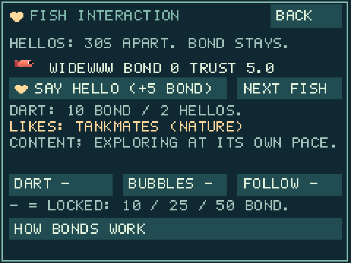

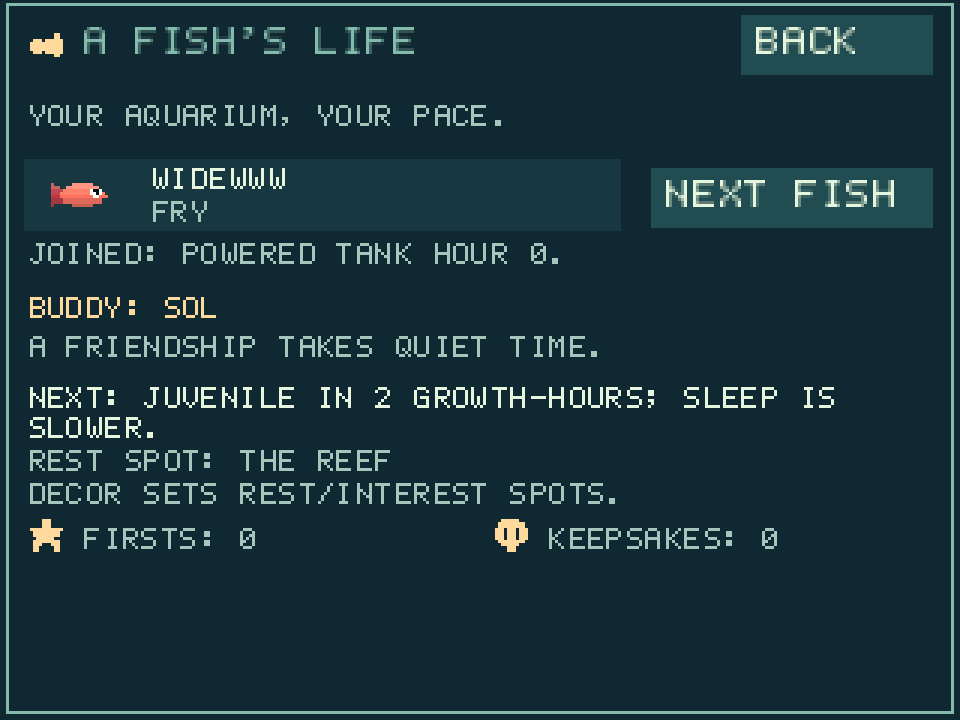

**2.3.17 smoother background work:** weather checks at boot and hourly, even
after failures. Exact clock/decoration/helper caches reduce repeated rendering
work without simplifying the artwork or slowing fish simulation. SD backup
storage and readback run in a lower-priority background worker after a validated
snapshot; the measured tank-task service fell from 718 to 109 ms. Snapshot
validation still briefly pauses a frame. Controlled FPS changes are small and
mixed: the clock-heavy fixture improved from 13.80 to 14.00 FPS with unchanged
p95 frame time. No save schema, partition, calibration or hardware-profile
changes. See [the complete hardware results](../firmware/CYD.md#com4-verification-of-the-four-part-follow-up).

**2.3.14 roomier tank:** aquarium fish are 33% smaller in width and height
at every life stage, including their fins, patterns and wearables. Relative
growth differences remain visible. Decorations/helpers and readable menu
portraits stay unchanged, as do saved sizes, growth, swimming and tap targets.
Rendering-only culling/repaint bounds follow the smaller artwork with padding
for turns and wearables; dense scenes may still repaint the full frame.

**2.3.14 harbor and garden:** twenty detailed static decorations and six new
wearables join the normal shop and wardrobe. Species-aware fitting preserves
proportions through all life stages; only the scarf is unavailable on jellyfish.
Ties, bowties and bandanas remain available. **BUY** and **PLACE** manage shared
storage; hold a placed decoration to move it and confirm **REMOVE** to store it
without selling it.


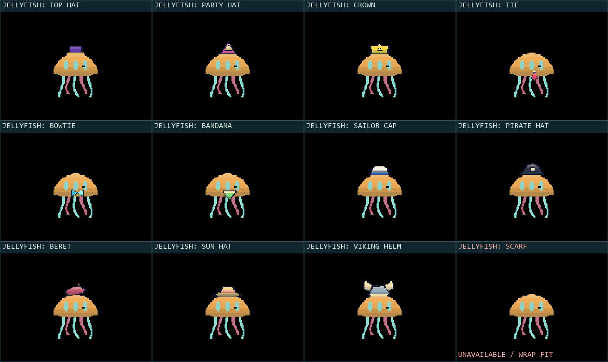

**2.3.14 fish-first rendering:** alternating 40-row tiles overlap drawing and LCD
transfer within the existing framebuffer. Cost-based damage plans replace the
fixed 40% promotion threshold. Scenery animates less frequently while fish
movement stays full-rate; diagnostics expose pacing percentiles and slow phases.
Actual speed depends on tank contents and display settings.

Back up first: saves now use schema 19 / 6336 bytes and companion version 7.
Legacy saves migrate, but older firmware cannot read newly saved data. Hardware
profiles, partitions and calibration are preserved.

**2.3.11 creature polish:** when helpers overlap, tapping selects the
closest eligible creature, with the existing fish-first priority retained.
Only rendered shrimp are tappable, and their card's shown count follows scene
detail rather than screen size. The snail now describes its current activity.
COLORS gestures stay on the card instead of reaching the water behind it;
slide off to cancel. Visible next arrows and the shared five-creature palette
editor remain available.

**2.3.11 artwork and LCD updates:** exact-color RGB565 palette indexing compresses
32 embedded icons without changing a pixel. The local unified app is
**1,728,176 bytes**, with **237,904 bytes of OTA headroom**. Seven low-color
icons use 4-bit indices, saving another **2,704 app bytes** over the first
indexed-art build. The raw SD/browser icon bank
is unchanged. Partial LCD writes preserve unrelated canonical fingerprints:
a one-pixel partial-to-canonical test retransmits only one stripe instead of
40-43 at both scales/orientations. This is not a measured live FPS gain.
LCD invalidation jumps to the affected stripe range rather than scanning a
whole band. The latest follow-up was backed up, flashed and fully read back
on COM4 only. These changes are included in release 2.3.11.

**Also included in 2.3.11:** modal pages and mini-games are size-optimized
without removing content. That unified app has **215,264 bytes of
OTA headroom**: lossless embedded alpha compression, shared creature-card
frames and more menu-only size optimization save another 22,704 bytes over the
first-stage build last flashed to COM4. Repeated static ornaments share a bounded
indexed sprite/silhouette; fish reuse exact prepared yaw/colors between tiles.
Unchanged partial LCD stripes can now be skipped safely across overlapping
updates, and the decorated/clock diagnostic is seeded with fixed time.
Three alternating desktop pairs retain all 48 sampled frame hashes and reduce
decorated-scene CPU rendering time by 5.7-11.3%; this is **not a device FPS claim**.
That prior pass was flashed and read back on COM4; its appearance was confirmed.
These measurements describe that earlier optimization stage.

The first-stage exact snail/seahorse geometry reuse and lazy urchin row colors reduce
repeated rendering work. Both resolutions, all details and full/tile drawing
retain matching scene hashes. First-stage desktop overall timings were mixed. COM4 fixed
benchmark scenes improved by roughly 4-5%, and the maximum-ornament scene by
about 3%; results for a changing live aquarium are not directly comparable.

**2.3.9 aquarium polish:** a center grass clearing, exact animation-calculation
reuse and fewer unused LCD checksums reduce rendering work without lowering
detail. Placement highlights/cycles overlapping copies, calm fish occasionally
inspect the mussel or rest near familiar companions, and successful automatic
payouts produce a brief local gold sparkle. Desktop benchmark results are mixed;
no new on-device FPS improvement is claimed.

**2.3.8 shop:** decoration copy/storage controls are in the item's normal shop
entry; the separate Inventory screen is gone. Buy a first copy normally before
buying additional copies. Pearl Mussel is a normal 120-dollar creature purchase
per aquarium (free in Creative), not a separate menu or daily-task reward.
Its income goes straight to the wallet; previously earned mussels and pearls
are preserved.

**2.3.10 creature cards:** tap the mussel in the tank for its income progress, daily allowance and current
earning/paused status. A visible arrow on helper information cards cycles
through owned residents, including the mussel; it does not collect income or
change settings. Fish information cards have a high-contrast graphical arrow.
The mussel also has **COLORS**: free primary shell and detail mantle colors,
with the same preview, **SAVE COLORS** and **NATURAL** behavior as other helpers.
It is included in **NEXT TYPE** in Creature Colors. Colors survive reload,
backups and aquarium switches. Existing saves default to Natural; save size and
field offsets stay unchanged, but the version-6 companion record is not readable
by older firmware, so do not downgrade after saving with 2.3.10.

**2.3.7 display defaults:** trophies start hidden in new aquariums, including
Creative mode. Enable them in **Life > Rewards > Trophies**. Existing saved
preferences are preserved. ELEGOO's fresh touch default now uses the same axis
directions as the previously working calibration; saved calibrations are unchanged.

**2.3.6 board support:** the website installer uses one shared application for
the original CYD and ELEGOO ESP32-32E 2.8-inch ILI9341V, with saved hardware profiles.
Both boards are supported, but their displays cannot be reliably autodetected.
The installer requires an explicit CYD or ELEGOO CYD choice, with no default.
The board retains that profile across reboots and updates; later web updates
ask you to select the matching board for verification, not to reconfigure it.
Existing tanks migrate by app-only USB update; new-board factory images differ
only in their blank NVS profile. Both run the same aquarium;
ELEGOO uses different LCD initialization and has no room-light sensor.
Select the exact board for USB. Once unified, both use unified-update.ptu /
unified-ota.json; legacy board-specific SD/Wi-Fi downloads remain separate.
A module's ESP32-32E
label alone is not enough to identify it. See the
[hardware/board-conversion guide](../firmware/CYD.md#supported-board-variants).

**2.3.5 menu cleanup:** use **Settings > Device >
Firmware Updates** for both SD and GitHub Wi-Fi updates (called **SD Updates**
in 2.3.4 and older). **Screenshot to SD** is only under Device; its old
SD Backups duplicate is removed. Weather text size is only on **Clock/Weather >
Weather**, not duplicated in Text / Effects. Layout checks cover both scales.
The Device, Text / Effects and update screenshots show the current controls.

Version 2.3.4 stores all eight aquariums internally. SD is optional for buying
and switching tanks; keep an existing installation's original card inserted
for its first boot to import inactive tanks. Backups, photos and offline
updates remain on SD.

Version 2.3.3 exposed **Screenshot to SD** under **Settings > Device**, initially
retaining **Photo to SD** under SD Backups (removed in 2.3.5). Dedicated update mode leaves
aquarium-only rendering scratch free for GitHub TLS certificate verification.

Version 2.3.2 added **Check GitHub via Wi-Fi** to the update page, now called
**Settings > Device > Firmware Updates**.
It checks this fork's latest stable release and asks before installing newer
firmware. Exact size, board, embedded version and full-file SHA-256 are checked
before switching the inactive boot slot. Install this version once by USB/SD
to enable the channel on older boards; keep power connected and back up first.
See the [Wi-Fi flow and trust model](OTA.md#github-wi-fi-updates-232-and-newer).

Version 2.3.1 adds an explicit inventory-item **BACK**, cancels
unconfirmed sales when returning to the list, and explains when the mussel
is paused for hungry/stressed fish. The list footer is hidden behind the item
panel so there is only one Back. It saves 19,312 bytes versus 2.3.0 while
retaining the two-slot update layout and certificate-verified HTTPS client.
Weather and GitHub Pages certificate validation passed on the actual CYD.

### New in 2.3.0: decoration inventory and pearl-mussel income

Available in 2.3.0 and newer; 2.3.8 integrates storage into the shop.
Select a purchased decoration's shop entry to **BUY**, **PLACE**, or
**SELL STORED**. Hold a decoration in the tank to open its movement screen.
**REMOVE** there requires a second tap and returns the selected piece to
storage, whether it is an original or an extra. There are no NEXT, MOVE COPY
or STORE COPY controls in item management. Removing
does not sell or refund a piece; moving and placing owned items do not charge
again. **SELL STORED** requires a second confirmation and only pays the resale
value of a paid copy, never a free/Creative one.

The 2.3.9 placement preview highlights the selected piece and its starting
position. Tap an overlap to select another placed decoration or copy, including
different item types; drag horizontally to reposition only the selected copy.
Its label identifies the selected placed piece and explains removal to storage.
Holding an extra copy also works when its original is no longer in the tank.
Switching selection drops unconfirmed edits, and CANCEL
restores the starting layout. Stored pieces must be placed before they can be
selected in the tank.

Use **TANKS** after storing to switch aquariums, then place from the same
inventory. Existing tank layouts remain local. Storage is limited to 64
pieces, with up to eight additional basic ornaments per tank. Extra ornaments
have independent positions and front/back depths; **CANCEL** discards only
the selected copy's positioning draft. They are decorative copies, not extra
helper anchors. Complex plants/castles/living coral/reef clusters/pumpkins
remain one placed copy of each type per tank, but additional owned copies can
be stored or placed in other aquariums. Helpers, upgrades, themes and fixed
background scenery retain their existing behavior outside inventory.

Daily care pays **30 + 30 + 65 = 125 sand dollars**; XP remains 50 per day.
The shop sells a **pearl mussel** for 120 sand dollars per aquarium.
All fish must have hunger below 8.5 and stress below 7 for its live-time
progress to advance. Ten healthy running minutes grow one coin, at most 15
per profile/care day, credited automatically to the wallet without a collection
screen. Old banked income settles automatically with save-failure rollback;
daily generation follows the same clock/fallback protections as care. There are no
offline earnings or XP, at most one resident per aquarium, and no multiplied
daily allowance from extra tanks. Creative purchases are free but generate no
income. Games allow **five dollars per game per day** (one per qualifying
saved round, 90 across all 18), with Challenge/Relaxed and all tanks sharing
each game's allowance. No game XP. Most of the time the
mussel rests; roughly every six minutes it slowly crawls to a nearby sand
position over 16 seconds, with a small foot movement and shell bob.

In 2.3.9, successful payouts produce a subtle
1.6-second gold sparkle above the shell. The effect is live-only and not saved;
failed writes retain the coins without playing a success effect. Calm curious
fish occasionally visit the mussel, with staggered visits rather than a crowd.
Resting fish may settle near an already-resting familiar companion. These are
target refinements, not new care obligations or notifications; urgent needs
retain priority.

Version 2.3.0 saves use schema 18 / 6,168 bytes, with the previous 6,032-byte prefix
unchanged. Back up before upgrading and do not downgrade an upgraded profile
to firmware that cannot read inventory or mussel state.
Once a mussel is purchased in 2.3.8, its per-aquarium ownership mask requires
2.3.8 or newer even though the save size and schema number remain unchanged.

Obsolete pending “new fry” flags are retired when that fish is no longer a
fry; fish, names and family history are not reset. Genuine unfinished fry
welcomes still resume. Finishing the welcome now requires a successful save,
with an explicit retry message on storage failure instead of silently closing.

**2.2.7** improves real CYD throughput without reducing artwork or detail.
LCD transfers use the full capacity of the existing DMA halves at the same
40 MHz SPI clock. Shared rendering skips clipped polygon palettes, reuses
identical fish-pitch and seahorse-tail calculations, shades urchin tones per
row and replays clipped translucent clock spans. Both display scales, all
three scene details and all gameplay modes benefit where those paths apply;
LCD DMA savings are hardware-only. A five-fish RAM copy of the decorated tank
with its clock enabled measured 10.79 FPS over 1,200 frames, with a lowest
120-frame window of 10.22 FPS including a 5 ms/frame service reserve.
This Normal/Balanced diagnostic is not the complete gameplay/network loop
or a universal minimum; ordinary four-fish monitoring included sub-10 windows.
Saves, ownership, gameplay and artwork stay unchanged. See the
[hardware methodology](../firmware/CYD.md#five-fish-hardware-follow-up-227).

**2.2.6** removes the second Back button from Wardrobe Colors and gives every
companion section the same header return. The selected fish's name appears
above the preview; leaving without Save Colors does not commit the draft.
Creature Colors retains Next Type. The five-fish renderer reuses identical
compressed backdrop rows within the same 12 KB budget and batches Simple's
uncached scenery rows. Native measurements show about 33-37% less render time
in Simple and 15-22% less in heavier themed scenes; these are desktop timings,
not hardware FPS promises. A perched seahorse's shadow now crosses tile
boundaries correctly. Full/tiled/retained rendering is stress-tested at both
scales and all details without touching the real aquarium. No gameplay,
ownership, artwork, save fields or additional cache memory are introduced.

**2.2.5** fixes the uneven stroke weight caused by fractional font scaling,
most visible in Normal. Shared 5x7 text now uses exact pixel coverage rather
than arbitrarily repeating rows/columns. Native-size text stays pixel-exact,
including Enlarged's small labels; integer-size clock text stays sharp.
Menus, cards, setup, games, stories, notices, weather and clock captions share
the fix. Jumbo text/Flip numerals use the same rasterizer while other clock
face styles stay distinct. Case-sensitive Wi-Fi text keeps its exact case
with matching metrics at every size. Common punctuation no longer disappears.
Existing layout, wrapping, touch targets, colors, saves and gameplay stay;
no new buffers, font downloads or per-frame allocations are introduced.

| Normal typography | Enlarged typography |
|---|---|
|  |  |

**2.2.4** refines sand grain, sparse pebbles and low distant ridges, with
quieter layered kelp, coral, ruins and ice backgrounds. Lily pad, duck, log,
buoy and jelly lantern gain material details. Rare visitors gain a scuted
turtle shell, folded manta wings, glassy ghost-fish edges and soft jelly/squid
shading. Food has a lit face and bubbles have fine translucent rims. A mint
wipe arc or warm trim glint follows a successful active tool stroke and
clears when the stroke ends; unsuccessful gestures do not show success cues.
Simple keeps quiet water and hidden ambient bubbles/helpers, with the same
sand, food and tool feedback. No helpers, castle, living coral or reef-cluster
art is changed. No new buffers, save fields, particles, timers, visit rules
or care/progression changes.

| Floating material details | Rare visitors and care effects, both poses |
|---|---|
|  |  |

**2.2.3** extends the material polish to all ten fish varieties and all six
wearables. Soft back highlights, body midtones and underside shadows give
the existing silhouettes volume; fins, ray wings, jellyfish bells and
accessories receive coordinated shading. Colors, inherited markings,
traits, stages, movement and wearable attachment are preserved. Tank fish,
wardrobe, setup and portraits share the same rendering code. Five pre-tinted
tones are selected during the existing scanline pass, with no texture packs,
new buffers or per-pixel lighting. Saves and daily care are unchanged.

| Actual body/fin renderer, ten varieties | Actual wearable renderer, six accessories |
|---|---|
|  |  |

These isolated renderer lineups use the same body/fin colors and plain markings
for comparison, not new default fish colors. Your own colors and markings remain.

**2.2.2** brings the polish into the aquarium itself: twenty ornaments and
fixed sand pieces gain material-specific depth, from chest fittings and
faceted crystals to rounded stones, pearl sheen, sponge pores and weathered
wood. Seagrass uses quieter jade tones; sword leaves have a lit face and
shaded fold. The actual tank and shop previews share the art. Existing
footprints, ownership, growth, placement, prices, care and saves are preserved;
no extra graphics buffers, artwork downloads or animations are required.

| Crafted wood, crystal and stone | Rounded seabed materials |
|---|---|
|  | 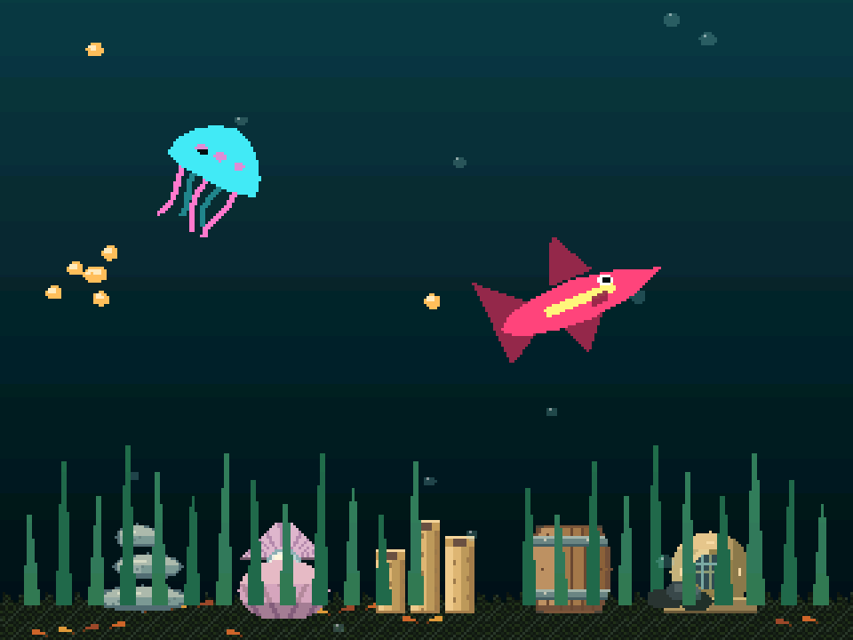 |
| 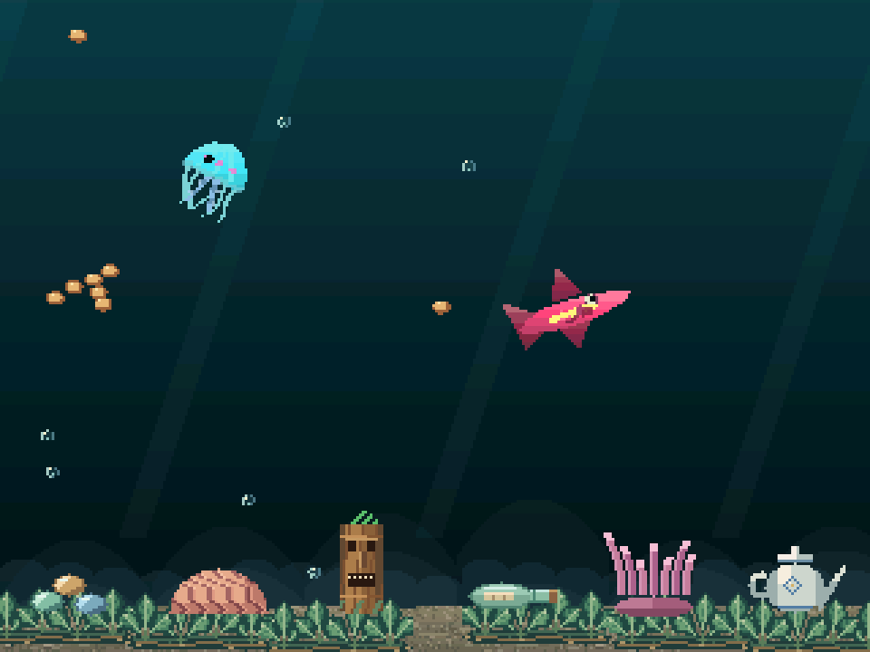 | 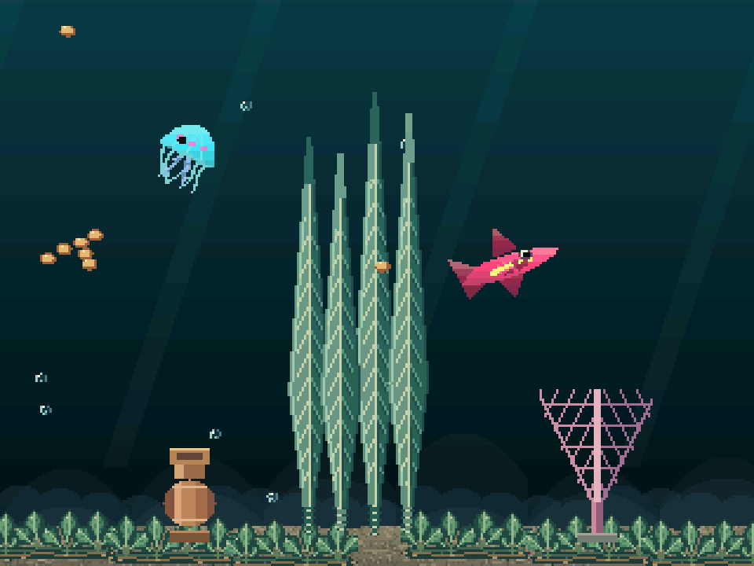 |

**2.2.1** refines the shared interface artwork: fifteen shaded menu/goal icons,
eighteen coordinated game thumbnails and faceted reward medals. Cleaner
silhouettes, upper-left highlights and a restrained aqua/gold/rose palette keep
the cozy pixel-art look readable at both sizes. Art stays inside the original
bounds, without new buffers, PSRAM or aquarium animation work. Fish, scenery,
story scenes, PNG icons and gameplay are unchanged in this first polish pass.

| Refined shared menu icons | Coordinated game thumbnails |
|---|---|
|  | 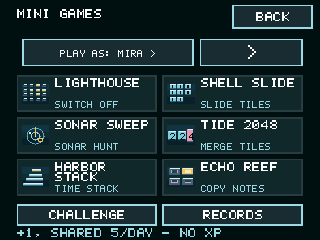 |

**2.2.0** makes care the progression path: **Collections > Goals > TODAY**
offers three flexible activities worth up to **100 dollars / 50 XP daily**.
Games share just five bonus dollars per day and give no XP; play and Challenge
records remain unlimited. Existing money, XP, fish and unlocks are preserved.
See [the care loop and pacing budget](#3-give-everyday-care-a-sense-of-progression).

**[Play the actual game in your browser](https://jeromedontdev.github.io/pocket-tank-cyd/play.html)**,
using mouse/touch controls and a separate local save. It needs no CYD or account,
does not upload your aquarium, and does not automatically synchronize a hardware
save. Hardware-only features are unavailable. Clearing this site's data, private
browsing or browser storage eviction can remove progress.

Browser controls in **2.1.1** add Fullscreen/Exit fullscreen, optional Touch
hints, and Place food: tap anywhere to choose the feeding column, or choose
Left/Middle/Right (removed in 2.1.3 in favor of tap-to-place only). Food drops from the surface; the pellet cap still applies.
The public simulator is compiled from the latest stable release tag, not the
ESP32 binary or unreleased main. Its release tag and source commit appear above
the game and must match the installer's release before deployment.

**2.1.2** fixes browser fish-card controls: the padlock toggles and saves the
tank-wide tool safety lock, sponge/scissors select their tools, and DONE returns
to bare hands. Locked bare-hand drags cannot clean or trim; explicit tools can.

**2.1.3** simplifies Settings with one Clock/Weather hub: Clock Face, Colors,
Text / Effects, Time / Zone, Weather and one Show Clock action. BACK goes one
level up. Weather has a visible **Text: Small/Medium/Large** control; the duplicate
**Weather Size** in Text / Effects was removed in 2.3.5. It sizes the weather reading and saved clock
weather/event captions. Condition icons show sun, partly cloudy, cloud, fog,
rain, snow or storms when a cached reading exists. Stale/error text remains.
Auto Feed is one toggle, SD actions are full-width, and forgetting a city needs
confirmation. No saved aquarium fields were added.

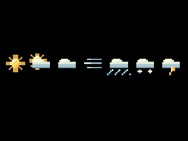
Updated October 24, 2026

This release also separates games from aquarium rendering, names companion
navigation states and shares Home initialization between hardware and simulator.
Compatibility fixtures and frozen save offsets remain. Physical-unit checks
cover both scales, all eighteen game entries, existing-save migration and
SD/Bank validation; see [hardware verification and budgets](../firmware/CYD.md#200-verification-and-budgets).

This page describes **2.1.0**, including three scene-detail levels, themed Jumbo
clocks, linked low-light screen/LED dimming, the illustrated interface, eighteen
games, permanent Normal/Creative/Hard modes and global Bank/shared progression.
[Get the 2.1.0 release](https://github.com/jeromedontdev/pocket-tank-cyd/releases/tag/v2.1.0)
or use the [website flasher](https://jeromedontdev.github.io/pocket-tank-cyd/flash.html).
Older releases remain unchanged; for their original interface, use the
[1.3.0 guide](https://github.com/jeromedontdev/pocket-tank-cyd/blob/v1.3.0/docs/CYD-FEATURES.md).

Originally a hardware port, Pocket Tank CYD is now **a distinct aquarium game**,
not merely the original game on a different board. It credits and retains
Pocket Tank's feeding, growth, personality, trust and
aquarium care, while adding more ways to decorate, collect, progress and
keep favorite fish. It is built specifically for the **ESP32-2432S028
Cheap Yellow Display** and **ELEGOO ESP32-32E 2.8-inch ILI9341V**,
rather than trying to fit every ESP32 display.

The headline additions:

- **Illustrated interface:** chapter landmarks, fish-guide
  scenes, destination cards, keepsake silhouettes, portrait-led fish information,
  recognizable game art and visual goal/navigation cues. Labels remain readable.
- **The Lost Current:** optional fish-and-family story RPG with six chapters,
  18 encounters, three endings, and saved chapter contributors (new in 1.4).

- **A 20-slot Fish Bank** with confirmed deposits, returns and swaps.
- **Purchasable aquariums:** 500 sand dollars each, up to eight named tanks.
- **Ten creature appearances**, nine markings and 24 colors for both body
  and markings.
- **Genetics and a family tree:** hidden markings, colors and recessive traits
  pass from parents to fry, with rare mutations.
- **Five rare visitors**, a visitor log and seasonal sand scenery.
- **Room-light dimming, a back LED glow,** daily SD backups and screenshots.
- **An Aquarium Journal** with 15 Keeper levels, objectives, an appearance
  album and unlockable backdrops.
- **Eighteen mini-games** across three pages, with records, medals and
  five daily bonus dollars per game in 2.3.0 and newer; no game XP.
- **A desk-companion hub:** optional Cozy Care, fish bonds, discoveries,
  collections and safe story adventures.
- **Game records and medals**, permanent challenges and relaxed play without
  countdowns in Bubble Pop or Feed Frenzy.
- **Optional real weather** beside the idle clock, with on-device city setup.
- **Twenty-five added decorations**, including three simultaneous surface floats.
- **Two upkeep and four fish-care upgrades**, with purchases shared across tanks.
- **A price-sorted shop:** gray icons before purchase, full color afterward.
- **Readable menus**, reorganized Settings, SD backups and offline updates.
- **Seven optional clock themes**, with on-screen Wi-Fi setup and NTP time.

> **About the imagery:** every image below is a fresh capture from the
> desktop emulator's actual CYD C renderer, not a mockup or webcam photo.
> Captures use a separate staged demonstration tank with unlocked content;
> the real aquarium was not read or changed. Each 320 x 240 Normal framebuffer is
> enlarged exactly 3x using nearest-neighbor pixels, without smoothing,
> retouching or added interface elements. The emulator is built with the
> hardware's five-active-fish limit and `CYD_FLAT_EDGES=1` (no vignette)
> for these captures. SD operations,
> flashing and touch calibration still run on the physical CYD, not in
> the emulator.

## Get the CYD build

Download a complete bundle from
[GitHub Releases](https://github.com/jeromedontdev/pocket-tank-cyd/releases).

### Visual overhaul in 2.0.0

All six Lost Current chapters have their own small pixel-art landmark. The fish
you select appears in the scene with its real appearance; the story journal uses
the same landmark art and the saved encounter result includes an illustration.
Courage, Curiosity and Kindness each have a matching icon as well as a text label.

| The Whispering Shell | The Kelp Crossing | The Glass Garden |
| --- | --- | --- |
|  | 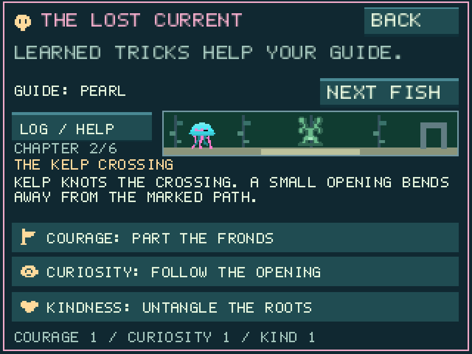 | 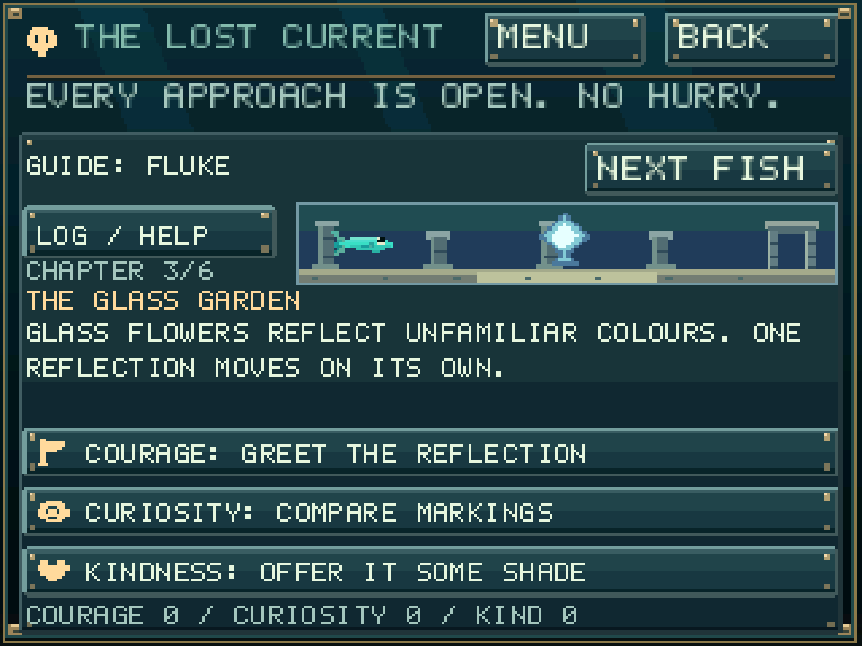 |

| The Lantern Shoal | The Ancestors' Arch | The Heart of the Current |
| --- | --- | --- |
| 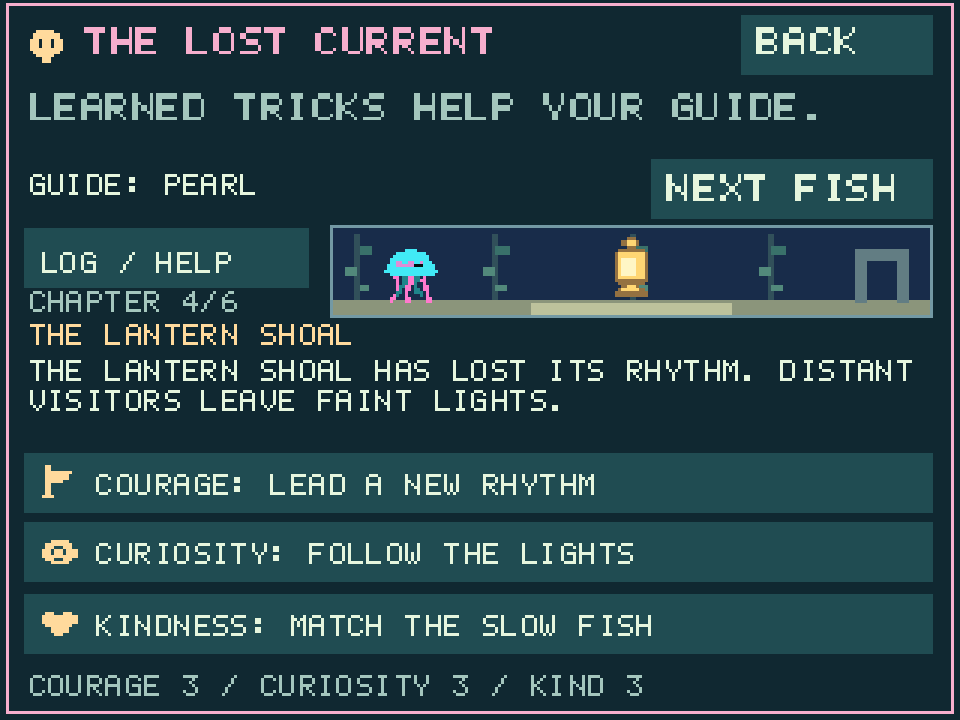 | 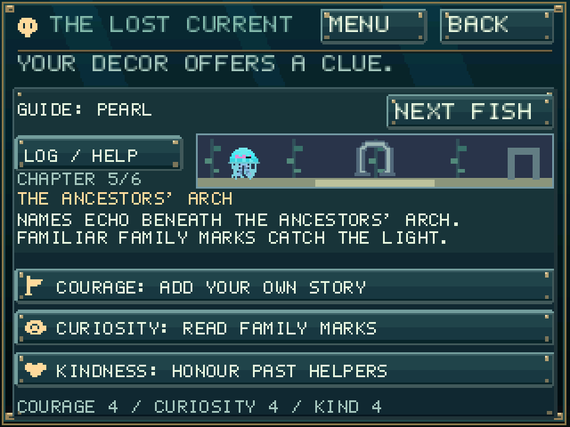 | 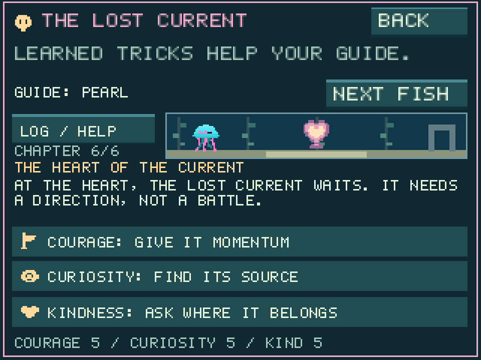 |

Adventures show destination cards, route arches or bubbles, and a fish portrait
before departure or while away. Keepsakes use colored art when found and muted
silhouettes when not found. Fish Life, Family, Genes and life firsts retain their
information while adding real portraits and visual landmarks.

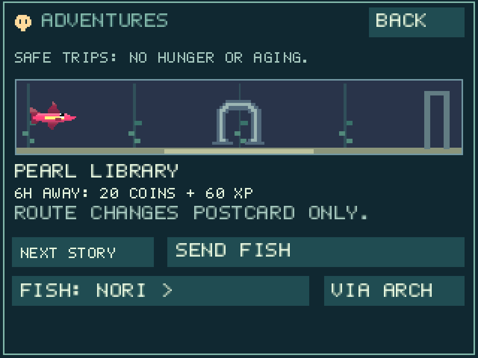
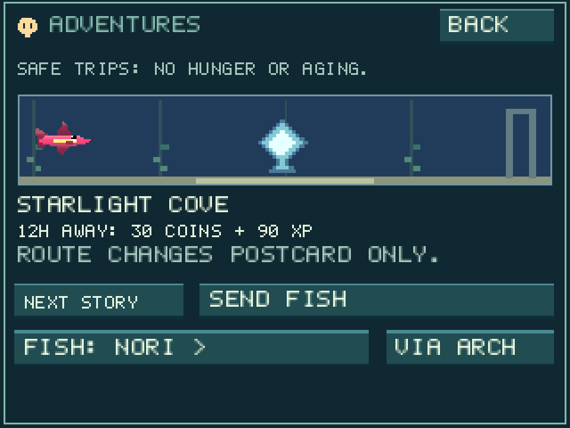

Home and its submenus use illustrated navigation cards. Every game has its own
small thumbnail, reused in its help and records pages; Journal goals use
objective icons, progress bars and a reserved claim area. Visitor Log reuses
the actual visitor designs, and Object Stories shows the corresponding shop art.

| Home | Games | Illustrated rules |
| --- | --- | --- |
|  | 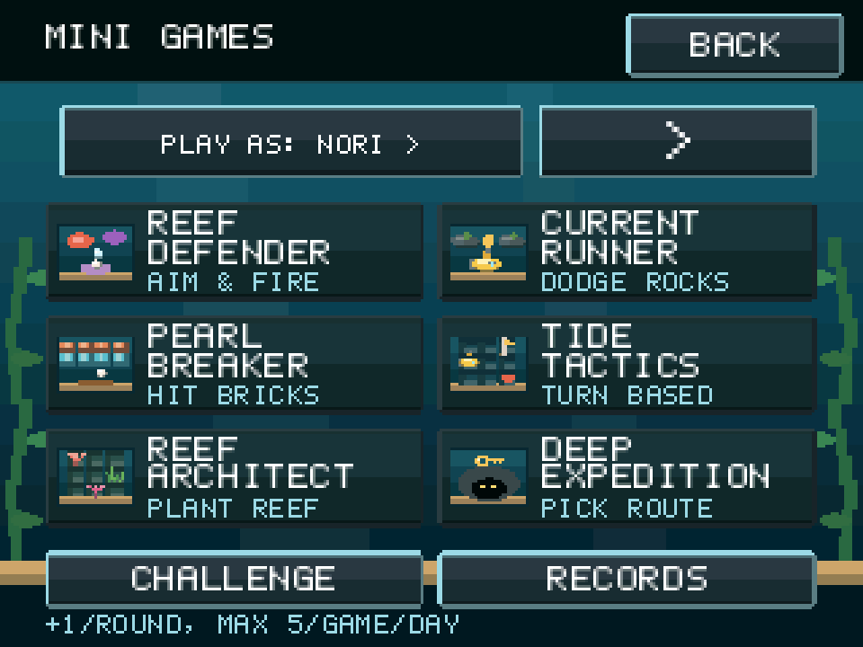 | 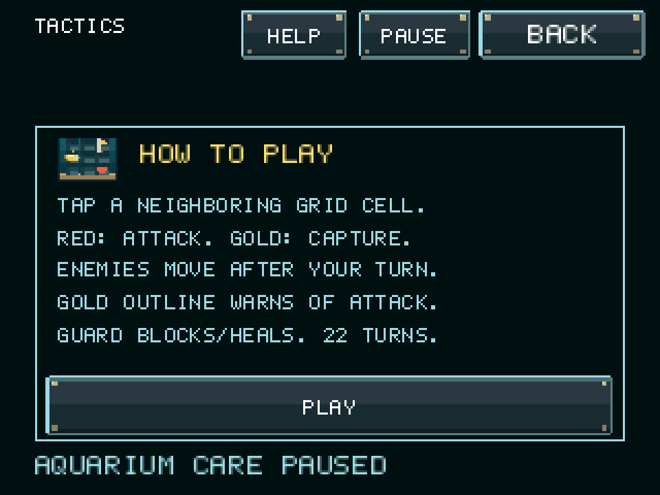 |

Artwork is embedded, static, and shared: no new SD asset pack or PSRAM is needed.
The artwork itself adds no save fields or background simulation. The later
game-mode/records expansion uses extended save storage rather than growing
the already-full NVS blob.

### Source menu expansion, eighteen games and first-run modes

The source now separates Goals, Album and Themes; **Tank > Themes** is the
backdrop picker, and **Tank > Aquariums > Tank Identity** holds subtitles,
emblems and seasons. Fish Life, Family, Genes, Life Firsts and Keepsakes each
have an independent Fish menu entry, with a second page rather than cross-tabs.
**Adventures** is a hub with **Stories** and **The Lost Current**.
Discoveries no longer duplicates Display Rewards.

**Games page 3** adds six games: Lighthouse (cross-toggle logic),
Shell Slide (sliding puzzle), Sonar Sweep (row/column clues), Tide 2048
(merging tiles), Harbor Stack (timed stacking), and Echo Reef (sequence memory).
All have help, pause, replay, saved records and medals. Version 2.3.0
allows five bonus dollars per game per day in Normal/Hard, with no XP and
save-failure rollback (2.2.7 and earlier had five total).


On **first run**, choose **Normal**, **Creative**, or **Hard**. That mode applies
to every aquarium and cannot be switched in Settings. Changing mode requires
a confirmed full wipe of fish, money, progression, records and the aquarium
collection. Existing saves migrate into Normal without losing progress.

The tank selector is only for multiple aquarium layouts: money, XP, goals,
discoveries, unlocks, campaign progress and records follow every tank. Residents
and placements stay local; Bank fish move with their genes, families and bonds.

**Creative** makes all themes, looks, wearables, frames, tricks and shop choices
available without payment. Add fish using the Creative control in Aquariums;
keep at most five active fish, including travelers, and two residents after
confirmed removal. It does not award spendable coins or progression XP.
**Normal** retains progression without deaths. **Hard** disables Comfort Assist:
six hours of severe starvation while running can be fatal, with an hour's
warning, but there are no offline or old-age deaths. Auto Feed starts off;
Comfort Assist cannot be enabled. Home offers a free rescue pair after
extinction, preserving money and progression, even with a traveler away.
JSON restores cannot bypass the fixed game-mode boundary.

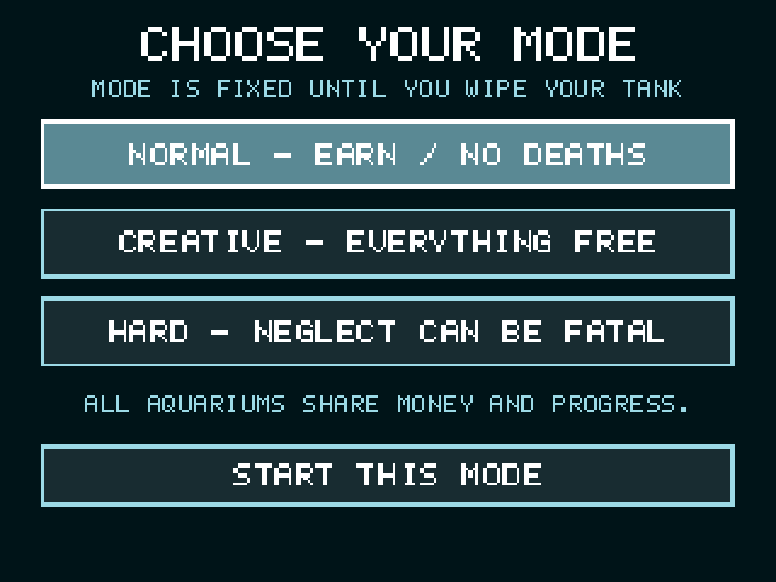

| Hard warns before starvation becomes fatal | Extinction does not end your progression |
|---|---|
| 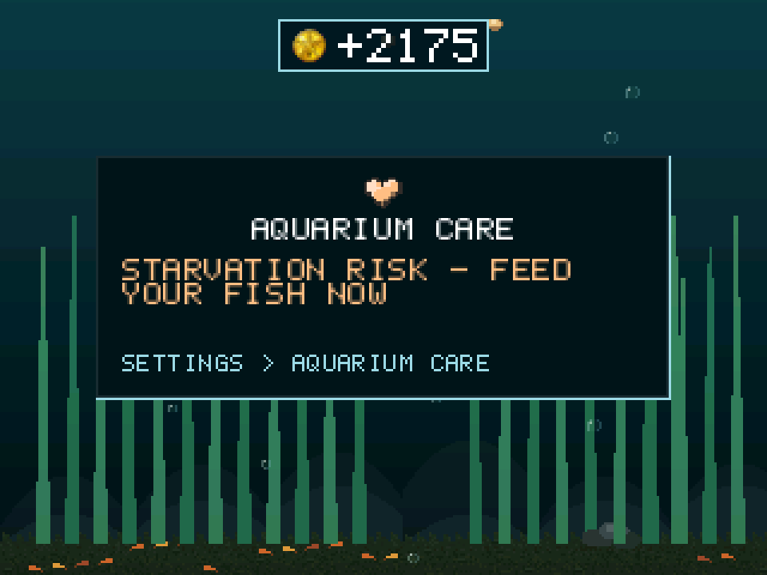 | 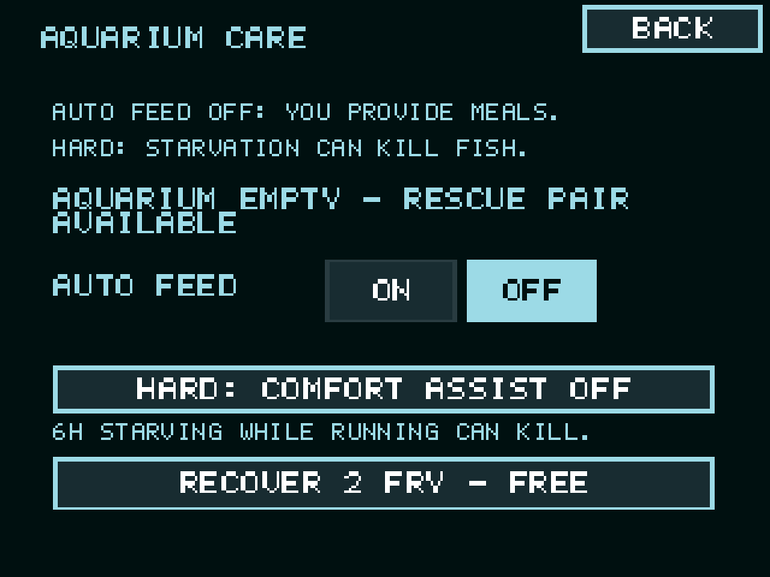 |

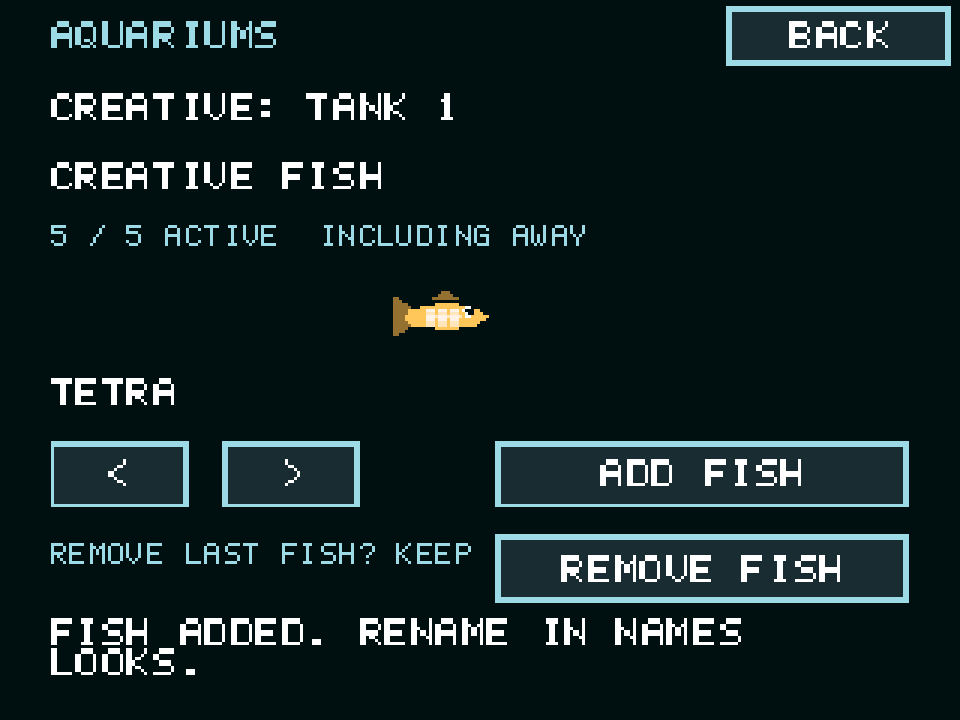
The story artwork adds no new quest obligations; game modes are separately
chosen at first run.
These are independently versioned CYD-only releases, not upstream multi-board releases.
Read the included `INSTALL.txt` and check `SHA256SUMS.txt`.
For ELEGOO use `elegoo-INSTALL.txt` and `elegoo-SHA256SUMS.txt` instead.

**New-board browser flashing:** the
[USB web installer](https://jeromedontdev.github.io/pocket-tank-cyd/flash.html) works in
desktop Chrome or Edge with a USB data cable. Choose **save-preserving USB update** for
an existing CYD installation: the updater validates the live board and active OTA
slot, then writes only the application. The **factory installer** remains separate and
overwrites saved tanks, Wi-Fi, calibration and collection identity.
Back up first; SD updates remain available.

From 2.3.2, **Check GitHub via Wi-Fi** on the Firmware Updates page offers newer
stable CYD releases after saving the aquarium. SD and USB remain available
when Wi-Fi is unavailable. Standard releases are not publisher-signed.

- **Already using this CYD fork:** back up your active aquarium, power off
  before moving SD, copy `update.ptu` to `pocket-tank/update.ptu`, then install
  through Settings > Device > Firmware Updates > Check SD Card. No SD artwork is required.
  ELEGOO uses `elegoo-update.ptu`, renamed to `pocket-tank/update.ptu` on the card.
- **New board:** use the factory image at `0x0`; all artwork is embedded in firmware.
  **Factory flashing overwrites saved tanks, Wi-Fi credentials, calibration
  and collection identity. Never use it for a normal upgrade.**
- **Advanced USB upgrades:** the application-only image belongs in the detected
  active OTA slot, not blindly at a fixed address.

Packages are verified but unsigned; only install trusted files. See
[installation and release details](../firmware/CYD.md#downloadable-releases).

## Small behaviors, useful inspection

Calm fish get acquainted while swimming near one another. After about half a
minute together, a fish can favor a familiar swim buddy. Short paired swims keep
a steady trailing lane, then take a break; hunger, stress and rest still come
first. Familiar buddies now survive restarting, Bank moves and adventures.
Friendships use stable per-fish identities, not shared names or appearances. Favorite
decoration choices are stable for a fish's original identity, not changed by
renaming or recoloring it. They guide resting and inspecting the reef.
**Home > Fish > Fish Life** names the current buddy and favorite spot.

Tap any helper creature for a card that retains its lifetime progress while
explaining food and activity. Shrimp show both their actual school population
and the representatives currently drawn. **COLORS** jumps straight to the
selected creature's free color preview; SAVE is still required.

| Snail and algae care | Representative shrimp school |
|---|---|
|  |  |

| Grass-trimming urchin | Trust-sharing seahorse |
|---|---|
|  |  |

Decoration placement is now a reversible **PREVIEW**. Drag, select depth,
change stacking or preview coral colors; **DONE** saves the layout, and
**CANCEL** restores it. A failed save keeps the preview open for retry.
Autosaves and JSON backups do not accidentally commit a draft. Cancelling
placement after a purchase keeps the owned item at its original default spot;
it does not undo the purchase.

The aquarium picker offers a **SUMMARY** for the active tank and a summary
before switching to any other tank: fish, away traveler, Bank, actual shrimp,
other helpers, stat upgrades, theme and last visit. Inactive tanks remain paused.
Last visit needs a synchronized clock; otherwise it is explicitly unknown.


Deep Glow occasionally gains a distant silhouette, Moonlit a short shooting
star, and owned treasure chests/crystals a brief glint. Effects use 4 Hz pose
steps and bounded old/new dirty regions, never a new full-screen background
animation. The opaque clock still occludes aquarium drawing.

### Quiet depth (new in 1.2)

Fish stories and tank records have separate homes:

- **Fish > Fish Life:** an individual biography, recorded arrival in powered tank hours,
  life firsts, current needs/activity, remembered buddy and favorite spot.
  Close companions have spent at least ten calm nearby minutes together.
  Older fish keep their existing milestones; their original arrival date
  is explicitly unknown rather than invented.
- **Tank > Tank Recap:** the eight latest real observations, newest first, with an older
  page and a quiet helper-contribution report. There are no interrupting
  recap pop-ups, offline stories, streaks or missed-day penalties.
- **Tank > Aquariums > Tank Identity:** optional preset subtitles and visible emblem badges, founding date when
  known, last verified SD backup and total unknown-visitor sightings.
  Subtitles/emblems also appear in the aquarium picker/summary.
- **Collections > Object Stories:** shop descriptions, ownership/source, recorded acquisition
  hour where available, and a fish that favors that placeable decoration.

Life firsts and adventure keepsakes have their own detail pages. The lantern
shell, pearl bookmark and star stone include short descriptions; newly
completed adventures attach them to the actual returning fish. Existing
postcards remain in Adventures, but older rewards are not retroactively
attributed to an unknown fish. Tap any name in **Discoveries** for a gentle
hint about the missing discovery.

A small unknown drifter may cross the upper reef for 24 seconds. The first
window is **6-12 hours of lit, uncovered aquarium simulation**, with later
windows 8-24 hours apart. Menus, darkness, power-off and inactive tanks do
not advance this counter; the board cannot detect whether someone is
physically watching. Sightings persist even if you miss the encounter.
The visitor is harmless: no feeding, care meter, reward or population slot.
Its small silhouette changes only once per second and uses local dirty
regions, including the existing opaque-clock occlusion handling.

Six new **fixed sand scenery** choices are available in the Shop: Sea Glass
(50), Brain Coral (110), Tiki Statue (130), Bottle Note (70), Anemone (90)
and Old Teapot (80 sand dollars). They use the cached backdrop, do not add
placement slots, and have no continuous animation. Static scenery can still
cost drawing time when the cache is rebuilt; this is not a promise that all
decorations are literally free.

SD restore confirmation previews the source tank name and firmware version.
Successful verified backups record their date; clockless backups explicitly
show an unknown date. Old backups have no source name and are labeled as
older backups. Backup scope remains **active aquarium + shared wallet**,
including its Bank and traveler, not all purchased SD tanks.

| Individual fish life | Quiet recent observations |
|---|---|
|  |  |

| Tank identity | New fixed scenery |
|---|---|
|  |  |

The visitor capture uses an accelerated demonstration schedule, not a changed
hardware encounter rate:


### Family, genes and visitors (new in 1.3)

Every fish now carries genes. Besides the marking and body color you see,
each fish holds a **hidden second marking and body color**, plus four
recessive cosmetic traits: **Shimmer** (a moving sheen), **Painted Fins**
(fins in the marking color), **Pale Belly** and **Gold Eye**. A trait only
shows when a fish inherits it from both parents; one copy is carried silently.
Bred fry take one allele from each parent, so a hidden look can resurface
generations later. About one birth in fourteen brings a brand-new marking, and
about one in twelve a new trait allele; the Family Tree marks these as
**MUTANT!** Existing fish receive randomly seeded hidden genes on upgrade.

Five new markings join Stripes, Spots, Band and Plain: **Saddle, Tiger,
Speckle, Fade and Mask**. They can appear through breeding or be chosen in
**CUSTOMIZE**, and work on every creature look, including jellyfish.

Open **Home > Fish > Family** for a fish's generation,
parents, grandparents, children, siblings and births in this tank. The separate
**Fish > page 2 > Genes** shows visible traits and hidden inherited genes. Up to twelve departed ancestors keep their names, so a
parent who has gone is still remembered. **NEXT FISH** walks the family.

The rare-visitor encounter now chooses among five harmless species: the
Drifter, Old Turtle, Ghost Fish, Night Manta and very rare Lantern Squid.
**Collections > Visitor Log** opens sighting counts and the
powered hour each was first seen; unseen visitors stay as **???**.

With a synchronized clock, the sand follows the seasons: spring sprigs,
summer shells and starfish, autumn leaves and a winter snow dusting, plus
holiday lights from December 15 to January 1. Choose **SEASONS: NORTH**,
**SOUTH** or **OFF** in **Tank > Aquariums > Tank Identity**. Seasonal scenery is drawn into the
cached backdrop, so it does not add continuous animation.

| Family tree | Fish genes |
|---|---|
|  | 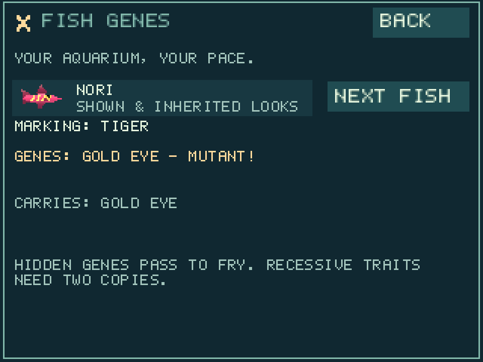 |

| Visitor log | Redesigned Night Manta |
|---|---|
|  | 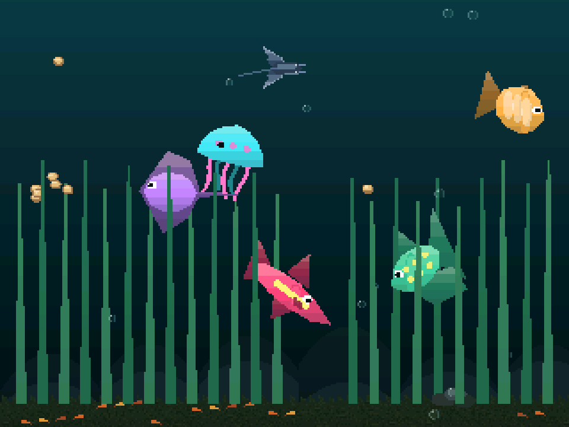 |

The [save viewer](https://jeromedontdev.github.io/pocket-tank-cyd/viewer.html)
opens any schema 9 or newer JSON backup in the browser, without uploading it,
and draws each fish card with its family, genes and visitor history.

### Room light, back LED and photos (new in 1.3)

The CYD's light sensor beside the screen and RGB LED on the back are now used.
In **Settings > Display**:

- **ROOM LIGHT: DIM** scales both the screen and automatic back LED down
  aggressively as the room darkens: approximately 27% at 50% room light,
  8% at 25%, and 2% in darkness. Screen output multiplies your chosen brightness
  with a 1% floor before night dimming; the LED may become fully dark.
  **DIM+NIGHT** also switches the tank to night after
  30 seconds of sustained darkness and back after 5 seconds of filtered light.
  **OFF** ignores it for both screen and LED. An eight-second filter softens brief shadows, and a
  conservative low-end calibration avoids overreacting to very bright-room readings.
  The sensor learns your lit room automatically.
- **BACK LED: GLOW** breathes softly in the water's color, dimmer at night.
  **ALERTS** adds an orange pulse when a fish is hungry and a pale flicker
  while a visitor passes. **OFF** keeps it dark.

**Settings > SD Backups > DAILY** makes one verified automatic backup per day
(`pocket-tank/auto-NNNN.json`, the newest seven are kept) once the clock is
set. **Settings > Device > SCREENSHOT TO SD** saves a BMP screenshot of the
aquarium. Versions 2.3.4 and older also had **PHOTO TO SD** under **SD Backups**;
2.3.5 removes that duplicate. Screenshots save to
`pocket-tank/photos/`.

## Mini-games: play with your fish, not their care stats

Open **Home > Games** for three pages of six games. The first page holds
**Bubble Pop, Pearl Match, Fish Slalom, Treasure Cast, Feed Frenzy and Reef Puzzle**.
The second page adds **Reef Defender, Current Runner, Pearl Breaker, Tide Tactics,
Reef Architect and Deep Expedition**. Tap PLAY AS to choose an active
fish's appearance. Your actual fish are never put at risk or fed by a game.
Aquarium care pauses while the games menu, round or result is open.

Page two adds longer-form play: five-wave aimed defense, an 18-gate runner,
a multi-hit brick board with three balls, a 22-turn flag-capture tactics grid,
a coral/grass placement puzzle, and an eight-depth expedition with oxygen,
health, food, keys, and a safe return decision. Each has an opening rules screen,
HELP, PAUSE, replay, and its own saved challenge records and medals.


| Turn-based tactics | Resource-managed exploration |
|---|---|
| 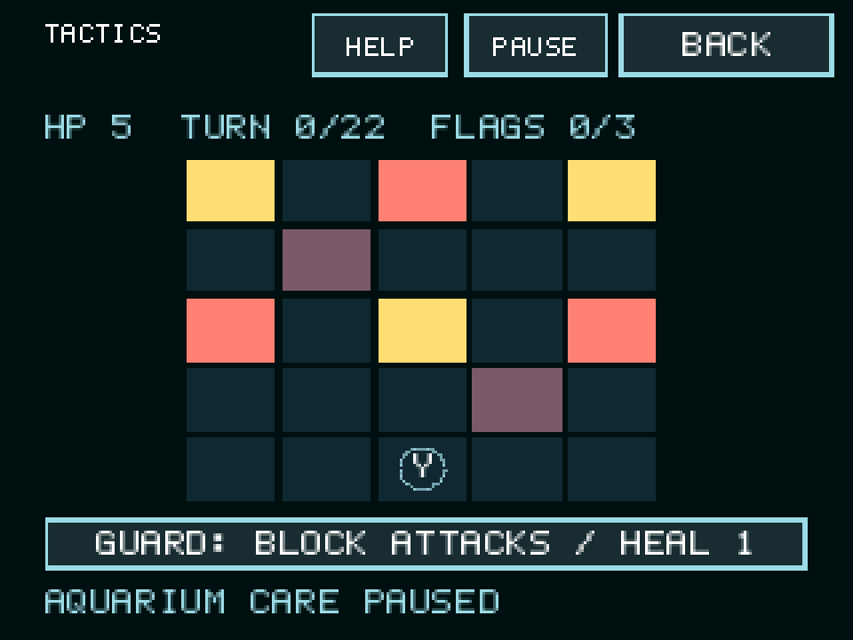 | 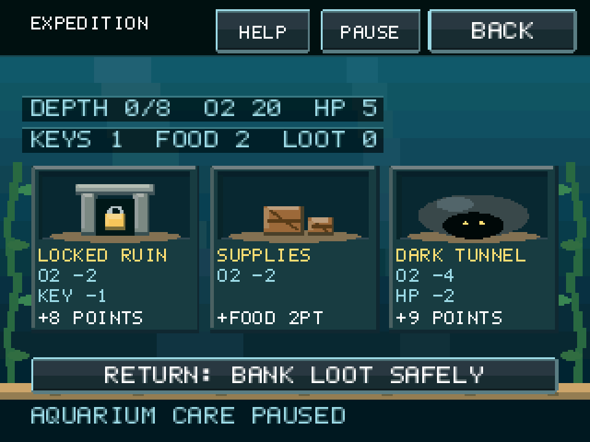 |

| Aim through five waves | Pick the safe current |
|---|---|
| 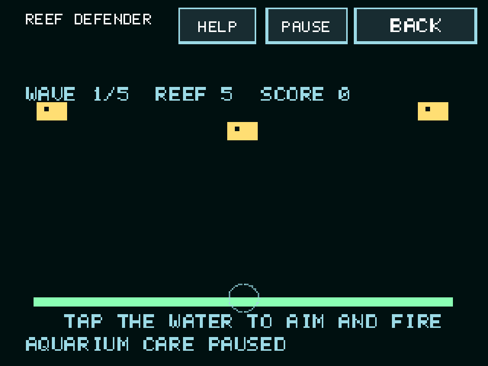 | 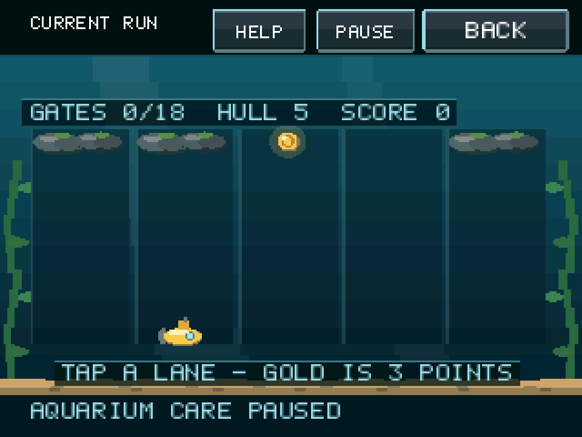 |

| Clear the brick board | Build a balanced habitat |
|---|---|
| 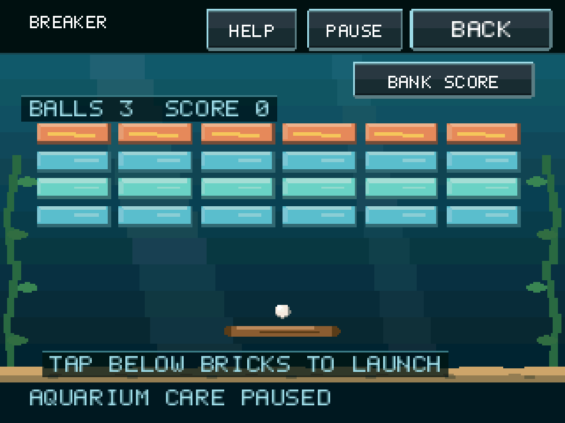 | 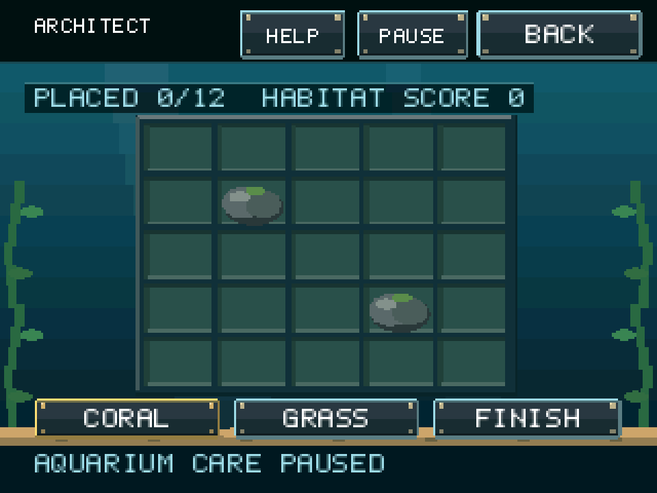 |

| Pick a game | Swim through the open gates |
|---|---|
|  |  |

| Pop bubbles | Remember pearl pairs |
|---|---|
|  |  |

| Time your cast | Match a fish's snack |
|---|---|
|  |  |


| Save the daily bonus | Saved once, ready to replay |
|---|---|
|  |  |

Qualifying rounds award **1 sand dollar**, with a shared **5-dollar daily limit**
across all eighteen games and both paces. Games give **no Journal XP** and are
never required for care progression. Further Challenge rounds still save
records/medals. Tap SAVE RESULT; failed saves can be retried without losing
or duplicating rewards. BACK/replay asks for a second tap before discarding
an unclaimed prize. Sessions and unclaimed prizes are not saved across reboot.
See the [complete rules and reward table](../README.md#mini-games).

Use **CHALLENGE / RELAXED** to choose the pace. Relaxed Bubble Pop and Feed
Frenzy continue until you tap FINISH; Slalom and Treasure Cast move more
slowly. Relaxed rewards retain the usual cap, but records/medals belong to
challenge mode. **RECORDS** shows your claimed personal bests and the permanent
gold challenge for each game. There are no daily streaks or expiring challenges.

The Journal's Kelp Forest, Coral Reef and Deep Glow backdrops now use stronger
green/blue/midnight palettes, leafy kelp, branching coral and luminous jellyfish.
Their existing unlock levels (3/6/10) and IDs are unchanged. Original stays
unchanged, and purchased decorations and fish remain in front of the scenery.

### Four more backdrops to earn

**Tank > Themes** has two pages; use its `<` / `>` arrows.
Sunken Ruins unlocks at Keeper 5, Sunset Lagoon at 8, Ice Cavern at 12,
and Moonlit Reef at 15. This brings the selection to eight including Original.

| Sunken Ruins | Sunset Lagoon |
|---|---|
|  |  |

| Ice Cavern | Moonlit Reef |
|---|---|
|  |  |


### Fish appearances are progression rewards too

New tanks start with Classic fish. Keeper levels unlock Guppy (2), Tetra (3),
Clownfish (4), Angel (6), Betta (8), Puffer (10), Shark (12), Stingray (14) and
Jellyfish (15). The Album lists required levels; customization cycles only
available varieties, and shop fry offers use the same unlock rules.
All colors/patterns remain available. Existing active/banked fish and looks
already recorded in the Journal stay unlocked, so upgrading never takes away
a favorite. These unlocks and Journal XP follow all aquariums.


## Your aquarium as a desk companion

### The Lost Current: your aquarium's optional story

**Home > Adventures > The Lost Current** opens a six-chapter turn-based RPG.
Your real fish lend their names, appearances, family history, and learned
tricks to the story without leaving the tank or changing their care statistics.
Choose a guide, read an encounter, and choose a courageous, curious, or kind
approach. Each action saves; BACK leaves safely whenever you want.

The chapters follow **The Whispering Shell**, **The Kelp Crossing**,
**The Glass Garden**, **The Lantern Shoal**, **The Ancestors' Arch**, and
**The Heart of the Current**. Eighteen encounters build courage, curiosity,
and kindness; your resolutions lead toward journeys, wonders, or welcome.
Progression awards story memories and a map keepsake, not currency or care
bonuses. Display Rewards' existing **Trophies** switch also controls that map.

The campaign journal records the fish who completed each chapter and the path
they chose. Family connections let a later generation continue an ancestor's
work. Genetics, bonds, visitors, decorations, appearance settings, and existing
expeditions supply context or alternative solutions, not mandatory purchases
or reasons to alter your tank setup.
Use **LOG / HELP** for the [chapter journal](media/cyd-features/rpg-journal.png)
and [in-game instructions](media/cyd-features/rpg-help.png).

This is an optional addition: no deadlines, forced quests, entry fees,
permanent harm, or missed-day penalties. Skills are shared campaign progress,
not care multipliers. Story rewards and progress save together, and failed
saves change neither. The RPG adds no background work to aquarium simulation;
the existing care, games, visitors, clock, and timed expeditions remain usable.

| A fish guides each encounter | Saved choices have safe consequences |
|---|---|
|  | 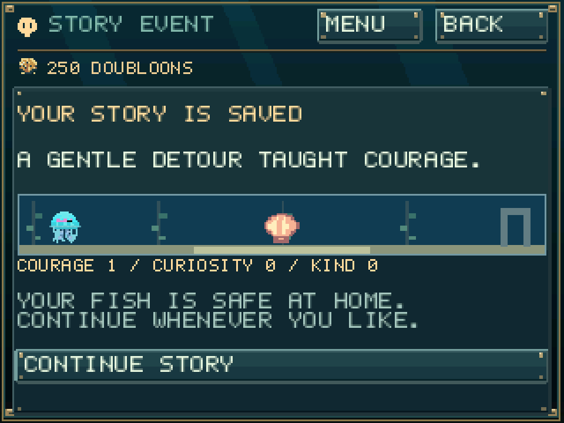 |

| A shared chapter journal | Fish biographies remember guides |
|---|---|
| 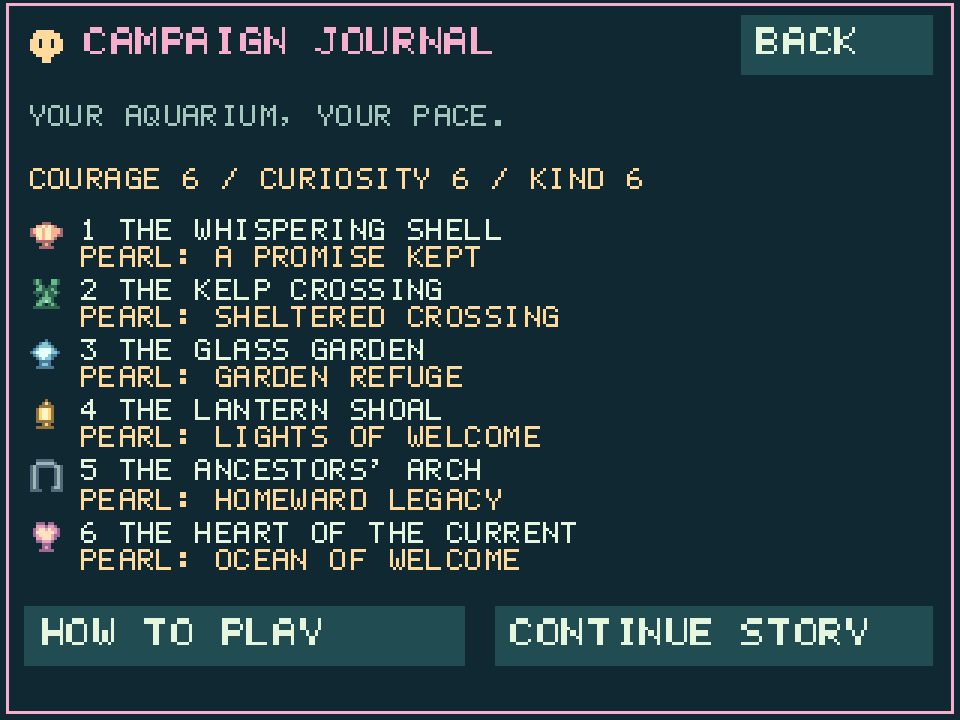 | 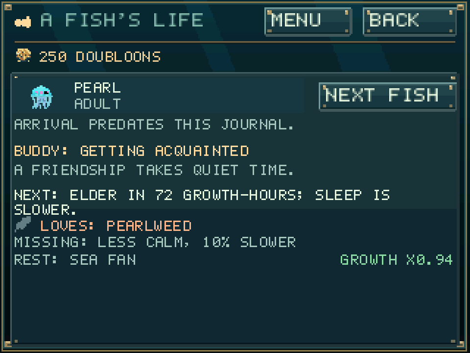 |

| Also fits Enlarged display mode | An ending shaped by your choices |
|---|---|
| 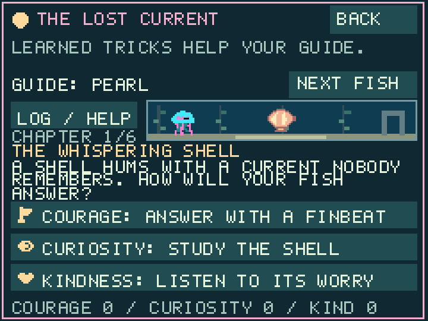 | 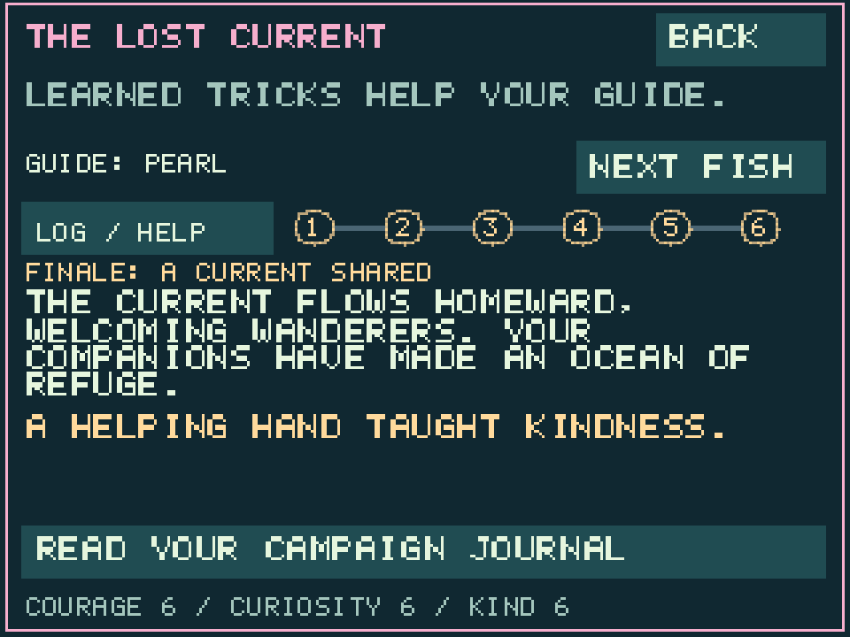 |

Tap a fish, then its card's **MENU** button to open **Home**.
Features are organized by purpose:

| Home category | Inside |
|---|---|
| **Fish** | Say Hello, Fish Bank, Wardrobe, Names & Looks, Fish Life, Family; page 2: Genes, Life Firsts, Keepsakes |
| **Tank** | Shop & Decor, Aquariums (layouts, names, identity; free fish editor in Creative), Sand & Water, Creature Colors, Themes, Tank Recap |
| **Adventures** | Stories (timed trips/postcards), The Lost Current (optional RPG) |
| **Collections** | Goals, Discoveries, Display Rewards, Visitor Log, Album, Object Stories |
| **Games** | Eighteen games on three pages, records/medals, relaxed play, rewards in Normal/Hard |
| **Settings** | Display, Clock/Weather, Wi-Fi/Sync, SD Backups, Aquarium Care, Device |

**BACK** returns to the category used to enter a feature; **BACK** on Home
returns to the aquarium. Appearance is no longer nested under fish quests.
Weather belongs to **Settings > CLOCK/WEATHER > WEATHER**.
**Fish > Say Hello** offers permanent fish bonds, greetings and learned tricks.
**Settings > Aquarium Care** holds automatic feeding and **Comfort Assist**.
Comfort Assist caps hunger/stress and keeps energy up;
it does not fabricate feeding, cleaning or training achievements. Existing tanks
retain their previous care setting.
**Settings > Clock/Weather > Text / Effects > Sparkles** adds eight brighter cyan/gold
drifting stars beside the clock, independently of captions. Stars do not cover the
clock face or weather panel and have no effect on fish care.

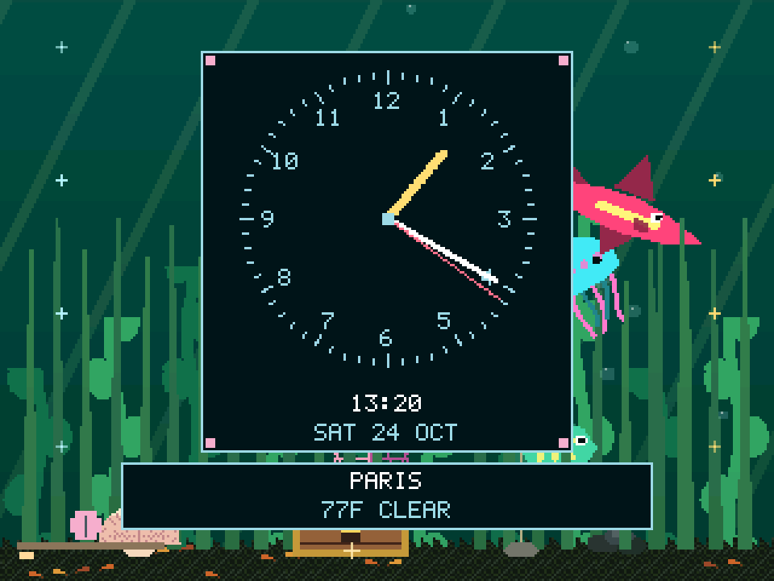

**Settings > Clock/Weather > Text / Effects > Event Captions** enables useful clock messages: adventures,
ready postcards, visitors, hunger or stress. Calm swimming produces no filler
caption. Messages and weather wrap to fit rather than being cut off with ellipses.
Wi-Fi/Sync uses a memory-safe restart, keeps the backlight dark until its first
painted frame, and returns to **Settings** after the clock-sync step.

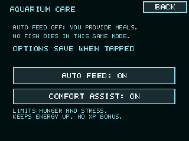

**Fish Life** has a single entry under **Fish**, separate from **Say Hello**.
**Names & Looks** has one **BACK** button, without a duplicate Home shortcut.
**Collections > Visitor Log** is a dedicated visitor screen; tank recaps and
object histories have their own **Collections > Object Stories** entry.
Display Rewards uses a fixed-size Frame label, so cycling frames changes border
colors without resizing the option's lettering.

| Desk companion hub | Care and permanent fish bonds |
|---|---|
|  |  |

SAY HELLO earns 5 bond every 30 powered-on seconds; DART unlocks at 10,
BUBBLES at 25, FOLLOW at 50. Bonds never fade and travel with banked fish.
Bond is friendship (0–100); trust is care confidence (0–10), not the same
stat. **HOW BONDS WORK** explains both and each trick. Tricks request a
playful dart, a bubble visit or following a tankmate; close CARE to watch.
Confident, energetic fish can also choose dart play on their own; learning a
trick does not permanently enable a speed boost. Playful darts are now gentler
(42–58 internal pixels/second before urgency/vegetation adjustments), rather
than the old 65–95. A requested dart chooses a fresh destination immediately.
Startle reactions and hungry-food pursuit retain their separate behavior.

**Home > Fish > Wardrobe** opens the fish wardrobe. This is the single wardrobe entry point.
Use the arrows to preview an accessory, **NEXT FISH** to choose its owner,
and **BUY + EQUIP** to purchase it with sand dollars.

| Accessory | Journal level | Sand dollars |
|---|---:|---:|
| Party hat | 2 | 20 |
| Bandana | 2 | 20 |
| Top hat | 3 | 45 |
| Bowtie | 4 | 30 |
| Tie | 5 | 35 |
| Crown | 10 | 100 |
| Sailor Cap | 3 | 40 |
| Pirate Hat | 6 | 65 |
| Beret | 2 | 30 |
| Sun Hat | 4 | 45 |
| Viking Helm | 8 | 80 |
| Scarf | 2 | 25 |

Each fish owns its purchases: one accessory equipped at a time, with free
re-equipping and **REMOVE** (which keeps ownership). Previews are free and
do not change the tank. Wearables are cosmetic only, with no XP or stat
bonus, and follow the fish through the Bank, adventures and backups.
Postcards retain the traveler's departure accessory; newborns start bare.
Headwear follows each variety's forehead; gill accessories follow its body depth.
The fit scales through fry, juvenile, adult and elder stages. Jellyfish support
the hats/crowns, tie, bowtie and bandana. Only the wraparound scarf does not fit:
it shows **UNAVAILABLE**, cannot be bought/equipped, and is omitted from all
portraits and swimming views even if an older save equipped it. Previously
owned items and saved colors remain intact; **REMOVE** still works.
The six added designs are still cosmetic polygon art, not independent animated entities.
**Wardrobe > COLORS** gives the selected fish independent primary and detail
colors for its wearables. Each fish keeps one color pair across its wardrobe,
including Bank transfers and adventures; the postcard preserves departure colors.
Colors are free, including before buying an accessory.

**Home > Tank > Creature Colors** opens color settings for the
shrimp colony, snail, urchin and seahorse. **NEXT TYPE** cycles between them.
All shrimp share one color pair; each other creature has its own pair per tank.
Primary colors affect bodies/shells; detail colors affect legs, soft bodies,
spine tips or fins. Eye colors and procedural shading remain intact.

Both editors provide **Natural + 15 colors** for each channel, a live portrait,
and **SAVE COLORS**. Browsing does not change the tank or spend coins.
**NATURAL** previews original colors; tap SAVE to restore them permanently.
Changing colors does not purchase creatures or accessories or grant XP.
Whole-tank, resolution-style scaling is deferred to the next update.


| Creature primary/detail colors | Wearable primary/detail colors |
|---|---|
|  |  |

| Bond, trust and trick help | Explicit frame unlock guidance |
|---|---|
|  |  |

**Collections > Discoveries** automatically records aquarium activities and saves the discoveries
until you decide to browse them.
Each row opens a hint; a plus marks a discovery already found.
**Collections > Display Rewards** shows each set's progress and a **CLAIM**
button when complete. Claiming unlocks a cosmetic menu frame; **FRAME**
cycles only unlocked frames, with **ORIGINAL** meaning the unadorned border.
**TROPHIES: SHOW/HIDE** controls earned shells and game markers on the tank's
sand. These are cosmetic, not storage shelves or care bonuses.

| Discovery Album | Permanent collection cosmetics |
|---|---|
|  |  |

**Home > Adventures** offers three safe adventures: Lantern Lagoon (**2 hours**),
Pearl Library (**6 hours**), and Starlight Cove (**12 hours**).
Pick a fish and ARCH/BUBBLES postcard scenery (same rewards), then
**SEND FISH > CONFIRM SEND**. The real fish leaves until its automatic return,
with no hunger, aging, injury, failure or expiry. Its tank slot stays reserved.
Each destination has one permanent postcard and one claim: 10/20/30 coins
plus 30/60/90 Journal XP. Timers include unplugged time when a synced clock
is available; otherwise powered-on time advances them. Rewards wait without
a deadline after the fish is home.

| Choose a destination and route | A completed adventure waits for you |
|---|---|
|  |  |

| Earned aquarium trophies | Collection ornament and activity caption |
|---|---|
|  |  |

Under **Settings > CLOCK/WEATHER > WEATHER**, search for a city, select the correct result and
choose F/C. Only your city query/selected coordinates go to Open-Meteo over
HTTPS; nothing infers your location. Saved Wi-Fi is required, and unavailable,
offline or stale readings are identified rather than replaced with fake data.
Weather settings are device-wide, separate from aquarium backups.
When enabled with a saved city, weather checks **at boot and once per hour**,
with a stale warning after **two hours** or a failed check.
Wi-Fi sleeps between refreshes and reconnects when needed;
the last reading stays visible without a false offline warning during sleep.
City searches also temporarily wake Wi-Fi. Failed updates retain the reading
with a stale/offline warning and wait one hour before the next automatic attempt.
An automatic attempt that cannot connect relinquishes its lease after 30 seconds.
Explicit city searches and setting changes can request an immediate update.
The city and conditions now use a bordered, larger-text clock
area rather than a tiny aquarium caption.
The clock's **SIZE** control scales its face. Captions keep a readable native
font and a minimum panel width at every size, wrapping long city names and events.

**Postcards** are saved adventure souvenirs, not photos or messages. Returning fish
leave a destination's find and ARCH/BUBBLES scenery recorded in Adventures. Claiming
the postcard pays that destination's one-time coins and XP; completing the three
stories also progresses the Story collection. There is no deadline to claim.

**Frames** are cosmetic collection rewards, not picture holders. Complete and
claim Nature, Friend or Story in Display Rewards to unlock its frame. **FRAME >** cycles
Original and unlocked styles, changing the companion page/portrait border
colors and adding matching clock-corner accents. They do not boost fish stats
or rewards. **TROPHIES: SHOW/HIDE** separately controls earned sand ornaments.

**Settings > Display > BRIGHTNESS** is a draggable percentage slider, from 10% to 100%.

| Optional city-configured weather | Bordered clock weather |
|---|---|
|  |  |

See [complete companion, quest and weather details](../README.md#desk-companion-discoveries-and-safe-adventures).
Schema 7 backups include the traveling fish and companion progress. Earlier backups still import;
do not downgrade after using the new progression.

## 1. Keep favorites in the Fish Bank

The active aquarium still holds **five fish**. The new bank adds **20
shared storage slots**, so making room no longer has to mean selling a
favorite. The same Bank is available in every aquarium: **store in one tank,
switch tanks, then return or swap the fish into another**.

Open **Home > Fish > Fish Bank**:

1. Choose **IN TANK**, select a fish and confirm **STORE**.
2. Choose **STORED > CHOOSE** to inspect a saved fish.
3. Use **RETURN** when the tank has room.
4. If the tank is full, choose **SWAP**, select the active fish to trade
   places with it, then confirm.

| Browse stored fish | Inspect a favorite |
|---|---|
|  |  |

| Choose the outgoing fish | Confirm before moving either fish |
|---|---|
|  |  |

### What storage preserves

Names, body and marking colors, variety, pattern, stage, age, personality,
trust, bonds, family links, genes, care state, food counts and milestone reward records travel with the
fish. Stored fish **do not age, grow, eat or need attention**, and do not
earn care rewards while stored.

Storage is free. At least **two fish must stay active**, but swaps still
work at that minimum, at the five-fish tank limit, or with all 20 bank
slots occupied. Finish naming a new fry before moving fish.

Every move saves immediately. If saving fails, neither fish is moved.
Swimming positions and current goals restart on return. Parent links that
refer to a departing active slot are cleared, rather than accidentally
pointing at its replacement.


The bank is included in internal saves and SD backups. Removing the card
does not remove stored fish. Restoring an older, pre-bank backup restores
an empty bank; **Wipe clears the bank along with the aquarium**.

## Additional aquariums: room for another little ocean

Open **Home > Tank > Aquariums**. Each additional aquarium costs
**500 sand dollars from your shared wallet**. The original is free,
with up to **eight total**. Confirming a purchase enters a fresh tank with
two fry and the normal welcome, naming and customization setup.

| Buy another aquarium | Confirm its price |
|---|---|
|  |  |

**Money and progression follow all tanks:** XP, objectives, discoveries, unlocked
shop choices, upgrades, campaign progress, records and the **global 20-slot
Fish Bank**. Each tank has its **own residents, decoration placement, layout
and palette selection**. Family links and bonds follow fish moved through
the Bank. Tanks expand the same profile rather than starting separate games.
Game mode applies to the whole collection, not one tank.
Switching among owned tanks is free. **NAME TANK** edits the active tank's
name, up to 15 characters: select a letter, use `<` / `>` and SAVE. BACK cancels.
Names persist across switches and restarts.

| Name your active tank | Keep your tanks recognizable |
|---|---|
|  |  |
Inactive tanks are fully paused: no aging, hunger, growth or rewards
while you play another aquarium. Finish naming any new fry before leaving.
Existing per-tank Banks merge on the first visit to each old aquarium.
If there is not enough room in the shared 20 slots, the switch asks you to
make room first, leaving the live tank and all stored fish unchanged.

| A fresh start, without wiping the first tank | Return whenever you like |
|---|---|
|  |  |

**From 2.3.4:** buying and switching
no longer require a card. All eight aquarium slots fit in internal storage.
The active save retains two generations. An inactive archive replacement is
written and checksum/readback-verified before retiring its old generation;
the final active-save commit selects the incoming aquarium. A failed transaction
does not charge you or replace the live tank. Inactive archives retain one
verified generation between transactions, not two historical copies.

Boot once with the original SD inserted to import existing inactive tanks.
Imports leave SD originals untouched, but subsequent gameplay does not update
those old SD snapshots. Missing slots can retry on a later boot with the card;
an existing corrupt internal archive reports failure, never silently loads a
stale SD version. Backups, photos and offline update files stay on the card.

**JSON replaces the active aquarium and shared progression; Wipe resets the
whole profile and permits a new first-run mode choice.** Individual JSON backups do not
contain the entire collection, slot ownership or tank names; a JSON restore
keeps the current device's slot identity/name and replaces the active tank's
contents **and shared progression/wallet**. There is no one-click whole-collection
backup. For current per-tank contents, visit each aquarium and make an SD JSON
backup; old imported SD snapshots are not refreshed. Preserve a complete flash
recovery image when archiving collection identity/internal slots; individual
JSON files alone cannot recreate the collection after a factory erase.
Avoid downgrading to older firmware, which does not preserve the collection.

## 2. Make each fish your own

Open **Keeper > fish portrait > CUSTOMIZE** to edit an existing fish for
free. The adult preview makes the shape and markings easy to judge before
committing.


### Ten creature appearances

**Classic, Angel, Guppy, Tetra, Puffer, Shark, Jellyfish, Stingray,
Clownfish and Betta.**

These are more than palette swaps: sharks have pointed snouts, dorsal
fins and gills; jellyfish pulse and wave their tentacles; stingrays flap
their wings; bettas have flowing fins.
Swimming clearance projects each silhouette, growth size, pitch, animated
fins/tails and wearable above the highest sand edge. Dorsal fins no longer add
an unnecessary downward margin, and gentle upward steering begins only four
pixels before the safe limit. Sharks and jellyfish can approach the sand
without letting their bodies or tentacles sink into it; floor pellets remain
reachable.
Exploration uses the full width in both display modes, with body-size-based
side clearance rather than large empty margins within each third of the tank.
Fish approach destinations more closely before choosing another one. Grass
beds include their last safe frond position near the right glass; there is
still a small clearance for leaf sway rather than drawing past the screen.

Each appearance supports:

- **Nine markings:** Stripes, Spots, Band, Plain, Saddle, Tiger, Speckle, Fade and Mask.
- **24 body colors** and **24 marking colors**, chosen independently.
- Vivid pinks, reds, oranges, yellows, lime, cyan, electric blue, purple,
  magenta, pastels, white and dark slate.
- **DONE** to save, or **CANCEL** to discard the preview.

Fry offers show their appearance, and bred fry inherit appearance traits
from their parents. The varieties share the existing peaceful fish-care
system: sharks do not hunt tankmates, and jellyfish do not introduce a
separate species simulation. A jellyfish-looking fish uses a normal fish
slot; the decorative Jelly Lantern is a different shop item.

## 3. Give everyday care a sense of progression

Open **Home > Collections > Goals** or **Album** as separate entries.
Choose backdrops under **Home > Tank > Themes**.

### Keeper levels and objectives

There are **15 Keeper levels** and **15 one-time objectives**, with three
objectives active at a time. When a goal is ready, tap it to claim its XP
and sand-dollar reward; the next objective takes its place.


**Goals opens TODAY.** MILESTONES switches to the one-time objectives.
Daily care earns:

| Activity | Sand dollars | XP |
|---|---:|---:|
| One eaten player feeding | 25 | 12 |
| Say Hello or 60 seconds of calm holding near a fish | 25 | 13 |
| Clean a colony, trim a 10 cm counter step, or watch a settled tank five minutes | 50 | 25 |

Claim ready cards once per profile per UTC day: **100 dollars / 50 XP**.
Watching only counts with the lit tank uncovered and a fed, calm fish present.
Menus and games do not count. Without a usable clock, renewal takes 24 hours
of running care time; rebooting, switching aquariums or changing games cannot
reset the allowance. No streaks or missed-day debt; no accumulated back-pay.
Unclaimed daily progress refreshes with the day; saved rewards remain yours.
One-time goals now total **1,410 XP / 830 dollars**; existing XP is not reduced.
Growth/birth/full-trust milestone money remains. Repeated gestures do not farm
XP or money, and helpful cleaners do not remove the observation alternative.
The budget aims at roughly 6-8 weeks for the shop and about eight weeks for
Keeper 15 with short daily visits and milestone claims. Extra tanks extend it
to roughly 10-12 weeks; games are an optional small bonus, never the fast track.

Spending sand dollars does not lower your Keeper level. Level 15 starts at
**4,200 XP**. There are no daily streaks or absence penalties in this
progression system. Existing care totals can qualify for objectives,
but old care does not award a bulk retroactive XP payout.

### A permanent appearance album

The album records which appearances you have seen and which have reached
adulthood. Records remain after a fish is sold or stored. Customizing a
fish counts too: this is an **appearance album**, not a checklist requiring
you to buy every variety.


### Unlockable backdrops

| Backdrop | Unlock |
|---|---|
| Original | Always available |
| Kelp Forest | Keeper level 3 |
| Coral Reef | Keeper level 6 |
| Deep Glow | Keeper level 10 |


Themes change the backdrop without replacing your chosen sand or water
palette. XP, claimed objectives, album records and the selected theme are
included in saves and SD backups.

| Kelp Forest | Coral Reef |
|---|---|
|  |  |


## 4. Decorate beyond the original tank

Release 2.2.2 refines twenty of these ornaments and fixed scenery pieces.
Wood, metal, glass, stone, coral and ceramic have their own restrained
highlights and shadows, rather than sharing one flat treatment. The same
procedural art is used in the tank and shop previews. The swim-through arch
stays open; scenery keeps its fixed sand positions and does not consume
decoration slots. All three scene details retain the owned artwork.

The fork adds these shop decorations and sets their prices as follows.
Prices are in sand dollars.


| Added decoration | Price |
|---|---:|
| Treasure chest | 120 |
| Scallop shell | 60 |
| Starfish ornament | 60 |
| Sunken anchor | 80 |
| Tethered buoy | 80 |
| Shipwreck | 200 |
| Treasure urn | 60 |
| Crystals | 100 |
| Sea fan | 80 |
| Sunken ruins | 160 |
| Jelly lantern | 120 |
| Zen pebbles | 40 |
| Duck float | 60 |
| Pearl clam | 70 |
| Lily pads | 80 |
| Floating log | 90 |
| Tube sponges | 100 |
| Lost barrel | 110 |
| Dive helmet | 140 |
| Sea glass | 50 |
| Brain coral | 110 |
| Tiki statue | 130 |
| Bottle note | 70 |
| Anemone | 90 |
| Old teapot | 80 |

The shop now sorts unlocks **cheapest first**, keeping equal-price choices
in a stable order. The optional nursery FRY row remains a separate first row.
There are **42 stable unlock IDs** in the catalog (the seasonal pumpkin can
be unavailable), plus the separate nursery offers. All original and added
item icons follow the same ownership rule in both the list and detail dialog:
**muted gray before purchase, full color after purchase**. Gray does not mean
you cannot afford an item; the price/button indicates affordability.

### More scenery, including the surface

The eight original scenic unlocks and six new sand ornaments have **fixed
positions** and stay in their tank;
they have no MOVE control, but an eligible paid copy refunds 20 percent once
after two taps. The unlock follows all tanks, allowing free replacements
with zero refund; their button says REMOVE. The shop describes
this before purchase. The **lily pads, floating log and duck float** gently
bob in three separate surface positions and can all be displayed together.


### Optional upkeep upgrades

- **Slow Garden - 160 sand dollars:** grass grows at half its usual speed.
- **Bio Filter - 180 sand dollars:** new algae grows at half its usual speed.

Both work awake and asleep, only in the tank that owns them. They are
permanent upgrades; they do not remove existing growth, generate cleaning or
trimming rewards, change fish care or slow coral/sword-plant growth. Inactive SD tanks
remain completely paused.


Placeable decorations support positioning, depth/layering, moving and
selling. The buoy and jelly lantern bob above their bottom tethers rather
than sitting on the sand. Placements and ownership survive saves and
backup/restore.

| Decorations and palette upgrades | More decoration choices |
|---|---|
|  |  |

### Fish-care upgrades

Each aquarium can buy its own permanent improvements in the price-sorted shop:

| Upgrade | Sand dollars | Benefit |
|---|---:|---|
| Calm Current | 160 | Resting and sleep restore energy 25% faster |
| Cozy Shelter | 180 | Base natural stress decay is 25% faster, awake and asleep |
| Play Kit | 200 | Exploring restores curiosity 25% faster |
| Training Ring | 240 | Calm holds earn an extra 25% of the normal trust rate |

Training Ring adds to the seahorse bonus: together they give 225% of the normal
rate while hitched, not an unlimited multiplier. Stats still cap at 10.
No changes to food rewards, hunger, aging, size or breeding requirements.
Nothing stacks repeatedly; extra tanks and banked fish remain paused.
These upgrades are saved with their own aquarium, not shared between tanks.
Cozy Shelter boosts base calming, not separate vegetation comfort effects.
Calm Current also speeds up the daytime breather: an exhausted fish ducks
into nearby seagrass (or its resting corner) to recover before resuming its
advisor goal. Play Kit does not amplify curiosity spending or food rewards.
Full-profile Wipe removes these purchases. Old backups that predate
the optional care-upgrade field restore without these upgrades.


### Loud colors, without flashing

**Sand Palette** and **Mood Lights** each cost **300** as one-time
upgrades. After purchase, use the separate **SAND** and **WATER** rows in
**Home > Tank > Sand & Water** to cycle freely.

- **Sand:** Original, Gold, Pearl, Volcanic, Rainbow, Hot Pink,
  Electric Cyan and Neon Lime.
- **Water:** Original, Blue, Teal, Violet, Amber, Rainbow, Hot Pink
  and Neon Lime.

The original look remains selectable. Rainbow is a colorful palette, not
a flashing or strobing effect.


## 5. Menus made for a small screen

The CYD uses a 240 x 180 rendering framebuffer on its 320 x 240 panel.
Previously, small logical text could shrink until strokes disappeared.
Text now lands on the framebuffer pixel grid with a complete minimum
**5 x 7 glyph**, brighter secondary labels and wrapped status messages.

Journal cards, fish-bank rows, customization controls and Settings use
readable captions rather than tiny downscaled subtext.
Menus use consistent dark buttons with pale teal borders and white labels.
Page arrows and tank-name letter cycling use `<` / `>`, not plus/minus.

| Keeper navigation | Reorganized Settings |
|---|---|
|  |  |

Settings groups brightness and scale in **Display**, network setup in
**Wi-Fi / Sync**, and backup/restore in **SD Backups**. **Device** contains
updates, touch calibration and the confirmed aquarium wipe. Sand and water
palettes live under **Home > Tank > Sand & Water**.

### Whole-tank Normal mode

**Settings > Display > SCENE** independently selects **BALANCED**, **SIMPLE**
or **ENHANCED**. Normal size + Balanced detail are the defaults.
Simple works with either size; Enlarged + Simple gives larger fish with less
visual clutter. It shows fish, food, algae-care feedback, real stationary
seagrass, placed decorations, fixed purchased scenery and floating ornaments.
Helpers, bubbles, the trophy shelf and ambient sparkles are hidden; their
simulation,
ownership, benefits and progression remain unchanged. Balanced reduces grass
and secondary animation; Enhanced retains smooth vegetation and the full
bubble/shrimp density. The performance goals are approximately 20 FPS Simple,
10 FPS Balanced and 5 FPS Enhanced at either size, not guaranteed minimums
or artificial frame caps. Placement editors always show the complete scene.
The CYD saves detail as a device preference,
not in aquarium backups; simulator previews last for the current session.

Open **Settings > Display > SCALE** to switch between **Enlarged** (240x180)
and **Normal** (320x240, formerly Compact). Normal is the default for fresh
installations, resets and newly purchased aquariums. Existing saves keep their
chosen scale; the old Normal view is now called Enlarged. Normal uses
the LCD's native resolution: fish, wearables, creatures, decorations, food,
bubbles and clock graphics occupy about **25% less screen width/height**,
leaving more tank space without cropping or adding an inset border.
Full-page controls retain their readable layout and matching touch targets.

The choice is saved per aquarium and included in backups. Positions and
algae are remapped when switching; fish identity, ownership, coins and XP
are unchanged. A failed save leaves the old scale active. On the no-PSRAM
CYD, both sizes draw horizontal tiles through the existing framebuffer,
reusing its tail for a compressed static backdrop so weather still has RAM.
Longer Normal frames use bounded simulation steps so care and idle timers
still advance in real time rather than slowing with the animation.
The renderer clips shape/decor work to each tile and reuses row colors;
the LCD runs at 40 MHz. On the tested CYD, the
populated Ice Cavern aquarium measured about 6.5–6.8 FPS in Normal after
artwork/clock caching and weather radio sleep (previous builds measured
about 2.4 FPS, then 4 FPS, then 5–6 FPS). This does not meet a 15 FPS aquarium target.
Actual speed varies with fish, decorations and effects.
An additional tile-culling pass skips off-tile fish and limits seagrass
scanline calculations to the visible rows. Exact full-frame/tiled comparisons
cover all fish varieties, stages and wearables. On-device samples after this
pass ranged about 6.6–7.3 FPS; clock size/state, fish positions and user
interaction affect the result, so this is not a fixed-FPS guarantee.
The latest pass removes the cosmetic edge-darkening vignette on CYD (it has
no gameplay function). The warmed aquarium with large clock/weather measured
about 7.5–7.7 FPS (about 8.2–8.4 FPS before the idle clock appeared); the
vignette profile is now 0 ms. The following Normal pass measured about
10.4-11.1 FPS with the saved Medium Flip clock/weather visible and
10.6-11.5 FPS with the clock OFF after warm-up in the same populated aquarium.
These are measured samples, not a minimum-FPS guarantee; boot, weather
refreshes, different populations and fish positions can still cause dips.
This meets the tested 10 FPS goal, not the original 15 FPS aspiration.
Release 1.2.0 measured 10.6-11.8 FPS after warm-up with the user's
existing one-resident-fish tank and Neon clock/weather visible. Its recent
1.1 baseline was about 10.3 FPS. This sample showed no steady-state slowdown,
but it is not a controlled benchmark or a guarantee for other populations;
the new scenery was exercised separately in renderer tests and demo captures.
A later hard-edged vignette trial used integer RGB565 shifts, a dark perimeter
and wider corners. The shading stage cost about 3 ms/frame, but the complete
trial build measured only 8.0-8.4 FPS after warm-up; that overall regression
was larger than the shading stage alone explains. It was not retained.
Restoring the vignette-free build recovered 10.6-10.7 FPS with clock/weather.

Normal draws half the ambient bubbles and uses gently leaning, more rigid
grass blades with a 2 Hz sway update. Growth and trimming still apply immediately.
Seahorse secondary artwork updates at 5 Hz; its blade attachment uses the same
grass shape. Fish movement and the care simulation are not slowed down.
A shrimp school is represented by one visible shrimp per two actual shrimp,
rounded up (10 actual shrimp show as 5). Its formation is tighter, but the
actual population, feeding/progression rules and card totals are unchanged.
Enlarged mode retains its full bubble/shrimp display and original grass motion.

Normal reuses the unused end of its existing framebuffer for a lossless,
run-length-compressed water/theme/sand and static-scenery cache, without allocating another
full screen or taking RAM away from weather. Complex rows that do not fit
are rendered normally. Cache keys include resolution, theme, water/sand
palettes, day/night dimming, scenery ownership, decoration order/positions and
coral growth/colors. Stable decorations are cached in painter order up to the
first animated/dragged piece; later pieces and foreground redraws remain live,
preserving transparency and fish occlusion. Complex rows still fall back exactly.

The LCD driver fingerprints output blocks and only transmits changed blocks,
so old fish positions are restored when fish move and unchanged clock/menu
regions are not repeatedly sent. Small alternating DMA buffers overlap
pixel preparation with the preceding transfer. This is **changed-block LCD
updating**. Normal additionally tracks conservative **two-dimensional CPU
dirty regions**: old and new creature/overlay rectangles are united
into 32x40 blocks. Unchanged blocks are not drawn or transferred. Algae
changes invalidate their own cells; covering pages or background changes
invalidate the frame. Rectangles merge within the existing 80-row buffer;
over 40% coverage falls back to large canonical tiles to avoid excessive setup
overhead and preserve changed-block LCD fingerprints. Grass invalidates its
old/new bounds only on a sway tick, height change or move, without an extra
repaint on the following frame. Fish bounds follow their projected anatomy,
including fins, jellyfish strands and wearables, rather than a fixed wide box.
This is block-based, not per-pixel damage. Dense grass, bubbles and a large
clock can still select full tiles. This does not redraw the hidden scene:
visible clock/weather panels are opaque, and Normal skips scene pixels and
wholly covered creatures/fronds behind them in a single scene traversal.
A stationary Normal Home menu
measured about 25 FPS with zero pixel blocks transmitted after settling;
that is not the aquarium's animation rate.

The expensive urchin uses 16 reusable spine poses, with separate invalidation
when chewing changes. Floor-snail shell artwork uses eight subpixel heave
positions (at most about 0.09 pixel from the live shape); eye stalks and foot
waves stay live. Colors, water tint, night dimming and blending are still
applied when drawing. Existing glass-snail and seahorse geometry caches remain.
Clock/weather artwork is cached as exact paint runs until displayed time,
text or settings change. Visible panels are solid; hiding the clock face panel
still leaves any weather/activity caption panel opaque and occluded.
These bounded optional caches use small allocations and are released before
weather reconnects; low-memory cases explicitly fall back to live drawing.
SD backup/restore validation also releases them first, so warm artwork caches
do not take memory needed by the JSON safety checks.

Menu icons now live in firmware flash instead of an SD-loaded RAM buffer.
This removes a 12 KiB icon cache and menu card reads; fish and scenery were
already procedural, not loaded from SD. The card is still used for backups,
updates and inactive aquarium snapshots, so keep it inserted for multiple tanks.
Fish keep a short settling interval even during urgent turns, preventing
rapid collision-induced left/right reversals. Both grass beds now use the
same 12-pixel root inset rather than letting a lush left bed start off-screen.

| Display controls | Normal aquarium |
|---|---|
|  |  |

### A clock over your aquarium

Open **Settings > CLOCK/WEATHER** to choose **Minimal, Digital, Analog, Neon, Flip,
Binary or Orbit**.
This is an idle display mode, **large and centered by default**, with
large/medium/small/jumbo/tiny sizes, center or four-corner placement, 12/24-hour time and
a UTC offset with selectable **1-hour / 30-minute / 15-minute** adjustment
steps (tap **STEP**, default 1 hour). The clock starts **OFF**, saves separately
for each tank, and follows its SD snapshots and JSON restores.
**Jumbo** enlarges the selected clock design: Minimal text, Digital segments,
Analog hands, Neon glow, Flip tiles, Binary dots and Orbit rings. Primary and
secondary colors, seconds/date options and weather/activity captions remain.
Large, Medium and Small retain their default appearance. **Tiny** uses a smaller
face, with quarter-hour numerals on its Analog dial. **Clock/Weather > Text / Effects**
offers separate Small/Medium/Large controls for date/AM-PM/seconds and for
weather/activity. **Weather > Text** is a second entry to the same saved weather
size, and also changes the weather settings reading. Captions wrap, the face adapts, and text fits down when needed
to keep every enabled element on screen without overlap. Choices save per tank;
both resolutions, every theme/position and long captions are regression tested.
Without captions and with default supporting text, Jumbo Minimal time
covers at least 85% of the screen width and 70% of its height at either size;
round clock faces retain their proportions.

| Jumbo Digital | Jumbo Flip | Jumbo Analog |
|---|---|---|
|  |  |  |
**Time / Zone > IDLE CLOCK** offers **15 sec, 30 sec, 1, 2, 5 or 10 min**, or **Manual Only**.
**SHOW CLOCK** enters immediately; the first touch only dismisses it, without
affecting fish or tools. Menus do not count as inactivity. Fish keep swimming
behind the solid panel, without drawing the hidden scene in Normal mode.
Set your standard-time UTC offset, then use
**DAYLIGHT SAVING: +1H** during daylight saving; turn it OFF for standard time. This
manual toggle changes the time and date together and saves per tank. It does
not select regional rules or switch automatically.

**Colors** offers separate **PRIMARY** and **SECONDARY** selectors, each with
theme defaults plus **white, amber, mint, cyan, rose, lavender and red**.
Primary colors the numerals/hour indicators; secondary colors the captions,
date, border and minute/second indicators. Theme defaults keep the original
multi-color accents. Orbit leaves a clear gap between its circle and AM/PM.
Independently hide **seconds**, the **background panel
and border**, or the **date**. Seconds visibility also controls the analog
second hand, Binary seconds columns and Orbit seconds ring. A missing time sync
still shows **SYNC NEEDED**. Preferences save per tank, and **SHOW CLOCK** previews
the result from the Clock/Weather hub. Text / Effects holds seconds/date
visibility; Colors holds the background toggle.

| Minimal | Digital |
|---|---|
|  |  |
| Analog | Neon |
|  |  |
| Flip | Binary |
|  |  |
| Orbit | Custom colors and details |
|  |  |

Binary's pairs of columns represent each decimal digit: add the lit weights
(8/4/2/1, top to bottom) in each column. Orbit's gold outer ring tracks the
12-hour cycle, cyan middle ring tracks minutes and pink inner ring tracks
seconds; the center shows the ordinary time.

**WI-FI / SYNC** saves the aquarium and briefly restarts into an
on-screen network picker and case-sensitive password keyboard. Choose a visible
2.4 GHz network, connect, then **BACK** to synchronize with NTP and return to Settings.
All letters fit on one QWERTY page with large uppercase keycaps. Typing starts
lowercase; **CAPS** and the case indicator control uppercase entry, while the
password field shows exactly what you typed. **123** opens a separate
number/symbol layout, **#+=** shows more symbols and **ABC** returns to letters.
Dedicated **SPACE** and **DEL** keys let you edit without leaving the keyboard.
Saved networks can be reconnected, changed or forgotten with confirmation.
This flow never checks or downloads firmware.

| Clock settings | Choose a network |
|---|---|
|  |  |
| Password keyboard | Connected |
|  |  |


### Cycle fish without closing the card

Select a fish, then tap **>** just outside the card's upper-right corner to
select the next fish. It wraps back to the first fish and keeps you in the
tank without feeding. Tap the card itself to open Keeper as before.
The arrow appears only when the active tank has multiple fish, not on the
special-creature cards.


The CYD has no battery-backed clock. Once NTP succeeds, time keeps ticking
offline while powered or in deep sleep; power loss requires another sync.
Until then the overlay says **SYNC NEEDED**, rather than showing an approximate
save/build time as real time. Credentials are device-wide, not part of tank
backups. The screenshots use fake emulator networks, not real credentials.

### A deliberate fresh start

**Settings > Device > WIPE ALL PROGRESS** opens a separate confirmation before
starting over with a new mode choice, two fry and first-time setup.
Cancel, or wait 20 seconds, to keep the entire profile.


Wipe clears **every aquarium slot**, the wallet, XP, goals, discoveries, records,
campaign progress, fish/Bank, decorations, upgrades and clock choices, then
reopens Normal/Creative/Hard selection. Old inactive snapshots cannot reappear
as tanks in the new collection. It **does not delete explicit SD backups,
unrelated SD files or touch calibration**. To recover an explicit backup, first
choose its matching mode; this is not an in-Settings mode switch.

## 6. Make the SD card useful

### Tank backups and restores

Settings provides versioned JSON backups on SD, including fish,
appearance, shared wallet, owned items, care/upkeep upgrades, placement,
palettes, Journal and bank.
Backups are written and read back for validation. A restore first creates
a safety snapshot of the current aquarium.

New backups use **schema 19**, including twenty additional static decoration
placements/ownership/storage and twelve fish wearables, shared decoration inventory,
extra placed ornaments, pearl-mussel income, per-game daily allowances,
shared daily care/bonus limits, fixed game mode, starvation timers,
global shop unlocks/local refundable purchases, eighteen-game records,
Lost Current progress, family lineage, genes, visitor sightings, fish identities/stories, remembered buddies,
recaps, tank identity, fixed scenery, backup status, display scale, traveling fish, creature colors, per-fish wearables/colors,
companion progression and the optional `tank.stat_upgrades` field for the four
fish-care purchases. Schemas 1 through 18 remain importable when valid for the
chosen mode; earlier firmware cannot restore schema 19 files. Restores must
match the chosen Normal/Creative/Hard mode; changing it requires a full wipe.
Keep a matching backup
when deliberately downgrading.

Backup export processes sections and stored fish one record at a time to
reduce RAM use beside weather's Wi-Fi buffers on the no-PSRAM CYD. Restore releases the input buffer
before writing its safety snapshot, then rereads and checks the original
file before committing. The 6,032-byte internal save preserves the frozen
4,520-byte base and append-only tails. It now uses dual CRC/readback-verified
copies in the existing 128 KiB internal SPIFFS partition, not the crowded NVS
blob. Only erased storage may be formatted automatically; corruption never
silently revives stale NVS data. Normal play, mode choice and Bank storage
do not depend on keeping the card inserted.

### Offline firmware updates

**Settings > Device > Firmware Updates > Check SD Card** checks a local package at
`pocket-tank/update.ptu` on SD. It does not require Wi-Fi or install
anything automatically at boot.


The installer checks the board, image, size and SHA-256, asks for explicit
confirmation, and creates a verified pre-update tank backup. It writes
the inactive application slot and changes the boot selection only after
successful verification.

Packages are **local and unsigned**: the checksum detects corruption,
not an untrusted publisher. Only install trusted packages and keep power
connected. See [the update guide](OTA.md) for packaging and installation.

All artwork is embedded in firmware; no icons are needed on SD. The card provides
useful storage, but does not substitute for the RAM that rendering and JSON
processing need. Optional daily backups and photos are described under
[room light, back LED and photos](#room-light-back-led-and-photos-new-in-13).

## 7. A focused CYD fork, not a different game

The underlying aquarium still has personality-aware goals, feeding,
growth, trust, milestones, breeding and maintenance. This fork uses a
**rules-based advisor**, not an LLM or learned model. Other board targets,
inference/training, audio, battery/PMIC and IMU support were removed from
this CYD-specific build.

The desktop emulator runs the actual gameplay and renderer with an
isolated save. It is useful for feature previews and regression tests,
but is not hardware emulation: the card, LCD, touch controller and update
flashing still need physical-board checks.

## Recreate these screenshots

From the project root, with Python 3.9+, an existing GCC/Clang-compatible
compiler (or Zig), and the firmware's managed cJSON dependency available:

```powershell
python tools\capture_cyd_gallery.py --cc clang
```

Use `--cc C:\path\to\zig.exe` for Zig, or `--out C:\path\to\gallery`
for another destination. The capture tool compiles the emulator, stages
its own temporary demonstration save, navigates the real UI and exports
PNG screenshots. It never opens a serial port, touches the board, or replaces
the normal desktop save.

For the 434-state menu audit and its current Device, update, Text / Effects,
Clock/Weather and Goals screenshots, use:

```powershell
python tools\test_page_art.py --cc clang --gallery C:\path\to\menu-gallery
```

The gallery names include the actual framebuffer width, `240` or `320`.
Release 2.3.5 uses the `320` captures for those five guide/website images.

For build instructions and live usage, see the [project README](../README.md)
and [CYD hardware guide](../firmware/CYD.md).
