# Pocket Tank CYD: a more personal little ocean

**An illustrated tour of the CYD fork, based on Pocket Tank v0.3.8**  
Updated October 22, 2026

**Sharing on Discord?** Use the [Discord posting kit](discord/START-HERE.txt):
five short copy/paste posts with matching PNG image boards. Paste each text
and drag its matching PNG into the same Discord message. Local Markdown
image links will not upload pictures when copied as text.

This fork keeps Pocket Tank's feeding, growth, personality, trust and
aquarium care, while adding more ways to decorate, collect, progress and
keep favorite fish. It is built specifically for the **ESP32-2432S028
Cheap Yellow Display**, rather than trying to fit every supported board.

The headline additions:

- **A 20-slot Fish Bank** with confirmed deposits, returns and swaps.
- **Purchasable aquariums:** 500 sand dollars each, up to eight named tanks.
- **Ten creature appearances**, four patterns and 24 colors for both body
  and markings.
- **An Aquarium Journal** with 15 Keeper levels, objectives, an appearance
  album and unlockable backdrops.
- **Nineteen added decorations**, including three simultaneous surface floats.
- **Two upkeep and four fish-care upgrades**, purchased separately for each tank.
- **A price-sorted shop:** gray icons before purchase, full color afterward.
- **Readable menus**, reorganized Settings, SD backups and offline updates.
- **Four optional clock themes**, with on-screen Wi-Fi setup and NTP time.

> **About the imagery:** every image below is a fresh capture from the
> desktop emulator's actual CYD C renderer, not a mockup or webcam photo.
> Captures use a separate staged demonstration tank with unlocked content;
> the real aquarium was not read or changed. Each 240 x 180 framebuffer is
> enlarged exactly 3x using nearest-neighbor pixels, without smoothing,
> retouching or added interface elements. The emulator is built with the
> hardware's five-active-fish limit for these captures. SD operations,
> flashing and touch calibration still run on the physical CYD, not in
> the emulator.

## Get the CYD build

Download a complete bundle from
[GitHub Releases](https://github.com/jeromedontdev/pocket-tank-cyd/releases).
These are CYD-only alpha builds, not upstream multi-board releases.
Read the included `INSTALL.txt` and check `SHA256SUMS.txt`.

- **Already using this CYD fork:** back up your active aquarium, power off
  before moving SD, copy the matching `icons-<crc>.bin` to the card root and
  `update.ptu` to `pocket-tank/update.ptu`, then install through Settings > Updates.
- **New board:** use the factory image at `0x0` and install the matching SD art.
  **Factory flashing overwrites saved tanks, Wi-Fi credentials, calibration
  and collection identity. Never use it for a normal upgrade.**
- **Advanced USB upgrades:** the application-only image belongs in the detected
  active OTA slot, not blindly at a fixed address.

Packages are verified but unsigned; only install trusted files. See
[installation and release details](../firmware/CYD.md#downloadable-releases).

## 1. Keep favorites in the Fish Bank

The active aquarium still holds **five fish**. The new bank adds **20
separate storage slots**, so making room no longer has to mean selling a
favorite.

Open **Keeper > FISH BANK**:

1. Choose **IN TANK**, select a fish and confirm **STORE**.
2. Choose **STORED > CHOOSE** to inspect a saved fish.
3. Use **RETURN** when the tank has room.
4. If the tank is full, choose **SWAP**, select the active fish to trade
   places with it, then confirm.

| Browse stored fish | Inspect a favorite |
|---|---|
| 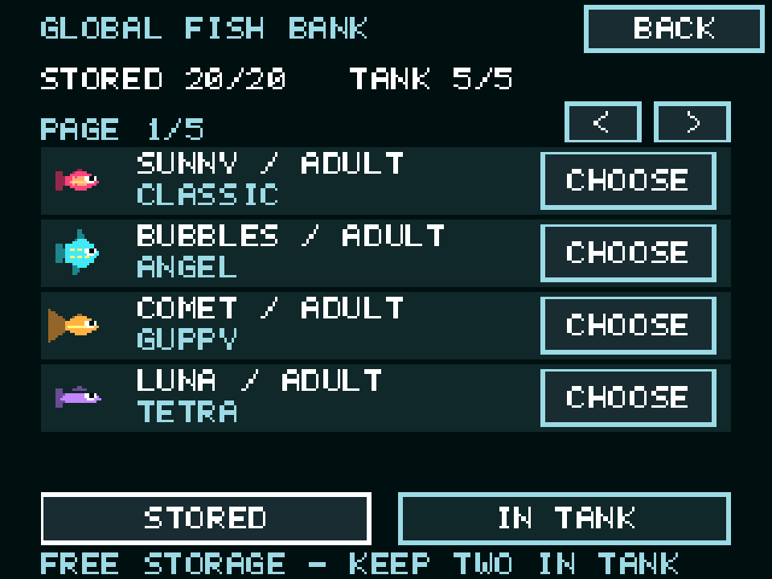 | 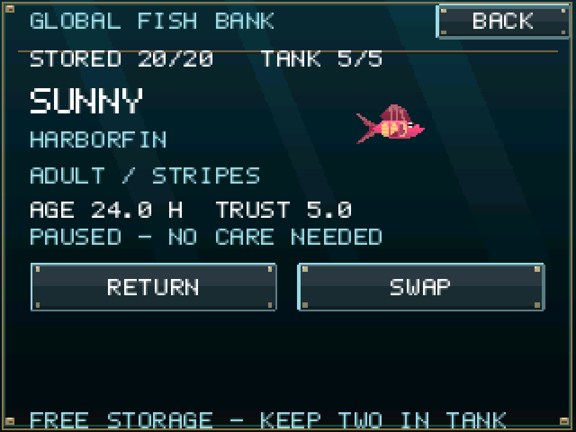 |

| Choose the outgoing fish | Confirm before moving either fish |
|---|---|
| 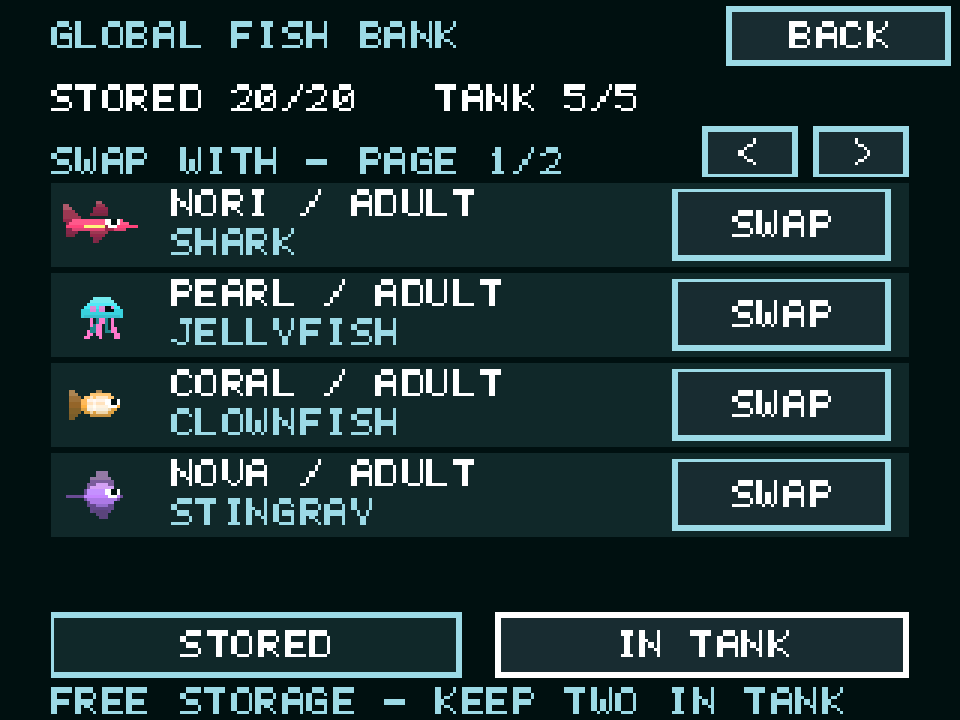 | 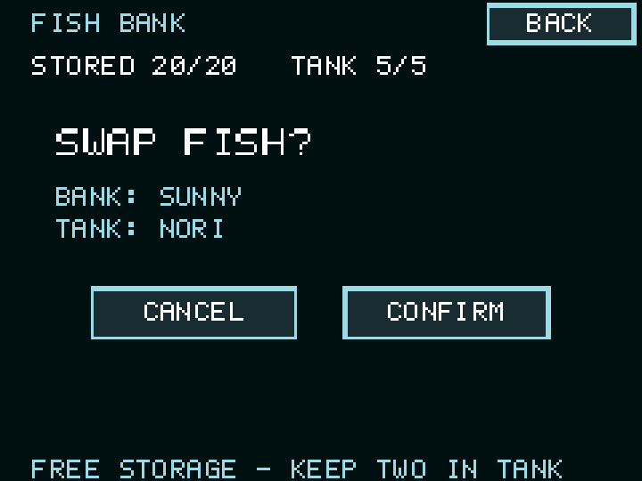 |

### What storage preserves

Names, body and marking colors, variety, pattern, stage, age, personality,
trust, care state, food counts and milestone reward records travel with the
fish. Stored fish **do not age, grow, eat or need attention**, and do not
earn care rewards while stored.

Storage is free. At least **two fish must stay active**, but swaps still
work at that minimum, at the five-fish tank limit, or with all 20 bank
slots occupied. Finish naming a new fry before moving fish.

Every move saves immediately. If saving fails, neither fish is moved.
Swimming positions and current goals restart on return. Parent links that
refer to a departing active slot are cleared, rather than accidentally
pointing at its replacement.

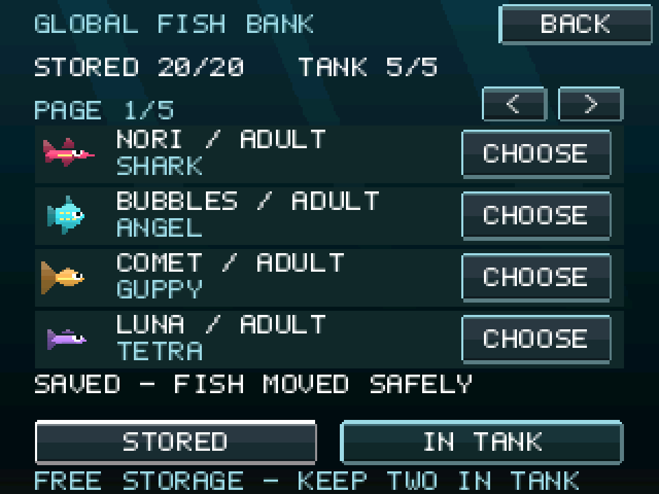

The bank is included in internal saves and SD backups. Removing the card
does not remove stored fish. Restoring an older, pre-bank backup restores
an empty bank; **Wipe clears the bank along with the aquarium**.

## Additional aquariums: room for another little ocean

Open **Keeper > UPGRADES > TANKS**. Each additional aquarium costs
**500 sand dollars from your shared wallet**. The original is free,
with up to **eight total**. Confirming a purchase enters a fresh tank with
two fry and the normal welcome, naming and customization setup.

| Buy another aquarium | Confirm its price |
|---|---|
| 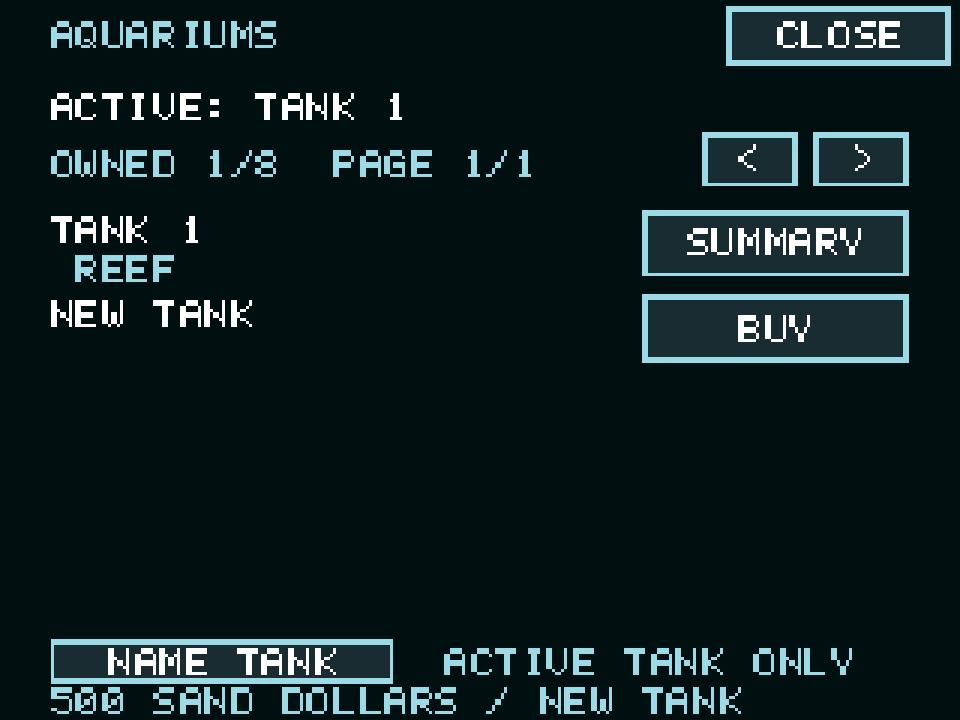 | 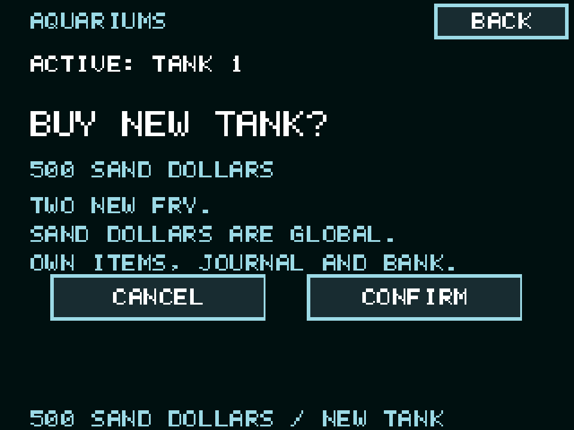 |

**Sand dollars are shared across all tanks.** Each tank has its **own fish,
decorations, upkeep/fish-care upgrades, layout, palettes, Journal and
20-slot Fish Bank**. Buying an upgrade in one tank does not unlock it elsewhere.
Switching among owned tanks is free. **NAME TANK** edits the active tank's
name, up to 15 characters: select a letter, use `<` / `>` and SAVE. BACK cancels.
Names persist across switches and restarts.

| Name your active tank | Keep your tanks recognizable |
|---|---|
| 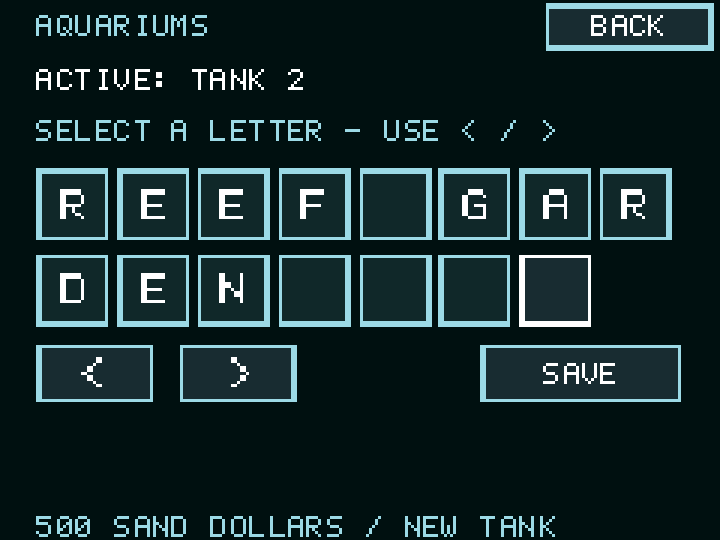 | 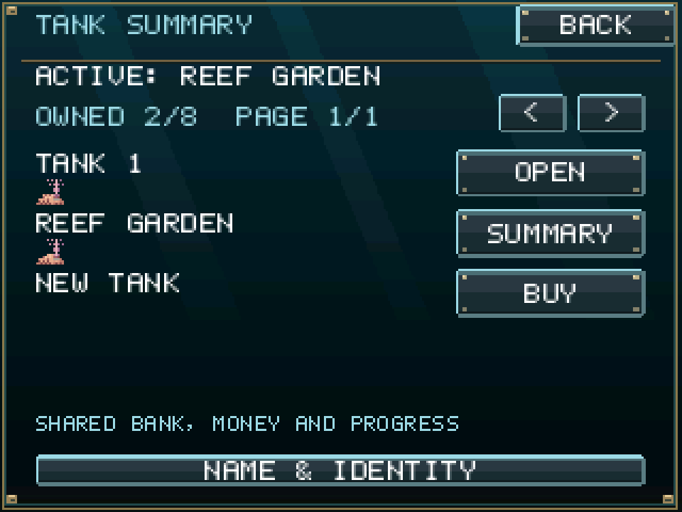 |
Inactive tanks are fully paused on SD: no aging, hunger, growth or rewards
while you play another aquarium. Finish naming any new fry before leaving.

| A fresh start, without wiping the first tank | Return whenever you like |
|---|---|
| 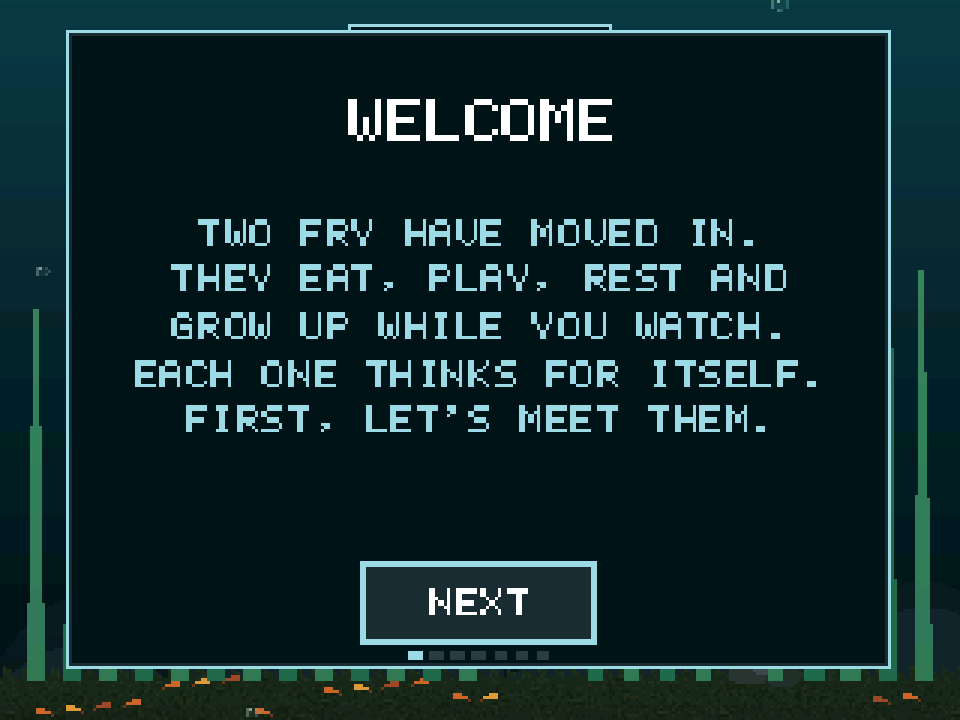 | 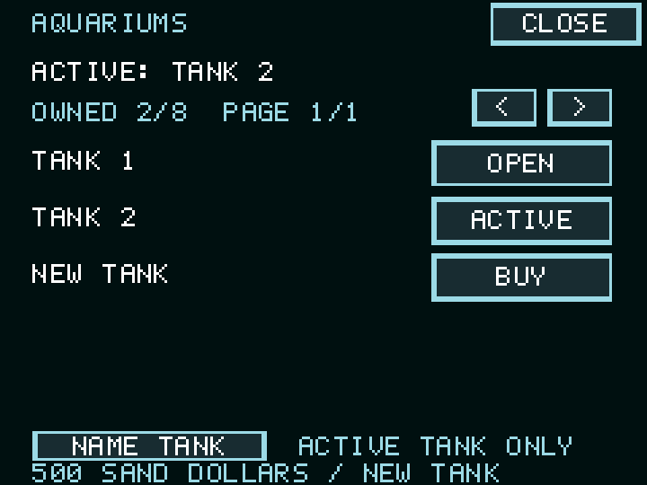 |

Buying or switching requires the card. The outgoing aquarium is saved to
alternating, checksummed SD files and read back before the new active tank
is committed to internal storage. A failed transaction does not charge you
or replace the live tank. The selected tank can keep running without SD,
but the card is needed to access inactive tanks.

**Backup/Restore and Wipe now apply to the active aquarium only.**
Purchased slots and other aquariums remain. Individual JSON backups do not
contain the entire collection, slot ownership or tank names; a JSON restore
keeps the current device's slot identity/name and replaces the active tank's
contents **and the shared wallet**. Also copy the SD card's `pocket-tank/tanks`
directory when archiving it. There is no one-click whole-collection recovery:
SD copies alone cannot recreate collection identity after NVS is erased.
Avoid downgrading to older firmware, which does not preserve the collection.

## 2. Make each fish your own

Open **Keeper > fish portrait > CUSTOMIZE** to edit an existing fish for
free. The adult preview makes the shape and markings easy to judge before
committing.

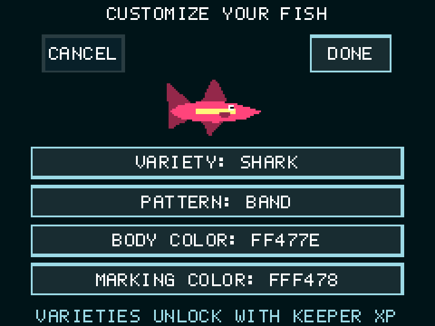

### Ten creature appearances

**Classic, Angel, Guppy, Tetra, Puffer, Shark, Jellyfish, Stingray,
Clownfish and Betta.**

These are more than palette swaps: sharks have pointed snouts, dorsal
fins and gills; jellyfish pulse and wave their tentacles; stingrays flap
their wings; bettas have flowing fins.

Each appearance supports:

- **Four patterns:** Stripes, Spots, Band and Plain.
- **24 body colors** and **24 marking colors**, chosen independently.
- Vivid pinks, reds, oranges, yellows, lime, cyan, electric blue, purple,
  magenta, pastels, white and dark slate.
- **DONE** to save, or **CANCEL** to discard the preview.

Fry offers show their appearance, and bred fry inherit appearance traits
from their parents. The varieties share the existing peaceful fish-care
system: sharks do not hunt tankmates, and jellyfish do not introduce a
separate species simulation. A jellyfish-looking fish uses a normal fish
slot; the decorative Jelly Lantern is a different shop item.

## 3. Give everyday care a sense of progression

Open **Keeper > JOURNAL** for **Goals**, **Album** and **Themes**.

### Keeper levels and objectives

There are **15 Keeper levels** and **15 one-time objectives**, with three
objectives active at a time. When a goal is ready, tap it to claim its XP
and sand-dollar reward; the next objective takes its place.

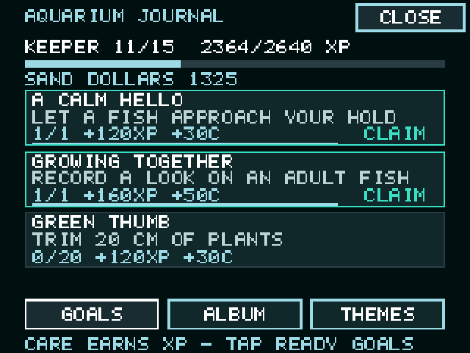

Care earns ongoing XP:

| Activity | XP |
|---|---:|
| Eaten meal batches | 8 |
| Cleaned algae colonies | 2 |
| Each 10 cm of plant trimming | 2 |
| A successful calm-hold approach | 10 |

Spending sand dollars does not lower your Keeper level. Level 15 starts at
**4,200 XP**. There are no daily streaks or absence penalties in this
progression system. Existing care totals can qualify for objectives,
but old care does not award a bulk retroactive XP payout.

### A permanent appearance album

The album records which appearances you have seen and which have reached
adulthood. Records remain after a fish is sold or stored. Customizing a
fish counts too: this is an **appearance album**, not a checklist requiring
you to buy every variety.

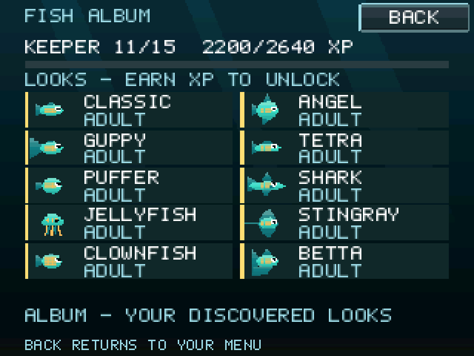

### Unlockable backdrops

| Backdrop | Unlock |
|---|---|
| Original | Always available |
| Kelp Forest | Keeper level 3 |
| Coral Reef | Keeper level 6 |
| Deep Glow | Keeper level 10 |

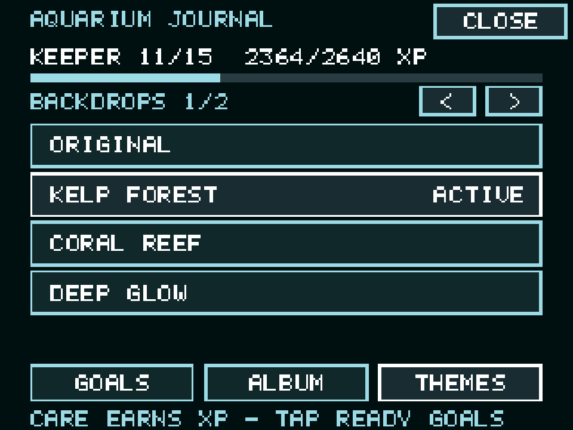

Themes change the backdrop without replacing your chosen sand or water
palette. XP, claimed objectives, album records and the selected theme are
included in saves and SD backups.

| Kelp Forest | Coral Reef |
|---|---|
| 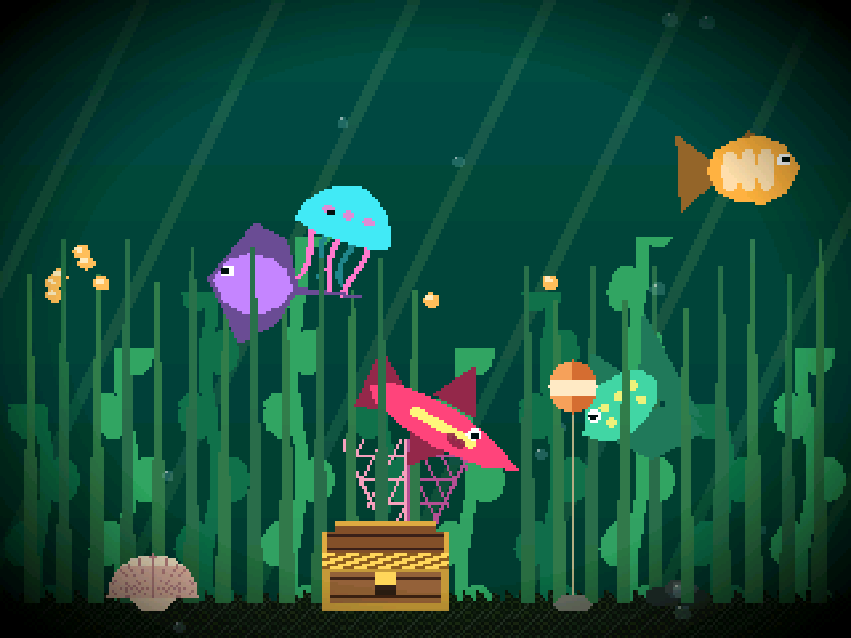 | 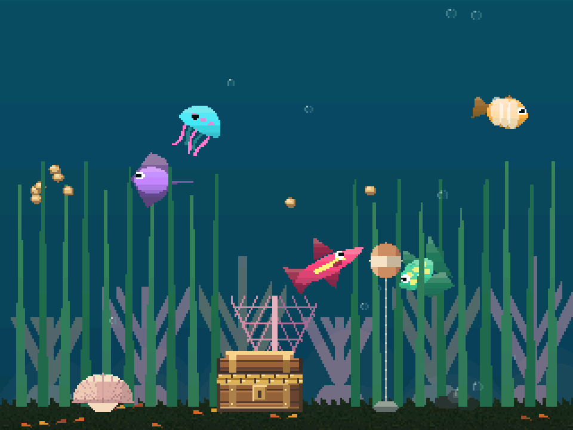 |

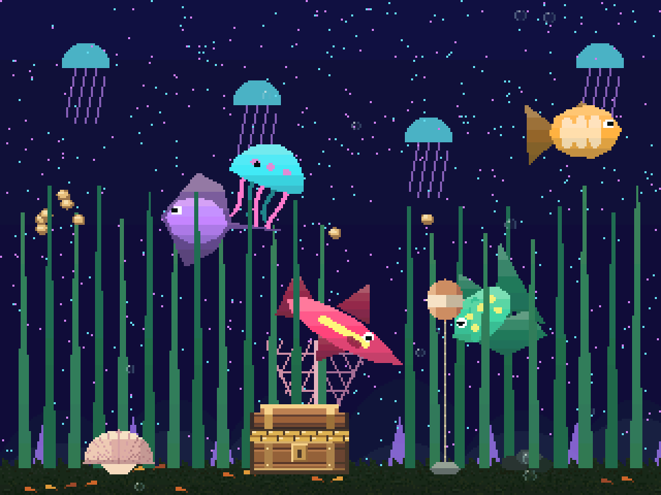

## 4. Decorate beyond the original tank

The fork adds these shop decorations and sets their prices as follows.
Prices are in sand dollars.

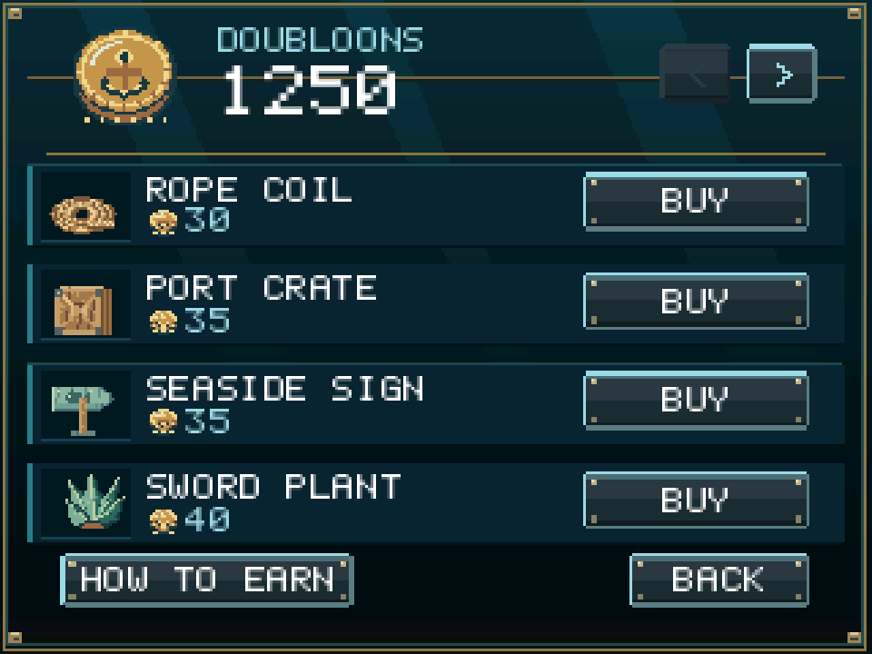

| Added decoration | Price |
|---|---:|
| Treasure chest | 120 |
| Scallop shell | 60 |
| Starfish ornament | 60 |
| Sunken anchor | 80 |
| Tethered buoy | 80 |
| Shipwreck | 200 |
| Treasure urn | 60 |
| Crystals | 100 |
| Sea fan | 80 |
| Sunken ruins | 160 |
| Jelly lantern | 120 |
| Zen pebbles | 40 |
| Duck float | 60 |
| Pearl clam | 70 |
| Lily pads | 80 |
| Floating log | 90 |
| Tube sponges | 100 |
| Lost barrel | 110 |
| Dive helmet | 140 |

The shop now sorts unlocks **cheapest first**, keeping equal-price choices
in a stable order. The optional nursery FRY row remains a separate first row.
There are **36 stable unlock IDs** in the catalog (the seasonal pumpkin can
be unavailable), plus the separate nursery offers. All original and added
item icons follow the same ownership rule in both the list and detail dialog:
**muted gray before purchase, full color after purchase**. Gray does not mean
you cannot afford an item; the price/button indicates affordability.

### More scenery, including the surface

The eight new scenic unlocks have **fixed positions** and stay in their tank;
they have no MOVE control, but SELL refunds the usual 20 percent after two
taps. The shop describes
this before purchase. The **lily pads, floating log and duck float** gently
bob in three separate surface positions and can all be displayed together.

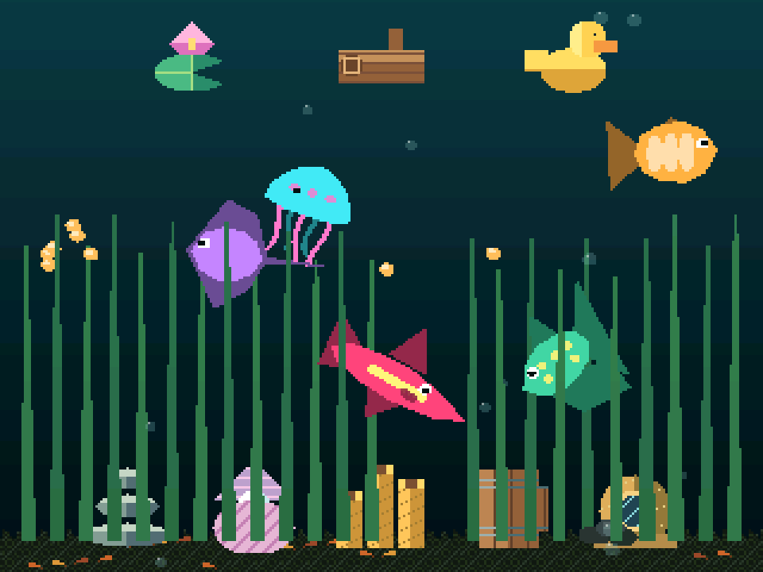

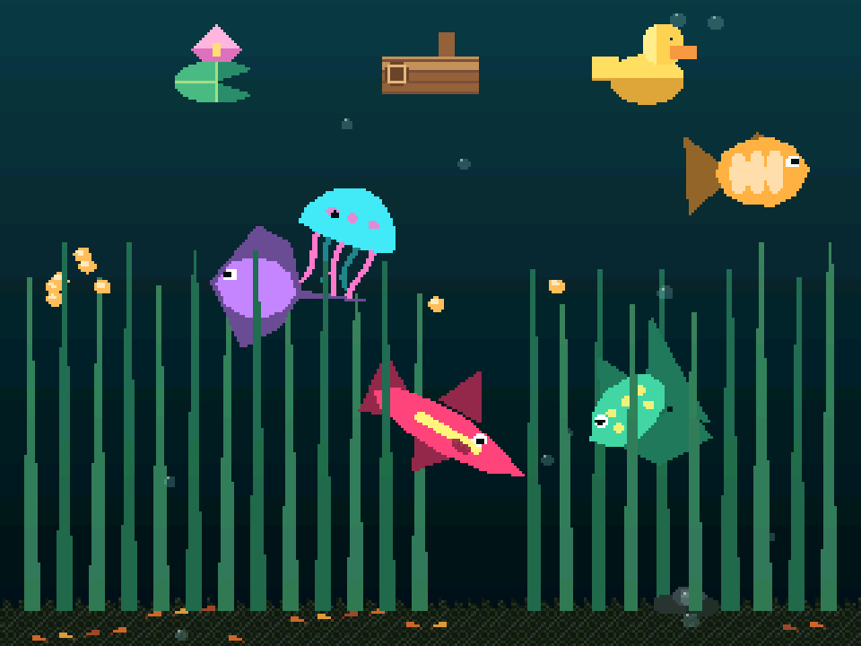

### Optional upkeep upgrades

- **Slow Garden - 160 sand dollars:** grass grows at half its usual speed.
- **Bio Filter - 180 sand dollars:** new algae grows at half its usual speed.

Both work awake and asleep, only in the tank that owns them. They are
permanent upgrades; they do not remove existing growth, generate cleaning or
trimming rewards, change fish care or slow coral/sword-plant growth. Inactive SD tanks
remain completely paused.

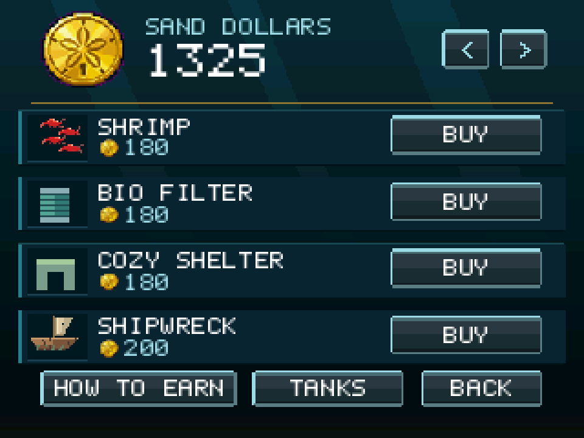

Placeable decorations support positioning, depth/layering, moving and
selling. The buoy and jelly lantern bob above their bottom tethers rather
than sitting on the sand. Placements and ownership survive saves and
backup/restore.

| Decorations and palette upgrades | More decoration choices |
|---|---|
| 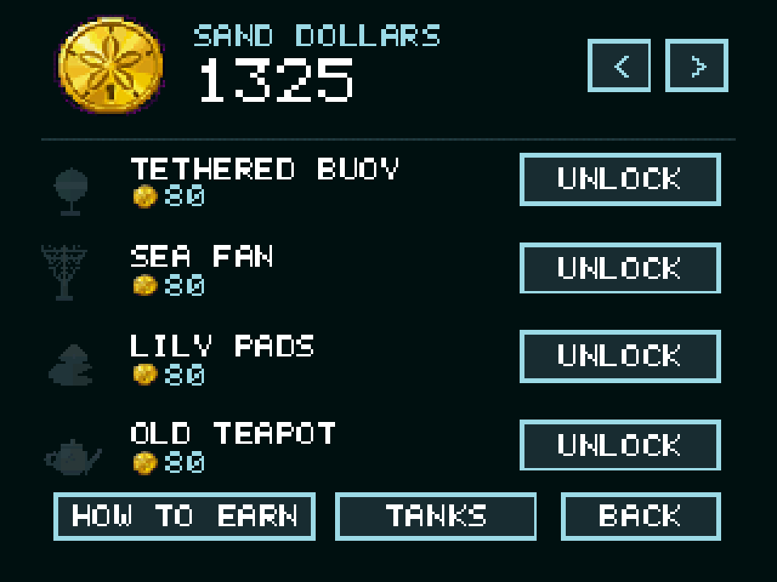 | 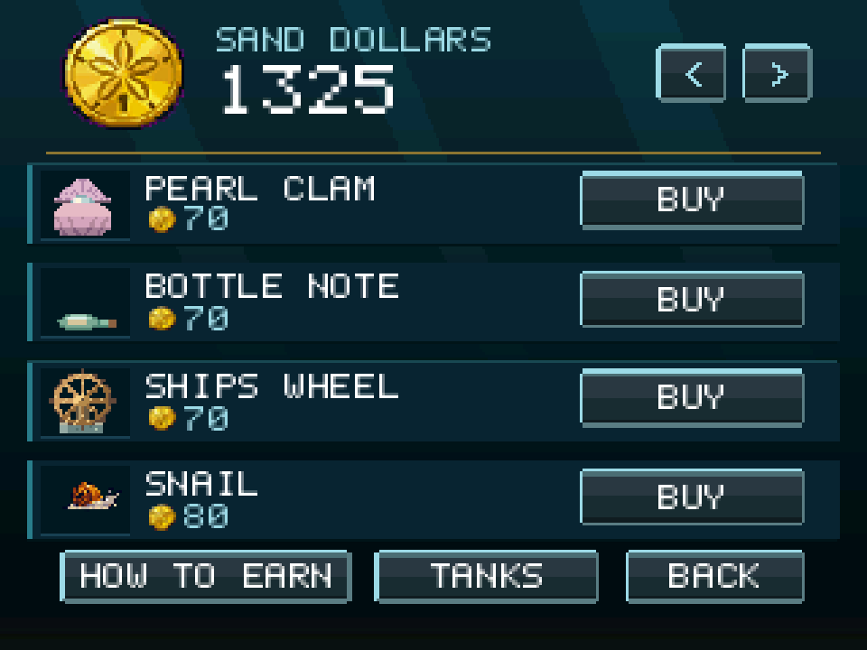 |

### Fish-care upgrades

Each aquarium can buy its own permanent improvements in the price-sorted shop:

| Upgrade | Sand dollars | Benefit |
|---|---:|---|
| Calm Current | 160 | Resting and sleep restore energy 25% faster |
| Cozy Shelter | 180 | Base natural stress decay is 25% faster, awake and asleep |
| Play Kit | 200 | Exploring restores curiosity 25% faster |
| Training Ring | 240 | Calm holds earn an extra 25% of the normal trust rate |

Training Ring adds to the seahorse bonus: together they give 225% of the normal
rate while hitched, not an unlimited multiplier. Stats still cap at 10.
No changes to food rewards, hunger, aging, size or breeding requirements.
Nothing stacks repeatedly; extra tanks and banked fish remain paused.
These upgrades are saved with their own aquarium, not shared between tanks.
Cozy Shelter boosts base calming, not separate vegetation comfort effects.
Calm Current also speeds up the daytime breather: an exhausted fish ducks
into nearby seagrass (or its resting corner) to recover before resuming its
advisor goal. Play Kit does not amplify curiosity spending or food rewards.
Wipe removes these purchases from the active tank. Old backups that predate
the optional care-upgrade field restore without these upgrades.


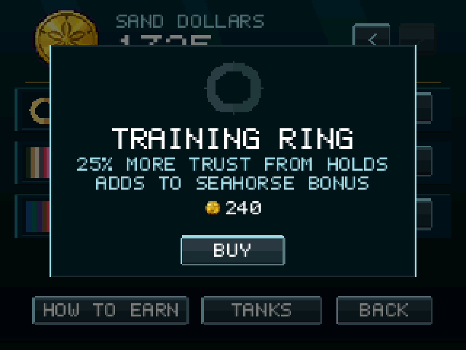

### Loud colors, without flashing

**Sand Palette** and **Mood Lights** each cost **300** as one-time
upgrades. After purchase, use the separate **SAND** and **WATER** rows in
Settings to cycle freely.

- **Sand:** Original, Gold, Pearl, Volcanic, Rainbow, Hot Pink,
  Electric Cyan and Neon Lime.
- **Water:** Original, Blue, Teal, Violet, Amber, Rainbow, Hot Pink
  and Neon Lime.

The original look remains selectable. Rainbow is a colorful palette, not
a flashing or strobing effect.

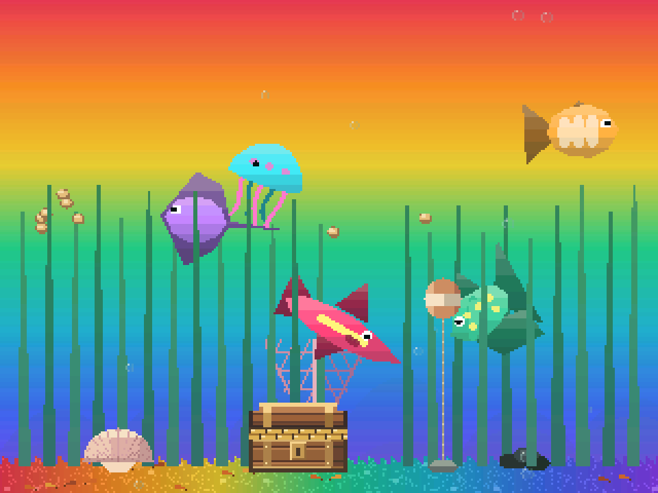

## 5. Menus made for a small screen

The CYD uses a 240 x 180 rendering framebuffer on its 320 x 240 panel.
Previously, small logical text could shrink until strokes disappeared.
Text now lands on the framebuffer pixel grid with a complete minimum
**5 x 7 glyph**, brighter secondary labels and wrapped status messages.

Journal cards, fish-bank rows, customization controls and Settings use
readable captions rather than tiny downscaled subtext.
Menus use consistent dark buttons with pale teal borders and white labels.
Page arrows and tank-name letter cycling use `<` / `>`, not plus/minus.

| Keeper navigation | Reorganized Settings |
|---|---|
| 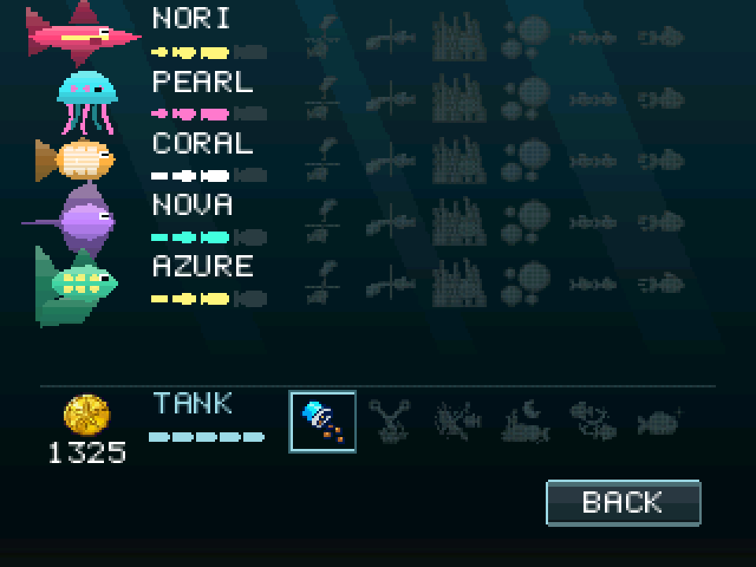 | 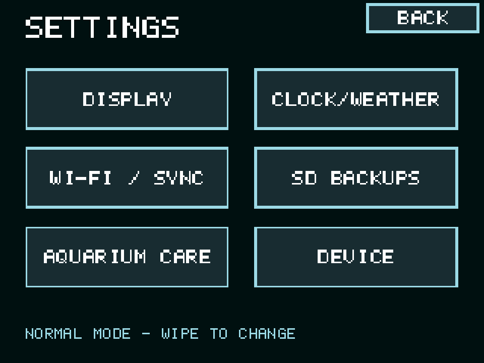 |

Settings puts **CLOSE** at the top right, **TOUCH CALIBRATION** at the
bottom right, and **UPDATES** at the bottom left. Sand and water have their
own lines. The old Lights Out setting button is no longer on this page.

### A clock over your aquarium

Open **Settings > CLOCK** to choose **Minimal, Digital, Analog, Neon, Flip,
Binary or Orbit**.
This is an idle display mode, **large and centered by default**, with
large/medium/small sizes, center or four-corner placement, 12/24-hour time and
a UTC offset with selectable **1-hour / 30-minute / 15-minute** adjustment
steps (tap **STEP**, default 1 hour). The clock starts **OFF**, saves separately
for each tank, and follows its SD snapshots and JSON restores.
**ACTIVATE** offers **15 sec, 30 sec, 1, 2, 5 or 10 min**, or **Manual Only**.
**SHOW CLOCK** enters immediately; the first touch only dismisses it, without
affecting fish or tools. Menus do not count as inactivity. Fish keep swimming
behind the translucent panel. Set your standard-time UTC offset, then use
**DST: +1 HOUR** during daylight saving; turn it OFF for standard time. This
manual toggle changes the time and date together and saves per tank. It does
not select regional rules or switch automatically.

**STYLE** offers separate **PRIMARY** and **SECONDARY** selectors, each with
theme defaults plus **white, amber, mint, cyan, rose, lavender and red**.
Primary colors the numerals/hour indicators; secondary colors the captions,
date, border and minute/second indicators. Theme defaults keep the original
multi-color accents. Orbit leaves a clear gap between its circle and AM/PM.
Independently hide **seconds**, the **background panel
and border**, or the **date**. Seconds visibility also controls the analog
second hand, Binary seconds columns and Orbit seconds ring. A missing time sync
still shows **SYNC NEEDED**. Preferences save per tank, and **SHOW CLOCK** previews
the result from either settings page.

| Minimal | Digital |
|---|---|
| 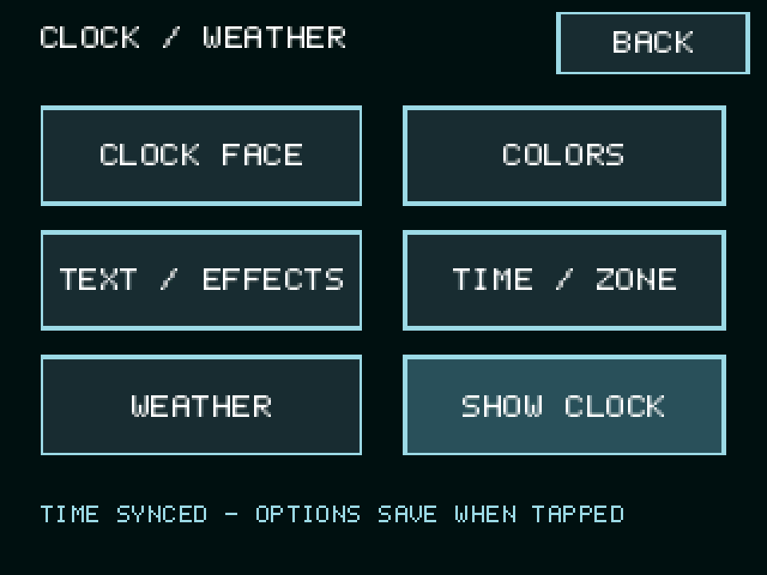 |  |
| Analog | Neon |
|  |  |
| Flip | Binary |
|  |  |
| Orbit | Custom colors and details |
|  |  |

Binary's pairs of columns represent each decimal digit: add the lit weights
(8/4/2/1, top to bottom) in each column. Orbit's gold outer ring tracks the
12-hour cycle, cyan middle ring tracks minutes and pink inner ring tracks
seconds; the center shows the ordinary time.

**WI-FI / SYNC** saves the aquarium and briefly restarts into an
on-screen network picker and case-sensitive password keyboard. Choose a visible
2.4 GHz network, connect, then **BACK TO TANK** to synchronize with NTP.
All letters fit on one QWERTY page with large uppercase keycaps. Typing starts
lowercase; **CAPS** and the case indicator control uppercase entry, while the
password field shows exactly what you typed. **123** opens a separate
number/symbol layout, **#+=** shows more symbols and **ABC** returns to letters.
Dedicated **SPACE** and **DEL** keys let you edit without leaving the keyboard.
Saved networks can be reconnected, changed or forgotten with confirmation.
This flow never checks or downloads firmware.

| Clock settings | Choose a network |
|---|---|
|  | 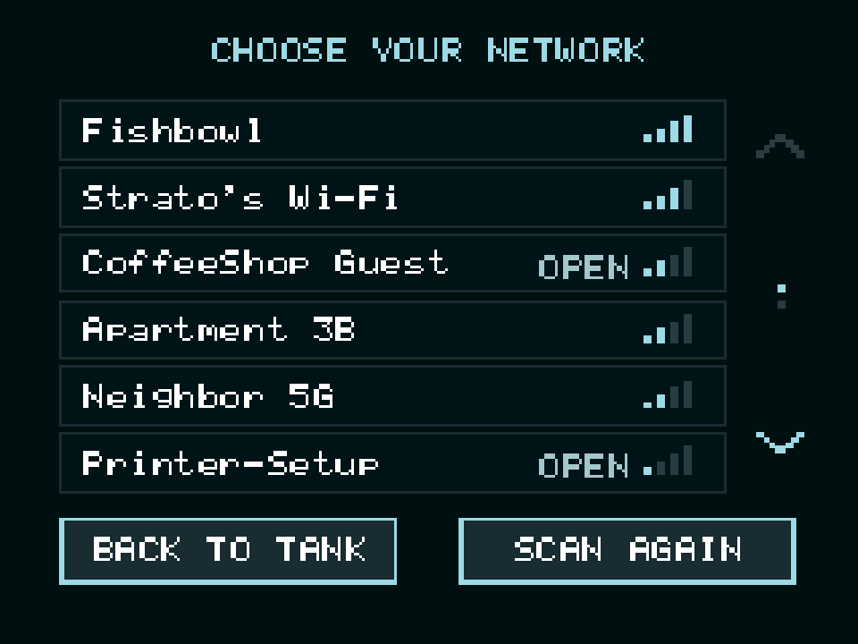 |
| Password keyboard | Connected |
| 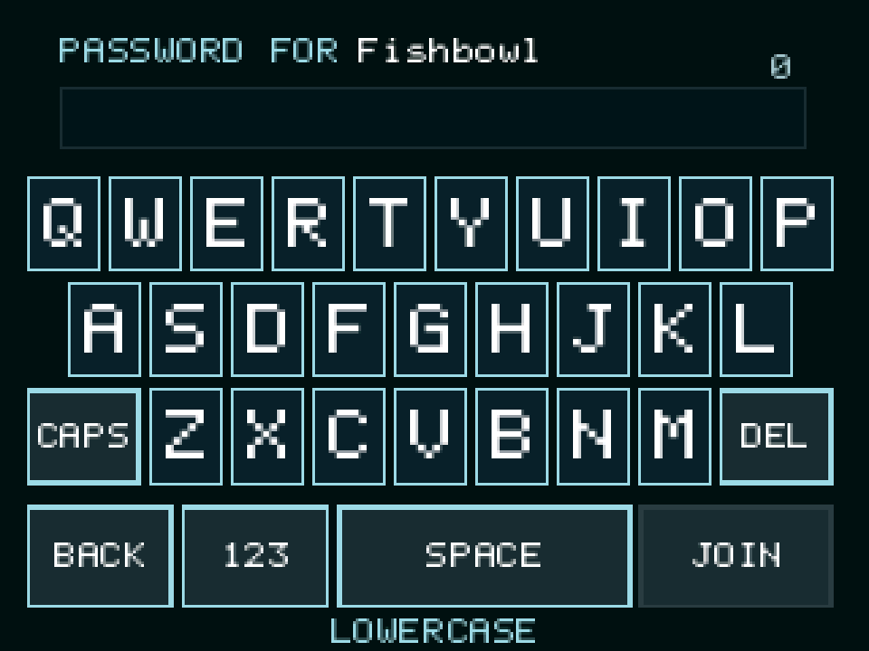 | 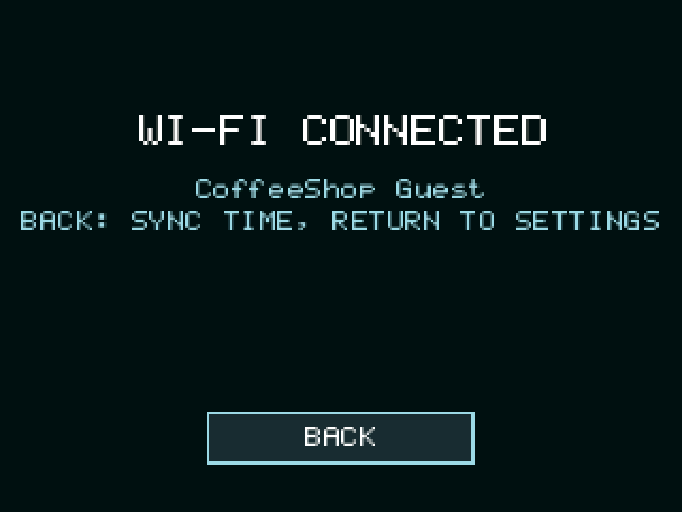 |

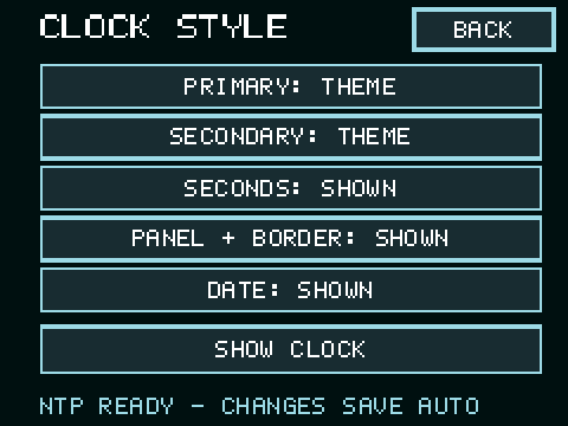


### Cycle fish without closing the card

Select a fish, then tap **>** just outside the card's upper-right corner to
select the next fish. It wraps back to the first fish and keeps you in the
tank without feeding. Tap the card itself to open Keeper as before.
The arrow appears only when the active tank has multiple fish, not on the
special-creature cards.

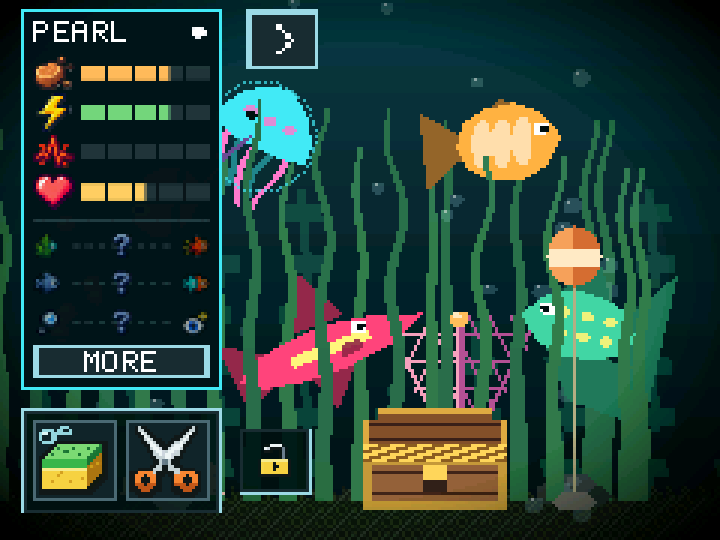

The CYD has no battery-backed clock. Once NTP succeeds, time keeps ticking
offline while powered or in deep sleep; power loss requires another sync.
Until then the overlay says **SYNC NEEDED**, rather than showing an approximate
save/build time as real time. Credentials are device-wide, not part of tank
backups. The screenshots use fake emulator networks, not real credentials.

### A deliberate fresh start

**Settings > WIPE** opens a separate confirmation before starting over
with two fry and first-time setup. Cancel, or wait 20 seconds, to keep
the aquarium.

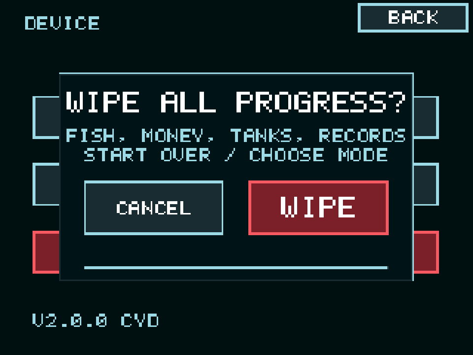

Wipe clears the active tank's fish, bank contents, decorations, care/upkeep
upgrades, clock preferences and Journal
progress. With multiple tanks, the global sand-dollar wallet is kept; with
only the original tank, its wallet resets too. It **does not delete purchased
slots, other tanks, SD backup files or touch calibration**.
Restore a compatible SD snapshot to bring back the saved tank and bank.

## 6. Make the SD card useful

### Tank backups and restores

Settings provides versioned JSON backups on SD, including fish,
appearance, shared wallet, owned items, care/upkeep upgrades, placement,
palettes, Journal and bank.
Backups are written and read back for validation. A restore first creates
a safety snapshot of the current aquarium.

New backups use **schema 5**, with an optional `tank.stat_upgrades` field
for the four fish-care purchases. Schemas 1 through 4 remain importable;
older firmware cannot restore schema 5 files. Keep a matching backup
when deliberately downgrading.

Full-bank backup handling processes stored fish one record at a time to
reduce RAM use on the no-PSRAM CYD. Restore releases the input buffer
before writing its safety snapshot, then rereads and checks the original
file before committing. The compact internal save stays within its
4,000-byte budget (including aquarium identity, name and care-upgrade flags),
so normal play and bank storage do not depend on keeping
the card inserted.

### Offline firmware updates

**Settings > Updates** checks a local package at
`pocket-tank/update.ptu` on SD. It does not require Wi-Fi or install
anything automatically at boot.

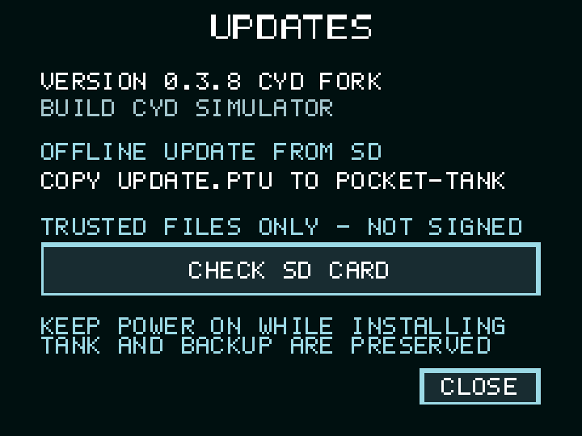

The installer checks the board, image, size and SHA-256, asks for explicit
confirmation, and creates a verified pre-update tank backup. It writes
the inactive application slot and changes the boot selection only after
successful verification.

Packages are **local and unsigned**: the checksum detects corruption,
not an untrusted publisher. Only install trusted packages and keep power
connected. See [the update guide](OTA.md) for packaging and installation.

The SD card also holds the icon art. It provides useful storage, but does
not substitute for the RAM that rendering and JSON processing need.

## 7. A focused CYD fork, not a different game

The underlying aquarium still has personality-aware goals, feeding,
growth, trust, milestones, breeding and maintenance. This fork uses a
**rules-based advisor**, not an LLM or learned model. Other board targets,
inference/training, audio, battery/PMIC and IMU support were removed from
this CYD-specific build.

The desktop emulator runs the actual gameplay and renderer with an
isolated save. It is useful for feature previews and regression tests,
but is not hardware emulation: the card, LCD, touch controller and update
flashing still need physical-board checks.

## Recreate these screenshots

From the project root, with Python 3.9+, an existing GCC/Clang-compatible
compiler (or Zig), and the firmware's managed cJSON dependency available:

```powershell
python tools\capture_cyd_gallery.py --cc clang
```

Use `--cc C:\path\to\zig.exe` for Zig, or `--out C:\path\to\gallery`
for another destination. The capture tool compiles the emulator, stages
its own temporary demonstration save, navigates the real UI and exports
41 PNGs. It never opens a serial port, touches the board, or replaces
the normal desktop save.

For build instructions and live usage, see the [project README](../README.md)
and [CYD hardware guide](../firmware/CYD.md).
