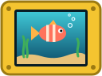

# CYD and ELEGOO 2.8-inch display boards

<p align="center"></p>

This fork targets two explicit 2.8-inch display variants with an ESP32, SPI LCD,
and XPT2046 resistive touch. It uses a 320x240 landscape LCD, an internal-RAM
framebuffer, flash-resident icons, and the rules-based fish advisor; the 4 MB flash
layout has no model partition. Generic board support, model/training code, audio,
battery/PMIC and IMU drivers have been removed from the source tree.

**Pocket Tank CYD 2.3.13 is a distinct aquarium game, not just a board port.**

Version 2.3.10 treats the mussel as an inspectable, color-customizable creature.
Tap it for automatic-income progress, daily allowance and earning/paused status.
Visible arrows cycle owned helper cards; fish-card arrows use graphical
chevrons. The mussel's COLORS button and Creature Colors > NEXT TYPE share the
free PRIMARY shell / DETAIL mantle editor. SAVE COLORS commits a preview;
NATURAL requires saving too. Tank, card and shop artwork use the saved colors.
Existing saves migrate to Natural. A reserved byte stores mussel colors in the
version-6 companion record without shifting fields, changing partitions or
growing saves. Older firmware cannot read this record: retain a pre-update
backup and do not downgrade after saving with 2.3.10.

Version 2.3.9 adds a sandy center grass clearing, exact fish/jellyfish animation
reuse between tiles and skips unused partial-region LCD checksums. Visual detail,
SPI speed, save schema and partitions are unchanged; desktop timings do not
establish a hardware FPS gain. Placement marks the selected copy and its starting
position: tap overlaps to cycle placed items/copies, drag horizontally to move,
DONE to save, or CANCEL to restore. Switching selections discards draft edits.
Calm fish occasionally investigate the mussel or rest beside familiar companions.
Successful saved mussel income produces a brief gold glint, never a permanent
icon; failed payouts, Creative mode and loading a save do not trigger it.

## Release 2.3.13: fish-first rendering pipeline

The existing 86,400-byte internal framebuffer is partitioned into two alternating
40-row working tiles. An LCD worker on core 1 rotates/checksums/transmits the
previous tile while the tank task on core 0 renders the next. Submission captures
the region coordinates; the worker never reads mutable renderer viewport state.
The next submission waits for the previous source buffer to finish, and every
frame drains before simulation, resolution changes, sleep, or synchronous update
screens. The existing DMA stripe ping-pong remains intact. No second framebuffer
or PSRAM is required; the worker adds a 3,072-byte stack, completion semaphore,
task metadata, and a larger six-band checksum table. The Normal-scale backdrop
tail retains its previous capacity. Worker allocation is deferred until the
tank task starts, leaving provisioning/update-only startup synchronous. A worker
allocation failure is logged explicitly and retains synchronous tile transfers.

Damage no longer becomes full-screen merely for crossing 40% of the block grid.
The planner counts actual merged pixels and 40-row transfer rectangles, comparing
their estimated cost with canonical full-screen tiles. Initial cost estimates
are 900 ns/pixel and 200 us/rectangle, not a claimed hardware-calibrated optimum;
the RAM-only diagnostic overrides permit direct partial/full comparisons.
Simple detail deliberately retains its existing cheap full repaint.

Fish simulation, positions, yaw, and tails remain full-rate. Balanced scenery
effects run at 5 Hz and grass at 2 Hz; Enhanced effects run at 10 Hz and grass at
4 Hz. Grass beds have staggered update phases. Crowns, buoy motion, decorative
bobbing, pumpkin glow, and mussel reward glints do not need fish-rate animation.
Helpers retain their movement and behavior. No care or save timers are slowed.

Every regular ten-second display log now includes conservative 2-ms histogram
p50/p95/p99 bounds, exact maximum frame interval, >50/>80/>100-ms counts, and
maximum polling, simulation, rendering, and display-backpressure times.
LCD worker fill, wire wait, and send-call timings are separate overlapping
measurements, not additional terms to add to main-task frame time.

The `benchmark` serial command uses isolated, unsaved fixed-seed aquariums:
four scenes at 240 measured frames each after ten warmup frames, repeated in
four modes: synchronous/full, pipeline/full, pipeline/partial, and pipeline/
cost-based. All use 40-row tiles and the same 5-ms service reserve. It reports
frame-time percentiles as well as mean FPS, and restores normal adaptive planning
afterward. The user's aquarium is never modified or saved by these fixtures.
Compare modes 0/1 to isolate transfer overlap and modes 1/2/3 for damage policy.
Hardware gains and heap/stack headroom must be measured on the board before
claiming a smoother or faster release.

Local validation executes the actual LCD worker and flush loop with delayed DMA,
captured viewports, alternating source ownership, unchanged-block reuse, both
scales/orientations, and synchronous-screen compatibility. Frame histogram tests
cover percentile bounds, long stalls, and exact threshold boundaries. The final
30-second embedded-art soak checked 18,963 full/tiled/retained frame sets.
All 48 sampled images match across full, partial, and cost-based policies.
In the sampled scenes, partial plans repaint up to about 15% fewer pixels, but
desktop CPU rendering is sometimes slower because of extra rectangles. These
CPU-only results do not include SPI wire time and do not establish a hardware
FPS gain. Sparse-plan tests also cover stale damage bits when switching from
320-wide to 240-wide rendering; off-screen old columns must never produce
negative-width transfer regions.

The local 2.3.13 unified app measures **1,753,680 bytes**, leaving **212,400 bytes**
(10.80%) free in each unchanged OTA slot. Release CI rebuilds and publishes the
verified board-specific and unified packages.

## Release 2.3.11: indexed RGB and selective canonical invalidation

The 2.3.11 unified app measured **1,728,176 bytes**, leaving **237,904 bytes
(12.10%) free** in each unchanged OTA slot. It saves another **2,704 bytes**
over the first indexed-art build (1,730,880 bytes), or **22,640 bytes** versus
the 1,750,816-byte prior pass. Both indexed-art builds were backed up, app-only
flashed and completely read back on **COM4 only**. The historical 2.3.11 SHA256
was `6894f9e73bab3ff1784481ecc14fe690df698c2be1c1c581ccdbed3dca0ed6c2`.
Release 2.3.11 included these optimization changes.

The generator palette-indexes 32 of the 47 embedded RGB565 planes only when
the indexed representation is smaller. Each plane stores a 16-bit palette
count, exact RGB565 entries, then four 4-bit indices per word for palettes of
up to 16 colors, or two 8-bit indices per word otherwise. Seven icons use the
4-bit form. The accessor uses shifts/masks without per-pixel division. The second
high `icon_t.offset` bit selects this representation; the alpha RLE flag remains
independent. There is no color quantization, new pointer, heap cache or image
buffer. RGB data shrinks from 80,256 to 56,282 bytes (23,974 gross bytes);
the app savings above include decoder and LCD-code costs.

All four artwork blit paths use the same RGB accessor. Packing reconstructs
the original raw bank and rejects invalid counts, lengths and indices.
The bank remains **120,384 bytes, CRC32 `b3de6773`**, retaining SD/browser
compatibility. Native tests compare every RGB/alpha pixel, normal/locked/scaled
blits and thumbnails against raw artwork at both resolutions; decoder edge
cases include odd pixel counts, the 16/17-color boundary, every 4-bit value
and all 256 palette indices.

Partial LCD transfers now invalidate only intersecting canonical checksum
entries, calculated in physical panel coordinates. Partial rectangles no longer
replace the retained canonical layout, and their CRCs never populate canonical
entries. Actual canonical writes still invalidate overlapping partial entries.
Dimension/orientation/canonical-layout changes retain full cache resets.
The implementation adds no framebuffer or persistent rectangle table.
Invalidation now computes the first intersecting stripe directly and visits
only that range, rather than testing every stripe in each intersecting band.

The actual-flush/delayed-DMA harness covers both resolutions, both orientations,
full/tiled layouts, 640 generated overlapping updates, and stale partial/old-CRC
restoration cases. In all eight resolution/orientation/layout combinations,
a one-pixel partial update followed by canonical drawing resends **one of
40-43 stripes**, rather than invalidating the entire canonical table.
This is a transfer-count test, **not an on-device FPS result**.

A proposed fish-motion pointer optimization was tested in three alternating
7,200-frame desktop pairs. Although isolated fish drawing improved, full-scene
times worsened slightly (0.2-2.9%), so it was rejected. No new fish CPU speedup
is claimed. Final rendering retains all 48 reference frame hashes, and the
latest 30-second soak checked 18,781 full/tile/retained frame sets without tank
mutation. A later horizontal polygon-culling experiment also failed to show
a reliable overall gain and was removed; polygon rasterization is unchanged.

### COM4 follow-up validation

One paired run compared the 1,730,880-byte first indexed-art build with the
1,728,176-byte nibble-indexed/range-invalidation build. Both were backed up,
flashed app-only and fully read back before testing. The same RAM-only seeded
fixtures ran at Normal/Balanced with the 5 ms service reserve:

| Fixture | Before FPS | Latest FPS | Before render ms | Latest render ms | Latest flush ms |
|---|---:|---:|---:|---:|---:|
| Five fish, theme 0 | 13.96 | 14.12 | 26.59 | 25.65 | 32.76 |
| Five fish, theme 1 | 13.44 | 13.59 | 28.70 | 27.69 | 33.35 |
| Frozen decor/clock v1 | 11.72 | 11.73 | 44.79 | 44.56 | 27.71 |
| Maximum extra ornaments | 11.48 | 11.62 | 41.88 | 40.77 | 32.69 |

The roughly 0-1.2% FPS differences are small, single-run observations, not
evidence of a sustained gameplay improvement. No large rendering speedup is
claimed for this pass; its confirmed benefits are smaller artwork storage and
less invalidation bookkeeping with the same transferred image.

The original bolt/pip/kelp/odie roster, wallet, ownership and clock settings
were retained through the diagnostics, and the final `save` returned `saved`.
The EMEET camera confirmed a rendering tank during testing, the ordinary clock
after returning, and a legible shop with its artwork; glare limits precise color
assessment. The shop was closed afterward without purchases/settings changes.
Native/embedded pixel tests remain the exact-art validation. Final checks include
38 Python tests (one skipped), browser acceptance, native simulator smoke,
save migration tests and LCD overlap/delayed-DMA tests.

## Included in 2.3.11, second stage: rendering and artwork

The local unified application is **1,750,816 bytes**, with **215,264 bytes
(10.95%) free** in either unchanged `0x1e0000` OTA slot. This is **22,704 bytes
smaller** than the 1,773,520-byte first-stage app, or
38,560 bytes smaller than the original local preview. This stage was backed up,
flashed and fully read back on **COM4 only**, with the saved CYD profile and
appearance confirmed. The hardware FPS
results below belong to stage one, not this installation.

Changes preserve artwork, timing policy, saves and partitions:

- Cache a single palette-indexed full sprite and 64-bit row silhouettes for
  the most-repeated static extra ornament. At most 4,096 indexed pixels,
  64 palette colors and 110 mask rows are retained (under 5.2 KiB plus allocator
  overhead); no duplicate means no allocation. Candidate changes and disabling
  work caches release it. Animated ornaments stay procedural. Allocation/bounds
  failures log and retain the exact procedural artwork.
- Reuse eased fish yaw and hunger/stress/body/fin colors between tiles, with
  explicit input-key invalidation, alongside the existing motion preparation.
- Retain up to 48 exact physical-rectangle/CRC fingerprints for partial LCD
  stripes (**768 bytes** of static RAM). Any overlapping write invalidates old
  partial fingerprints, including canonical writes. Scale, tile-layout and
  inversion changes reset them; canonical checksums and DMA ownership remain
  intact. Matching adjacent horizontal damage runs may merge from odd or even
  40-pixel rows, never beyond the existing 80-row buffer limit.
- Encode embedded icon alpha as count/value RLE only when smaller, without
  changing RGB565 colors or `icon_t` size. The 64px coin alpha shrinks from
  4,096 to 922 bytes. Normal, locked, integer-scaled and resampled blits decode
  exactly; source-row rewinds use a new cursor. The SD/browser bank stays
  **120,384 bytes, CRC32 `b3de6773`**, byte-for-byte unchanged.
- Use a shared creature-card frame and a third bounded ESP32 GCC `-Os` section
  for fish/helper cards. Existing modal/mini-game size settings remain; live
  aquarium, clocks, simulation and LCD code keep their speed settings.
- Replace serial benchmark fixture 2 with **frozen decor/clock v1**: seeded
  fish, fixed mixed ornament positions including a repeated static pair,
  a mussel and analog clock at Unix `1792803600` advancing deterministically.
  It no longer reads the current aquarium or network clock. The render-only
  clock override resets after each fixture and at diagnostic exit.

Three alternating reference/current desktop pairs used the same Zig `-O2`
harness, 3,600 moving frames per case, both sizes and all three details. The
reference renderer is the preserved first-stage source, not the older release.
All 48 sampled full/tile frame hashes matched in every pair. Median CPU times:

| Workload | Render time reduction |
|---|---:|
| Decorated/analog-clock scenes, both sizes and all details | 5.7-11.3% |
| Lighter five-fish scenes | 0.9-3.6% |
| Isolated five-fish drawing | 10.8-14.7% |

These are desktop render timings, **not on-device FPS, LCD transfer timings or
a gameplay minimum**. The rejected per-row ornament cache regressed performance;
only the measured full-sprite implementation is retained. Use `--baseline-file`
to compare a preserved local renderer, or `--baseline` for a Git revision, with
the same current fixture harness and no concurrent CPU-heavy tests.

CI/release stress now use `--embedded-icons`: every RGB/alpha sample and all four
blit paths are compared against the unchanged raw bank, including clipped art,
repeated samples and resampled thumbnails at both scales. Tests also cover
exact ornament pixels/masks, animated fallback, allocation failure, cache
lifetime, same-frame fish-key changes and odd-row damage merging. The actual
LCD harness checks that an overlapping write cannot be hidden by an old partial
CRC when the original region returns to its previous pixels.

## Included in 2.3.11, first stage: creature and helper rendering

Helper-card targeting selects the nearest eligible helper inside its existing
hit area, while retaining fish-first selection and shrimp triple-tap behavior.
Only the shrimp actually drawn at the current detail setting receive taps.
The diagnostic-hidden seahorse is not tappable. COLORS captures its gesture
before water drag/hold/feed handling; releasing outside the button cancels it.
The simulator/browser follow the same targeting and release behavior. Snail
cards show their current grazing, seeking, exploring or return-to-sand activity.

The first-stage unified app measured **1,773,520 bytes**, versus the recorded
1,789,376-byte pre-change preview: **15,856 bytes saved** and **192,560 bytes
(9.79%) free** per unchanged `0x1e0000` OTA slot. Isolating just the modal
renderer compiler change saves 12,896 bytes (1,786,416 to 1,773,520). ESP32 GCC
uses `-Os` for the milestones/shop and settings/journal/home modal sections,
and for mini-games. Aquarium drawing, simulation, live clocks, touch and LCD
transfer code retain their speed settings. Native/Clang builds do not use the
GCC-only modal pragmas. Save schema, companion version, games, artwork, TLS trust
and rollback remain intact.

Exact fixed-geometry caches remove repeated snail ridge powers and seahorse
body-row powers / fin radius-angle calculations. Urchin rows prepare only
their visible tones. The caches add approximately 1.9 KiB of static RAM and no
heap allocation. The stress fixtures now actually place their unlocked helpers,
exercise floor/glass, rest/swim and chew/rest variants with custom colors, and
report separate helper timings plus four full/tile hashes per case. Use the same
fixture harness for both sides:

```powershell
python ..\tools\test_renderer_stress.py --cc PATH_TO_CC --baseline v2.3.10 --frames 7200 --seconds 0 --out before.json
python ..\tools\test_renderer_stress.py --cc PATH_TO_CC --frames 7200 --seconds 20 --out after.json
```

All 48 sampled scene hashes matched the reference in three paired desktop runs;
isolated upright-snail drawing was about 10-15% faster and urchin drawing about
5-16% faster. Seahorse improvements were small (roughly 1-4%). Glass-snail
timings did not improve. Whole-frame timings were mixed, so these do not
establish a hardware FPS gain.

COM4 was subsequently app-only flashed with a fresh full 4 MiB backup and
complete application readback verification. The same RAM-only benchmark
(including service reserve and real display transfers) measured:

| Fixed scene | Before FPS | After FPS | Before render ms | After render ms |
|---|---:|---:|---:|---:|
| Five fish, theme 0 | 13.90 | 14.53 | 26.36 | 23.90 |
| Five fish, theme 1 | 13.46 | 14.03 | 28.30 | 25.87 |
| Maximum extra ornaments | 9.35 | 9.62 | 61.35 | 58.95 |

Snail time fell from about 2.1-2.2 to 1.7 ms and seahorse time from about
7.2 to 5.6-5.7 ms in these scenes. LCD flush remained around 33 ms. These are
single before/after hardware runs, not repeated-run statistics.
The live-copy clock fixture changed from 11.79 to 10.04 FPS, but copies a
changing aquarium; its fish/front cost rose from 21.80 to 38.33 ms, so it cannot
establish a cross-build regression or gain. Stage two replaces that fixture
with frozen decor/clock v1; its results cannot be compared to this live copy.
Original residents and successful saving
were verified after the benchmark.

## Supported board variants

| Build choice | Board identity | LCD initialization | Red LED | GPIO34 |
|---|---|---|---|---|
| `cyd` (default) | `cyd2432s028` | Existing CYD custom ST7789-style sequence | 4 | LDR |
| `elegoo` | `elegoo28` | ELEGOO ILI9341V power/gamma sequence, BGR | 22 | Battery sensing, never read as light |
| `unified` | `cydesp32profiles` | Saved `cyd` or `elegoo` runtime profile | Profile-specific | Profile-specific |

**Hardware validation:** physical testing identified the white/striped-screen cause: after
an absent/failed SD card, freeing SPI3 disrupted the already-running SPI2
LCD DMA on the tested ESP32/ESP-IDF stack. The SD failure path now logs its
error without formatting the card and retains the SPI3 bus for the boot's
lifetime. Independent display tests and the full UI then displayed correctly.
The small retained bus allocation is intentional, not a mounted SD card.
SD features still report unavailable when mounting fails.
Normal 40 MHz SPI and automatic chip-select are restored. ELEGOO-specific
panel mirroring produces upright, readable text on the webcam; the measured
full-resolution welcome screen runs at 16.5-16.6 fps (60-61 ms/frame).
The user corrected backwards touch using calibration. ELEGOO's uncalibrated
default reverses logical X and preserves Y, matching the axis directions in
the previously working five-point calibration. The earlier Y-only default
reversed the wrong axis; saved affine
calibration overrides that default using the unchanged raw coordinate basis.
Existing calibrations are not erased or invalidated. The fresh-board default
has native coordinate tests; physical touch was confirmed using the user's
saved calibration, not by erasing it to retest the fresh-board default.
Use the built-in calibration tool if your individual panel needs adjustment.
App-only updates preserve saved calibration, so a default correction does not
replace an existing calibration.

For ELEGOO brightness diagnosis, the reference demo and this firmware both use
GPIO21 with an 8-bit maximum PWM duty of 255. If diagnostics already report
`bright 255` with night and room dimming off, increasing the configured
percentage cannot make the backlight brighter. Compare white menu text as well
as the aquarium before attributing dim colors to backlight duty; do not change
panel power or gamma registers without hardware evidence.

The `unified` image implements saved hardware profiles for these
two compatible ESP32/4 MiB boards. The same application bytes have been
provided for both boards, not separate game binaries. The web installer starts
with no hardware selected and requires an explicit CYD / ELEGOO CYD choice.
It cannot reliably autodetect these displays. Once set, the profile stays on
the board across reboots and updates; later web updates verify the user's
matching selection against the saved profile rather than overwriting it.
The same application bytes have been
installed on both local boards and checked by full app readback and reboot,
with their aquariums preserved. When no profile has been provisioned, first
boot waits for `hardware cyd` or
`hardware elegoo` over USB serial at 115200 baud, before LCD/peripheral startup.
The profile is persisted as `pt_hardware` / `profile` in NVS (1 = CYD,
2 = ELEGOO). It is independent of the application slot and aquarium saves.
Unknown saved IDs require explicit selection; NVS read failures stop startup
with an error rather than guessing hardware.

Once running, `hardware` reports the profile and image identity.
`hardware cyd` / `hardware elegoo` first save the aquarium successfully, then
persist the selected profile and restart. This recovery command needs no
readable screen and does not overwrite touch calibration. Profile changes
are refused in network setup/update mode; queries remain available. Legacy
board-specific images refuse a saved profile belonging to the other board.
No automatic controller probing is used: the ELEGOO test board returns zero
IDs even though status/GRAM reads work. Different ESP32 families, display
buses, pins or framebuffer budgets may still require separate builds.

**Save-preserving migration:** the website selects the real hardware while
downloading `pocket-tank-unified-app.bin` for either board. A fresh boot banner,
live OTA report, partition table, OTA metadata and app marker must agree.
For legacy firmware only that selected hardware's identity is accepted;
existing unified firmware must report the matching saved profile. After
writing/checksumming only the active app, the updater reboots, provisions a
missing profile, and confirms it over serial. It never falls back to factory
flashing. Existing calibration, aquariums, Wi-Fi and partition layout remain.

The local tool additionally creates a new full 4 MiB backup, validates the
layout/OTA metadata and full app readback, and restores the old app on failed
verification. It refuses explicit slot guesses or a generic migration bypass:

```powershell
.\tools\build_cyd.ps1 -Board unified -HardwareProfile cyd -Port COM4 -Flash -Backup .\before-unified-com4.bin
.\tools\build_cyd.ps1 -Board unified -HardwareProfile elegoo -Port COM8 -Flash -Backup .\before-unified-com8.bin
```

Use the actual port and a new backup filename. Profiled factory images
`pocket-tank-unified-cyd-factory.bin` / `pocket-tank-unified-elegoo-factory.bin`
are for blank boards or deliberate resets only; their app bytes are identical,
and only the blank NVS hardware profile differs. Packaging uses Espressif's
`esp-idf-nvs-partition-gen==0.1.9`.

Legacy SD/Wi-Fi firmware remains on its board-specific channel; migrate to
unified by USB once. Thereafter use `unified-ota.json` or rename
`unified-update.ptu` to `pocket-tank/update.ptu` on SD. Subsequent updates retain
the NVS profile and existing family checks. No schema/partition change.

The ELEGOO ESP32-32E 2.8-inch resistive-touch board is documented by
[ELEGOO](https://wiki.elegoo.com/oshw-parts-&-accessories/esp32-dispaly-introduction).
LCD CS15/DC2/SCLK14/MOSI13/MISO12/backlight21 and
XPT2046 CS33/clock25/MOSI32/MISO39/IRQ36 match the existing CYD pins.
LCD reset is tied to EN. ELEGOO audio enable GPIO4 is held high (disabled);
green/blue LEDs are 16/17. The SD SPI pins also match. There is no LDR,
so room-light settings report unavailable; manual brightness still works.
An ESP32-32E module label alone is not sufficient to identify other boards.
No battery, charger or audio application is implemented.

From an ESP-IDF PowerShell environment:

```powershell
.\tools\build_cyd.ps1 -Board cyd
.\tools\build_cyd.ps1 -Board elegoo
.\tools\build_cyd.ps1 -Board unified
.\tools\build_cyd.ps1 -Board elegoo -Port COM8 -Flash
```

Separate `build_cyd`/`build_elegoo`/`build_unified` directories prevent cached board settings
from contaminating the other build. Normal app-only flashing verifies the
installed marker against the built image; web, SD and Wi-Fi updates also
refuse another board. ELEGOO release assets use `pocket-tank-elegoo-app.bin`,
`pocket-tank-elegoo-factory.bin`, `elegoo-update.ptu`, `elegoo-ota.json`,
`elegoo-SHA256SUMS.txt` and a separate ZIP. The original names remain unchanged.
Rename `elegoo-update.ptu` to `update.ptu` when placing it at an SD search path.

### Recovering a wrong CYD image on ELEGOO without resetting fish

First make a complete 4 MiB flash backup and save the running aquarium.
Positively detect its running and next-boot slots using the `ota` serial command;
they must agree. Factory flashing overwrites saves and is not this procedure.
For a confirmed `ota_0`, explicit conversion is:

```powershell
.\tools\build_cyd.ps1 -Board elegoo -Port COM8 -Flash -AppSlot ota_0 -AllowBoardMigration
```

Use `ota_1` instead only if that is the verified active slot. This escape hatch
is restricted to the local recovery script and known board markers; it does
not relax browser/SD/Wi-Fi checks. The app starts with the correct new identity
while the partition table, NVS, internal archives and SD stay untouched.

### Firmware-space audit after 2.3.0

The local follow-up keeps the existing two `0x1e0000` application slots,
the 40 MHz SPI clock, certificates, embedded artwork and all features.
It does not change the schema-18 save contract or require an aquarium reset.

| Actual CYD application | Bytes | Free per 1,966,080-byte slot |
|---|---:|---:|
| Published 2.3.0 | 1,797,152 | 168,928 |
| First local selective-size pass | 1,788,752 | 177,328 |
| 2.3.1: client-only TLS and device-management size flags | 1,777,840 | 188,240 |
| 2.3.2 local build: GitHub manifest, full-file OTA checks and Wi-Fi entry | 1,780,160 | 185,920 |
| 2.3.3 local build: screenshot shortcut and update-mode memory | 1,780,128 | 185,952 |

Net saving: **19,312 bytes**; headroom increases from about **165 KiB to
184 KiB**.
Setup, update UI, companion menus, snapshot storage and weather use `-Os`.
The fish simulation, renderer, games, companion tick and progression retain
`-O2`; progression/weather/companion retain their existing `-fno-fast-math`
guards. No new decoded-image or font buffers are introduced.
The extended pass also uses `-Os` for director commands, update mode, outbound
network/weather services and SD management. Main frame-loop, LCD, touch,
brightness and ambient-light sources retain their existing optimization.
TLS is client-only: firmware initiates HTTPS for weather/updates and does not
serve HTTPS. The linked image retains the client handshake and
`esp_crt_bundle_attach`; the TLS server handshake is absent. Certificate
bundle, hostname checks, supported client cipher configuration and OTA
rollback stay intact. Both checked-in CYD configuration entry points carry
the client-only setting, with regression guards for trust and partition layout.

The link-map audit shows approximately 505 KiB of flash code/data in tankcore,
156 KiB in `net80211`, 126 KiB in `esp_stdio`, 120 KiB in PSA crypto,
93 KiB in lwIP and 75 KiB in WPA supplicant. These are separate archive
contributions, not independent feature sizes; dependencies and other archives
also consume flash. The largest individual application functions include
fish simulation, tank rendering, companion/setup screens and director commands.
The certificate bundle is about 16 KiB. Native ELF debug sections do not go
into the flashed application and stripping them would not recover OTA space.
Removing networking or certificate verification, moving mandatory UI artwork
to SD, and dropping an OTA slot were deliberately avoided.

Reproduce with the ESP-IDF environment active, from `firmware`:

```powershell
idf.py -B build_cyd build
python -m esp_idf_size --archives build_cyd\pocket_tank.map --format csv
```

The shop's decoration-copy panel has one explicit Back. Back cancels sale
confirmation without mutating inventory.
In 2.3.8 the separate inventory/mussel screens are removed. Copy management
opens from a decoration's normal shop row after the first purchase. The mussel
is stable shop ID42, costs 120 per aquarium, and credits income automatically
while all fish have hunger below 8.5 and stress below 7; no fish also pauses income.
Mussel v2 uses the existing ownership byte as an eight-aquarium resident mask,
preserving the eight-byte layout. Legacy v1 creatures migrate into the saved
active aquarium; legacy banked pearls settle automatically with save rollback.
The 15/day cap remains profile-wide; Creative can buy free residents but earns none.
After purchasing a mussel in 2.3.8, older firmware cannot read the new resident
mask; do not downgrade that profile.
Both scales, threshold/NaN guards, sale cancellation and one-row UI parity
are covered by page-art tests; browser acceptance covers the actual Back path,
duplicate storage/placement, passive settlement and reload.

A read-only check of the actual board running published 2.3.0 retained bolt,
pip, kelp and odie and verified SD backup I/O without changing the tank.
One live four-fish sample was 11.2 FPS; this is neither a minimum nor a
measurement of the new build. The selective size flags have been built and
tested on CYD, but no new controlled hardware FPS benchmark is claimed.
Client-only TLS passed certificate validation on actual CYD weather requests
and an HTTPS request to GitHub Pages. The temporary installer-JSON URL was
removed after the test and the original empty legacy OTA channel restored.
The installer JSON is not a legacy Wi-Fi OTA manifest and was rejected by that
parser after HTTPS succeeded; no end-to-end Wi-Fi firmware install is claimed.
Extended validation passed a 180-second five-fish stress run with 23,104
cases / 161,728 full/tiled/retained frame sets, both scales, all details,
day/night, palettes and clock layouts, without simulation mutation.
All twelve fixed reference scenes matched published 2.3.0. Profile corruption,
storage formatting guards, weather mailbox/backoff, actual DMA ownership/pixels,
settings actions, ambient thresholds, brightness save failures and complete
flat-edge backup regressions also passed.

#### Why two application slots?

The 4 MiB flash is already almost completely assigned: two 1,920 KiB app
slots (3,840 KiB total), 128 KiB save storage and the first 128 KiB for boot,
partition metadata, NVS, OTA selection, PHY data and alignment gaps.
OTA writes a new image into the inactive slot without erasing the running
image. After validation it selects the new image for boot; enabled rollback
can return to the prior image if the new one is not confirmed healthy.
The second slot is not a second aquarium or interchangeable feature pack.

A single large app partition would require a deliberate partition-layout and
update/recovery redesign, incompatible with the current save-preserving OTA
contract. USB recovery could still be possible, but ordinary updates would
lose the current A/B safety. Enlarging partitions is not an app-only upgrade
and must not be done by flashing a factory image over an existing aquarium.
Even shrinking the separate 128 KiB save filesystem would recover relatively
little per equal-size app slot while compromising persistence capacity.
Keep A/B updates; measure code/data savings before considering such trade-offs.

Release 2.2.5 replaces uneven nearest-neighbor font expansion with exact
integer box coverage at fractional sizes. Native 5x7/integer-size text remains
pixel-exact. Shared menus/cards/setup/games/stories/notices and case-sensitive
Wi-Fi text use the same rasterizer; Jumbo text/Flip numerals share it while
clock-face styles stay distinct. Wi-Fi scale-1 metrics/advance match regular
UI text. Common UI punctuation is present rather than blank. Native and
fractional glyph coverage, conserved ink area, row/region clipping, both
resolutions and retained clock output are tested. No new font buffers,
downloads, PSRAM, save fields or gameplay/layout/touch-target changes.

Release 2.2.4 adds restrained sand grain/depth and sparse pebbles, low distant
ridges and quieter layered background silhouettes. Lily pad, duck, floating
log, buoy, jelly lantern and all five visitors gain shared procedural material
details within their existing bounds. Food has a lit face; bubble rims are
translucent. Small wipe/trim marks use the existing successful active-stroke
state, with old/new damage restoration and no added timers/particles. Simple
keeps quiet water/hidden ambient bubbles and receives the same sand/food/care
feedback. Both sizes, all details, night, clocks and full/tile/damage output
are tested. No new buffers, PSRAM, save fields, mechanics or progression;
helpers, castle, living coral and reef-cluster art are unchanged.

Release 2.2.3 shades all ten fish bodies/fins and all six wearable accessories.
Five pre-tinted material tones are selected by scanline in the existing polygon
rasterizer, retaining identical polygon coverage; head-on body ellipses retain
their original outer footprint. No per-pixel lighting, textures or new buffers.
Tank, wardrobe and portraits use shared art. Colors, genetic markings/traits,
growth, movement, sleep, wearable attachment, bounds and schema-17 saves remain.

Release 2.2.2 refines twenty actual tank ornaments/fixed scenery pieces with
material-specific shading, rounded forms, recessed details and muted highlights.
Seagrass has a jade palette; broad sword leaves have light/shadow faces inside
their existing silhouette. Art is shared with shop previews, including locked
previews. Both sizes, all scene details, night lighting and full/tile/cache
parity are tested. No new buffers, required PSRAM, asset packs, animation,
save fields or changes to ownership, placement, care or progression.

Release 2.2.1 refines the shared menu/goal stamps, all eighteen game thumbnails
and reward medals. Static outlined sprites use restrained shading/highlights
inside the existing 24x24, 40x32 and 20x24 page-coordinate bounds respectively.
Both sizes and clipped/tiled drawing are tested. No extra framebuffer, decoded
art cache, PNG pack, PSRAM or live-aquarium work is added. Save schema 17,
daily care, game bonus limits, touch targets and gameplay are unchanged.

Settings now uses a Clock/Weather hub with Face, Colors, Text / Effects,
Time / Zone, Weather and one Show Clock action. BACK returns one level.
Weather's **Text: Small/Medium/Large** control resizes its reading and saved
clock weather/event text. 2.3.5 removes its duplicate from
Text / Effects; 2.3.4 and older still have both shortcuts.
Simple condition icons use the cached weather code; unavailable readings do
not invent conditions. Clock layout reserves icon/text space and fits down
when needed. Auto Feed is one toggle, SD actions are full-width, and forgetting
a city is confirmed. Existing settings/save bytes are reused.

You can also [play the actual simulation in a browser](https://jeromedontdev.github.io/pocket-tank-cyd/play.html).
That game uses a separate browser-local save; it is not a device connection,
firmware flasher or live-weather/hardware emulator. The website offers complete
browser archive export/import and confirmed reset. Browser archives are not
device JSON backups and do not automatically synchronize with a CYD.
It retains and credits the original simulation while adding permanent
Normal/Creative/Hard profiles, shared aquarium progression, a global Fish Bank,
genetics, illustrated stories and eighteen games. See the
[illustrated guide](../docs/CYD-FEATURES.md) for current controls and behavior.
The refactor separates games from aquarium rendering and shares Home routing
between device and simulator without adding a framebuffer or requiring PSRAM.

### 2.0.0 verification and budgets

- Local ESP-IDF app: **1,760,944 bytes**, leaving **205,136 (10.43%)** per
  1,966,080-byte OTA slot; static DRAM **71,331 bytes**. No PSRAM.
- Real COM4 unit: original four residents, wallet, shop ownership and settings
  retained through migration. Both scales, all eighteen game entries and
  live aquarium rendering checked through actual firmware input/render paths
  with EMEET webcam inspection. This is serial-driven testing, not a claim
  that every resistive-touch target was manually pressed.
- Real SD backup, temporary backup/restore memory-I/O verification, Bank JSON
  validation and durable internal save checked without replacing the aquarium.
- Populated local scene (four residents plus purchased helpers/decorations):
  warmed-up 10-second Normal samples **9.4-9.6 FPS**, render **53.5-53.6 ms**,
  flush **39.0-41.6 ms**; Enlarged **7.1-7.2 FPS**, render **88.0-88.2 ms**,
  flush **40.0-40.1 ms**. Original clock configuration retained. These are
  scene-specific observations, not a controlled before/after or a speedup claim.
  Mixed transition/menu windows are excluded. The 10 FPS goal remains a goal.
- Legacy hardware revealed an exact empty 64 KiB SPIFFS format in the first
  half of the existing 128 KiB storage partition. Only that verified
  metadata-only template or fully erased bytes may be initialized; files,
  corruption and unknown nonblank data never authorize formatting.
- Native suites cover frozen saves, modes/global Bank, rollback, game rewards,
  both render scales/tiles, storage guards, display DMA, settings, ambient,
  brightness and weather. The simulator plays all eighteen games through
  real touch/frame APIs and checks first-run/wipe boundaries separately.

From an ESP-IDF PowerShell terminal in `firmware`:

```powershell
..\tools\build_cyd.ps1
..\tools\build_cyd.ps1 -Flash -Port COM4
```

The upgrade helper detects and writes only the active application slot
(`0x20000` or `0x200000`), preserving the existing
partition table, saved tank, credentials and calibration. For a brand-new board,
see the initial-install instructions in [README](../README.md).
`sdkconfig.defaults` is canonical; `sdkconfig.cyd` remains an identical alias
for existing configured build directories.

## Downloadable releases

For a new board or deliberate reset, the
[USB web installer](https://jeromedontdev.github.io/pocket-tank-cyd/flash.html) works in
desktop Chrome/Edge without ESP-IDF. **Save-preserving USB update** validates a running CYD
firmware's boot identity and `ota` response, detects its active slot and writes
only the application, preserving NVS and the partition table. Back up first.
The **factory installer** writes the factory image at `0x0` and overwrites saved
tanks/settings; it is only for new boards or deliberate resets.
Close serial monitors before connecting. The `CYD web installer` workflow checks
the latest stable release's application/factory checksums and board markers before deploying
the static site through GitHub Pages (Actions source). New releases dispatch
this workflow automatically; maintainers can also run it manually.

[Latest built release](https://github.com/jeromedontdev/pocket-tank-cyd/releases/latest)
provides independently versioned CYD builds, starting with 1.0.0. Download the complete ZIP and read its
`INSTALL.txt`. For an existing CYD installation, back up first and use
`update.ptu` at `pocket-tank/update.ptu` on SD. Menu artwork is embedded;
no SD icon download is required. These packages are verified but unsigned;
install only trusted releases.

**The factory image is for new boards or deliberate resets only.** Flashing
it at `0x0` overwrites NVS, tank saves, Wi-Fi credentials, calibration and OTA
slot selection. It is not a save-preserving upgrade. The app-only image must
be written to the detected active OTA slot, not blindly to a fixed offset.
Every release includes SHA-256 checksums. Artwork is included in the firmware,
not distributed as a separate SD icon bank.

### Install a downloaded build (no ESP-IDF required)

**Existing CYD installation, keeping your tanks:**

1. Make an SD tank backup in Settings and keep a separate copy of the card.
2. Download [update.ptu](https://github.com/jeromedontdev/pocket-tank-cyd/releases/latest/download/update.ptu)
   from the latest release; no artwork download is required.
3. Power off before moving the card. Put
   the update at `pocket-tank/update.ptu` (create `pocket-tank` if needed).
4. Reinsert the card, power on, open **Settings > Device > Firmware Updates > Check SD Card**
   (**SD Updates** on published 2.3.4 and older),
   then **Install and Restart**. Keep power connected until it finishes.

**Brand-new board or deliberate factory reset:**

1. Download [pocket-tank-cyd-factory.bin](https://github.com/jeromedontdev/pocket-tank-cyd/releases/latest/download/pocket-tank-cyd-factory.bin)
   and verify it against the release's `SHA256SUMS.txt`.
2. Close any serial monitor. In a terminal in the download directory:

   ```powershell
   python -m pip install esptool==5.6.0
   python -m esptool --chip esp32 --port COM4 --baud 460800 write-flash 0x0 pocket-tank-cyd-factory.bin
   ```

   Replace COM4 with the board's actual port. **This overwrites tank saves
   and settings. Do not run it as a normal upgrade.**
3. Power on and complete first-time setup/calibration. Menu artwork is embedded;
   SD is used for backups, photos and offline updates. From 2.3.4 all eight
   aquarium slots are internal. Keep the original SD inserted for the first
   upgraded boot to import existing inactive tanks without deleting originals.

The factory binary already contains the bootloader, partition table, initial
OTA data and application at the correct offsets. It is flashed once at `0x0`;
do not flash the application-only binary there.
[INSTALL.txt](https://github.com/jeromedontdev/pocket-tank-cyd/releases/latest/download/INSTALL.txt)
also accompanies every release. Stable releases use plain semantic versions
such as `v1.0.0`, independent of the original upstream version.

### Publish another release

Maintainers publish by pushing a tag such as `v1.0.0`. The CYD release
workflow builds with ESP-IDF v6.1, runs tool/native/emulator tests, packages
the application, factory image and SD updater, and creates a
normal GitHub release marked Latest. The version label without `v` must fit
15 characters. Stable releases are available through `/releases/latest`.
Branch pushes run checks but do not publish releases. Locally, after building:

```powershell
python ..\tools\package_cyd_release.py --build build_cyd --out ..\dist --version v1.0.0
```

Run this in the ESP-IDF Python environment (esptool v5 is required).
The output directory must not already exist; release files are never silently
overwritten. GitHub tags/releases provide the CYD distribution revision;
the firmware's base version remains 0.3.8 with its CYD-fork build identity.

The LCD uses SPI2; the XPT2046 uses a separate, software-driven SPI bus.
Pins and touch ADC calibration limits are in [main/board_pins.h](main/board_pins.h).
Touch readings discard the first conversion after a channel change, use a
three-sample median, and power down the ADC between polls to restore PENIRQ.
Pressure thresholds are 150 for a new press and 100 to maintain a press,
so light touches register without chattering near the threshold.
The default finger offset is zero on CYD. The raw ADC limits are defaults,
not a per-device calibration; physical accuracy still needs to be checked.
For per-device calibration, open **Settings > Device > TOUCH CALIBRATION**,
or send `touch calibrate` through the director console. Hold the stylus on
each of the five crosses briefly, then lift it. The first three points fit
an affine coordinate map; the remaining two must agree within six framebuffer
pixels before the map is saved to NVS. This corrects offsets, scale, swapped
or mirrored axes, and skew without changing LCD settings. A bad fit restarts
the targets; a 90-second inactivity timeout or an orientation change cancels
without replacing the previous calibration.
If a CYD revision reports touch coordinates inverted or clipped, adjust those
CYD touch constants and rebuild.

Enlarged uses a 240x180 internal-RAM framebuffer, scaled to the 320x240 LCD.
Normal (formerly Compact) is the default for fresh installations, active-tank
resets and newly purchased aquariums. Existing saves preserve their scale.
**Settings > Display > SCALE** switches to native **320x240 Normal** mode,
with scene objects and clock graphics about 25% smaller on screen. Both sizes
draw alternating 40-row tiles in the same allocation, overlapping the next
tile's rendering with the previous tile's rotated LCD transfer. The unused framebuffer tail stores a bounded compressed
backdrop cache; complex rows fall back to live drawing. Nothing is cropped.
This does not allocate a second framebuffer or take RAM away from weather.
Scale is saved per aquarium; positions and algae are remapped on a toggle,
and a failed save restores the previous mode. Menu controls stay readable.

**Settings > Display > SCENE** is a separate device-wide
Balanced/Simple/Enhanced choice. Normal size + Balanced detail are defaults.
Simple caches real stationary seagrass, all placed decorations and fixed
floating/purchased scenery against simplified water/sand. Helpers, bubbles,
the trophy shelf and ambient sparkles are hidden; fish/food and visible algae
stay active.
Balanced uses 2 Hz low-amplitude grass, 5 Hz secondary poses and reduced
bubble/shrimp density at either size. Enhanced retains curved grass at 4 Hz,
secondary poses at 10 Hz, and full creature density. Fish animation remains
full-rate in every detail mode. Placement editors show the complete scene.
The goals are approximately 20/10/5 FPS Simple/Balanced/Enhanced, not caps or
guaranteed minimums for arbitrary scenes. No simulation,
ownership, care rules or save schema changes; helpers continue working.
The `tank/simple` NVS byte defaults to zero (Balanced), preserves one as Simple,
and uses two for Enhanced. It commits before changing
the active view and survives reboot, tank changes and aquarium restores.
The simulator previews this preference per session. No framebuffer, PSRAM,
new assets or expanded profile/NVS save blobs are required.
Three scene details, themed Jumbo and linked dimming ship in 2.1.0, not the
historical 2.0.0 downloads. The local 2.1.0 ESP-IDF app is **1,763,840 bytes**, leaving
**202,240 bytes (10.29%)** per OTA slot (CI builds may differ slightly).

Local COM4 measurements with the same four-fish aquarium, saved theme/helpers/
decorations and unchanged clock configuration, in warmed 10-second scene
windows (excluding mixed menu-transition windows):

| Scene detail | Normal | Enlarged |
|---|---:|---:|
| Simple | 19.3-20.0 FPS | 19.8-20.9 FPS |
| Balanced | 10.0-10.1 FPS | 10.2-10.5 FPS |
| Enhanced | 7.9-8.5 FPS | 8.5-9.0 FPS |

Fish poses and simulation continued; these are scene-specific observations,
not guaranteed minimums. Enhanced is not artificially slowed to 5 FPS.
Enlarged uses the same detail policy and compressed-backdrop path, instead of
implicitly enabling the older smooth animations. Its final short tile keeps
its own source-band CRCs, preventing needless full-panel retransmission.
Three-detail transitions at both sizes, Enhanced/Balanced reboot persistence,
SD restore-validation and original resident/ownership preservation were
checked on the real unit. Wallet changes matched normal earned income.
The unit was left on Normal + Balanced. The EMEET camera faced the back of the
unit during this final run, so these checks do not establish final visual
appearance; scaled/tiled output was verified pixel-for-pixel in the LCD harness.

### Five-fish renderer validation (2.2.6)

The synthetic native benchmark uses five adults/elders, all ten varieties
across two fixtures, wearables, plants, helpers and scenery. It runs the real
C renderer in 80-row tiles with the hardware's 12,288-byte backdrop budget.
Three alternating baseline/current runs used the same Zig C compiler, `-O2`,
1,200 moving frames per scene and a fixed reference pose. Median desktop
microseconds per frame (not LCD transfer time or hardware FPS):

| Resolution/detail | Fixture | 2.2.5 | 2.2.6 | Render time saved |
|---|---|---:|---:|---:|
| Enlarged/Balanced | Heavier theme | 273.0 | 232.9 | 14.7% |
| Enlarged/Enhanced | Heavier theme | 280.9 | 239.7 | 14.7% |
| Normal/Balanced | Heavier theme | 509.1 | 398.7 | 21.7% |
| Normal/Enhanced | Heavier theme | 518.9 | 402.9 | 22.4% |
| Enlarged/Simple | Both fixtures | 184.0-190.4 | 115.3-122.1 | 35.9-37.4% |
| Normal/Simple | Both fixtures | 210.5-215.2 | 138.6-144.7 | 32.7-34.1% |

The lighter Balanced/Enhanced fixtures stayed within about 1.5% of baseline
(measurement noise). All twelve reference-frame hashes matched. Adjacent
identical RGB565 backdrop rows now share their existing RLE runs, and Simple
batches contiguous live fallback rows. Polygon edges avoid an integer
remainder. These changes add no buffers and do not reduce detail or simulation
frequency. A separate correctness fix lets perched-seahorse contact shadows
cross tile boundaries; its one-row regression fails against 2.2.5.

From the repository root, substitute your existing compiler:

```powershell
python tools\test_renderer_stress.py --cc clang --frames 1200 --seconds 0 --baseline v2.2.5 --out baseline.json
python tools\test_renderer_stress.py --cc clang --frames 1200 --seconds 1800 --out current.json
```

`--seconds 0` measures only; positive durations also check the dedicated
shadow regression and varying tile heights 1-80, full-frame idempotence,
retained 32x40 damage rectangles, both scales, three details, day/night,
palettes, clock layouts and work-cache toggles. Every frame checks five
residents, finite positions and no render-time tank mutation. Fixtures and
temporary saves are isolated; the real aquarium is never staged. A failed
stress run exits nonzero and preserves completed benchmark records when
`--out` is supplied. Run timings without other CPU-heavy tests for comparisons.
The old renderer intentionally fails the new shadow regression, so use zero
soak seconds when collecting its timing baseline. Neither desktop timing nor
the synthetic frame count establishes five-fish CYD FPS.

The final local 30-minute soak completed 238,142 cases / 1,666,994 five-fish
frame sets without full/tiled/retained mismatches or render-time tank
mutation. This is the actual soak duration, not an eight-hour hardware run.
Strict optimized GCC compilation also exposed uninitialized non-body seahorse
row fields. Explicit initialization passed an additional 55,384 frame sets
and the artwork regression without changing any reference-frame hash.

### Five-fish hardware follow-up (2.2.7)

The follow-up keeps 40 MHz SPI and the same 7,680-byte stripe allocation.
Each ping-pong half fits 24 rows for an 80-column Normal tile band; the old
16-row cap left capacity unused. A fully changed 320x240 frame now requires
42 LCD submissions instead of 60. The delayed-DMA regression asserts that
count, half-buffer capacity/ownership, exact rotated/scaled pixels and CRC
invalidation through scale, tile, region and inversion changes.

Other lossless changes skip palette setup for vertically clipped polygons,
memoize consecutive identical heading/speed pitch calculations, shade urchin
tones once per row and bound seahorse coronet distance tests conservatively.
Seahorse tail pixels reuse exact software-power results in a 16-entry,
96-byte numerical memo keyed by their stored 8-bit fraction. This is not an
approximation or image cache; tests exercise all 256 fractions, repeated hits
and eviction in both directions.
Cached translucent clock runs clip horizontally before replay and reuse the
existing span path; alpha-255 blends retain their original 255/256 semantics.
No new image buffers, simulation throttling, reduced art/detail, save fields
or faster SPI are involved. Profiling now separates fish-only time from the
larger fish/front-vegetation/helper stage; these nested counters must not be
summed as independent stages.

The current serial `benchmark` command requires Normal scale and no setup panel.
It temporarily allocates one isolated `tank_t`, pauses real care/input, and runs
four seeded five-adult/elder scenes: two themes (all ten varieties across them),
frozen decor/clock v1, and maximum extra ornaments. All four are reproducible;
the frozen clock scene replaces the original changing live-copy fixture.
Each scene warms for ten frames. The clock scene measures 1,200 frames and
the other scenes measure 240 each. It ticks only the fixture, uses the real retained
damage renderer/LCD, and never runs progression, saves or staging on it.
The original aquarium returns automatically; diagnostic timing is excluded
from ordinary FPS and LCD-transfer logs.

Historical COM4 results from the original live-copy diagnostic, Normal/Balanced,
including an additional 5 ms/frame sleep
reserve for ordinary services (plus the normal yield):

| Workload | Average FPS | Lowest 120-frame window |
|---|---:|---:|
| Fixed varieties 0-4, adults/elder and helpers | 14.28 | 14.22 |
| Fixed varieties 5-9, second theme and helpers | 13.82 | 13.77 |
| Saved decor/helpers/clock copied to five fish | 10.79 | 10.22 |

The last scene averaged 6.86 ms simulation, 50.35 ms render and 26.28 ms flush.
Earlier live-copy measurements saw flush fall from roughly 42-44 ms to
33-35 ms with the stripe change, but their changing poses prevent an exact
whole-frame speedup claim. This diagnostic is **not** the full gameplay loop:
touch, progression, companion services, menus and network fetches are not
executed; the 5 ms allowance is a reserve, not a measurement of those paths.
These results clear the tested five-fish target, not a universal 10 FPS floor.
Two minutes of subsequent ordinary four-fish operation measured 9.7-11.1 FPS,
including sub-10 windows; this is not evidence of a sustained gameplay minimum.
Resident names, ownership, wallet/earned accounting and clock preferences were
checked before/after flashing and testing. These measurements were collected
from the local implementation before the release version bump, not from the
CI-built release binary. Optimizations apply across both scales, all three
details and all gameplay modes; the table measures Normal/Balanced only.
The final current-renderer five-minute soak passed 40,432 cases / 283,024
full/tiled/retained five-fish frame sets. All twelve fixed reference hashes
matched a separately compiled v2.2.6 renderer. Final firmware size is
1,782,240 bytes, leaving 183,840 bytes in each OTA slot.

Menus retain their full 448x368 layout and are scaled into that framebuffer,
rather than cropped. Menu touch coordinates use the inverse scaling.
The post-1.4 source visual overhaul uses shared, static pixel-art sprites and
existing fish, visitor and decoration renderers for story/game/information
pages. It adds no framebuffer, required PSRAM, SD artwork pack or save fields.
The native page-art regression checks thumbnail bounds, distinct game art,
and visitor/decor preview tile equivalence at both scales:
`python tools\test_page_art.py --cc gcc` from the repository root.
Continue checking the actual application size against each `0x1e0000` OTA slot;
artwork belongs in bounded flash-resident data, not new heap caches.
The October 24 source build measured **1,723,168 bytes**, versus the published
1.4.0 image's 1,708,848 bytes: **14,320 bytes added** for the visual overhaul.
It leaves **242,912 bytes (12.36%)** in each 1,966,080-byte app slot. These are
the visual-only measurements. The subsequent menu/18-game/Creative source build
measures **1,737,888 bytes**, leaving **228,192 bytes (11.61%)** per app slot.
This expansion adds no PSRAM requirement or background aquarium work; hardware
FPS has not been re-benchmarked for it. These are
build-specific flash figures, not new hardware FPS or heap measurements.
The display sends RGB565 pixels most-significant byte first. For panel color
checks, `CYD_DIAGNOSTIC_PATTERN` in [main/display_port_cyd.c](main/display_port_cyd.c)
temporarily replaces the image with red, green, blue, white, black, yellow,
cyan, and magenta ramps; leave it at `0` for normal operation.
The current panel initialization uses the ST7789-style timing/gamma sequence
selected for the connected CYD revision, through the compatible SPI panel
transport. The exact controller has not been confirmed by register reads.
The LCD SPI clock is 40 MHz, validated on the connected board with live
aquarium, clock/weather and menu rendering. Other panel revisions may need
a lower clock. Tile flushes precompute rotated row offsets instead of
repeating coordinate divisions for every pixel.
The existing DMA stripe allocation is split into alternating buffers:
preparing the next stripe overlaps the preceding transfer, and buffers
are not reused until completion. CRC32 fingerprints identify unchanged
physical LCD blocks; their transfers are skipped. Resolution/tile-layout
changes, inversion and display wake invalidate those fingerprints.
Normal CPU damage tracking unions previous/current dynamic rectangles into
32x40 blocks, merges adjacent blocks into up-to-80-row regions, splits those into
40-row pipeline tiles, and clips
both drawing and rotated LCD transfers horizontally and vertically. Algae
changes invalidate their own cells. Background changes, covering pages and
modal overlays force complete repainting. The planner compares merged pixel
and rectangle costs with canonical full-screen tiles instead of the former
fixed 40% damage threshold. Partial rectangles
bypass/invalidate canonical LCD fingerprints so different geometries cannot
alias. The populated Ice Cavern tank can still dirty the entire screen.
CYD omits the purely cosmetic vignette, including inline edge shading and
the full-screen post-process; other targets retain it. Actual Normal samples
measured about 8.2–8.4 FPS before the idle clock appeared and 7.5–7.7 FPS with
the large clock/weather visible and caches warmed. The next Normal pass
measured 10.4-11.1 FPS with the saved Medium Flip clock/weather and
10.6-11.5 FPS with clock OFF after warm-up in the tested populated aquarium.
This is not a guaranteed minimum or a 15 FPS result.
Release 1.2.0 sampled 10.6-11.8 FPS after warm-up with the existing
one-resident-fish tank and Neon clock/weather, versus a recent 1.1 sample of
about 10.3 FPS. These are observational samples, not a controlled benchmark;
new scenery was tested separately with the native renderer and demo gallery.

Clock face and caption panels are always opaque when shown. Normal uses one
scene traversal with occlusion-aware spans/pixels and whole-object rejection,
including caption-only occlusion when the face panel is hidden. Sparse hidden
blocks are omitted from damage; dense canonical tiles still skip hidden scene
work. Backdrop cache construction deliberately disables occlusion so future
clock movement/dismissal cannot expose an incomplete cache.
Fish damage/culling uses cached projected anatomical extents, including fins,
strands and accessories. Normal halves rendered bubbles and represents each
two real shrimp with one visible shrimp (rounded up), with a tighter school;
population, card totals and progression rules are retained. Grass uses a
smaller, rigid lean at 2 Hz and invalidates damage only for changed pose,
height or placement. Seahorse secondary graphics use a 5 Hz clock while blade
attachment shares the grass shape. Enlarged animation and fish simulation remain
full-rate.

Optional work caches retain 16 quantized urchin spine poses (reset on chewing
changes), eight floor-snail shell-heave tones, and clock/weather paint runs.
The snail's live stalk/foot motion, creature palette/tint/night compositing and
clock compositing are retained. Clock runs preserve ordered RGB565 stores
and exact alpha blends, coalescing adjacent horizontal/vertical runs; 256-run
allocation pages avoid requiring a large contiguous block. Time/text/layout
changes rebuild the clock cache. Allocation/capacity failure is reported and
uses the live renderer. All work-cache memory is released before a predicted
weather deadline or foreground Wi-Fi setup, leaving network/TLS headroom.
The serial profile reports full-width-equivalent CPU rows and allocated cache bytes.
SD backup/restore JSON validation and the Bank JSON diagnostic also release
optional work caches before allocating their export/parser memory.
Seagrass clips its scanline calculations before interpolating/drawing a tile,
and fish outside a tile's silhouette bounds skip procedural artwork generation.
Native tests compare full/tiled output across every variety, growth stage and
wearable. Additional simulation tests verify Enlarged/Normal side reach, the
matching 12-pixel grass-root edge insets, bounded playful-dart speed and turn
settling under crowding. Urgent turns now settle for at least 650 ms, and
side-glass impacts retain the normal 1.3-second settle period.

`python tools/test_cyd_display.py --cc <compiler>` from the repository root
tests the actual flush loop against a simulated LCD with delayed DMA,
including buffer ownership, arbitrary damage slices and exact Enlarged/Normal
pixel mappings. Native renderer tests compare a retained display updated only
through CPU damage slices against full-frame reference images, and exercise
cached/live clocks across the layout matrix with nonuniform backgrounds.
Orientation is handled in the pixel mapping; per-frame orientation updates do
not rewrite panel scan-direction registers. This keeps orientation changes
separate from color/timing settings. Other CYD revisions may need different
initialization; correct primary-color bands alone are not sufficient to
validate midtone reproduction.
The CYD has no onboard IMU, so its orientation is fixed and Settings omits
the rotation-lock control and its touch target. Rotation fields remain in
the save format for compatibility but cannot flip the CYD display.

The shared decoration renderer reserves 35,384 bytes of byte-addressable
scratch immediately after the framebuffer, before peripheral initialization
fragments the heap. Another 49,280 bytes of integer masks and castle palette
live in 32-bit-capable internal RAM (including instruction RAM). Palette
entries and clearing operations deliberately use whole words: ESP32 instruction
RAM cannot serve byte/halfword accesses or floating-point storage. Native tests
exercise a guarded supplied allocation with both live and cached scenery.
Deferring required scratch allocation until a decoration is first drawn can
otherwise cause a saved pumpkin to crash repeatedly at boot.

CYD does not allocate the scene cache or its unused dirty/card caches.
This leaves byte-addressable RAM available for background Wi-Fi and TLS without
blanking or shrinking the aquarium. TLS uses dynamic buffers while retaining
the full 16 KiB incoming-record capacity and certificate-bundle verification.
Network diagnostics report **8-bit internal** free/largest blocks, not just
total internal heap (which also counts instruction RAM).

The director console uses UART0 through the board's USB-to-serial adapter
at 115200 baud (for example, `python ..\tools\director.py -p COM4 milestones`).

## Room light sensor, back LED, photos and daily backups

The light-dependent resistor beside the display and the rear RGB LED are
driven by `firmware/main/ambient.c`. **Settings > Display** selects
ROOM LIGHT OFF / DIM / DIM+NIGHT (screen and automatic LED share the gain
`0.02 + 0.98 * room_light_fraction^2`: 100/26.5/8.1/2% at room 100/50/25/0).
Screen brightness multiplies the chosen level and rounds to an integer percent,
with a 1% floor before the existing night factor. LED glow and both alert
patterns multiply the same gain, without a minimum; OFF bypasses sensor
dimming for both. Manual diagnostic LED overrides remain explicit overrides.
The eight-second sensor filter is unchanged; DIM+NIGHT forces night after
30 s of sustained darkness. BACK LED
OFF / GLOW / ALERTS (water-colored breathing glow; ALERTS adds hunger and
visitor signals). Choices persist in NVS; the learned lit-room reading is
saved at most every 30 minutes. **Settings > SD Backups** offers DAILY
automatic backups (`auto-NNNN.json`, verified, newest seven kept, retried
hourly on failure; requires a valid clock). **Settings > Device > Screenshot
to SD** saves `pocket-tank/photos/photo-NNNN.bmp`. Versions 2.3.4 and older also have a
PHOTO TO SD shortcut in SD Backups; 2.3.5 removes that duplicate.

Serial console helpers: `ldr` (log), `ldr <mode>`, `ldr <dark> <lit>` (manual
calibration), `led <mode>`, `led <r> <g> <b> [ms]`, `photo`,
`autobackup [0|1]`, `visit [0-4]` (a visitor on the next tick),
`season <0-4, +8 lights | -1>` and `genes` (every fish's shown and hidden alleles).

## Feature limitations

- Fish goals use the rules advisor, not the upstream local LLM. This build
  has no model partition and the connected board has no PSRAM.
- Wi-Fi scanning, saved-network reconnect and certificate-verified weather
  use internal RAM. Settings > Device > Firmware Updates (called SD Updates
  on published 2.3.4 and older) offers
  **Check GitHub via Wi-Fi** against the latest stable release of this fork.
  The download is checked for exact size, board, embedded version and full-file
  SHA-256 before selecting the inactive app slot. The channel trusts GitHub
  HTTPS and the release account, not publisher signatures or secure boot.
  Older boards need a one-time USB/SD upgrade to enable the default channel.
  See [OTA](../docs/OTA.md) for confirmation, rollback and trust details.
- SD adds asset storage, not RAM; it does not transparently replace model PSRAM.
- Audio output, sound-bank/mixer sources, the codec driver, PMIC driver,
  battery history/logging and IMU implementation have been deleted.
  Volume, battery overlays and rotation controls are absent; USB power is assumed.

## Embedded artwork and SD storage

Insert an existing FAT-formatted card before boot. The SD slot uses its own
SPI3 bus: SCLK 18, MOSI 23, MISO 19, CS 5, at 10 MHz. The firmware never formats
the card. It mounts at `/sdcard`. Mounting is deferred until after update/provisioning mode
and boot-time network synchronization, preserving Wi-Fi calibration headroom
on the no-PSRAM board. The SD console is available in normal tank mode.

All 47 icons (RGB565 plus alpha, 120,384 bytes at this revision) are linked from
the canonical generated [icons.c](../common/icons.c) as flash-mapped constants.
This removes the previous 12 KiB SD icon cache and menu-time card reads, at
the cost of about 120 KiB app flash. Procedural fish and scenery were never
streamed from SD, so offloading icons did not save their rendering RAM.
SD remains in use for inactive aquarium snapshots, JSON backups and firmware
updates. Keep the card inserted when using multiple aquariums.

The build still generates the legacy bank for desktop tools and legacy diagnostics,
but release packages do not include it.
It is not needed for on-device artwork. To support older firmware, copy
`build_cyd\cyd_assets\icons.bin` to the card root using the
filename specified in `build_cyd\cyd_assets\icons_sd_bank.h`. Alternatively,
with the card inserted in the CYD and the serial console closed:

```powershell
python ..\tools\upload_cyd_icons.py build_cyd\cyd_assets\icons.bin --port COM4
```

The uploader requires pyserial. It checks that the bank matches the flashed
firmware, uploads to a new `.upload` file, and verifies both the transfer CRC
and a complete SD readback before renaming it. A matching installed bank is
left unchanged; existing destination files are never overwritten.
`sd status` verifies/reports the legacy bank on demand; it is not opened at boot
or kept open for rendering. `sd cancel` removes only the named
partial upload for this build if an upload was interrupted.

Without a card or a valid legacy bank, all embedded menu icons remain available.
Card removal while running is not
supported: power off before inserting or removing the card.

### Other assets

Fish and tank decorations are mostly drawn procedurally, not read from large sprite files.
The remaining font bitmap, palettes and roster are
small; keeping them in flash preserves usable text without a card. Audio and
model weights are already absent from the CYD image, so copying them to SD
would not save more flash or supply the RAM needed by the LLM. Future large
backgrounds, sprite packs, or animations would be good SD candidates.

## Treasure chest

The shop offers **TREASURE CHEST** for **120 sand dollars**. It is
a decorative chest of gold, drawn procedurally without changing the SD icon
bank. Purchase opens the usual placement page: drag horizontally, choose
BEHIND or IN FRONT, change stacking order, and tap DONE. Its position, depth,
ownership, and rank survive reboot. MOVE and SELL work as for other
decorations; selling returns 24 dollars. Console equivalents include
`buy chest`, `place chest 180 front`, `order chest forward`, and `sell chest`.

The binary save keeps every previous field at its original offset. The
chest's original 1920-byte layout is intact; the new decoration/palette tail
extends it to 1952 bytes; the customization expansion appends another 48 bytes
to reach 2000; the Journal appends 40 bytes to reach 2040; the 20-slot fish
bank extends this to 3968; a 32-byte tail for aquarium collection identity,
active slot, tank name and care-upgrade flags extends the prefix to 4000.
The companion/traveler/color tail extends the prefix to 4520 bytes; the
append-only 1.2 polish tail brings the save to 5416 bytes, and the 432-byte 1.3
story tail (lineage, genes, ancestor names, visitor log, seasons) to 5848. The polish tail holds stable
fish identities/life records, a bounded recap, tank identity, visitor/backup
records and six fixed-scenery ownership bits. The 24 KiB NVS partition remains
unchanged; the practical 5920-byte NVS ceiling budgets three copies and 64
settings entries within the 630 usable entries, retaining the GC page.
Current saves are 6336 bytes/schema 19: the existing 128 KiB SPIFFS partition
holds alternating CRC/readback-verified active copies and a durable wipe
marker. NVS is migration input only; never put the expanded blob back there.
Only a byte-for-byte erased filesystem may be formatted automatically.
Corruption blocks stale-save fallback, rather than overwriting the user's tank.
The four care flags reuse one reserved byte;
they do not shift older fields.
Reconcile extensions explicitly when changing saves.

## More decorations and color upgrades

| Item | Sand dollars | Effect |
| --- | ---: | --- |
| Scallop shell | 60 | Pearly shell on the sand |
| Starfish | 60 | Coral-colored, five-armed ornament (not a feeding resident) |
| Sunken anchor | 80 | Weathered metal anchor |
| Tethered buoy | 80 | Bobs and sways in mid-water; rope ends at a fixed floor weight |
| Sand palette | 300 | Original, gold, pearl, volcanic, rainbow, hot pink, electric cyan and neon lime |
| Mood lights | 300 | Original, blue, teal, violet, amber, rainbow, hot pink and neon lime water |
| Shipwreck | 200 | Broken hull, mast and torn sail |
| Treasure urn | 60 | Gold-filled terracotta vessel |
| Crystals | 100 | Glowing-colored crystal cluster |
| Sea fan | 80 | Tall pink branching ornament |
| Sunken ruins | 160 | Mossy stone arch |
| Jelly lantern | 120 | Bobbing jellyfish-shaped ornament tethered to a floor weight |

Use the shop's page arrows to find them. The placeable decorations listed above have the same
drag/depth/order/MOVE/SELL controls as the chest. Selling follows the existing
20% refund rule, rounded down. The buoy animates in either depth layer,
including with the optional scene cache, without reserving another large
sprite or scratch buffer. These small procedural pieces require no SD-bank update.
The jelly lantern uses the same lightweight animation approach. Console aliases
for these six decorations are `wreck`, `urn`, `crystal`, `fan`, `ruins`, `jelly`.

## Fish appearance

Open **Keeper**, tap a fish's portrait, then **CUSTOMIZE**. Tap each row to
cycle **VARIETY**, **PATTERN**, **BODY COLOR**, or **MARKING COLOR**. The preview
shows the adult look (young fry reveal markings as they grow). **DONE** saves
the new appearance; **CANCEL** leaves the fish unchanged. Drafts are isolated
from automatic saves, and a failed save keeps the page open to retry.
Body and marking colors each have 24 choices: the original eight plus vivid
pink, red, orange, yellow, lime, green, cyan, blue, violet, purple, magenta,
pastel pink/mint/lavender, white/pearl and dark slate. Existing custom colors
are preserved until you cycle their row. First-run swatches remain unchanged.

Choose Classic, Angel, Guppy, Tetra, Puffer, Shark, Jellyfish, Stingray,
Clownfish or Betta silhouettes, and Stripes, Spots,
Band or Plain markings. These are visual varieties, not separate care/species
simulations; personalities, feeding and the five-fish population cap are
unchanged. Customizing is free, including for your existing fish. Shop fry
offerings show their variety; offspring inherit variety with their body-color
parent and pattern with their marking-color parent. Console: `fish customize 0`.
For serial UI checks, `setup tap <x> <y>` activates the current setup page's
normal touch hit target using 240x180 framebuffer coordinates.
Sharks have a pointed snout, tall dorsal fin and gills; jellyfish have a
pulsing bell and waving tentacles; stingrays have flapping wings and a whip
tail; clownfish have broader stripe markings; bettas have flowing fins.
Every look supports the same 24 body colors, 24 marking colors and four
patterns. Sharks do not eat their neighbors. Jellyfish use the existing
feeding, personality and growth rules and occupy a normal fish slot; they
are not the tethered Jelly Lantern decoration. No new SD icon bank is needed.
Existing fish keep their saved look until you change it. Backups with the
five newest IDs require this firmware or newer, even though the schema and
binary save size have not changed.

## Starting over

Open **Settings > Device** and tap the red **WIPE ALL PROGRESS** button. The separate
confirmation explains what is erased. Tap **CANCEL**, or wait 20 seconds,
to keep the tank; only a new tap on **WIPE** in the prompt starts over.

Wiping resets the **entire profile**: all aquarium slots, fish, Bank, money,
upgrades, milestones, XP, records, campaign and mode choice. Old inactive
snapshots cannot reappear under the new collection identity. It creates two
fry and reopens Normal/Creative/Hard selection before first-time setup.
Explicit SD backups and touch calibration remain untouched.
It does not erase touch calibration, Wi-Fi credentials, SD assets, SD JSON
backups or firmware packages. Brightness is retained. Back up to SD first if
you might want your old tank back; restoring an SD backup can bring it back.

## Sand and water palettes

The two palette packs are permanent one-time unlocks, not consumable paint.
After purchase, tap the separate full-width **SAND: ...** or **WATER: ...** rows in **Home > Tank > Sand & Water**
to cycle colors. Changes are saved immediately; choosing ORIGINAL is free.
Lights change the water gradient and water-tinted scenery, not fish genetics,
brightness, feeding or the lights-out schedule. Night dimming still applies.
Other item prices are unchanged. Existing ownership and balances are preserved.
Rainbow is a static, saturated red-to-violet gradient from surface to floor,
not a flashing effect. The new colors are included in the same Mood Lights
unlock. `style water 5`, `6`, and `7` select rainbow, hot pink, and neon lime.
Older firmware will not understand the three new color IDs; use ORIGINAL
before downgrading or restoring a new-color backup onto older firmware.
Rainbow sand runs left-to-right with the original stable grain texture.
`style sand 4`, `5`, `6`, and `7` select rainbow, hot pink, electric cyan,
and neon lime. All four are included in the existing Sand Palette purchase.
**Home > Tank > Sand & Water** keeps each palette on its own line.
**Settings > Device** contains **SCREENSHOT TO SD**, **TOUCH CALIBRATION**,
**FIRMWARE UPDATES** (**SD UPDATES** on published 2.3.4 and older) and the
confirmed aquarium wipe. Brightness and scale are in **Settings > Display**.
The Lights Out control remains hidden;
existing lighting behavior and the serial `ota check` command remain available.
**UPDATES** checks `pocket-tank/update.ptu` on SD, shows a release offer, then
requires a second tap before installing into the inactive application slot.
No Wi-Fi is needed. See [offline SD updates](../docs/OTA.md) for packaging,
USB copying, validation, safety backups and the trusted-local-file policy.

Console examples: `buy shell`, `buy starfish`, `buy anchor`, `buy buoy`,
`place buoy 180 behind`, `buy sand`, `buy lights`, `style sand 2`,
`style water 3`. These commands spend real tank currency like the shop.
`style sand 0` / `style water 0` restore the original colors.

## SD JSON tank backup and restore

Open **Settings > SD Backups** and tap **BACKUP TO SD**. Each successful backup creates a
new file in the card's `pocket-tank` directory: `backup-0001.json`,
`backup-0002.json`, and so on. Existing backups are not overwritten.
New exports use JSON schema 19, including twenty static harbor/garden decorations,
their independent placement/ownership/storage and twelve fish wearables, shared decoration inventory,
extra placed ornaments, pearl-mussel income and per-game daily allowances,
shared daily care/bonus limits, fixed mode, starvation/global unlock/
local refund state, eighteen-game records, Lost Current progress, family
lineage, genes, the visitor log, persistent fish stories/buddies, recaps,
tank identity, rare sightings, fixed scenery, backup status, Enlarged/Normal scale, creature/wardrobe colors, per-fish wearables, the traveling fish, companion progress, item ownership, placement,
stacking, palette selections, fish appearance, Aquarium Journal progress
and all stored fish. Schema 1 through 17 backups
still restore, defaulting absent additions to unowned decorations and
Classic/Stripes fish (schema 1 also defaults the palettes to original).
Older backups start with an empty Journal; existing care totals and current
fish appearances qualify as you play. Open **Home > Collections > Goals** to claim
objectives, view the appearance album and select level-unlocked backdrops.
See the README's Aquarium Journal section for XP rates and unlock levels.
Pre-bank snapshots restore with an empty fish bank. Open **Home > Fish > Fish Bank**
to deposit, return or swap fish; the global bank pauses care and growth and keeps
20 fish independently of the five active slots, shared across all aquariums.
Store in one aquarium and return or swap into another. Two fish must remain active;
a full tank can still swap with the bank. Wipe clears both the tank and bank.
**Home > Tank > Aquariums** offers up to eight independent aquariums.
Each additional tank costs 500 sand dollars from the global wallet and begins
with two fry. Switching is free and requires SD. Inactive tanks are fully
paused in alternating CRC-checked binary snapshots in `pocket-tank/tanks`.
Only one tank is active in RAM/internal storage. Purchase/switch commits select
the tank in the same verified save, so failed writes do not charge or switch.
Sand dollars and lifetime earnings are global; switching cannot restore a
stale balance. XP, objectives, unlocks, discoveries, campaign progress and game
records and the Fish Bank follow every tank. Residents and decoration placement
stay local; fish identities, family, genes and bonds travel through the Bank.
The frozen 6008-byte/schema-16 prefix is unchanged; a 24-byte daily-care tail
extends it to 6032 bytes/schema 17. Daily claims and the game bonus allowance
follow the active profile across tanks. Profile reserved bit 3
marks migrated shared-Bank snapshots. A single profile-wide identity counter
prevents new fish colliding with residents in inactive tanks. Old local
identity references are rebased together and old Banks merge once on first
visit; insufficient capacity blocks switching instead of dropping fish.
Portable multi-tank restores remap imported identities outside the live
profile's allocated range, preserving internal family/buddy/guide references.
NAME TANK edits the active tank's persistent name (15 characters, `<` / `>` editor).
The shop has 42 stable item IDs, presented in ascending price order (ties keep
their item order); the optional nursery row stays first. The scenery/upkeep
extension uses ownership bits through bit 31 without changing the 4000-byte save prefix
or schema 5. IDs 0..31 use the full 32-bit ownership mask; IDs 32..35 use the
four care flags in the reserved aquarium-metadata byte. IDs 36..41 use the
six-bit scenery mask in the append-only polish tail. Ownership queries
handle all three stores; there are no shifts past bit 31. Do not downgrade after
buying these items: older firmware masks
off ownership bits it does not recognize.

New fixed scenery: Zen Pebbles (40), Duck Float (60), Pearl Clam
(70), Lily Pads (80), Floating Log (90), Tube Sponges (100), Lost Barrel (110)
and Dive Helmet (140), all in sand dollars. The log, lily pads and duck occupy
separate bobbing surface positions and can coexist. Fixed scenery is behind
fish, with floor scenery behind movable pieces. There is no MOVE control;
SELL requires two taps and refunds 20 percent for an eligible paid copy only.
Permanent unlocks follow all tanks; free replacement/removal never earns coins.
Failed saves roll
back both purchases and sales of the new scenery.
Slow Garden (160) halves grass growth and Bio Filter (180) halves new algae
growth in both awake and offline simulation. Neither clears existing growth,
generates chore rewards or changes other care rates. Installations are local;
their purchase unlocks follow every tank and permit free installation elsewhere.
New purchases roll back their balance/ownership if the internal save fails.
Menu actions share the dark fill and pale teal outline; selected tabs and
letters use a white outline. Aquarium and bank pagination use `<` / `>`.
All original and added shop icons are muted gray while unowned and full color
after purchase, both in rows and detail dialogs. This indicates ownership,
not affordability; the price and UNLOCK button show whether you can buy.
JSON replaces the active tank plus shared wallet/progression while preserving
purchased-slot identity. Full Wipe resets the entire collection and progression,
then permits a new first-run mode choice. Explicit SD backups remain untouched.
Archive individual JSON exports and the tanks directory; there is no automatic
collection recovery after erasing NVS. Do not downgrade to older firmware.
The console `tanks` opens the page and `tanks tap <x> <y>` uses framebuffer
coordinates. Hardware `stash`, `restore` and destructive staging/demos are
disabled: their old NVS-only stash cannot protect expanded saves.
Their unreachable demo implementations have been removed; legacy commands
still report the refusal explicitly. The filming-only `kbd` grid/paged
prototype name keyboards are also removed. Naming always uses the shipped
letter wheel; the Wi-Fi QWERTY keyboard is independent and unchanged.
Use simulator demos and `sd backup`/`sd restore` for real snapshots instead.
Any legacy NVS `bk` remains untouched and is explicitly reported.
Schema 5 files require this firmware or newer; old firmware will refuse them.
The serial `sd verify` diagnostic exercises SD write/readback and restore
validation (including safety-backup memory usage), removes its temporary
verification snapshots, and leaves the tank and normal backups unchanged.
Keep your pre-upgrade backup if you plan to downgrade.
The status line reports success or failure. New files are flushed, synced,
fully read back and checked using CRC32, validated, and only then renamed from
their temporary name to `.json`.

Tap **RESTORE FROM SD**, then **CONFIRM RESTORE** within 10 seconds to restore
the highest-numbered backup. Restore replaces the active tank and restarts
the board. Before committing internal profile storage, it creates a separate
`before-restore-0001.json` snapshot of the current tank; if that safety backup
fails, restore is refused. A failed or malformed restore is reported on
screen and in serial logs, without intentionally replacing the active tank.

Console commands (normal tank mode):

```text
sd backup
sd backups
sd export
sd restore
sd restore confirm
sd restore 2 confirm
sd undo 1 confirm
```

`sd backups` reports the newest normal and safety snapshot paths.
`sd export` prints the latest normal backup between `JSON BEGIN` / `JSON END`
markers. `restore 2` chooses `backup-0002.json`; omitting the number chooses
the latest. `undo 1` chooses `before-restore-0001.json`; omitting its number
chooses the latest safety snapshot. Without `confirm`, restore/undo only
validates the file and prompts; it does not replace the tank.

To archive on a computer or supply a JSON file, power off before moving the
card. Copy snapshots out of `pocket-tank`, or copy a compatible snapshot into
that directory with an unused `backup-NNNN.json` name (0001 through 9999).
Use the numbered serial command to select an older file. Incomplete `.tmp`
files are never offered for restore; an interrupted write is not silently
overwritten. Move its matching `.tmp` file aside while powered off before
retrying that backup slot.

Schema 1 is readable JSON with named tank fields and a fish array, not a
base64 NVS blob. It includes names, colors, age, drives/personality, family
links, milestones and seen flags, sand dollars and earning ledger, owned
items and placement, vegetation, algae, and saved gameplay settings. Algae
cells are a compact hexadecimal string; numeric arrays use the frozen save
order (vegetation is bed-major). An empty saved name means to use that fish's
preset name rather than a custom name. Restore validates required fields, types,
array lengths, finite numeric ranges, schema, board, and framebuffer size.
The size limit is 32 KiB and nesting is bounded. JSON compatibility is
currently this CYD profile (Enlarged 240x180 or Normal 320x240), not automatic cross-board migration.

This is the same durable state as a normal tank save, not a frame-exact
memory dump: fish positions and transient animations are rebuilt at boot.
Restore resumes the snapshot without simulating the time spent in the
archive. Wi-Fi credentials, device brightness, and touch calibration are
not exported or overwritten. Routine saves use internal SPIFFS and do not require
SD. Backups contain no embedded icons or firmware.

Fish-care shop upgrades: Calm Current (160) gives 25% faster resting/sleep
energy recovery; Cozy Shelter (180) gives 25% faster base stress decay awake
and asleep; Play Kit (200) gives 25% faster exploring curiosity gains;
Training Ring (240) adds 25% of the base calm-hold trust rate, for 225% total
with a hitched seahorse. Food rewards and negative drives are unchanged.
Their unlocks follow the profile, while refund eligibility remains local.
They clear on full-profile wipe and persist in internal saves, SD tank snapshots
and portable JSON. Older backups default to none.
The four upgrades preserve the 4000-byte binary prefix; JSON has optional
`tank.stat_upgrades` (integer 0..15), binary saves use a reserved metadata byte.
Schemas 6 through 8 also include the companion extension; schema 7 appends a reserved traveler.
Console purchase keys: `current`, `shelter`, `play`, `training`.

### Mini-games and stronger Journal backdrops

**Home > Games** offers Bubble Pop, Pearl Match, Fish Slalom, Treasure Cast,
Feed Frenzy and Reef Puzzle. The games menu, rounds and results pause aquarium
simulation and care progression. Slalom and feeding games reuse active fish
portraits without changing fish state. Gameplay uses a separate random stream.

Qualifying rounds offer 1 sand dollar, at most 5 per UTC day across all eighteen
games and both paces, with no Journal XP. SAVE RESULT persists the actual bonus,
shared allowance and Challenge records atomically, with rollback and retry.
At the cap, games remain playable and records/medals still save.
Leaving/replaying an unclaimed result requires two taps.
Game sessions and unclaimed rewards do not survive reboot. Claimed personal
bests, medals and permanent challenges are saved in the companion extension.
Relaxed mode removes Bubble/Frenzy timers (FINISH ends the round), halves
Slalom/Cast speed, and uses the same shared allowance without records/medals.
Manual sleep follows the selected care mode's offline-care rules.

**Collections > Goals** opens TODAY: an eaten feeding (25 dollars/12 XP),
Say Hello or 60 seconds holding near a fish (25/13), and cleaning a colony,
trimming through a 10 cm counter step or five minutes observing a settled,
lit tank (50/25). Claim each once per profile per day. UI-covered time and
games do not count as observation. No purchases are required. Repeat gestures
no longer grant uncapped care money/XP; growth, births and full-trust firsts
still pay once. MILESTONES retains the 15 one-time goals with half their old
XP on future claims, totaling 1410 XP/830 dollars. Existing XP stays unchanged.
UTC day rollover refreshes care and game allowances; no valid wall clock uses
24 hours of running care time instead. Backward clocks, rebooting and switching
tanks do not renew allowances. Missed days have no debt, streak loss or back-pay.
Schema 17 stores the allowance transactionally. The native 84-visit budget test
checks the 6-8 week shop/level target and 10-12 week aquarium-expansion budget;
it is a deterministic income model, not a measured human playtest.

Kelp Forest, Coral Reef and Deep Glow retain their existing IDs and unlock
levels but now have much stronger water tints and scenery. Original is unchanged.
The Journal now has eight backdrops across two pages. Added IDs 4..7 are
Sunken Ruins (level 5), Sunset Lagoon (8), Ice Cavern (12) and Moonlit Reef (15).
Ice Cavern's hanging icicles start at the top framebuffer edge without a water gap.
Names and unlock levels share one table across rendering, selection, save
validation and JSON restore. The existing `journal.theme` byte in the 4000-byte
prefix is unchanged; schemas 5 and 6 accept `journal_theme` 0..7. Older firmware does
not recognize the new IDs; do not downgrade with one selected.

Fish appearances also use Keeper progression: Classic at level 1; Guppy 2,
Tetra 3, Clownfish 4, Angel 6, Betta 8, Puffer 10, Shark 12, Stingray 14 and
Jellyfish 15. Customization and shop previews/purchases use the same unlock
predicate. Existing active fish, banked fish and Journal-seen varieties stay
available below their required level, without changing fish or granting XP.
Journal-seen bits preserve acquired appearances after customization or sale.
Levels/unlocks follow all tanks; new tanks still begin with Classic fry.
Patterns/colors and inherited breeding appearances are unchanged.
See the [game rules and reward table](../README.md#mini-games).
The serial director's `games` and `games tap <framebuffer x> <y>` commands
open the same page and use the same hit targets without staging a demo tank.

### Optional tank clock and on-screen Wi-Fi setup

Open **Settings > CLOCK/WEATHER** to cycle **OFF / MINIMAL / DIGITAL / ANALOG / NEON /
FLIP / BINARY / ORBIT**.
This is an idle display mode rather than a permanent corner widget. The
default layout is **large and centered**; choose large/medium/small/jumbo/tiny and
center/top-left/top-right/bottom-left/bottom-right placement. Jumbo expands
the selected theme's actual design: Minimal text, Digital segments, Analog
hands, Neon glow, Flip tiles, Binary dots and Orbit rings. Date/seconds and
enabled weather/activity remain below it. Without captions, Minimal time spans
at least 85% of screen width and 70% of height, at least three times Large's
numeric glyph height; Analog and Orbit retain circular geometry.
Tiny reduces the face further; its Analog dial keeps quarter-hour numerals.
**Clock > Style > Text** independently cycles Small/Medium/Large supporting
details (date, AM/PM, seconds) and weather/activity captions. These are preferred
sizes: wrapping, a smaller face and text fitting prevent overlap at either
resolution, including long city names and activity messages. Default text stays
Small. Preferences save per tank with rollback on failure, without changing
save size or schema. Do not downgrade an upgraded save; older firmware cannot
read the new Tiny/text-size bit combinations.
Digital uses
large seven-segment numerals with separate beveled bars, visible gaps and
dim unlit segments; Analog has 60 ticks, numbered hours and three
hands; Neon adds cyan/pink accents. Flip uses shaded split-flap tiles, Binary
uses decimal-digit bit columns (8/4/2/1 from top to bottom, grouped H/M/S),
and Orbit uses concentric hour/minute/second progress rings. The hour ring
completes every 12 hours, the minute ring every hour and the second ring every
minute. Themes show the local date and seconds by default.
Open **STYLE** for separate **PRIMARY** and **SECONDARY** colors, each offering
theme defaults or **white / amber / mint / cyan / rose / lavender / red**.
Primary controls numerals, the analog hour hand and the Binary/Orbit hour
indicators; secondary controls captions/date/borders, the minute/second
indicators and analog second hand. Theme defaults retain the original
multi-color accents. The Orbit caption sits at least 10 native pixels below
the circle at every size.
There are also independent **SECONDS**, **PANEL + BORDER** and
**DATE** visibility. Hiding seconds also hides the analog second hand, Binary
seconds columns and Orbit seconds ring. Hiding the panel removes both its
background and border, not Flip's individual numeral tiles. The 12/24-hour
indicator remains, and an unsynchronized clock always shows **SYNC NEEDED**
even when the date is hidden. **SHOW CLOCK** previews directly from STYLE.
Choose 12/24-hour time. **ACTIVATE** cycles 1 minute (default), 15 seconds,
30 seconds, 2/5/10 minutes, then **MANUAL ONLY**. **OFF** disables both automatic
and manual activation; **SHOW CLOCK** opens an enabled theme immediately.
The first touch is consumed until release, returning to normal play without
feeding, selecting, wiping or dragging. Menus suspend/reset the clock idle timer.
Clock mode hides normal tool chips/cards/toasts and keeps the display readable;
fish continue simulating and swimming behind the opaque panel; Normal omits
the hidden scene drawing.
The UTC adjustment buttons start at **-1H / +1H**, from UTC-12 to UTC+14.
Tap **STEP** to cycle **1H / 30M / 15M**; the smaller steps support fractional
zones such as Nepal (UTC+5:45). STEP only controls editing granularity and
does not change the time or write a save. Set the UTC offset to your region's
**standard-time** offset, then toggle **DST: OFF / DST: +1 HOUR** for daylight
saving without changing that base offset. Both the time and calendar use the
extra hour. DST defaults to OFF and is manual, not an automatic regional
schedule. Regions with a different seasonal shift can use the UTC adjustment
instead. UTC is the default base offset.
Options save immediately for the active tank, roll back on save failure,
follow SD tank switches and portable JSON restores, and clear on active-tank
wipe. Old saves/backups default to OFF, large/centered and a 1-minute delay.
Five reserved metadata bytes hold theme, format/style flags, signed UTC quarter-hours,
size/position and packed delay/secondary color, keeping the original binary
prefix at 4000 bytes (the companion/traveler/color prefix is 4520 bytes; the polish and story tails make the full save 5848 bytes).
Schema 5 adds optional `tank.clock_theme` (0..7),
`tank.clock_flags` (0..255: bit 0 is 12-hour format, bit 1 is manual DST +1 hour,
bits 2/3/4 hide seconds/panel/date; bits 5..7 select the primary color, 0 = theme colors),
`tank.clock_utc_quarters` (-48..56),
`tank.clock_layout` (size in bits 0..1: Large=0, Medium=1, Small=2, Jumbo=3;
position in bits 2..4; bit 5 selects Tiny with bits 0..1 zero; bits 6..7 select
detail text size 0=Small, 1=Medium, 2=Large),
`tank.clock_delay` (bits 0..2 hold 0..6 in the ACTIVATE order above;
bits 3..4 select caption text size 0=Small, 1=Medium, 2=Large), and
`tank.clock_secondary` (0..7, same color order as PRIMARY). Missing secondary
color defaults to theme accents. Binary saves pack secondary color into the
high three bits of the delay byte, alongside its delay and caption-size bits.
Changing size, position, text sizes, delay or colors preserves the other fields.
Both colors save per tank,
follow SD switches and JSON restores, roll back on write failure and reset
on active-tank wipe. Do not downgrade to older firmware with a non-default
secondary color; older builds do not understand the packed delay.

### Cozy companions and story adventures

Tap a fish, then its card's **MENU**, to open **Home**. Keeper also has a
**HOME** shortcut. Home groups **Fish** (Say Hello, Bank, wardrobe, names/looks,
life, family, plus page 2 for genes/firsts/keepsakes), **Tank** (shop/decor,
aquariums with identity/Creative, palettes, creature colors, themes, tank recap),
**Adventures** (Stories and The Lost Current),
**Collections** (Goals, Album, discoveries, display rewards, visitor log, object stories), **Games**, and
**Settings**. Back returns to the category actually used to enter a page.
Settings groups Display, Clock/Weather, Wi-Fi/Sync, SD Backups, Aquarium Care, and Device.
New tanks start in **COZY** care: hunger and exhaustion stay comfortable,
without inventing player meals, trust, or care achievements. Existing binary
saves and schema 1–5 JSON backups remain **CLASSIC**, with captions and trophy
decorations OFF. **Settings > Aquarium Care** holds Comfort Assist (the saved
Cozy/Classic option) and auto feeding.
**Settings > Clock/Weather > Text / Effects** holds cosmetic **Sparkles** (formerly
Calm/Lively) and **Event Captions**. Sparkles are eight bright drifting stars
beside the clock, not a fish-care setting.
**Collections > Display Rewards > TROPHIES** shows/hides earned sand ornaments.
All can be changed without resetting a tank; new tanks start without sparkles.

**Home > Adventures > The Lost Current** is an optional six-chapter, 18-encounter
story RPG. It saves three shared adventure skills, chapter resolutions, and
family-linked contributors in a 24-byte append-only tail (5912 bytes through 1.4).
It adds no aquarium AI or timed background activity and does not transfer or
change real fish. Memories and an optional trophy map are its rewards; it
does not issue coins or care upgrades. BACK leaves safely; each choice saves
atomically and save failures leave the story unchanged.
The serial `rpg` command reports campaign progress without advancing it.

Source navigation separates Goals/Album, puts Themes under Tank and Identity
under Aquariums, and uses a two-entry Adventures hub and two-page Fish menu.
Six additional games add a third page (18 total), including persistent records,
medals and a shared five-dollar daily bonus in Normal/Hard, without game XP.

Choose **Normal / Creative / Hard** on first run. This whole-profile choice is
fixed until a confirmed full wipe: fish, money, progression, records and the
aquarium collection are reset before another mode can be selected. Settings
only displays the mode; the tank selector changes layouts, not game modes.
Existing saves migrate to Normal without losing progress. Progression and
unlocks follow all tanks. Residents/layouts stay local; Bank transfers carry
fish identities, families, genes and bonds between tanks.

Creative makes fish and every appearance/shop choice free; add up to five
active fish including travelers and remove with confirmation while retaining
two residents. It does not grant spendable progression rewards. Hard disables
Comfort Assist and permits prolonged running-time starvation deaths, never
offline or old-age deaths. A fishless Hard tank offers recovery from Home.
Cross-mode JSON restores are rejected. Extended active saves use verified
internal storage rather than exceeding the 5920-byte NVS ceiling.
Keep simulator and firmware navigation, rollback and mode boundaries consistent.

Say hello to the selected fish to grow its permanent bond (once per 30
seconds of powered-on tank time). At bonds 10/25/50, invite it to dart,
visit bubbles or follow a friend. Bonds, hello counts and learned tricks
never decay and follow the actual fish through bank deposits, withdrawals
and swaps, even when names are duplicated. Selling a fish clears only its
own relationship; a failed bank/sale save rolls back the transaction.
Say Hello shows each fish's favorite (e.g. `LIKES: TANKMATES (NATURE)`), derived
from its saved starting personality and roster preset, or `(SEEN)` once that
fish's matching milestone was actually observed. Clock messages show adventures,
ready postcards, visitors and care needs, not routine exploration or favorites.
Weather and event text wrap inside the caption panel without ellipses.

The scrapbook automatically records observed behavior, greetings, tricks,
growth and story postcards. Complete Nature, Friendship and Story collections
to **CLAIM** their cosmetic frames once in Display Rewards. **FRAME** selects an
unlocked menu border; **ORIGINAL** means the unadorned border.
**TROPHIES: SHOW/HIDE** shows or hides earned shells on the sand.
Gold mini-game challenges also add permanent cosmetic markers.

Choose Lantern Lagoon (2 hours), Pearl Library (6 hours) or Starlight Cove
(12 hours), select a fish and an **ARCH** or **BUBBLES** postcard route.
Routes change the postcard scenery, not the reward, duration or risk.
**SEND FISH > CONFIRM SEND** moves the actual fish out of the live tank into
a saved 96-byte fish record plus its bond. Its care and aging pause.
The return slot is reserved across fry purchases, births and bank withdrawals;
the fish cannot be sold or banked while away. At least one fish stays home.
Its automatic return saves atomically before making it visible; failed writes
retain the safely stored fish for retry. Rewards wait until claimed separately.

Adventure timers use real elapsed time when the clock is valid (including
power-off/deep sleep), falling back to powered-on time when it is unknown.
The hello cooldown still uses only powered-on time. Open menus never record
activity discoveries or change care. There is no injury, failure, expiry or deadline.
Progress saves with the tank. A completed postcard permanently records its
route and shell/bookmark/star-stone find; **CLAIM POSTCARD** awards 10/20/30
coins and 30/60/90 Journal XP once, with save-failure rollback.

Save schema 6 added a validated top-level `companion` object. Schema 7 extends
it from 392 to 512 bytes with the traveler, bond, away flag and last valid
adventure clock. Binary data remains at offset 4000; every earlier field and
fish-bank record is unchanged. Schema-6 saves keep their existing short
portrait stories and never remove a fish retroactively.
Older checksummed SD aquarium snapshots are zero-extended after validation,
and retain generation ordering when rewritten. Backups still import schemas
1–9. Schema 8 added a `portrait_wearable` field and companion version 3 validates
equipped IDs, ownership masks and reserved bytes. The relationship record's
three reserved bytes now hold equipped ID, six-bit ownership and packed color choices;
one portrait byte preserves the departure accessory. Records remain 12 bytes
and wardrobe-only saves were 4512 bytes. Schema 9 / companion version 4 adds
`portrait_colors` and four packed `creature_colors` entries. Each color byte
stores primary in bits 0–3 and detail in bits 4–7 (0 = Natural, 1–15 = palette).
Per-fish color pairs follow the relationship record; the second portrait byte
preserves departure colors. Four creature bytes plus a display-scale byte and three reserved zero bytes
extend the companion to 520 bytes and the full save to 4520 bytes, retaining
the earlier prefix. Schema 10 / companion version 5 uses `display_compact`
(0 = Enlarged, 1 = Normal); older companions default to Enlarged. Reserved bytes
must remain zero. Older companions default to Natural with no accessories.
Avoid downgrading after using companion features: old firmware cannot
retain a tail it does not understand.
Snapshot capture fills caller-provided storage instead of returning the whole
save by value. This avoids a second large temporary on the 12 KiB tank-task
stack; SD backup readback and safety-backup validation were verified
on the board without increasing its permanently reserved stack.

### Optional desk weather

Open **Settings > CLOCK/WEATHER > WEATHER**. Weather starts OFF, in Fahrenheit, with
no city. Search using the on-device QWERTY keyboard, select the correct
city/region/country result, choose F/C and enable it. **FORGET** removes the
city. No location is inferred: only the entered city search or selected
coordinates are sent to Open-Meteo over certificate-verified HTTPS. These
device-wide NVS settings are separate from aquarium saves and backups.

Weather joins the saved Wi-Fi network in the background, retries disconnected
links with backoff, and yields to foreground Wi-Fi setup/update work. Its radio
lease is held only while connecting/requesting/polling a refresh or city search;
it is released immediately after completion and during retry backoff.
Cached readings remain visible during deliberate sleep without an offline
label; actual failed refreshes still report stale/offline status.
Disabling weather or forgetting the city also releases its ownership. City searches
temporarily acquire the same connection even while the clock weather is OFF.
The existing network worker performs HTTPS; no permanent weather task or
network/file I/O runs on the render loop. Each request uses a bounded 4 KiB
response buffer and reports connection, HTTP and validation failures explicitly.
Configuration saves are asynchronous and do not acquire the network.
`weather_network_needed_after(dt)` predicts a deadline crossing before the tick
so the renderer frees optional work caches before the worker can start Wi-Fi.

Current temperature and conditions refresh about every 15 minutes. Readings
30 minutes old are marked stale; offline/unavailable states remain visible
instead of inventing data. Weather uses a bordered, larger-text area attached
to the clock, with its own city line. Weather and optional fish-activity text
have reserved space separate from the clock face. Open-Meteo
provides conditions and GeoNames city results. On-device London search,
current conditions, F/C conversion, clock captions and disable/reconnect
were verified with the aquarium still running; the test city was then forgotten.

### Cycling selected fish

With more than one fish in the active tank, selecting a fish shows a **>**
button just outside the card's top-right edge. Tap it to select the next fish,
wrapping from the last back to the first. The arrow does not feed, open Keeper,
or trigger hold/drag actions; dragging off the button cancels the tap.
The selected card and selection ring update together, and the normal
10-second card dismissal timer restarts after a successful cycle.
Tapping the card itself still opens Keeper. Single-fish tanks and special
snail/shrimp/urchin/seahorse cards do not show this arrow.

Tap **WI-FI / SYNC** on that page (or enter `wifi setup` on the console). The tank first commits its internal save,
then restarts into a memory-isolated setup so the Wi-Fi driver does not
compete with aquarium rendering for SRAM. Choose a visible **2.4 GHz** network,
enter its password using the case-sensitive keyboard, and join. All 26 letters
are on one staggered **QWERTY** page, with large, high-contrast uppercase
keycaps. Input starts lowercase; **CAPS** toggles uppercase input, and the
footer shows the current case. The password field always shows the actual
characters entered. **123** opens numbers and symbols; **#+=** switches to
the remaining symbols, and **ABC** returns to letters without losing the
selected case. **DEL**, **SPACE**, **BACK** and **JOIN** have dedicated keys.
Backing out to the network list and selecting the same network keeps the
password; joining a secured network requires at least eight characters.
Open networks
skip the keyboard. Errors offer retry, retype or another network. An existing
saved network offers **CONNECT / SYNC**, **CHANGE NETWORK** and a confirmed
**FORGET NETWORK**. Failed new connections do not replace the saved credentials;
credential-write failures are shown explicitly. Hidden SSIDs and enterprise
authentication are not supported by this picker.

After **WI-FI CONNECTED**, tap **BACK**. At boot/return the existing NTP
client tries `pool.ntp.org`, `time.google.com`, then `time.cloudflare.com`;
it switches the radio off afterward. This setup never checks or installs
firmware. Network credentials are global device settings, separate from
tank JSON and SD snapshots. No password is printed in the console.

The CYD has no battery-backed RTC. A successful NTP sync keeps ticking
offline while powered, including deep sleep, but a power loss requires a
new sync. Before a reliable sync the overlay shows `--:-- / SYNC NEEDED`.
The approximate build/save-time seed used for gameplay is never presented
as synchronized wall time. The Clock page reports whether NTP time is
available. Synchronization is boot-time/on-demand, not a continuous NTP service.

### Focused tests

With an existing host C compiler and firmware dependencies configured:

```powershell
python ..\tools\test_tank_backup.py --cc clang
python ..\tools\test_cyd_settings.py --cc clang
python ..\tools\test_ambient.py --cc clang
python -m unittest discover -s ..\tools -p "test_*.py"
python ..\sim\run.py --cc clang --smoke
```

`--cc` can also name a GCC-compatible compiler or the full path to `zig`
(the runner adds `cc` for Zig). The native suite covers purchase/sale,
placement and persistence, JSON round-trip, invalid inputs without writes,
failed NVS writes, frozen legacy save fixtures, cached/uncached rendering,
and Settings restore confirmation/timeout/fixed orientation.
The CYD settings test runs the hardware touch handler's actual action handoff,
including room light, back LED, daily backups and photos.
The desktop preview
uses the actual Enlarged/Normal renderer and rules advisor via a temporary native library,
displayed in Python's Tk window. It requires no SDL or LVGL and keeps a separate
local save. The headless smoke check renders distinct Tank/Keeper/Settings/Shop
pages and validates JSON restore and saving.